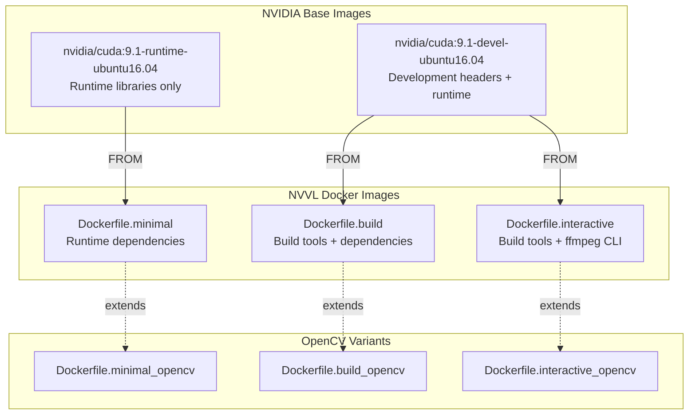
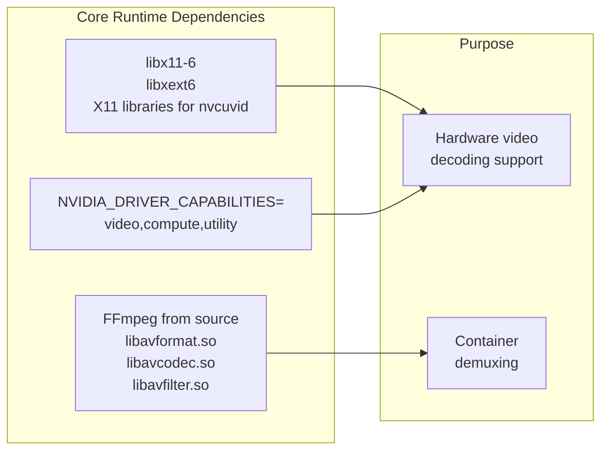
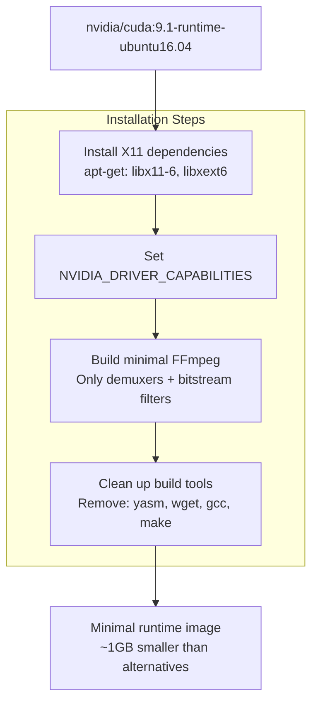
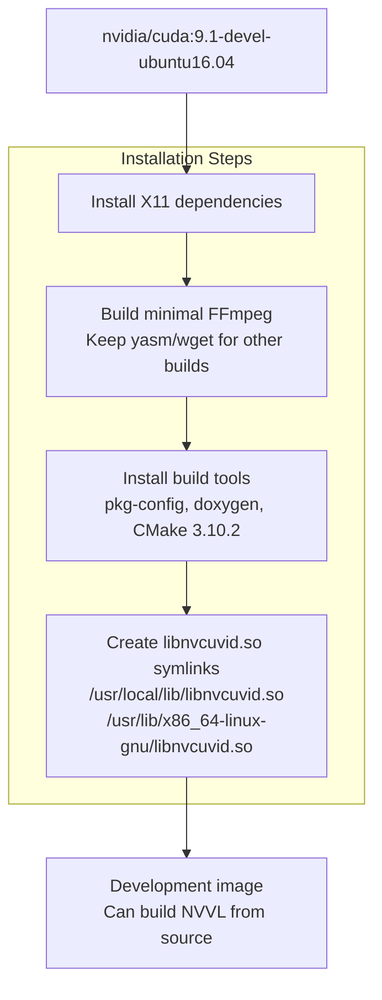
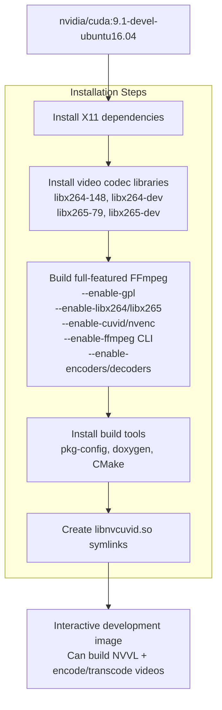
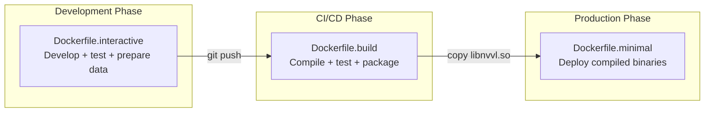

<!-- source: DeepWiki mcp.deepwiki.com · repo NVIDIA/nvvl · page 6 Docker Environments · fetched 2026-10-26 -->

# Docker Environments

<details>
<summary>Relevant source files</summary>

The following files were used as context for generating this wiki page:

- [docker/Dockerfile.build](docker/Dockerfile.build)
- [docker/Dockerfile.interactive](docker/Dockerfile.interactive)
- [docker/Dockerfile.minimal](docker/Dockerfile.minimal)
- [docker/README.md](docker/README.md)

</details>


## Purpose and Scope

This document describes the Docker container environments provided by NVVL to support different use cases: production runtime deployment, library development/building, and interactive development. Each Dockerfile is configured with minimal dependencies tailored to its specific purpose.

For instructions on using these Docker environments during initial setup, see [Using Docker](#2.2). For details on the CMake build system used within these containers, see [Build System](#5).

## Overview

NVVL provides three primary Docker environments, each based on NVIDIA's CUDA Docker images but configured for different stages of the development and deployment lifecycle:

| Dockerfile | Base Image | Primary Purpose | Target Users |
|------------|------------|-----------------|--------------|
| `Dockerfile.minimal` | `nvidia/cuda:9.1-runtime-ubuntu16.04` | Production runtime | Deployment, CI/CD runtime |
| `Dockerfile.build` | `nvidia/cuda:9.1-devel-ubuntu16.04` | Building NVVL | CI/CD build stages, package creation |
| `Dockerfile.interactive` | `nvidia/cuda:9.1-devel-ubuntu16.04` | Interactive development | Developers working inside containers |

Each Dockerfile also has an `_opencv` variant that includes OpenCV libraries for running the example applications. These variants follow the same pattern but add OpenCV dependencies.

**Sources:** [docker/README.md:1-20]()

## Docker Environment Hierarchy



**Sources:** [docker/Dockerfile.minimal:1](), [docker/Dockerfile.build:2](), [docker/Dockerfile.interactive:2](), [docker/README.md:17-19]()

## Common Architecture Components

All three Docker environments share a common foundation with customizable build arguments and core dependencies required for NVVL's video decoding capabilities.

### Build Arguments

Each Dockerfile accepts the following build arguments for version customization:

| Argument | Default Value | Purpose |
|----------|---------------|---------|
| `CUDA_VERSION` | `9.1` | CUDA toolkit version (passed to base image) |
| `FFMPEG_VERSION` | `3.4.2` | FFmpeg version to build from source |
| `CMAKE_VERSION` | `3.10.2` | CMake version (build/interactive only) |

**Sources:** [docker/Dockerfile.minimal:3](), [docker/Dockerfile.build:1-5](), [docker/Dockerfile.interactive:1-5]()

### Core Dependencies

All environments install the following baseline dependencies:



The environment variable `NVIDIA_DRIVER_CAPABILITIES=video,compute,utility` is critical—it enables the container to access NVIDIA's video codec hardware through the CUDA driver.

**Sources:** [docker/Dockerfile.minimal:5-8](), [docker/Dockerfile.build:7-10](), [docker/Dockerfile.interactive:7-10]()

### FFmpeg Build Configuration

All three environments build FFmpeg from source with a minimal, NVVL-specific configuration rather than using system packages. This reduces image size and ensures only necessary components are included.

#### Common FFmpeg Options

The following FFmpeg configuration is consistent across all images:

| Configure Option | Purpose |
|-----------------|---------|
| `--prefix=/usr/local` | Install location |
| `--disable-static` | Build only shared libraries |
| `--disable-all` | Disable everything by default |
| `--disable-autodetect` | Prevent unwanted dependency detection |
| `--disable-iconv` | Disable iconv (not needed) |
| `--enable-shared` | Build shared libraries |
| `--enable-avformat` | Enable container format support |
| `--enable-avcodec` | Enable codec support |
| `--enable-avfilter` | Enable filtering framework |
| `--enable-protocol=file` | Enable file I/O protocol |
| `--enable-demuxer=mov,matroska` | Enable MP4 and MKV demuxers |
| `--enable-bsf=h264_mp4toannexb,hevc_mp4toannexb` | Enable bitstream filters for H.264/HEVC |

This minimal configuration results in FFmpeg libraries that can only demux MP4 and Matroska containers with H.264/HEVC codecs—exactly what NVVL requires for hardware decoding.

**Sources:** [docker/Dockerfile.minimal:16-28](), [docker/Dockerfile.build:18-30](), [docker/Dockerfile.interactive:22-38]()

## Image Comparison

### Dockerfile.minimal



**Characteristics:**
- Uses `runtime` base image (no CUDA development headers)
- Installs temporary build tools to compile FFmpeg, then removes them [docker/Dockerfile.minimal:11-32]()
- No build tools, CMake, or pkg-config in final image
- Smallest image size—suitable for production deployment where NVVL is pre-compiled

**Sources:** [docker/Dockerfile.minimal:1-33](), [docker/README.md:6-7]()

### Dockerfile.build



**Characteristics:**
- Uses `devel` base image with CUDA headers and nvcc compiler
- Installs CMake 3.10.2 from official binaries [docker/Dockerfile.build:37-44]()
- Includes pkg-config for dependency detection
- Includes Doxygen for API documentation generation
- Creates `libnvcuvid.so` symlinks to work around nvidia-docker development limitations [docker/Dockerfile.build:52-53]()

**Workaround Details:** The symlink creation at [docker/Dockerfile.build:52-53]() addresses a specific nvidia-docker limitation. NVIDIA's Docker runtime provides versioned library files (e.g., `libnvcuvid.so.1`) but not the unversioned symlinks (e.g., `libnvcuvid.so`) needed for compilation. The Dockerfile creates these symlinks in two locations to support different nvidia-docker versions.

**Sources:** [docker/Dockerfile.build:1-54](), [docker/README.md:9]()

### Dockerfile.interactive



**Characteristics:**
- Includes significantly more FFmpeg features than the other images
- Enables FFmpeg CLI tool (`--enable-ffmpeg`) for video manipulation [docker/Dockerfile.interactive:31]()
- Includes GPU-accelerated encoding/decoding support:
  - `--enable-cuvid`, `--enable-nvenc`, `--enable-cuda` [docker/Dockerfile.interactive:34]()
  - Hardware accelerators: `h264_cuvid`, `hevc_cuvid` [docker/Dockerfile.interactive:37]()
  - Hardware encoders: `h264_nvenc`, `hevc_nvenc` [docker/Dockerfile.interactive:36]()
- Includes software codecs: libx264, libx265 [docker/Dockerfile.interactive:30,36]()
- Enables additional FFmpeg features: swresample, swscale, scaling filters [docker/Dockerfile.interactive:31-32]()
- Supports more container formats: mp4, matroska muxers [docker/Dockerfile.interactive:33]()

This configuration allows developers to prepare test videos, transcode footage, and experiment with video processing inside the container without requiring external tools.

**Sources:** [docker/Dockerfile.interactive:1-62](), [docker/README.md:11-15]()

## Component Comparison Matrix

The following table summarizes the key differences between the three Docker environments:

| Component | Minimal | Build | Interactive |
|-----------|---------|-------|-------------|
| **Base Image** | cuda:9.1-runtime | cuda:9.1-devel | cuda:9.1-devel |
| **CUDA Headers** | ❌ | ✅ | ✅ |
| **nvcc Compiler** | ❌ | ✅ | ✅ |
| **CMake** | ❌ | ✅ (3.10.2) | ✅ (3.10.2) |
| **pkg-config** | ❌ | ✅ | ✅ |
| **Doxygen** | ❌ | ✅ | ✅ |
| **FFmpeg CLI** | ❌ | ❌ | ✅ |
| **FFmpeg Demuxers** | mov, matroska | mov, matroska | mov, matroska |
| **FFmpeg Muxers** | ❌ | ❌ | mp4, matroska |
| **FFmpeg Encoders** | ❌ | ❌ | h264_nvenc, hevc_nvenc, libx264, libx265 |
| **FFmpeg Decoders** | ❌ | ❌ | h264, h264_cuvid, hevc, hevc_cuvid |
| **libx264/libx265** | ❌ | ❌ | ✅ |
| **libnvcuvid.so symlinks** | ❌ | ✅ | ✅ |
| **Primary Use Case** | Runtime deployment | Building NVVL | Interactive development |
| **Approximate Size** | Smallest (~2GB) | Medium (~3GB) | Largest (~4GB) |

**Sources:** [docker/Dockerfile.minimal:1-33](), [docker/Dockerfile.build:1-54](), [docker/Dockerfile.interactive:1-62]()

## NVIDIA Driver Capabilities

All three Dockerfiles set the environment variable `NVIDIA_DRIVER_CAPABILITIES=video,compute,utility`, which is required for NVVL to access hardware video decoding:

| Capability | Purpose in NVVL |
|------------|-----------------|
| `video` | Access to NVDEC/NVENC hardware via `libnvcuvid.so` |
| `compute` | CUDA compute operations for on-GPU transformations |
| `utility` | NVML (nvidia-ml) for GPU management and statistics |

Without the `video` capability, the container cannot access NVIDIA's hardware video decoder, and NVVL will fail at runtime.

**Sources:** [docker/Dockerfile.minimal:8](), [docker/Dockerfile.build:10](), [docker/Dockerfile.interactive:10]()

## Build Argument Customization

All Dockerfiles support customization via build arguments. Example usage:

```bash
# Build with CUDA 10.0 and FFmpeg 4.0.2
docker build \
  --build-arg CUDA_VERSION=10.0 \
  --build-arg FFMPEG_VERSION=4.0.2 \
  --build-arg CMAKE_VERSION=3.12.0 \
  -f docker/Dockerfile.build \
  -t nvvl-build:custom \
  .
```

The `CUDA_VERSION` argument is passed directly to the base image tag, so it must match an available NVIDIA CUDA image version. Common values include `9.0`, `9.1`, `9.2`, `10.0`, `10.1`, etc.

**Sources:** [docker/Dockerfile.build:1-5](), [docker/Dockerfile.interactive:1-5](), [docker/Dockerfile.minimal:3]()

## OpenCV Variants

The [docker/README.md:17-19]() mentions that each Dockerfile has an `_opencv` variant (e.g., `Dockerfile.build_opencv`) that includes OpenCV libraries. These variants are used to run the NVVL example applications that demonstrate OpenCV integration.

The OpenCV variants follow the same base architecture as their counterparts but add:
- OpenCV development headers
- OpenCV CUDA modules (for GPU-accelerated image processing)
- Additional build dependencies for compiling OpenCV

For details on the example applications that require OpenCV, see [C++ Frame Extraction](#4.1).

**Sources:** [docker/README.md:17-19]()

## Development Workflow Considerations

The Docker environments support different stages of the NVVL development and deployment workflow:



The README notes that using development containers (build, interactive) for actual development is "decidedly non-docker-ish" practice [docker/README.md:14-15](), but these images support it for teams that prefer containerized development environments.

**Sources:** [docker/README.md:1-20]()

---

