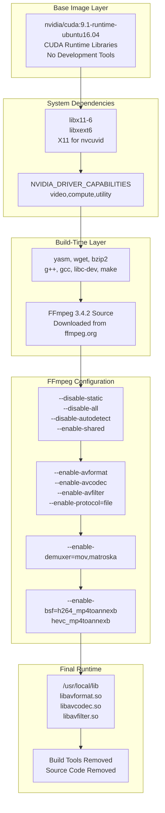
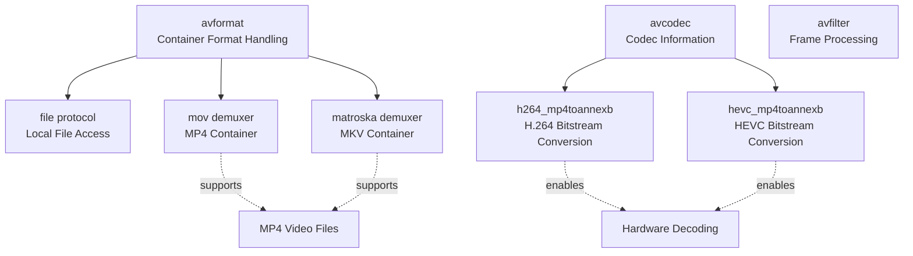
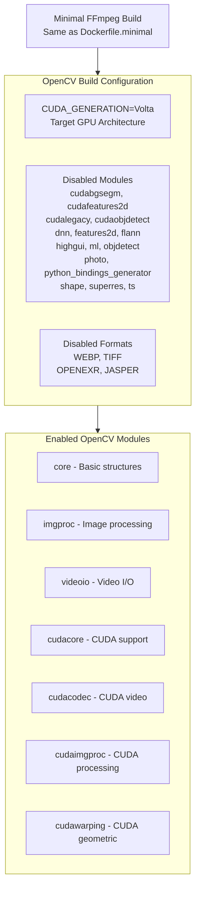
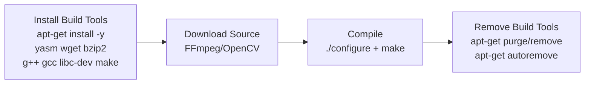
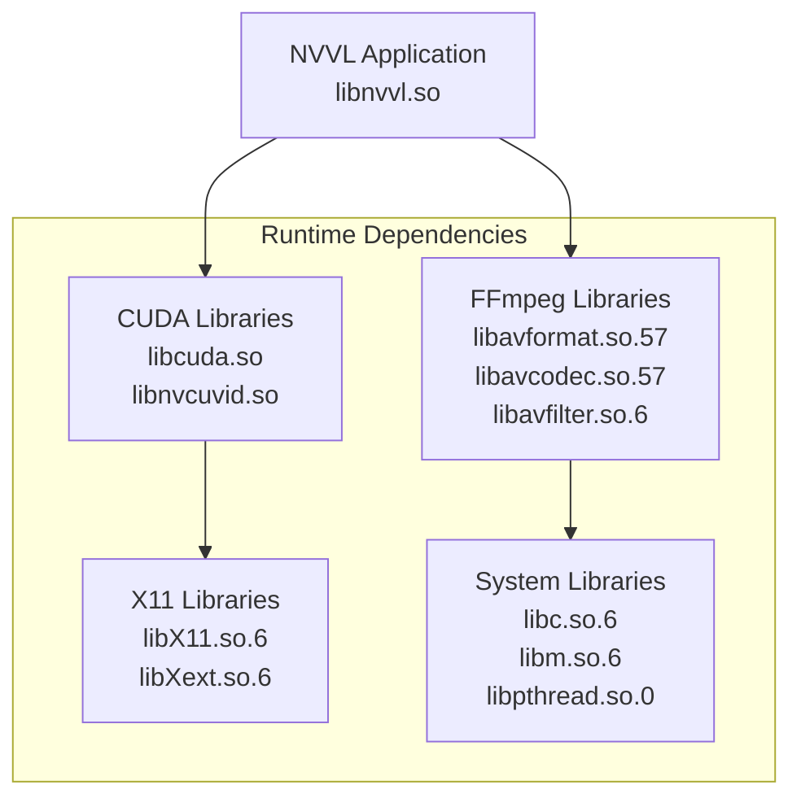

<!-- source: DeepWiki mcp.deepwiki.com · repo NVIDIA/nvvl · page 6.1 Minimal Runtime Images · fetched 2026-10-26 -->

# Minimal Runtime Images

<details>
<summary>Relevant source files</summary>

The following files were used as context for generating this wiki page:

- [docker/Dockerfile.minimal](docker/Dockerfile.minimal)
- [docker/Dockerfile.minimal_opencv](docker/Dockerfile.minimal_opencv)
- [docker/README.md](docker/README.md)

</details>


## Purpose and Scope

This document describes the minimal runtime Docker images designed for production deployment of applications using NVVL. These images contain only the essential runtime dependencies required to execute programs linked against `libnvvl.so`, with aggressive size optimization through minimal FFmpeg builds and dependency reduction.

For building NVVL from source within Docker, see [Build Development Images](#6.2). For interactive development with additional tools, see [Interactive Development Images](#6.3).

**Sources:** [docker/README.md:1-19]()

## Image Variants

NVVL provides two minimal runtime image configurations:

| Dockerfile | Base Image | FFmpeg | OpenCV | Primary Use Case |
|------------|------------|---------|---------|------------------|
| `Dockerfile.minimal` | `nvidia/cuda:9.1-runtime-ubuntu16.04` | Custom minimal build | No | Pure NVVL applications |
| `Dockerfile.minimal_opencv` | `nvcr.io/nvidia/pytorch:18.02-py3` | Custom minimal build | Custom minimal build | NVVL + OpenCV integration |

Both variants prioritize minimal size by:
- Building FFmpeg from source with only required features enabled
- Removing build tools after compilation
- Using CUDA runtime (not development) base images
- Disabling all unnecessary FFmpeg components

**Sources:** [docker/README.md:6-19](), [docker/Dockerfile.minimal:1](), [docker/Dockerfile.minimal_opencv:1]()

## Architecture Overview



**Sources:** [docker/Dockerfile.minimal:1-33]()

## Base Image Configuration

### CUDA Runtime Base

The minimal image uses `nvidia/cuda:9.1-runtime-ubuntu16.04` as its foundation, which provides:

- CUDA runtime libraries without development headers
- Ubuntu 16.04 LTS base system
- Minimal system footprint

**Sources:** [docker/Dockerfile.minimal:1]()

### nvcuvid Dependencies

NVVL's hardware video decoding requires the `nvcuvid` library, which depends on X11 libraries:

```dockerfile
# nvcuvid deps
RUN apt-get update --fix-missing && \
    apt-get install -y libx11-6 libxext6
```

**Sources:** [docker/Dockerfile.minimal:5-7]()

### Driver Capabilities

The environment variable `NVIDIA_DRIVER_CAPABILITIES` must include `video` to enable hardware video decoding:

```dockerfile
ENV NVIDIA_DRIVER_CAPABILITIES=video,compute,utility
```

This grants the container access to:
- `video` - NVDEC/NVENC hardware acceleration
- `compute` - CUDA compute capabilities
- `utility` - nvidia-smi and management tools

**Sources:** [docker/Dockerfile.minimal:8]()

## FFmpeg Build Configuration

### Build Strategy

The minimal image compiles FFmpeg from source with an aggressive minimization strategy:


**Sources:** [docker/Dockerfile.minimal:16-28]()

### Enabled Features Table

| Feature Category | Enabled Components | Purpose |
|-----------------|-------------------|---------|
| **Core Libraries** | `avformat`, `avcodec`, `avfilter` | Container parsing, codec identification, frame processing |
| **Protocols** | `file` only | Local file system access (no network protocols) |
| **Demuxers** | `mov`, `matroska` | MP4 and MKV container support |
| **Bitstream Filters** | `h264_mp4toannexb`, `hevc_mp4toannexb` | Convert MP4 bitstream to Annex B format for hardware decoders |

**Sources:** [docker/Dockerfile.minimal:23-28]()

### Build Process

The FFmpeg build follows this sequence:

1. **Install build dependencies:** [docker/Dockerfile.minimal:11]()
   - `yasm` - Assembly optimizer for codec performance
   - `wget`, `bzip2` - Source download and extraction
   - `g++`, `gcc`, `libc-dev`, `make` - Compilation toolchain

2. **Download and extract source:** [docker/Dockerfile.minimal:12-14]()
   ```bash
   wget -q http://ffmpeg.org/releases/ffmpeg-$FFMPEG_VERSION.tar.bz2
   tar xf ffmpeg-$FFMPEG_VERSION.tar.bz2
   ```

3. **Configure with minimal flags:** [docker/Dockerfile.minimal:16-28]()

4. **Compile and install:** [docker/Dockerfile.minimal:29]()
   ```bash
   make -j8 && make install
   ```

5. **Clean up build artifacts:** [docker/Dockerfile.minimal:30-32]()
   - Remove source directory
   - Purge build tools
   - Run `apt-get autoremove` to remove orphaned dependencies

**Sources:** [docker/Dockerfile.minimal:11-32]()

## FFmpeg Configuration Details

### Disabled Features

The `--disable-all` flag disables all optional features by default. Combined with `--disable-autodetect`, this prevents FFmpeg from discovering and linking against system libraries, ensuring a truly minimal build:

| Configuration Flag | Effect |
|-------------------|--------|
| `--disable-static` | Build only shared libraries (reduces size) |
| `--disable-all` | Disable all optional components |
| `--disable-autodetect` | Don't auto-detect external libraries |
| `--disable-iconv` | Disable character encoding conversion (not needed) |

**Sources:** [docker/Dockerfile.minimal:18-21]()

### Required Components

Only components necessary for NVVL's operation are enabled:



**Sources:** [docker/Dockerfile.minimal:23-28]()

### Bitstream Filters

The bitstream filters `h264_mp4toannexb` and `hevc_mp4toannexb` are critical for hardware decoding:

- **MP4 format:** Stores H.264/HEVC in MP4 format (length-prefixed NAL units)
- **Hardware decoders:** Expect Annex B format (start code-prefixed NAL units)
- **Conversion:** These filters perform the necessary bitstream conversion

Without these filters, NVVL cannot pass MP4-encapsulated video to NVIDIA's hardware decoders.

**Sources:** [docker/Dockerfile.minimal:28]()

## OpenCV Variant

### Additional Configuration

`Dockerfile.minimal_opencv` extends the minimal configuration by adding OpenCV with CUDA support:



**Sources:** [docker/Dockerfile.minimal_opencv:35-51]()

### Base Image Difference

The OpenCV variant uses `nvcr.io/nvidia/pytorch:18.02-py3` as its base instead of the plain CUDA runtime:

| Aspect | `Dockerfile.minimal` | `Dockerfile.minimal_opencv` |
|--------|---------------------|---------------------------|
| Base Image | `nvidia/cuda:9.1-runtime-ubuntu16.04` | `nvcr.io/nvidia/pytorch:18.02-py3` |
| Size | Minimal | Medium (includes PyTorch) |
| Use Case | Pure NVVL deployment | NVVL with ML framework and OpenCV |

**Sources:** [docker/Dockerfile.minimal:1](), [docker/Dockerfile.minimal_opencv:1]()

### OpenCV Build Arguments

The OpenCV build is controlled by three arguments:

```dockerfile
ARG FFMPEG_VERSION=3.4.2
ARG OPENCV_VERSION=3.4.0
ARG OPENCV_CUDA_GENERATION=Volta
```

The `OPENCV_CUDA_GENERATION` parameter optimizes OpenCV's CUDA code for specific GPU architectures (e.g., `Volta`, `Pascal`, `Turing`).

**Sources:** [docker/Dockerfile.minimal_opencv:3-5]()

### OpenCV Module Selection

The build explicitly disables unnecessary modules using CMake flags:

```bash
cmake -DCUDA_GENERATION=$OPENCV_CUDA_GENERATION \
  $(for m in cudabgsegm cudafeatures2d cudalegacy \
  cudaobjdetect dnn features2d flann highgui ml \
  objdetect photo python_bindings_generator shape \
  superres ts; do echo -DBUILD_opencv_$m=OFF; done) \
  $(for f in WEBP TIFF OPENEXR JASPER; do echo -DWITH_$f=OFF; done)
```

This loop-based approach disables:
- **CUDA modules:** Background segmentation, feature detection, object detection
- **CPU modules:** DNN inference, ML algorithms, high-level GUI
- **Image formats:** WEBP, TIFF, OpenEXR, JASPER (not needed for video)

**Sources:** [docker/Dockerfile.minimal_opencv:42-48]()

## Size Optimization Strategies

### Build Tool Removal

Both minimal images follow the pattern of removing build tools after compilation:



**FFmpeg cleanup approach:**

| Dockerfile | Cleanup Method | Packages Removed |
|-----------|----------------|------------------|
| `Dockerfile.minimal` | `apt-get purge` + `autoremove` | All build dependencies including compilers |
| `Dockerfile.minimal_opencv` | `apt-get remove` | Only `yasm` (keeps tools for potential future builds) |

**Sources:** [docker/Dockerfile.minimal:31-32](), [docker/Dockerfile.minimal_opencv:33]()

### Shared Library Configuration

Both images use `--enable-shared --disable-static` for FFmpeg:

- **Shared libraries** (`.so`) - Can be shared between processes, smaller total size
- **Static libraries** (`.a`) - Linked into each binary, larger total size

This configuration optimizes for:
1. Reduced disk space (single copy of FFmpeg libraries)
2. Memory efficiency (shared library pages in RAM)
3. Dynamic linking flexibility (can update libraries independently)

**Sources:** [docker/Dockerfile.minimal:18,22](), [docker/Dockerfile.minimal_opencv:20,24]()

### Source Code Removal

After installation, all source trees are deleted:

```bash
cd /tmp && rm -rf ffmpeg-$FFMPEG_VERSION
cd /tmp && rm -rf opencv-$OPENCV_VERSION
```

This removes:
- Extracted source code
- Object files and build intermediates
- Documentation and examples included in source distributions

**Sources:** [docker/Dockerfile.minimal:30](), [docker/Dockerfile.minimal_opencv:51]()

## Runtime Dependencies Summary

### Minimal Image Dependencies



**Sources:** [docker/Dockerfile.minimal:1-33]()

### OpenCV Variant Dependencies

The OpenCV variant adds:
- `libopencv_core.so.3.4`
- `libopencv_cudacodec.so.3.4`
- `libopencv_cudaimgproc.so.3.4`
- Additional CUDA libraries for OpenCV operations

**Sources:** [docker/Dockerfile.minimal_opencv:35-51]()

## Usage Patterns

### Container Execution

To run an application using the minimal runtime image:

```bash
docker run --gpus all \
  -v /path/to/videos:/data \
  your-minimal-image:tag \
  /path/to/your/nvvl-application
```

The `--gpus all` flag grants access to GPU devices, and `NVIDIA_DRIVER_CAPABILITIES` enables video decoding hardware.

### Multi-Stage Build Pattern

The minimal runtime images are typically the final stage in a multi-stage build:

```dockerfile
# Build stage
FROM nvvl-build-image AS builder
COPY . /workspace
RUN cmake --build build --target install

# Runtime stage
FROM Dockerfile.minimal
COPY --from=builder /usr/local/lib/libnvvl.so /usr/local/lib/
COPY --from=builder /usr/local/include/nvvl /usr/local/include/nvvl
COPY your-application /app/
CMD ["/app/your-application"]
```

This pattern:
1. Builds NVVL and your application with full toolchain (see [Build Development Images](#6.2))
2. Copies only runtime artifacts to minimal image
3. Results in smallest possible production image

**Sources:** [docker/README.md:6-7]()

## Version Specifications

### FFmpeg Version

Both minimal images use FFmpeg 3.4.2 by default:

```dockerfile
ARG FFMPEG_VERSION=3.4.2
```

This version is selected for:
- Stability in hardware decoding support
- Compatibility with CUDA 9.1 ecosystem
- Known working configuration with nvcuvid

**Sources:** [docker/Dockerfile.minimal:3](), [docker/Dockerfile.minimal_opencv:3]()

### Build Parallelism

Both images use `make -j8` for parallel compilation:

```bash
make -j8 && make install
```

The `-j8` flag spawns 8 parallel compilation jobs, balancing:
- Build speed (more parallel jobs)
- Memory usage (each job consumes RAM)
- Container build environment typical resources

**Sources:** [docker/Dockerfile.minimal:29](), [docker/Dockerfile.minimal_opencv:31,49]()

---

