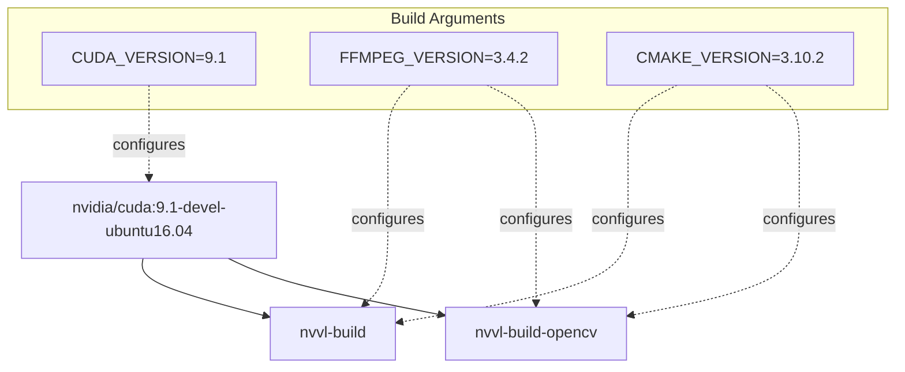
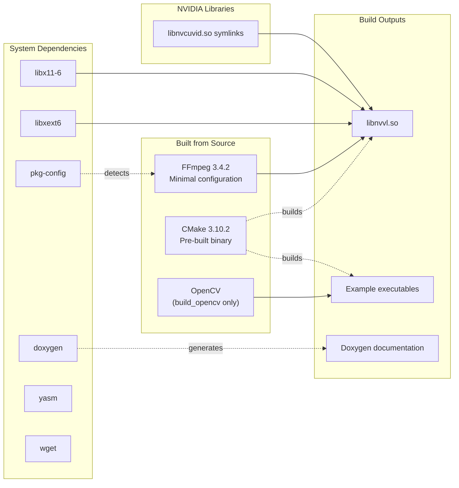
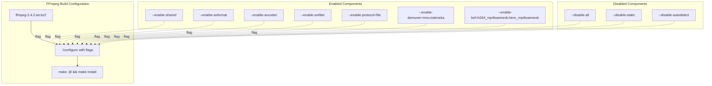
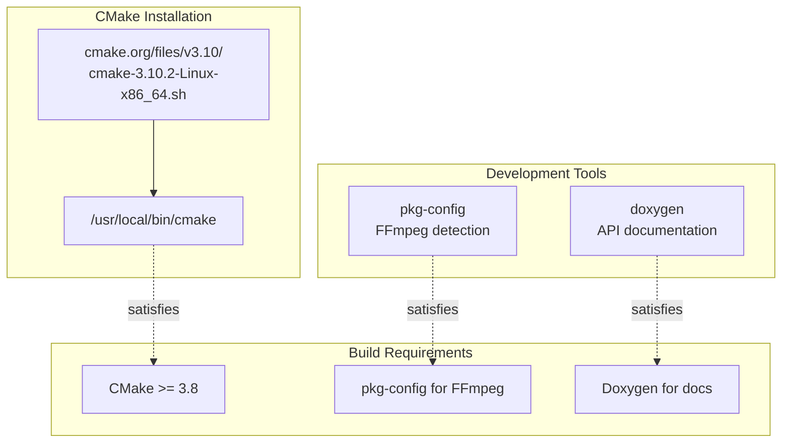
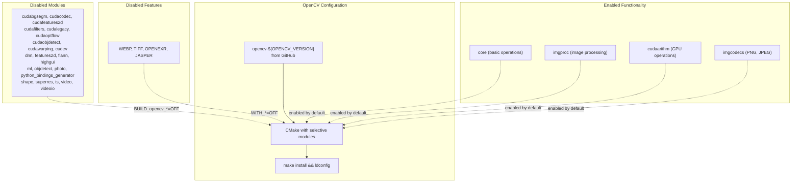
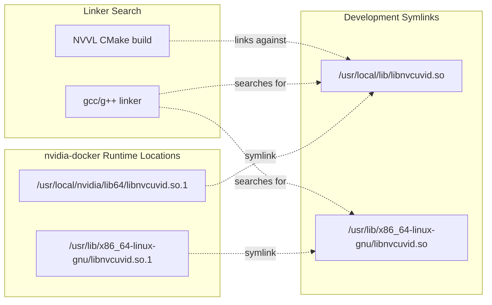

<!-- source: DeepWiki mcp.deepwiki.com · repo NVIDIA/nvvl · page 6.2 Build Development Images · fetched 2026-10-26 -->

# Build Development Images

<details>
<summary>Relevant source files</summary>

The following files were used as context for generating this wiki page:

- [docker/Dockerfile.build](docker/Dockerfile.build)
- [docker/Dockerfile.build_opencv](docker/Dockerfile.build_opencv)
- [docker/README.md](docker/README.md)

</details>


## Purpose and Scope

The build development images provide complete toolchains for compiling NVVL from source within Docker containers. These images include all build dependencies (FFmpeg, CMake, pkg-config, Doxygen) and development versions of CUDA libraries needed to compile the NVVL library and its examples.

For runtime deployment without development tools, see [Minimal Runtime Images](#6.1). For development workflows that include additional interactive tools, see [Interactive Development Images](#6.3). For complete build configuration details, see [CMake Configuration](#5.1).

Sources: [docker/README.md:1-20]()

## Image Variants

NVVL provides two build development image variants:

| Dockerfile | Purpose | Use Case |
|------------|---------|----------|
| `Dockerfile.build` | Standard build environment | Building NVVL library and examples without OpenCV |
| `Dockerfile.build_opencv` | Build environment with OpenCV | Building NVVL library and OpenCV-dependent examples |

Both images share the same base configuration and differ only in the inclusion of OpenCV. The OpenCV variant adds a minimal OpenCV build configured specifically for running NVVL's example code.

Sources: [docker/README.md:9-19](), [docker/Dockerfile.build:1-54](), [docker/Dockerfile.build_opencv:1-76]()

## Base Image Configuration



**Base Image Configuration**

Both build images start from `nvidia/cuda:${CUDA_VERSION}-devel-ubuntu16.04`, which provides:
- CUDA development toolkit (nvcc compiler, headers)
- Ubuntu 16.04 base system
- NVIDIA runtime libraries

The `-devel` variant is critical as it includes CUDA development headers and compilation tools required to build NVVL's CUDA kernels and link against CUDA libraries.

Sources: [docker/Dockerfile.build:1-2](), [docker/Dockerfile.build_opencv:1-2]()

## Build Dependencies Architecture



**Dependency Installation Flow**

Sources: [docker/Dockerfile.build:1-54](), [docker/Dockerfile.build_opencv:1-76]()

## FFmpeg Configuration

The build images compile FFmpeg from source with a minimal configuration tailored for NVVL's requirements:



**FFmpeg Build Process**

The FFmpeg build is highly selective, enabling only components required for NVVL:

| Component | Purpose |
|-----------|---------|
| `avformat` | Container parsing (MP4, Matroska/MKV) |
| `avcodec` | Codec detection and packet handling |
| `avfilter` | Basic filtering capabilities |
| `protocol=file` | Local file access only |
| `demuxer=mov,matroska` | MP4 and MKV container support |
| `bsf=h264_mp4toannexb,hevc_mp4toannexb` | Bitstream filters for H.264/HEVC |

This minimal configuration reduces build time and image size while providing all functionality needed by NVVL. Static libraries are disabled (`--disable-static`) in favor of shared libraries to minimize image size and enable dynamic linking.

Sources: [docker/Dockerfile.build:12-34](), [docker/Dockerfile.build_opencv:12-34]()

## Build Tool Installation



**Build Tool Configuration**

The images install specific versions of build tools:

- **CMake 3.10.2**: Installed from pre-built binary to ensure version compatibility. NVVL requires CMake 3.8+ for modern CUDA support. The installation extracts the pre-built archive to `/usr/local`.

- **pkg-config**: System package manager version. Used during NVVL's CMake configuration to detect FFmpeg libraries installed in `/usr/local`.

- **Doxygen**: System package manager version. Optional dependency for generating API documentation from NVVL's header files.

Sources: [docker/Dockerfile.build:36-44](), [docker/Dockerfile.build_opencv:36-44]()

## OpenCV Build Configuration

The `Dockerfile.build_opencv` variant includes a minimal OpenCV build:



**OpenCV Build Strategy**

The OpenCV build aggressively disables unnecessary modules to minimize build time and image size:

- **Disabled CUDA modules**: Most CUDA-accelerated modules are disabled as NVVL examples only need basic operations
- **Disabled formats**: Exotic image formats (WEBP, TIFF, OpenEXR, JASPER) are excluded
- **Enabled core**: Only core image processing and CUDA arithmetic operations remain

The build uses `CUDA_GENERATION` argument to specify target GPU architectures, matching NVVL's architecture requirements. After installation, `ldconfig` updates the dynamic linker cache to make OpenCV libraries discoverable.

Sources: [docker/Dockerfile.build_opencv:46-66]()

## Development Library Workarounds



**nvcuvid Development Symlinks**

The images create unversioned symlinks for `libnvcuvid.so` to enable development within containers:

```
ln -s /usr/local/nvidia/lib64/libnvcuvid.so.1 /usr/local/lib/libnvcuvid.so
ln -s libnvcuvid.so.1 /usr/lib/x86_64-linux-gnu/libnvcuvid.so
```

**Rationale**: nvidia-docker provides NVIDIA libraries for runtime use only, with versioned filenames (e.g., `libnvcuvid.so.1`). The linker requires unversioned names (e.g., `libnvcuvid.so`) to link during compilation. These symlinks bridge this gap, though this practice is non-standard and specific to containerized development workflows.

**Multiple locations**: Different nvidia-docker versions place libraries in different paths, so symlinks are created in both `/usr/local/lib` and `/usr/lib/x86_64-linux-gnu` for compatibility.

Sources: [docker/Dockerfile.build:46-53](), [docker/Dockerfile.build_opencv:68-75]()

## Build Arguments

| Argument | Default | Purpose |
|----------|---------|---------|
| `CUDA_VERSION` | `9.1` | Selects base CUDA toolkit version for `nvidia/cuda` image |
| `FFMPEG_VERSION` | `3.4.2` | Specifies FFmpeg source release to download and build |
| `CMAKE_VERSION` | `3.10.2` | Specifies CMake binary version to install |
| `OPENCV_VERSION` | (none) | Specifies OpenCV source version (build_opencv only) |
| `OPENCV_CUDA_GENERATION` | (none) | Specifies target GPU architectures for OpenCV (build_opencv only) |

**Usage Example**:
```bash
docker build -f docker/Dockerfile.build \
  --build-arg CUDA_VERSION=10.0 \
  --build-arg FFMPEG_VERSION=4.0.2 \
  -t nvvl-build:cuda10 .
```

Sources: [docker/Dockerfile.build:1-5](), [docker/Dockerfile.build_opencv:1-5]()

## Environment Variables

| Variable | Value | Purpose |
|----------|-------|---------|
| `NVIDIA_DRIVER_CAPABILITIES` | `video,compute,utility` | Enables video decoding, compute, and utility capabilities in nvidia-docker |

The `NVIDIA_DRIVER_CAPABILITIES` environment variable controls which NVIDIA driver features are available in the container. The `video` capability is essential as it enables access to the NVDEC hardware video decoder used by `libnvcuvid`.

Sources: [docker/Dockerfile.build:10](), [docker/Dockerfile.build_opencv:10]()

## Usage Patterns

### Building NVVL Library

```bash
# Build the development image
docker build -f docker/Dockerfile.build -t nvvl-build .

# Run build container and compile NVVL
docker run --runtime=nvidia -v $(pwd):/workspace -w /workspace nvvl-build bash -c "
  mkdir -p build && cd build
  cmake ..
  make -j8
"
```

### Building with OpenCV Examples

```bash
# Build the OpenCV development image
docker build -f docker/Dockerfile.build_opencv \
  --build-arg OPENCV_VERSION=3.4.0 \
  --build-arg OPENCV_CUDA_GENERATION=Maxwell \
  -t nvvl-build-opencv .

# Build NVVL with OpenCV support
docker run --runtime=nvidia -v $(pwd):/workspace -w /workspace nvvl-build-opencv bash -c "
  mkdir -p build && cd build
  cmake -DBUILD_OPENCV_EXAMPLE=ON ..
  make -j8
"
```

### Generating Documentation

```bash
docker run --rm -v $(pwd):/workspace -w /workspace/build nvvl-build bash -c "
  make doc
"
```

Sources: [docker/Dockerfile.build:1-54](), [docker/Dockerfile.build_opencv:1-76]()

## Comparison with Other Docker Images

| Feature | Minimal (6.1) | Build (6.2) | Interactive (6.3) |
|---------|--------------|-------------|-------------------|
| **Purpose** | Runtime deployment | Building NVVL | Development workflow |
| **Base Image** | `nvidia/cuda:*-runtime-*` | `nvidia/cuda:*-devel-*` | `nvidia/cuda:*-devel-*` |
| **FFmpeg** | Runtime libraries only | Built from minimal source | Built with full features |
| **CMake** | Not included | 3.10.2 | 3.10.2 |
| **Doxygen** | Not included | Included | Included |
| **pkg-config** | Not included | Included | Included |
| **OpenCV** | Not included | Optional variant | Optional variant |
| **ffmpeg CLI** | Not included | Not included | Included |
| **Size** | Smallest | Medium | Largest |

**Key Distinction**: Build images use the `-devel` base image variant which includes CUDA development headers and compilation tools. Minimal images use `-runtime` base which includes only the libraries needed to run NVVL applications.

Sources: [docker/README.md:1-20]()

---

