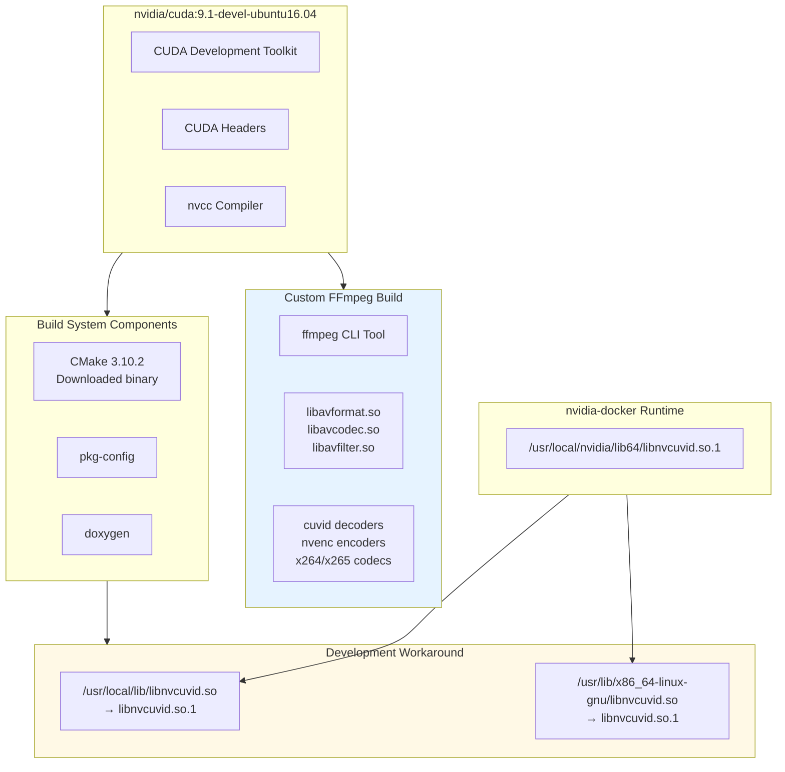
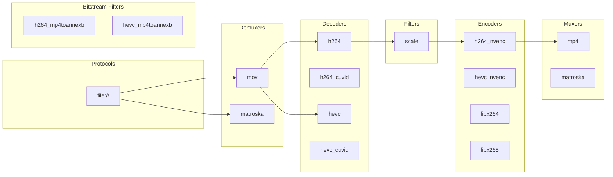
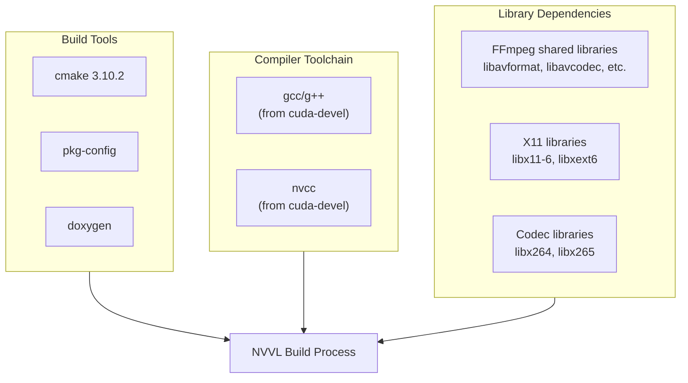
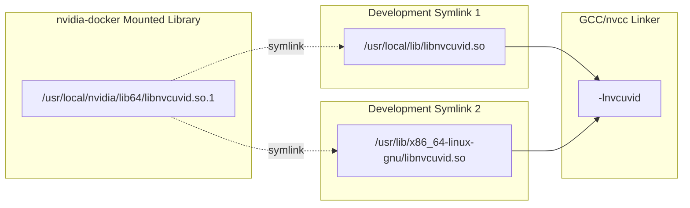
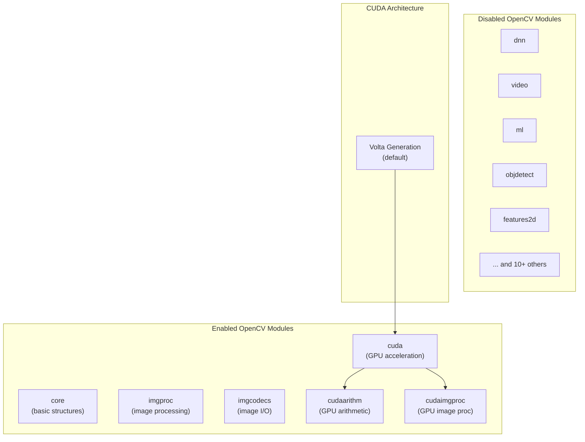
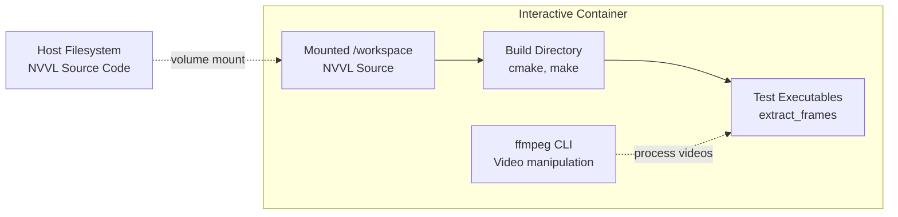
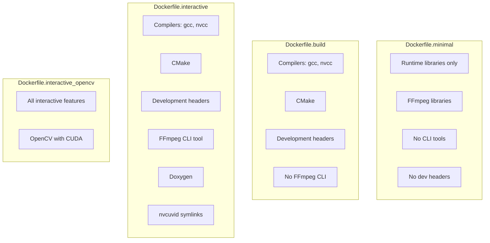

<!-- source: DeepWiki mcp.deepwiki.com · repo NVIDIA/nvvl · page 6.3 Interactive Development Images · fetched 2026-10-26 -->

# Interactive Development Images

<details>
<summary>Relevant source files</summary>

The following files were used as context for generating this wiki page:

- [docker/Dockerfile.interactive](docker/Dockerfile.interactive)
- [docker/Dockerfile.interactive_opencv](docker/Dockerfile.interactive_opencv)
- [docker/README.md](docker/README.md)

</details>


## Purpose and Scope

This document describes the interactive development Docker images provided in NVVL's `docker/` directory. These images are designed for developers who want to work on NVVL or experiment with its features from within a containerized environment. Unlike the minimal runtime images (see [Minimal Runtime Images](#6.1)) or build-only images (see [Build Development Images](#6.2)), interactive images include additional tools for development workflows, video manipulation, and documentation generation.

**Sources:** [docker/README.md:1-20]()

---

## Image Variants

NVVL provides two interactive development image configurations:

| Image File | Purpose | Additional Components |
|------------|---------|----------------------|
| `Dockerfile.interactive` | Basic interactive development | FFmpeg CLI tools, Doxygen |
| `Dockerfile.interactive_opencv` | Development with OpenCV examples | FFmpeg CLI tools, Doxygen, OpenCV with CUDA |

Both images extend the `nvidia/cuda` development base image and include full build toolchains, development headers, and interactive utilities.

**Sources:** [docker/README.md:11-19]()

---

## Base Interactive Image Architecture



**Diagram: Interactive Image Component Layers**

The interactive image builds upon the CUDA development base with three key additions: build system tools, a custom FFmpeg build with CLI utilities, and development library symlinks to work around nvidia-docker limitations.

**Sources:** [docker/Dockerfile.interactive:1-62]()

---

## Build Arguments

The interactive images accept several build arguments for customization:

| Argument | Default | Purpose | Referenced Lines |
|----------|---------|---------|------------------|
| `CUDA_VERSION` | `9.1` | CUDA toolkit version for base image | [docker/Dockerfile.interactive:1-2]() |
| `FFMPEG_VERSION` | `3.4.2` | FFmpeg version to build from source | [docker/Dockerfile.interactive:4]() |
| `CMAKE_VERSION` | `3.10.2` | CMake binary version to install | [docker/Dockerfile.interactive:5]() |
| `OPENCV_VERSION` | `3.4.0` | OpenCV version (opencv variant only) | [docker/Dockerfile.interactive_opencv:6]() |
| `OPENCV_CUDA_GENERATION` | `Volta` | GPU architecture for OpenCV (opencv variant only) | [docker/Dockerfile.interactive_opencv:7]() |

**Sources:** [docker/Dockerfile.interactive:1-5](), [docker/Dockerfile.interactive_opencv:1-7]()

---

## FFmpeg Configuration

The interactive images include a full FFmpeg build from source with both library components and command-line tools. This enables interactive video manipulation and debugging workflows.

### Enabled FFmpeg Components



**Diagram: FFmpeg Pipeline Components in Interactive Image**

The FFmpeg build is intentionally minimal (`--disable-all --disable-autodetect`) but includes all components necessary for video loading library development and interactive video processing.

**Sources:** [docker/Dockerfile.interactive:22-38]()

### FFmpeg Build Process

The FFmpeg build process follows these steps:

1. **Dependency Installation**: Install yasm, wget, libx264, libx265, and pkg-config [docker/Dockerfile.interactive:13-17]()
2. **Source Download**: Download FFmpeg source tarball [docker/Dockerfile.interactive:18]()
3. **Configuration**: Configure with minimal feature set and GPU acceleration [docker/Dockerfile.interactive:22-38]()
4. **Compilation**: Build with 8 parallel jobs [docker/Dockerfile.interactive:39]()
5. **Installation**: Install to `/usr/local` [docker/Dockerfile.interactive:39]()
6. **Cleanup**: Remove source and build dependencies [docker/Dockerfile.interactive:40-42]()

**Sources:** [docker/Dockerfile.interactive:12-42]()

---

## Development Environment Setup

### Build Dependencies

The interactive image includes the full set of dependencies needed to build NVVL:



**Diagram: Development Dependencies in Interactive Image**

**Sources:** [docker/Dockerfile.interactive:44-52](), [docker/Dockerfile.interactive:8-9]()

### CMake Installation

CMake is installed as a pre-built binary rather than from apt repositories to ensure a recent version (3.10.2) is available:

```bash
export dir=$(echo $CMAKE_VERSION | sed "s/^\([0-9]*\.[0-9]*\).*/v\1/")
wget -q https://cmake.org/files/${dir}/cmake-$CMAKE_VERSION-Linux-x86_64.sh
/bin/sh cmake-$CMAKE_VERSION-Linux-x86_64.sh --skip-license --prefix=/usr/local
```

This approach extracts the major.minor version (e.g., "3.10" from "3.10.2") to construct the download URL path.

**Sources:** [docker/Dockerfile.interactive:47-49]()

---

## nvidia-docker Development Workaround

A critical feature of the interactive images is the workaround for developing with nvidia-docker containers. Normally, nvidia-docker only provides versioned runtime libraries (e.g., `libnvcuvid.so.1`), but development requires unversioned symlinks that the linker can find.

### Symlink Configuration



**Diagram: nvcuvid Symlink Workaround for Container Development**

The image creates unversioned symlinks in two locations to accommodate different nvidia-docker versions:

```bash
ln -s /usr/local/nvidia/lib64/libnvcuvid.so.1 /usr/local/lib/libnvcuvid.so
ln -s libnvcuvid.so.1 /usr/lib/x86_64-linux-gnu/libnvcuvid.so
```

This allows compilation with `-lnvcuvid` to succeed inside the container, enabling the "non-Docker-ish practice of developing while inside a container" mentioned in the documentation.

**Sources:** [docker/Dockerfile.interactive:54-61](), [docker/README.md:14-15]()

---

## OpenCV Interactive Image

The `Dockerfile.interactive_opencv` variant extends the base interactive image with OpenCV support, enabling development and execution of NVVL examples that use OpenCV (see [C++ Frame Extraction](#4.1)).

### OpenCV Build Configuration

The OpenCV build is intentionally minimal, enabling only core modules needed for NVVL examples:



**Diagram: OpenCV Module Configuration in interactive_opencv Image**

The build explicitly disables numerous modules to reduce build time and image size:

```bash
for m in cudabgsegm cudacodec cudafeatures2d cudafilters cudalegacy \
         cudaoptflow cudaobjdetect cudawarping cudev dnn features2d \
         flann highgui ml objdetect photo python_bindings_generator \
         shape superres ts video videoio; do
    echo -DBUILD_opencv_$m=OFF
done
```

**Sources:** [docker/Dockerfile.interactive_opencv:65-69]()

### CUDA Architecture Selection

OpenCV is built with GPU architecture support specified by the `OPENCV_CUDA_GENERATION` build argument (default: `Volta`):

```bash
cmake -DCUDA_GENERATION=$OPENCV_CUDA_GENERATION ...
```

This ensures OpenCV's CUDA kernels are compiled for the appropriate GPU generation, matching the deployment target.

**Sources:** [docker/Dockerfile.interactive_opencv:64]()

---

## Environment Configuration

Both interactive images set the `NVIDIA_DRIVER_CAPABILITIES` environment variable to enable multiple nvidia-docker capabilities:

```dockerfile
ENV NVIDIA_DRIVER_CAPABILITIES=video,compute,utility
```

This enables:
- `video`: Access to NVDEC/NVENC hardware acceleration
- `compute`: CUDA compute capability
- `utility`: nvidia-smi and other management utilities

**Sources:** [docker/Dockerfile.interactive:10](), [docker/Dockerfile.interactive_opencv:12]()

---

## Usage Patterns

### Interactive Development Workflow



**Diagram: Development Workflow with Interactive Image**

Typical development workflow:

1. **Launch Container**: Mount source code into container
   ```bash
   docker run -it --gpus all -v $(pwd):/workspace nvvl:interactive
   ```

2. **Configure Build**: Run CMake in mounted workspace
   ```bash
   cd /workspace && mkdir build && cd build
   cmake .. -DCMAKE_BUILD_TYPE=Debug
   ```

3. **Build and Test**: Compile and run examples
   ```bash
   make && ./examples/extract_frames video.mp4
   ```

4. **Video Manipulation**: Use ffmpeg CLI for debugging
   ```bash
   ffmpeg -i input.mp4 -c:v h264_cuvid -c:v h264_nvenc output.mp4
   ```

**Sources:** [docker/README.md:14-15]()

---

## Comparison with Other Docker Images



**Diagram: Feature Comparison Across Docker Image Types**

| Feature | minimal | build | interactive | interactive_opencv |
|---------|---------|-------|-------------|-------------------|
| Runtime libraries | ✓ | ✓ | ✓ | ✓ |
| Development headers | ✗ | ✓ | ✓ | ✓ |
| Compilers (gcc, nvcc) | ✗ | ✓ | ✓ | ✓ |
| CMake | ✗ | ✓ | ✓ | ✓ |
| FFmpeg CLI tools | ✗ | ✗ | ✓ | ✓ |
| Doxygen | ✗ | ✗ | ✓ | ✓ |
| nvcuvid dev symlinks | ✗ | ✗ | ✓ | ✓ |
| OpenCV | ✗ | ✗ | ✗ | ✓ |
| Intended use case | Production | CI/CD | Development | Examples |

**Sources:** [docker/README.md:1-20]()

---

## File Reference Summary

| Component | File Path |
|-----------|-----------|
| Base interactive image | [docker/Dockerfile.interactive:1-62]() |
| OpenCV variant | [docker/Dockerfile.interactive_opencv:1-86]() |
| Docker documentation | [docker/README.md:1-20]() |
| FFmpeg configuration | [docker/Dockerfile.interactive:22-38]() |
| CMake installation | [docker/Dockerfile.interactive:45-52]() |
| nvcuvid workaround | [docker/Dockerfile.interactive:54-61]() |
| OpenCV build | [docker/Dockerfile.interactive_opencv:56-76]() |

**Sources:** [docker/Dockerfile.interactive:1-62](), [docker/Dockerfile.interactive_opencv:1-86](), [docker/README.md:1-20]()

---

