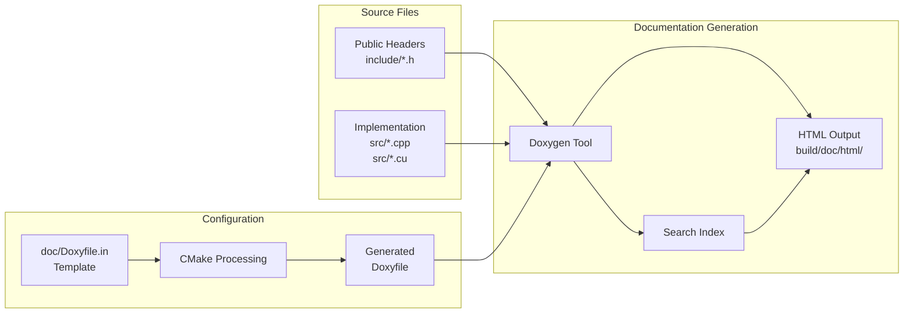
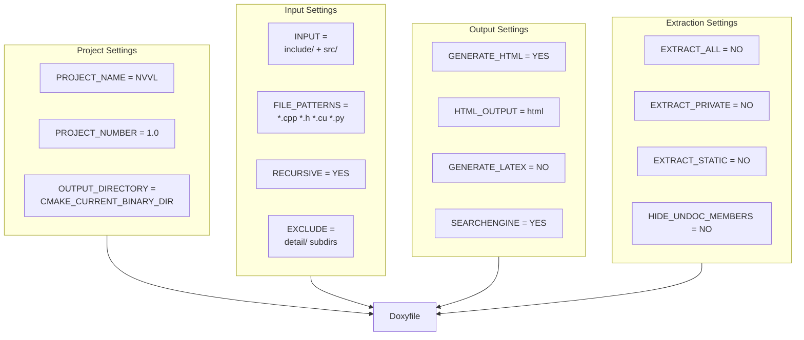
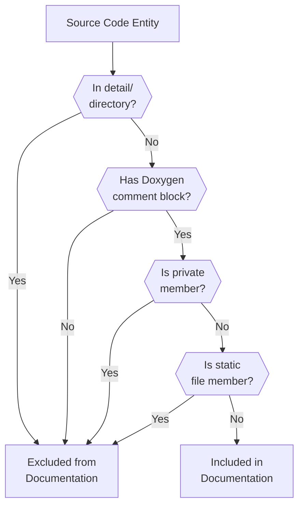
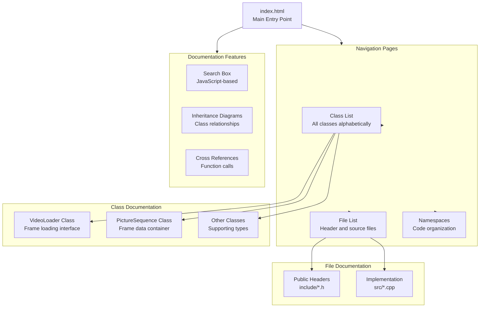
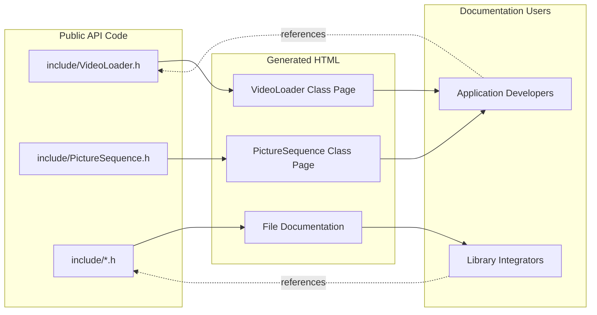

<!-- source: DeepWiki mcp.deepwiki.com · repo NVIDIA/nvvl · page 7 API Documentation · fetched 2026-10-26 -->

# API Documentation

<details>
<summary>Relevant source files</summary>

The following files were used as context for generating this wiki page:

- [doc/Doxyfile.in](doc/Doxyfile.in)
- [doc/examples/CMakeLists.txt](doc/examples/CMakeLists.txt)

</details>


This page describes NVVL's API documentation system, which uses Doxygen to generate comprehensive reference documentation from source code comments. This documentation provides detailed information about classes, functions, data structures, and their usage patterns extracted from the codebase.

For information about the actual APIs themselves, see [VideoLoader API](#3.2) and [PictureSequence API](#3.3). For instructions on building the library that contains these APIs, see [Building from Source](#2.1).

## Documentation Generation Overview

NVVL uses Doxygen, a documentation generator tool, to produce HTML reference documentation from specially-formatted comments in the source code. The system is integrated with the CMake build system and configured through a template file that CMake processes during build configuration.

### Documentation Generation Pipeline



**Sources:** [doc/Doxyfile.in:1-1520]()

### Source Coverage

The documentation system processes specific directories and file types from the codebase:

| Input Category | Files/Directories | Description |
|---------------|------------------|-------------|
| **Public Headers** | `include/*.h` | Public API declarations including `VideoLoader` and `PictureSequence` |
| **Implementation** | `src/*.cpp`, `src/*.cu` | Implementation files with additional documentation |
| **File Types** | `*.cpp`, `*.h`, `*.cu`, `*.py` | C++, CUDA, and Python files |
| **Excluded** | `include/detail/*`, `src/detail/*` | Internal implementation details not part of public API |

**Sources:** [doc/Doxyfile.in:571](), [doc/Doxyfile.in:588](), [doc/Doxyfile.in:600]()

## Doxygen Configuration

The documentation generation behavior is controlled by [doc/Doxyfile.in](), a Doxygen configuration template that CMake processes to produce the final configuration file.

### Key Configuration Settings



**Sources:** [doc/Doxyfile.in:28-34](), [doc/Doxyfile.in:571](), [doc/Doxyfile.in:588-600](), [doc/Doxyfile.in:764-770](), [doc/Doxyfile.in:300-310]()

### Critical Configuration Values

| Setting | Value | Purpose |
|---------|-------|---------|
| `PROJECT_NAME` | `NVVL` | Documentation title |
| `PROJECT_NUMBER` | `1.0` | Version number displayed in documentation |
| `OUTPUT_DIRECTORY` | `@CMAKE_CURRENT_BINARY_DIR@` | CMake variable expanded to build directory |
| `INPUT` | `@CMAKE_HOME_DIRECTORY@/include` `@CMAKE_HOME_DIRECTORY@/src` | Source directories to process |
| `STRIP_FROM_PATH` | `@CMAKE_HOME_DIRECTORY@` | Remove source root from file paths in documentation |
| `EXTRACT_ALL` | `NO` | Only document explicitly commented entities |
| `EXTRACT_PRIVATE` | `NO` | Exclude private class members from documentation |
| `GENERATE_HTML` | `YES` | Produce HTML output |
| `GENERATE_LATEX` | `NO` | Do not produce LaTeX/PDF output |
| `SEARCHENGINE` | `YES` | Include JavaScript-based search functionality |

**Sources:** [doc/Doxyfile.in:28](), [doc/Doxyfile.in:34](), [doc/Doxyfile.in:41](), [doc/Doxyfile.in:571](), [doc/Doxyfile.in:117](), [doc/Doxyfile.in:300](), [doc/Doxyfile.in:305](), [doc/Doxyfile.in:764](), [doc/Doxyfile.in:991](), [doc/Doxyfile.in:982]()

### Documentation Extraction Rules

The configuration controls what documentation is extracted from the source code:



**Sources:** [doc/Doxyfile.in:300-310](), [doc/Doxyfile.in:600]()

## Generating Documentation

Documentation generation is integrated into the CMake build system. The process involves CMake configuring the Doxygen template and then invoking Doxygen to process the source files.

### Build Integration

The documentation build target is created when the library is built with documentation enabled. CMake performs the following steps:

1. **Template Processing**: CMake reads [doc/Doxyfile.in]() and replaces CMake variables (e.g., `@CMAKE_HOME_DIRECTORY@`) with actual paths
2. **Configuration Generation**: Creates a `Doxyfile` in the build directory
3. **Target Creation**: Registers a build target (typically `doc` or `documentation`) that invokes Doxygen

### Generation Command

To generate the API documentation:

```bash
# From the build directory
cmake --build . --target doc
```

Or if using Make directly:

```bash
# From the build directory
make doc
```

The documentation generation requires:
- Doxygen installed and accessible in the system PATH
- CMake has successfully configured the build
- Source files are present in the locations specified in the configuration

### Output Location

Generated documentation is placed in:
```
<build-directory>/doc/html/
```

The main entry point is:
```
<build-directory>/doc/html/index.html
```

**Sources:** [doc/Doxyfile.in:41](), [doc/Doxyfile.in:770]()

## Generated Documentation Structure

The HTML documentation generated by Doxygen provides multiple navigation and viewing modes for the API reference.

### Documentation Organization



**Sources:** [doc/Doxyfile.in:764-770](), [doc/Doxyfile.in:982](), [doc/Doxyfile.in:1338]()

### Key Documentation Sections

| Section | Content | Source Configuration |
|---------|---------|---------------------|
| **Class Index** | Alphabetical list of all documented classes | [doc/Doxyfile.in:742]() |
| **File List** | All processed header and implementation files | [doc/Doxyfile.in:483]() |
| **Class Documentation** | Detailed documentation for each class including methods, members, and usage | [doc/Doxyfile.in:300-310]() |
| **Function Documentation** | Descriptions, parameters, return values for all public functions | Generated from source comments |
| **Namespace Documentation** | Organization of classes and functions by namespace | [doc/Doxyfile.in:490]() |
| **Search Functionality** | JavaScript search index for quick navigation | [doc/Doxyfile.in:982]() |

### Documentation Features

The generated documentation includes several features to aid navigation and understanding:

| Feature | Enabled | Configuration | Description |
|---------|---------|---------------|-------------|
| **Brief Member Descriptions** | Yes | `BRIEF_MEMBER_DESC = YES` | Short descriptions in member lists |
| **Detailed Sections** | Yes | `REPEAT_BRIEF = YES` | Full documentation for each entity |
| **Include Files** | Yes | `SHOW_INCLUDE_FILES = YES` | Shows which header to include |
| **Used Files** | Yes | `SHOW_USED_FILES = YES` | Lists files used in implementation |
| **Search Engine** | Yes | `SEARCHENGINE = YES` | JavaScript-based search |
| **Class Diagrams** | Basic | `HAVE_DOT = NO` | Simple inheritance diagrams (no Graphviz) |
| **Source Browser** | No | `SOURCE_BROWSER = NO` | Source code not included in output |

**Sources:** [doc/Doxyfile.in:70](), [doc/Doxyfile.in:77](), [doc/Doxyfile.in:387](), [doc/Doxyfile.in:471](), [doc/Doxyfile.in:982](), [doc/Doxyfile.in:1360](), [doc/Doxyfile.in:687]()

## Accessing the Documentation

Once generated, the documentation can be accessed through any web browser. The documentation is self-contained HTML with embedded JavaScript for search functionality.

### Viewing the Documentation

1. **Open in Browser**: Navigate to `<build-directory>/doc/html/index.html`
2. **Use Search**: The search box in the top-right corner provides quick access to classes and functions
3. **Navigate Hierarchy**: Use the navigation bar to browse by classes, files, or namespaces
4. **Follow Cross-References**: Click on class names, function names, or types to navigate to their documentation

### Documentation Content Mapping

The documentation directly corresponds to code entities in the repository:



**Sources:** [doc/Doxyfile.in:571]()

### Documentation vs. Source Code

| Element | In Documentation | In Source Code | Purpose |
|---------|-----------------|----------------|---------|
| `VideoLoader` class | Class documentation page | [include/VideoLoader.h]() | Main video loading interface |
| `PictureSequence` class | Class documentation page | [include/PictureSequence.h]() | Frame data container |
| Public methods | Method documentation with parameters | Class definitions in headers | API usage reference |
| Private implementation | Not documented | [src/detail/*](), [include/detail/*]() | Internal implementation details |
| Example code | Not included | [examples/extract_frames.cpp]() | See [C++ Frame Extraction](#4.1) |

The documentation excludes `detail/` directories [doc/Doxyfile.in:600]() to keep the public API surface clear and focused on user-facing interfaces.

## Documentation Warnings and Quality

Doxygen's configuration enables several warning mechanisms to ensure documentation quality:

| Warning Type | Enabled | Configuration | Description |
|-------------|---------|---------------|-------------|
| **General Warnings** | Yes | `WARNINGS = YES` | All warnings enabled |
| **Undocumented Members** | Yes | `WARN_IF_UNDOCUMENTED = YES` | Warns about missing documentation |
| **Documentation Errors** | Yes | `WARN_IF_DOC_ERROR = YES` | Warns about incorrect parameter documentation |
| **Parameter Documentation** | No | `WARN_NO_PARAMDOC = NO` | Does not require all parameters to be documented |

**Sources:** [doc/Doxyfile.in:524](), [doc/Doxyfile.in:530](), [doc/Doxyfile.in:537](), [doc/Doxyfile.in:545]()

These warnings appear during the documentation generation process and help maintain documentation quality by highlighting undocumented or incorrectly documented API elements.

---

