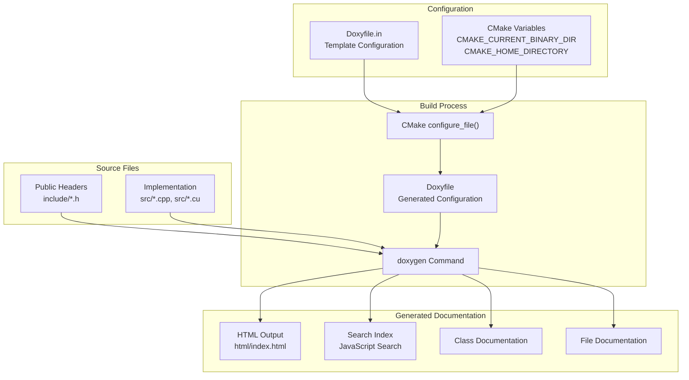
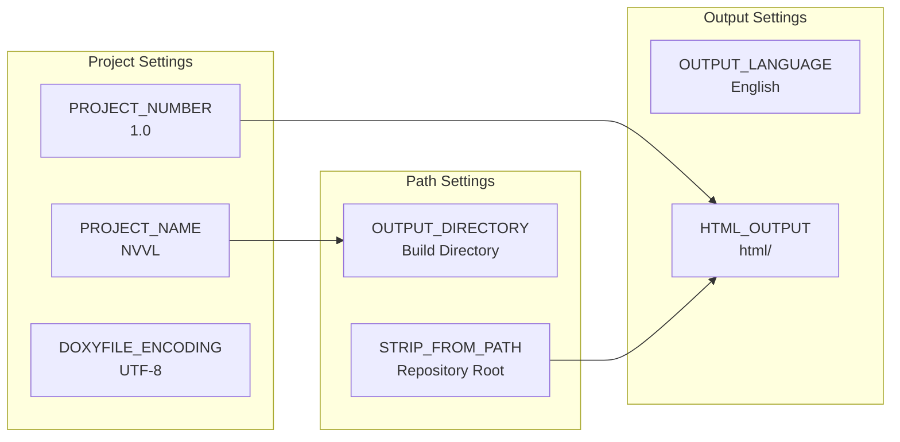
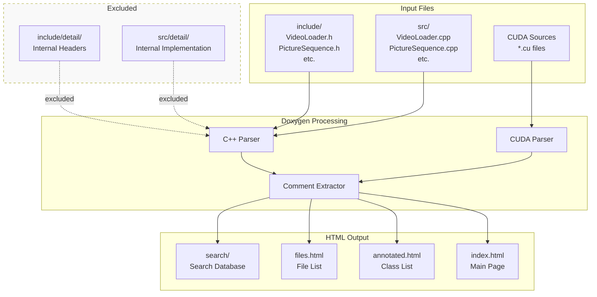
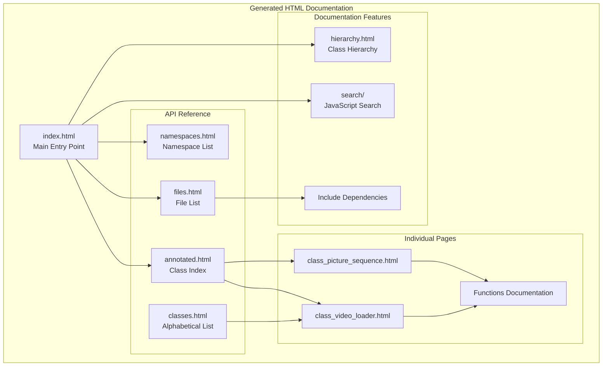

<!-- source: DeepWiki mcp.deepwiki.com · repo NVIDIA/nvvl · page 7.1 Generating Documentation · fetched 2026-10-26 -->

# Generating Documentation

<details>
<summary>Relevant source files</summary>

The following files were used as context for generating this wiki page:

- [doc/Doxyfile.in](doc/Doxyfile.in)
- [doc/examples/CMakeLists.txt](doc/examples/CMakeLists.txt)

</details>


This page explains NVVL's Doxygen-based API documentation generation system, including configuration, build process, and output formats. For information about the repository structure and development workflow, see [Repository Structure](#8.1). For details on the build system that generates documentation as part of the overall build, see [CMake Configuration](#5.1).

## Purpose and Scope

NVVL uses Doxygen to automatically generate API documentation from source code comments in the public headers and implementation files. The documentation system is configured via a template file that integrates with CMake to produce comprehensive HTML documentation of the library's public API, with implementation details excluded from the output.

**Sources:** [doc/Doxyfile.in:1-1520]()

## Documentation Generation Workflow



**Sources:** [doc/Doxyfile.in:1-1520]()

## Doxygen Configuration Template

NVVL uses a Doxygen configuration template file that CMake processes to generate the final configuration. This approach allows the documentation system to adapt to different build environments and directory structures.

### CMake Variable Substitution

The template file `doc/Doxyfile.in` contains CMake variable placeholders that are replaced during the configuration phase:

| CMake Variable | Purpose | Example Usage |
|---|---|---|
| `@CMAKE_CURRENT_BINARY_DIR@` | Output directory for generated docs | [doc/Doxyfile.in:41]() |
| `@CMAKE_HOME_DIRECTORY@` | Repository root path | [doc/Doxyfile.in:117](), [571]() |

The CMake `configure_file()` command processes the template, replacing `@VARIABLE@` patterns with actual paths, producing a working `Doxyfile` in the build directory.

### Project Configuration



**Sources:** [doc/Doxyfile.in:23-41](), [63](), [117]()

## Input Source Configuration

The documentation system is configured to process specific source files while excluding internal implementation details.

### Included Files

The `INPUT` tag specifies which directories Doxygen will scan:

```
INPUT = @CMAKE_HOME_DIRECTORY@/include @CMAKE_HOME_DIRECTORY@/src
```

This configuration includes both public headers and implementation files for complete documentation coverage.

**Sources:** [doc/Doxyfile.in:571]()

### File Pattern Matching

Doxygen processes files matching specific patterns:

```
FILE_PATTERNS = *.cpp *.h *.cu *.py
```

This configuration captures:
- **`*.h`**: Public header files containing API declarations
- **`*.cpp`**: C++ implementation files
- **`*.cu`**: CUDA kernel implementations
- **`*.py`**: Python binding code (if present)

**Sources:** [doc/Doxyfile.in:588]()

### Directory Exclusions

Implementation details are explicitly excluded from the generated documentation:

```
EXCLUDE = @CMAKE_HOME_DIRECTORY@/include/detail @CMAKE_HOME_DIRECTORY@/src/detail
```

This ensures that internal helper classes and functions in `detail/` subdirectories do not appear in the public API documentation, maintaining a clean separation between public and private interfaces.

**Sources:** [doc/Doxyfile.in:600]()

### Recursive Processing

```
RECURSIVE = YES
```

The recursive flag enables Doxygen to process all subdirectories within the input paths, ensuring complete coverage of the source tree.

**Sources:** [doc/Doxyfile.in:594]()

## Input/Output Architecture



**Sources:** [doc/Doxyfile.in:571](), [588](), [594](), [600]()

## Documentation Extraction Settings

### Member Documentation Control

The configuration controls what gets documented:

| Setting | Value | Effect |
|---|---|---|
| `EXTRACT_ALL` | `NO` | Only documented entities appear |
| `EXTRACT_PRIVATE` | `NO` | Private members excluded |
| `EXTRACT_STATIC` | `NO` | Static file members excluded |
| `EXTRACT_LOCAL_CLASSES` | `YES` | Local classes included |

These settings ensure that only the public API surface is documented, maintaining focus on user-facing functionality.

**Sources:** [doc/Doxyfile.in:300](), [305](), [310](), [316]()

### Undocumented Code Handling

```
HIDE_UNDOC_MEMBERS = NO
HIDE_UNDOC_CLASSES = NO
```

Undocumented members and classes are included in the documentation structure but without detailed descriptions. This provides a complete API overview while highlighting areas that need documentation improvements.

**Sources:** [doc/Doxyfile.in:339](), [346]()

### Warning Configuration

```
WARNINGS = YES
WARN_IF_UNDOCUMENTED = YES
WARN_IF_DOC_ERROR = YES
```

The documentation build emits warnings for:
- Undocumented public members
- Documentation errors (e.g., documented parameters that don't exist)
- Malformed documentation markup

This helps maintain documentation quality during development.

**Sources:** [doc/Doxyfile.in:524](), [530](), [537]()

## HTML Output Configuration

### Output Directory Structure

The generated HTML documentation is placed in:

```
OUTPUT_DIRECTORY = @CMAKE_CURRENT_BINARY_DIR@
HTML_OUTPUT = html
```

This produces documentation at `{build_dir}/html/index.html`.

**Sources:** [doc/Doxyfile.in:41](), [770]()

### HTML Features

| Feature | Setting | Purpose |
|---|---|---|
| HTML generation | `GENERATE_HTML = YES` | Enable HTML output |
| Search engine | `SEARCHENGINE = YES` | JavaScript search functionality |
| Timestamps | `HTML_TIMESTAMP = NO` | Omit generation time for reproducible builds |
| Dynamic sections | `HTML_DYNAMIC_SECTIONS = NO` | Static collapsible sections |
| Member alignment | `HTML_ALIGN_MEMBERS = YES` | Use tables for member layout |

**Sources:** [doc/Doxyfile.in:764](), [982](), [793](), [816](), [808]()

### Non-HTML Formats

```
GENERATE_LATEX = NO
GENERATE_RTF = NO
GENERATE_MAN = NO
GENERATE_XML = NO
```

NVVL is configured to generate only HTML documentation. LaTeX, RTF, man pages, and XML output are disabled to simplify the build process and reduce dependencies.

**Sources:** [doc/Doxyfile.in:991](), [1072](), [1113](), [1142]()

## Build Integration

### Building Documentation

To generate the documentation as part of the NVVL build:

1. Configure CMake with documentation generation enabled (if it's optional)
2. Build the documentation target

The exact commands depend on the CMakeLists.txt configuration, but typically follow this pattern:

```bash
mkdir build && cd build
cmake ..
make docs  # or cmake --build . --target docs
```

The generated documentation will be available at `build/html/index.html`.

### Documentation Target

CMake typically creates a custom target for building documentation that:
1. Processes `doc/Doxyfile.in` to create `Doxyfile`
2. Invokes `doxygen` on the generated configuration
3. Produces HTML output in the build directory

**Sources:** [doc/Doxyfile.in:1-1520]()

## Advanced Configuration Options

### Source Code Browsing

```
SOURCE_BROWSER = NO
INLINE_SOURCES = NO
VERBATIM_HEADERS = YES
```

Source code browsing is disabled to keep the documentation focused on API reference rather than implementation details. However, verbatim header includes are enabled, showing users exactly what they need to `#include`.

**Sources:** [doc/Doxyfile.in:687](), [692](), [732]()

### Diagram Generation

```
HAVE_DOT = NO
CLASS_DIAGRAMS = YES
```

Basic class inheritance diagrams are generated using Doxygen's built-in renderer. Graphviz dot tool integration is disabled, reducing external dependencies while still providing visual class hierarchy information.

**Sources:** [doc/Doxyfile.in:1360](), [1338]()

### Sorting and Organization

| Setting | Value | Effect |
|---|---|---|
| `SORT_MEMBER_DOCS` | `YES` | Members sorted alphabetically |
| `SORT_BRIEF_DOCS` | `NO` | Brief docs in declaration order |
| `SHOW_INCLUDE_FILES` | `YES` | List files that include each header |
| `SHOW_NAMESPACES` | `YES` | Generate namespace documentation |

These settings balance discoverability (alphabetical sorting) with maintaining logical code organization (declaration order for brief docs).

**Sources:** [doc/Doxyfile.in:399](), [406](), [387](), [490]()

## Generated Documentation Structure



**Sources:** [doc/Doxyfile.in:764](), [770](), [982]()

## Encoding and Internationalization

```
DOXYFILE_ENCODING = UTF-8
INPUT_ENCODING = UTF-8
OUTPUT_LANGUAGE = English
```

All documentation uses UTF-8 encoding for broad character support, and output is generated in English. The configuration supports international characters in comments and documentation strings.

**Sources:** [doc/Doxyfile.in:23](), [579](), [63]()

---

