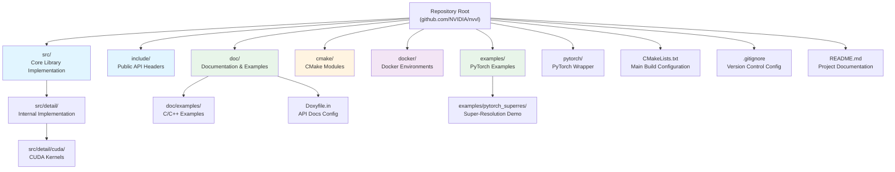
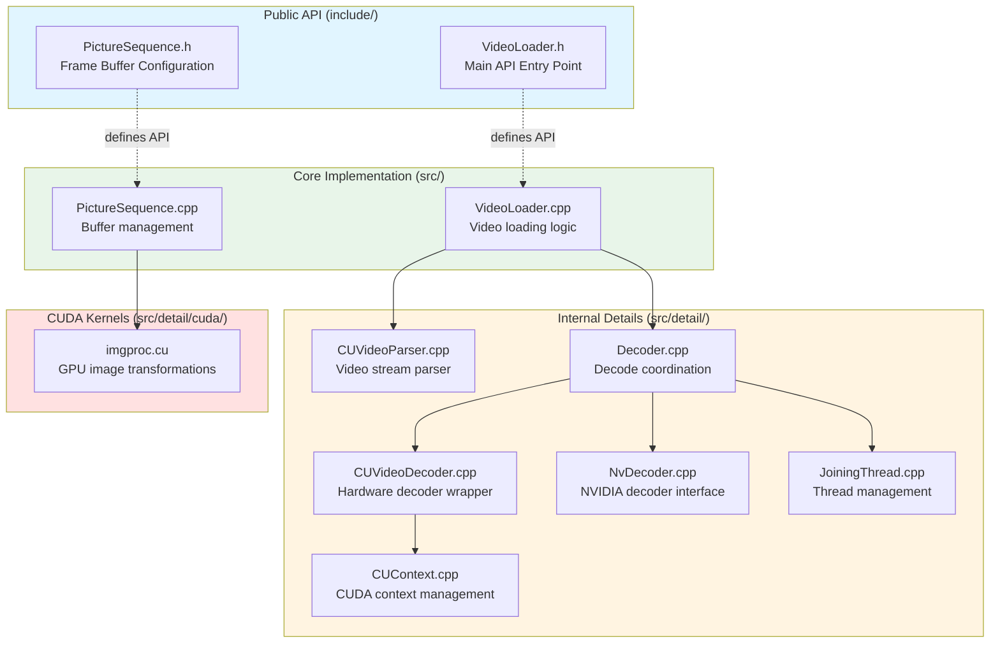
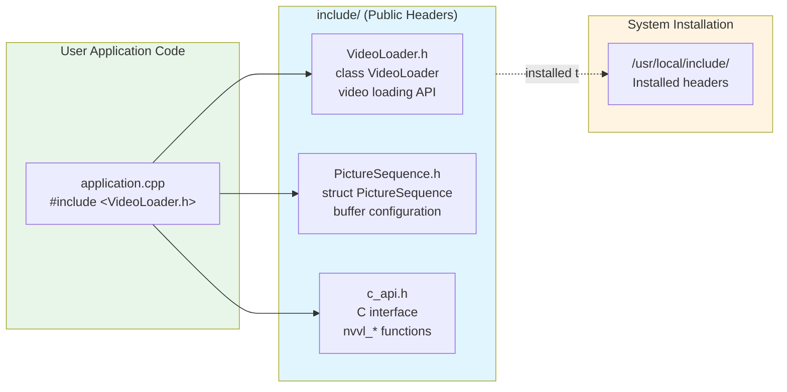
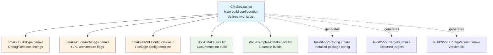
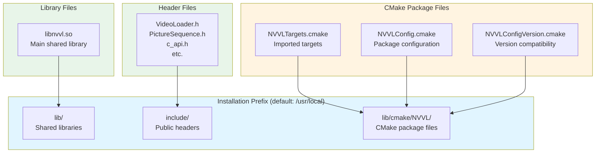
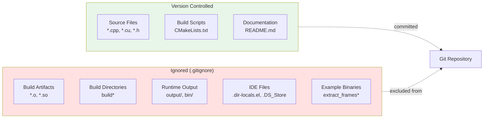

<!-- source: DeepWiki mcp.deepwiki.com · repo NVIDIA/nvvl · page 8.1 Repository Structure · fetched 2026-10-26 -->

# Repository Structure

<details>
<summary>Relevant source files</summary>

The following files were used as context for generating this wiki page:

- [.gitignore](.gitignore)
- [CMakeLists.txt](CMakeLists.txt)
- [README.md](README.md)

</details>


This document describes the organization of the NVVL repository, including the directory layout, source code organization, build artifacts, and version control configuration. This information is essential for developers contributing to NVVL or understanding how the project is structured.

For information about building the project, see [Building from Source](#2.1). For details on the CMake build system, see [CMake Configuration](#5.1). For information about the FlowNet2 submodule, see [Git Submodules](#8.2).

## Top-Level Repository Layout

The NVVL repository follows a standard C++/CMake project structure with clear separation between source code, public API, build configuration, and examples.

**Directory Structure Overview**



**Top-Level Directory Table**

| Directory/File | Purpose | Contents |
|---------------|---------|----------|
| `src/` | Core library implementation | C++ source files for VideoLoader, PictureSequence, and internal components |
| `include/` | Public API headers | Header files that users include when using NVVL |
| `doc/` | Documentation and examples | Doxygen configuration and C/C++ example programs |
| `cmake/` | CMake build modules | Custom CMake scripts for build configuration |
| `docker/` | Docker environments | Dockerfiles for various development and deployment scenarios |
| `examples/` | Advanced examples | PyTorch super-resolution example project |
| `pytorch/` | PyTorch wrapper | Python bindings for PyTorch integration |
| `CMakeLists.txt` | Main build file | Top-level CMake configuration |
| `.gitignore` | Version control config | Files to exclude from Git |
| `README.md` | Project documentation | User-facing documentation |

Sources: [CMakeLists.txt:1-126](), [README.md:1-313](), [.gitignore:1-10]()

## Source Code Organization

The source code is organized to separate the public API from internal implementation details, following industry best practices for C++ library design.

**Source Code Structure**



**Core Library Source Files**

The library is built from the following source files as defined in [CMakeLists.txt:32-42]():

| Source File | Purpose | Layer |
|-------------|---------|-------|
| `src/VideoLoader.cpp` | Main API implementation | Public Interface |
| `src/PictureSequence.cpp` | Frame buffer configuration | Public Interface |
| `src/detail/CUContext.cpp` | CUDA context management | Internal |
| `src/detail/CUVideoDecoder.cpp` | Hardware decoder wrapper | Internal |
| `src/detail/CUVideoParser.cpp` | FFmpeg parser integration | Internal |
| `src/detail/Decoder.cpp` | Decode thread coordination | Internal |
| `src/detail/JoiningThread.cpp` | Thread lifecycle management | Internal |
| `src/detail/NvDecoder.cpp` | NVIDIA decoder API interface | Internal |
| `src/detail/cuda/imgproc.cu` | GPU image processing kernels | CUDA Kernels |

The separation between `src/` and `src/detail/` follows the convention that `detail/` contains implementation classes not intended for direct user access, while top-level `src/` contains the implementation of publicly-facing classes.

Sources: [CMakeLists.txt:32-42]()

## Public API Headers

The public API is exposed through headers in the `include/` directory. These headers are installed system-wide and define the user-facing interface.

**Include Directory Structure**



The `include/` directory is marked as a public interface directory in [CMakeLists.txt:65-72](), making it available to users via:
- `$<BUILD_INTERFACE:${CMAKE_CURRENT_SOURCE_DIR}/include>` during build
- `$<INSTALL_INTERFACE:include>` after installation

Headers are installed to the system using [CMakeLists.txt:86]():
```cmake
install(DIRECTORY include/ DESTINATION ${CMAKE_INSTALL_INCLUDEDIR})
```

Sources: [CMakeLists.txt:65-72](), [CMakeLists.txt:86](), [README.md:186-196]()

## Build Artifacts and Generated Files

Build artifacts are generated in directories that are excluded from version control. The `.gitignore` file defines which files and directories are temporary or generated.

**Build Artifacts**

| Artifact | Location | Purpose |
|----------|----------|---------|
| Object files | `*.o` | Compiled object files |
| Shared library | `*.so`, `build*/libnvvl.so` | Core library binary |
| Build directory | `build*` | CMake build files and intermediates |
| Example binaries | `doc/examples/extract_frames` | Compiled example executables |
| Example binaries | `doc/examples/extract_frames_c` | C example executable |
| Output directory | `output/` | Runtime output from examples |
| Binary directory | `bin/` | Additional compiled binaries |

The `.gitignore` file [.gitignore:1-10]() specifies these patterns:

```
*.o           # Object files
*.so          # Shared libraries
build*        # All build directories (build, build-debug, etc.)
bin           # Binary output directory
output        # Example output directory
```

**Build Directory Structure**

When CMake is invoked, it creates a build directory (typically `build/`) containing:

```
build/
├── CMakeCache.txt              # CMake configuration cache
├── CMakeFiles/                 # CMake internal files
├── libnvvl.so                  # Compiled shared library
├── NVVLTargets.cmake           # Exported CMake targets
├── NVVLConfig.cmake            # Package configuration
├── NVVLConfigVersion.cmake     # Version information
└── doc/
    ├── html/                   # Generated Doxygen documentation
    └── examples/
        ├── extract_frames      # C++ example binary
        └── extract_frames_c    # C example binary
```

Sources: [.gitignore:1-10](), [CMakeLists.txt:100-122]()

## CMake Build Configuration Layout

The build system is organized across multiple CMake files to separate concerns and improve maintainability.

**CMake Configuration Files**



The main [CMakeLists.txt:1-126]() includes the custom modules and subdirectories:

- [CMakeLists.txt:12](): `include(cmake/BuildType.cmake)` - Build type configuration
- [CMakeLists.txt:13](): `include(cmake/CudaArchFlags.cmake)` - CUDA architecture detection
- [CMakeLists.txt:124](): `add_subdirectory(doc EXCLUDE_FROM_ALL)` - Documentation
- [CMakeLists.txt:125](): `add_subdirectory(doc/examples EXCLUDE_FROM_ALL)` - Examples

Sources: [CMakeLists.txt:1-126](), [README.md:101-147]()

## Installation Layout

When NVVL is installed (via `make install`), files are placed in standard system locations following GNU installation conventions.

**Installation Structure**



The installation configuration is defined in [CMakeLists.txt:76-122]():

**Installation Destinations**

| Component | CMake Variable | Default Location |
|-----------|---------------|------------------|
| Shared libraries | `CMAKE_INSTALL_LIBDIR` | `/usr/local/lib/` |
| Headers | `CMAKE_INSTALL_INCLUDEDIR` | `/usr/local/include/` |
| CMake configs | `INSTALL_CONFIGDIR` | `/usr/local/lib/cmake/NVVL/` |
| Install prefix | `CMAKE_INSTALL_PREFIX` | `/usr/local` |

After installation, downstream projects can find NVVL using CMake's `find_package(NVVL)` command, which locates the package configuration files in the `INSTALL_CONFIGDIR` location.

Sources: [CMakeLists.txt:76-122](), [README.md:101-136]()

## Examples and Documentation Layout

The repository includes both basic examples and advanced applications, organized under separate directories.

**Examples Directory Structure**

| Directory | Contents | Build Target |
|-----------|----------|--------------|
| `doc/examples/` | C/C++ frame extraction examples | `make examples` |
| `doc/examples/extract_frames.cpp` | C++ API demonstration | `extract_frames` |
| `doc/examples/extract_frames_c.c` | C API demonstration | `extract_frames_c` |
| `doc/examples/utils.cu` | CUDA utility functions | Compiled into examples |
| `doc/examples/utils.h` | Utility headers | N/A |
| `doc/Doxyfile.in` | Doxygen configuration template | `make doc` |
| `examples/pytorch_superres/` | PyTorch super-resolution project | N/A (separate build) |

The examples are built separately from the main library using [CMakeLists.txt:125]():
```cmake
add_subdirectory(doc/examples EXCLUDE_FROM_ALL)
```

The `EXCLUDE_FROM_ALL` flag means examples are only built when explicitly requested via `make examples`.

Documentation is similarly built on-demand using [CMakeLists.txt:124]():
```cmake
add_subdirectory(doc EXCLUDE_FROM_ALL)
```

When built, Doxygen generates HTML documentation in `doc/html/` as noted in [README.md:147]().

Sources: [CMakeLists.txt:124-125](), [README.md:137-147](), [README.md:186-196]()

## Version Control Configuration

The `.gitignore` file defines the version control configuration, specifying which files should not be tracked in Git.

**Ignored File Categories**



The [.gitignore:1-10]() file specifies:

**Build Artifacts** (lines 1-2, 9):
- `*.o` - Compiled object files
- `*.so` - Shared library files
- `build*` - All build directory variants

**Runtime Output** (lines 7-8):
- `bin` - Binary output directory
- `output` - Example execution output

**Example Binaries** (lines 5-6):
- `doc/examples/extract_frames` - C++ example executable
- `doc/examples/extract_frames_c` - C example executable

**Development Environment** (lines 3-4):
- `.dir-locals.el` - Emacs configuration
- `.DS_Store` - macOS metadata

This configuration ensures that only source code, build scripts, and documentation are version controlled, while generated binaries and build artifacts are kept local to each developer's workspace.

Sources: [.gitignore:1-10]()

## Docker Environment Organization

The repository includes multiple Docker environments for different use cases, located in the `docker/` directory.

**Docker File Organization**

| Dockerfile | Purpose | Use Case |
|------------|---------|----------|
| `docker/Dockerfile.minimal` | Minimal runtime environment | Production deployment |
| `docker/Dockerfile.build` | Build environment | CI/CD pipelines |
| `docker/Dockerfile.interactive` | Development environment | Interactive development |

Each Dockerfile is self-contained and can be built independently. The example project in `examples/pytorch_superres/` also includes its own Dockerfile that builds and installs NVVL as mentioned in [README.md:75-79]().

For detailed information on each Docker environment, see [Minimal Runtime Images](#6.1), [Build Development Images](#6.2), and [Interactive Development Images](#6.3).

Sources: [README.md:75-79]()

## Repository Metadata

The repository includes standard metadata files at the top level:

**Metadata Files**

| File | Purpose |
|------|---------|
| `README.md` | Main project documentation, build instructions, usage guide |
| `LICENSE` | License information (referenced in README) |
| `.gitignore` | Version control exclusions |
| `.gitmodules` | Git submodule configuration for FlowNet2-PyTorch |

The README serves as the primary entry point for users, containing build instructions, usage examples, and performance information. It notably includes a deprecation notice directing users to DALI [README.md:1-5]().

Sources: [README.md:1-313](), [.gitignore:1-10]()

---

