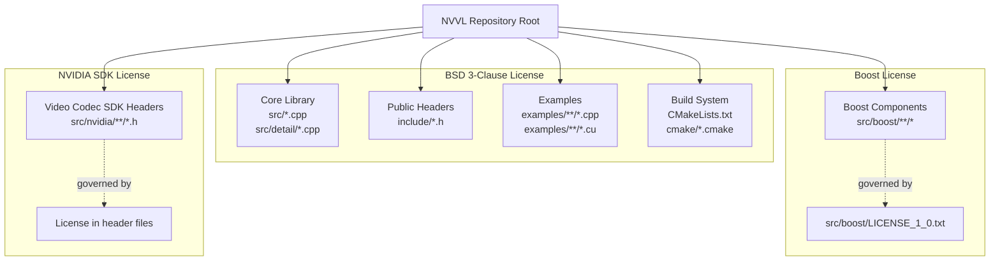
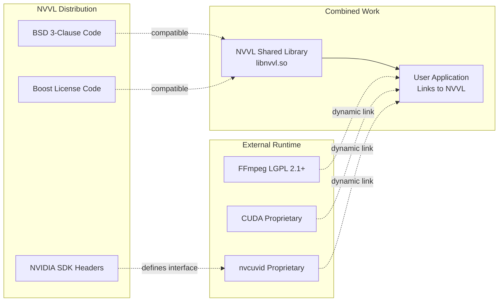

<!-- source: DeepWiki mcp.deepwiki.com · repo NVIDIA/nvvl · page 9 License and Legal · fetched 2026-10-26 -->

# License and Legal

<details>
<summary>Relevant source files</summary>

The following files were used as context for generating this wiki page:

- [LICENSE](LICENSE)

</details>


This page documents the licensing terms for NVVL and its components. It covers the primary project license, license exceptions for specific components, and licensing information for external dependencies. For information about building and configuring NVVL dependencies, see [Dependencies](#3.5).

## Purpose and Scope

NVVL is distributed under an open-source license with specific terms for the core library and various components. This documentation identifies:

- The primary license governing NVVL source code
- Components under alternative licenses
- External dependency licensing considerations
- Copyright attributions and restrictions

Understanding these terms is essential for commercial use, redistribution, and derivative works.

## Primary License: BSD 3-Clause

The NVVL library and most source files are released under the BSD 3-Clause License with copyright held by NVIDIA CORPORATION (2018).

### License Terms

The BSD 3-Clause license permits:

- **Redistribution** in source and binary forms
- **Modification** of the source code
- **Commercial use** without royalties
- **Sublicensing** and distribution of modified versions

With the following requirements:

- **Copyright notice retention** in source redistributions [LICENSE:8-9]()
- **Disclaimer reproduction** in binary redistributions [LICENSE:10-12]()
- **Name usage restriction**: NVIDIA CORPORATION's name and contributor names may not be used to endorse derived products without permission [LICENSE:13-15]()

### Warranty Disclaimer

The software is provided "AS IS" without warranties of any kind [LICENSE:17-19](). NVIDIA and contributors disclaim liability for damages including data loss, business interruption, or indirect damages [LICENSE:20-27]().

**Sources:** [LICENSE:1-27]()

## Component License Structure



**Sources:** [LICENSE:1-34]()

## License Exceptions

### Boost Library Components

Files from the Boost C++ library located in `src/boost/` are governed by the Boost Software License 1.0, not the BSD license.

**License location:** [src/boost/LICENSE_1_0.txt]()

The Boost license is compatible with the BSD 3-Clause license and permits similar use cases with minimal restrictions.

**Sources:** [LICENSE:30-31]()

### NVIDIA Video Codec SDK Headers

Header files from the NVIDIA Video Codec SDK in the `src/nvidia/` directory have their own license terms.

**License location:** Each header file contains its own license text at the top of the file [LICENSE:33-34]()

These headers define interfaces to NVIDIA's hardware video decoder (nvcuvid) and are redistributed with NVVL for convenience. Users must comply with NVIDIA's SDK licensing terms when using these headers.

**Key files affected:**
- Header files in `src/nvidia/` directory
- Interfaces to `nvcuvid` API

**Sources:** [LICENSE:33-34]()

## External Dependency Licenses

NVVL depends on several external libraries, each with its own licensing terms. These are not included in the NVVL repository but are required at build time and runtime.

### Dependency License Summary

| Dependency | License Type | Usage in NVVL | Link Requirement |
|------------|--------------|---------------|------------------|
| FFmpeg (libavformat, libavcodec, libavfilter, libavutil) | LGPL 2.1+ or GPL 2+ | Video container parsing and codec detection | Dynamic linking |
| NVIDIA CUDA Toolkit | Proprietary | GPU memory management and kernel execution | Dynamic linking |
| NVIDIA Video Codec SDK (nvcuvid) | Proprietary | Hardware video decoding | Dynamic linking |
| nvidia-ml | Proprietary | GPU device management | Dynamic linking |
| OpenCV (optional, examples only) | Apache 2.0 | Image processing in examples | Optional |

### FFmpeg

FFmpeg libraries are used for video container demuxing and codec detection. FFmpeg is typically licensed under LGPL 2.1 or later, though GPL 2+ licensing applies if certain features are enabled during FFmpeg's build.

**NVVL's usage:** NVVL dynamically links to FFmpeg libraries, ensuring LGPL compliance. Users who build FFmpeg themselves must ensure their FFmpeg build's license terms are compatible with their use case.

**Libraries used:**
- `libavformat` - container parsing
- `libavcodec` - codec identification
- `libavfilter` - video filtering
- `libavutil` - utility functions

### NVIDIA Proprietary Components

NVVL requires several NVIDIA proprietary libraries:

**CUDA Toolkit** provides GPU compute capabilities. Required for building and running NVVL.

**nvcuvid (NVIDIA Video Decode API)** provides hardware-accelerated video decoding. This is part of the NVIDIA Video Codec SDK and requires NVIDIA GPU hardware with decode capabilities.

**nvidia-ml (NVIDIA Management Library)** provides GPU device management and monitoring capabilities.

**License implications:** These components require accepting NVIDIA's end-user license agreements. Use of NVVL with NVIDIA GPUs requires compliance with NVIDIA's terms.

### OpenCV (Optional)

OpenCV is used only in example applications for image visualization and output. It is not required for the core NVVL library.

**License:** Apache 2.0  
**Usage:** Optional dependency in [examples/extract_frames.cpp]()

**Sources:** [LICENSE:1-34](), [README.md]() (inferred from context), example files

## License Compatibility



### Compatibility Analysis

**BSD + Boost + NVIDIA SDK Headers:** These licenses are compatible for distribution in the NVVL library. The BSD and Boost licenses are both permissive, and the NVIDIA SDK headers define interfaces without imposing restrictions on the NVVL code itself.

**LGPL FFmpeg:** Dynamic linking to FFmpeg satisfies LGPL requirements, allowing NVVL to remain under BSD license while using LGPL libraries.

**Proprietary NVIDIA Components:** These are dynamically linked at runtime and do not affect NVVL's license. Users must separately comply with NVIDIA's licensing terms.

**Commercial Use:** The BSD license permits commercial use of NVVL. Users must ensure compliance with:
- FFmpeg's LGPL terms (typically satisfied by dynamic linking)
- NVIDIA's CUDA and Video Codec SDK licenses
- Any patent considerations for video codecs

**Sources:** [LICENSE:1-34]()

## Copyright and Attribution

### Copyright Notice

All files unless otherwise stated are:

```
Copyright (c) 2018, NVIDIA CORPORATION. All rights reserved.
```

[LICENSE:3]()

### Required Attributions

When redistributing NVVL in source form:
- Retain the copyright notice [LICENSE:8-9]()
- Retain the license conditions list [LICENSE:9]()
- Retain the warranty disclaimer [LICENSE:9]()

When redistributing NVVL in binary form:
- Reproduce the copyright notice in documentation [LICENSE:10-12]()
- Reproduce the license conditions in documentation [LICENSE:10-12]()
- Reproduce the warranty disclaimer in documentation [LICENSE:10-12]()

### Name Usage Restrictions

The name "NVIDIA CORPORATION" and contributor names cannot be used to endorse or promote products derived from NVVL without specific written permission [LICENSE:13-15]().

**Sources:** [LICENSE:3-15]()

## Integration with NVIDIA DALI

NVVL's functionality has been incorporated into NVIDIA DALI (Data Loading Library). Projects considering NVVL should evaluate DALI as the recommended, actively maintained alternative.

**License note:** DALI has its own licensing terms separate from NVVL. Consult DALI's license information if using that project instead of standalone NVVL.

**Sources:** [README.md]() (context inferred from overview documentation)

## Compliance Checklist

### For NVVL Users

- [ ] Review BSD 3-Clause license terms [LICENSE:1-27]()
- [ ] Ensure FFmpeg build on target system is compatible (LGPL vs GPL)
- [ ] Accept NVIDIA CUDA Toolkit EULA
- [ ] Accept NVIDIA Video Codec SDK license terms
- [ ] If redistributing binaries, include copyright notice and disclaimer
- [ ] If modifying source, retain original copyright notices
- [ ] Do not use "NVIDIA CORPORATION" name for endorsement without permission

### For Contributors

- [ ] Ensure new code is compatible with BSD 3-Clause license
- [ ] Add appropriate copyright headers to new files
- [ ] Document any new third-party dependencies and their licenses
- [ ] Verify license compatibility of any imported code

**Sources:** [LICENSE:1-34]()