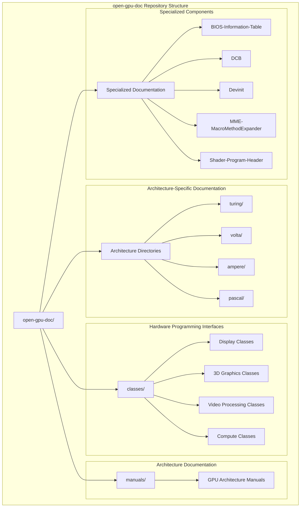
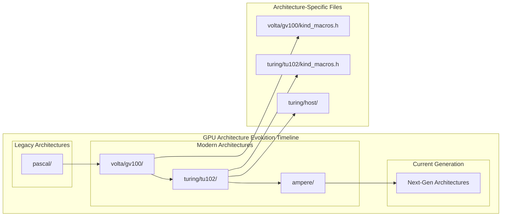
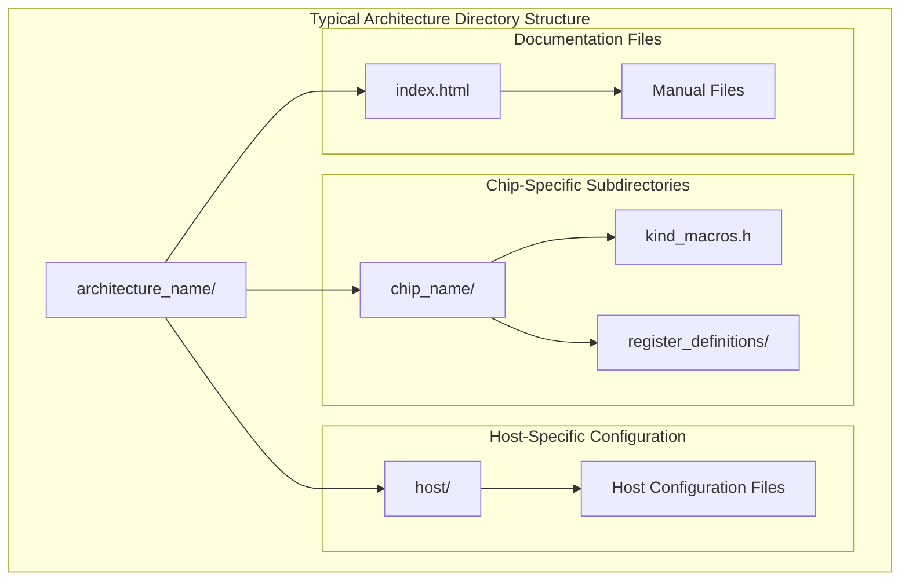

<!-- source: DeepWiki mcp.deepwiki.com · repo NVIDIA/open-gpu-doc · page 1 Overview · fetched 2026-10-26 -->

# Overview

Relevant source files

The following files were used as context for generating this wiki page:

- [index.html](index.html)
- [turing/index.html](turing/index.html)
- [turing/tu102/index.html](turing/tu102/index.html)
- [turing/tu102/kind_macros.h](turing/tu102/kind_macros.h)
- [volta/gv100/index.html](volta/gv100/index.html)
- [volta/gv100/kind_macros.h](volta/gv100/kind_macros.h)
- [volta/index.html](volta/index.html)

This document provides an overview of the open-gpu-doc repository, NVIDIA's open-source GPU hardware documentation covering register definitions, hardware specifications, and programming interfaces across multiple GPU generations. The repository serves as a comprehensive technical reference for GPU hardware developers, driver writers, and system integrators working with NVIDIA GPU architectures.

For information about specific GPU architecture implementations, see [GPU Hardware Architecture](#2). For details about programming different GPU subsystems, see [Programming Interfaces](#3). For core system infrastructure documentation, see [System Components](#4).

## Repository Structure and Organization

The open-gpu-doc repository is organized into several key areas covering different aspects of GPU hardware documentation:

**Sources:** [index.html:1-26](), [turing/index.html:1-8](), [volta/index.html:1-7]()

## GPU Architecture Coverage

The repository provides comprehensive documentation across multiple NVIDIA GPU architecture generations, with varying levels of detail based on the maturity and public availability of each architecture:

Each architecture directory contains specific hardware definitions, memory management macros, and register specifications tailored to that GPU generation's capabilities and features.

**Sources:** [volta/index.html:1-7](), [turing/index.html:1-8](), [volta/gv100/index.html:1-7](), [turing/tu102/index.html:1-7]()

## Documentation Types and Key Components

The repository contains several distinct types of technical documentation:

### Hardware Register Definitions
Architecture-specific register definitions and hardware interface specifications, including memory management unit (MMU) configurations and page table entry (PTE) kind definitions.

### Memory Kind Macros
Comprehensive macro definitions for memory types and formats, such as those found in `kind_macros.h` files. These macros define surface formats, compression types, and memory layout characteristics:

| Macro Category | Example Macros | Purpose |
|---------------|----------------|---------|
| Memory Kinds | `KIND_INVALID`, `KIND_BLOCKLINEAR` | Define basic memory layout types |
| Surface Types | `KIND_Z16`, `KIND_Z24S8`, `KIND_C32` | Specify surface format characteristics |
| Compression | `KIND_COMPRESSIBLE`, `PTEKIND_COMPRESSIBLE` | Control memory compression features |
| Memory Support | `KIND_SYSMEM_SUPPORTED`, `KIND_LOCALMEM_SUPPORTED` | Define memory location compatibility |

### Programming Interface Classes
Hardware abstraction layer definitions organized by functional subsystem, providing software interfaces to GPU hardware blocks.

### Architecture Manuals
High-level architectural documentation explaining GPU design principles, pipeline organization, and system integration requirements.

**Sources:** [turing/tu102/kind_macros.h:27-96](), [volta/gv100/kind_macros.h:26-96]()

## File Organization Patterns

The repository follows consistent organizational patterns across different GPU architectures:

Each architecture directory typically contains chip-specific subdirectories (like `tu102/` for Turing or `gv100/` for Volta) with their respective hardware definition files, particularly the critical `kind_macros.h` files that define memory and surface format macros.

**Sources:** [turing/index.html:5-6](), [volta/index.html:5](), [turing/tu102/index.html:5](), [volta/gv100/index.html:5]()

## Key File Types and Their Functions

The repository contains several critical file types that serve different documentation purposes:

- **`kind_macros.h`** - Auto-generated macro definitions for memory kinds, surface formats, and hardware capabilities
- **`*.ref.txt`** - Register reference files containing detailed hardware register specifications  
- **`index.html`** - Navigation files providing structured access to documentation components
- **Hardware class files** - Programming interface definitions for different GPU subsystems
- **Manual files** - Comprehensive architectural documentation and programming guides

These files work together to provide a complete technical reference for GPU hardware programming, from low-level register access to high-level programming interfaces.

**Sources:** [turing/tu102/kind_macros.h:23](), [volta/gv100/kind_macros.h:23](), [index.html:1-26]()

---

