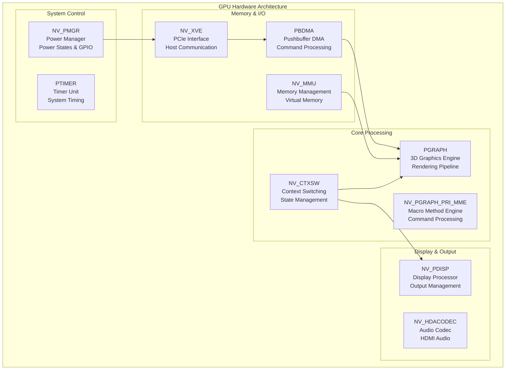
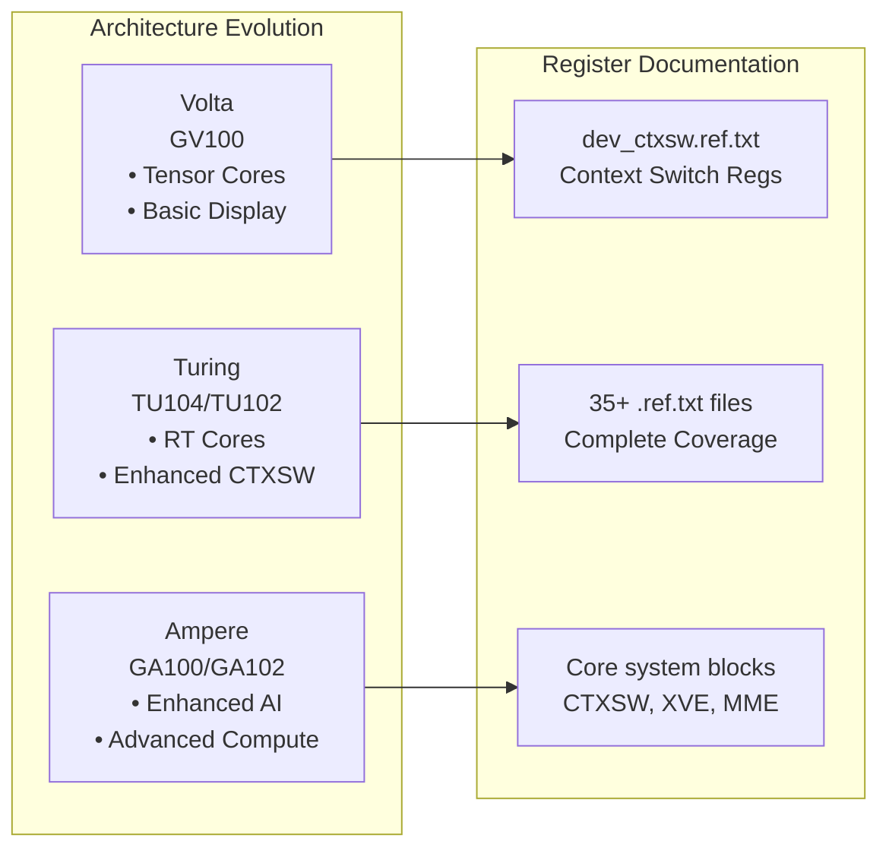
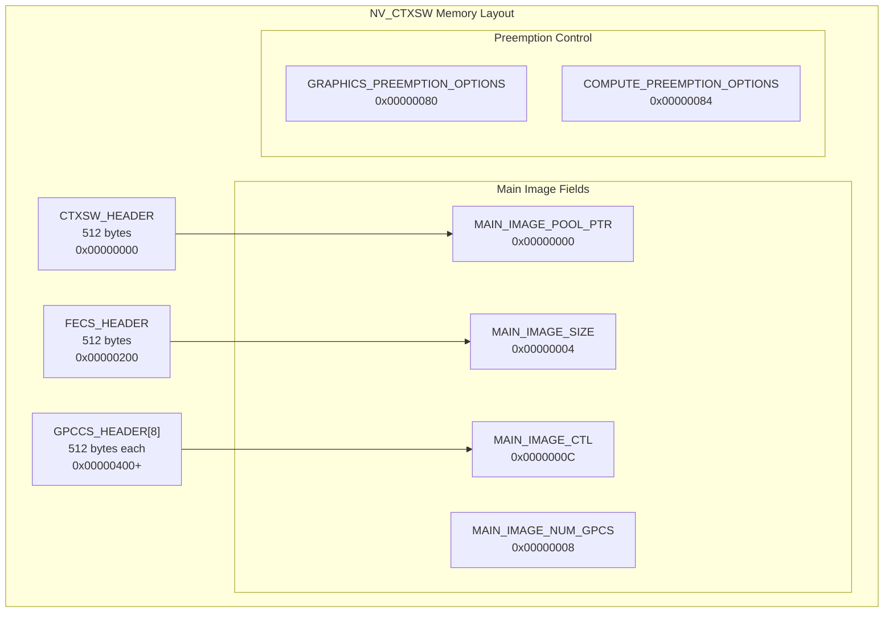
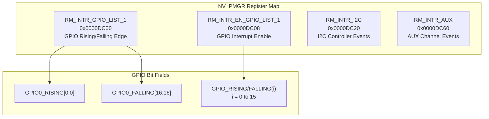
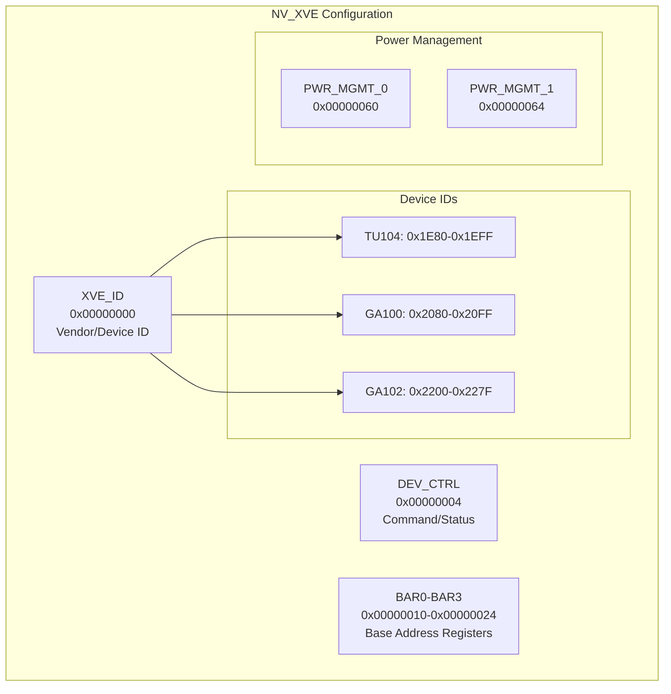
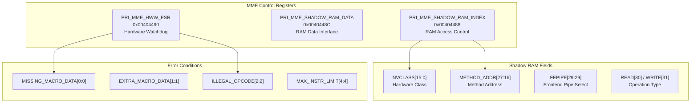

<!-- source: DeepWiki mcp.deepwiki.com · repo NVIDIA/open-gpu-doc · page 2 GPU Hardware Architecture · fetched 2026-10-26 -->

# GPU Hardware Architecture

<details>
<summary>Relevant source files</summary>

The following files were used as context for generating this wiki page:

- [manuals/ampere/ga100/dev_ctxsw.ref.txt](manuals/ampere/ga100/dev_ctxsw.ref.txt)
- [manuals/ampere/ga100/dev_nv_xve3g_fn0.ref.txt](manuals/ampere/ga100/dev_nv_xve3g_fn0.ref.txt)
- [manuals/ampere/ga100/dev_nv_xve3g_fn1.ref.txt](manuals/ampere/ga100/dev_nv_xve3g_fn1.ref.txt)
- [manuals/ampere/ga100/index.html](manuals/ampere/ga100/index.html)
- [manuals/ampere/ga100/pri_mme.ref.txt](manuals/ampere/ga100/pri_mme.ref.txt)
- [manuals/turing/tu104/dev_pmgr.ref.txt](manuals/turing/tu104/dev_pmgr.ref.txt)
- [manuals/turing/tu104/index.html](manuals/turing/tu104/index.html)

</details>


This document covers the hardware specifications, register definitions, and low-level programming interfaces for NVIDIA GPU architectures. It provides comprehensive documentation of hardware blocks, register maps, and system interfaces across multiple GPU generations including Turing, Ampere, Volta, and others.

For higher-level programming interfaces and hardware classes, see [Programming Interfaces](#3). For specific implementation details of command processing and memory management, see [System Components](#4).

## Architecture Overview

The NVIDIA GPU hardware architecture consists of multiple specialized processing units, each with dedicated register interfaces and control mechanisms. The architecture is organized around core processing engines, display subsystems, memory management units, and system control blocks.



**Sources:** [manuals/turing/tu104/index.html:1-37](), [manuals/ampere/ga100/index.html:1-24]()

## GPU Generation Coverage

The documentation spans multiple GPU architecture generations, each with specific hardware capabilities and register interfaces:

| Architecture | Chip Examples | Key Features | Documentation Coverage |
|--------------|---------------|--------------|----------------------|
| **Turing** | TU104, TU102 | RT Cores, Enhanced Context Switching | Complete register definitions |
| **Ampere** | GA100, GA102 | Enhanced AI, Advanced Compute | Core system blocks |
| **Volta** | GV100 | Tensor Cores, Display Processing | Context switching focus |
| **Pascal** | GP100-GP108 | Enhanced Memory, Basic Features | Limited coverage |



**Sources:** [manuals/turing/tu104/index.html:1-37](), [manuals/ampere/ga100/index.html:1-24]()

## Context Switching Hardware

The `NV_CTXSW` block manages GPU context switching and preemption across different workload types. It provides hardware-level state management for graphics, compute, and display contexts.

### Context Switch Image Structure



### Preemption Types

The context switching hardware supports multiple preemption granularities:

| Preemption Type | Graphics Control | Compute Control | Use Case |
|-----------------|------------------|-----------------|----------|
| **WFI** | `CONTROL_WFI` (0x0) | `CONTROL_WFI` (0x0) | Wait for idle |
| **GFXP** | `CONTROL_GFXP` (0x1) | N/A | Graphics preemption |
| **CTA** | N/A | `CONTROL_CTA` (0x1) | Cooperative thread array |
| **CILP** | N/A | `CONTROL_CILP` (0x2) | Compute instruction level |

**Sources:** [manuals/ampere/ga100/dev_ctxsw.ref.txt:98-106]()

## Power Management and System Control

The `NV_PMGR` block handles power management, GPIO control, and system-level interrupts. It provides interfaces for power state transitions and peripheral control.

### GPIO and Interrupt Control



**Sources:** [manuals/turing/tu104/dev_pmgr.ref.txt:33-203]()

## PCIe Interface Hardware

The `NV_XVE` block implements the PCIe interface and provides host communication capabilities. It includes standard PCIe configuration space and NVIDIA-specific extensions.

### PCIe Configuration Space

The PCIe interface supports multiple device IDs across GPU generations:



**Sources:** [manuals/ampere/ga100/dev_nv_xve3g_fn0.ref.txt:24-139]()

## Macro Method Engine (MME)

The `NV_PGRAPH_PRI_MME` provides hardware acceleration for repetitive GPU operations through programmable macro execution.

### MME Register Interface



**Sources:** [manuals/ampere/ga100/pri_mme.ref.txt:22-87]()

## Register Definition Format

All hardware registers follow a standardized format with 5-field access codes:

| Field | Values | Description |
|-------|--------|-------------|
| **Read** | `R`, `C`, `-` | Read capability and constant values |
| **Write** | `W`, `-` | Write capability |
| **Internal State** | `I`, `E`, `B`, `C`, `V`, `X` | Reset behavior and initialization |
| **Declaration/Size** | `1`, `2`, `4`, `8`, `V`, `U`, `S`, `F` | Data type and size |
| **Define Indicator** | `R`, `F`, `V`, `D`, `A` | Register, field, value, device, array |

Example register definition:
```
#define NV_CTXSW_MAIN_IMAGE_CTL                        0x0000000C /* RW-4R */
#define NV_CTXSW_MAIN_IMAGE_CTL_TYPE                          5:0 /* RWXVF */
#define NV_CTXSW_MAIN_IMAGE_CTL_TYPE_OPENGL                   0x8 /* RW--V */
```

**Sources:** [manuals/ampere/ga100/dev_ctxsw.ref.txt:272-343]()

---

