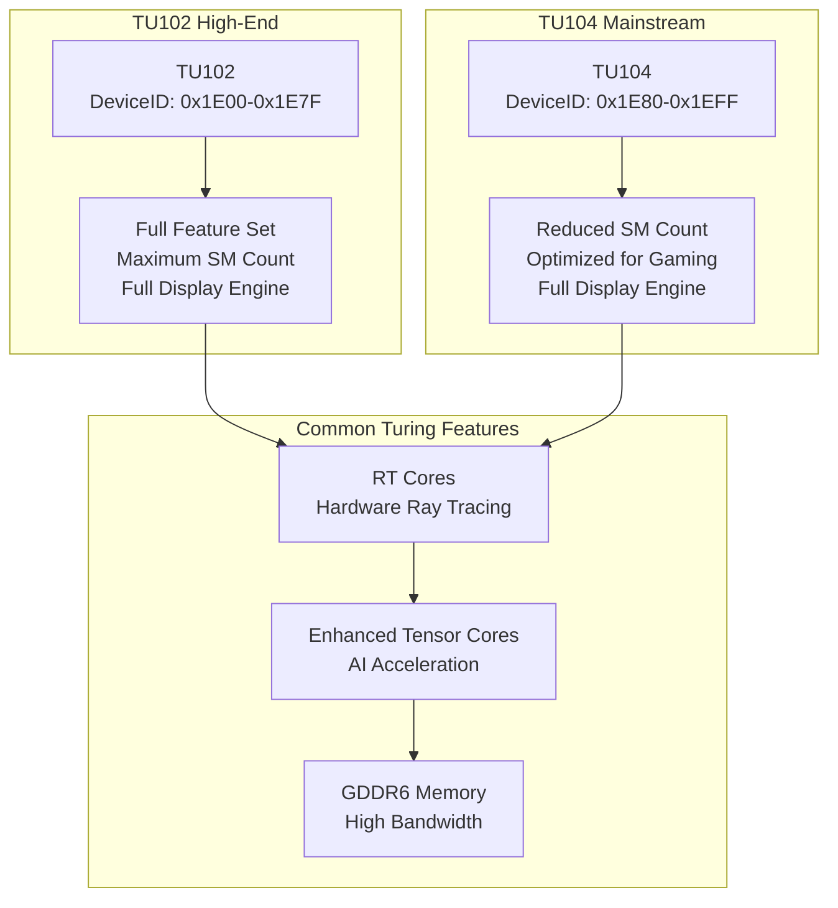
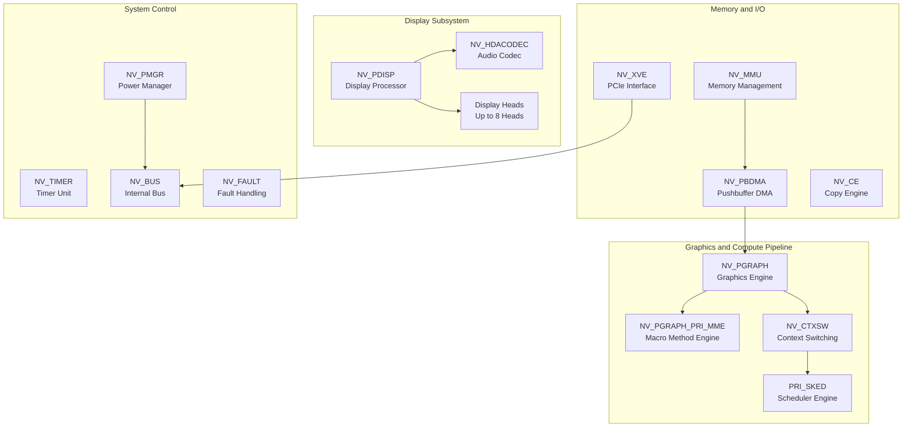
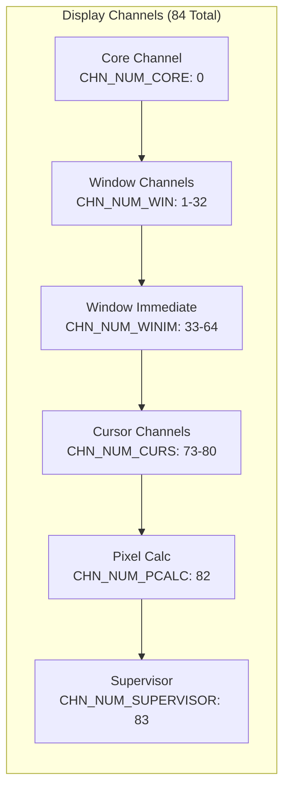
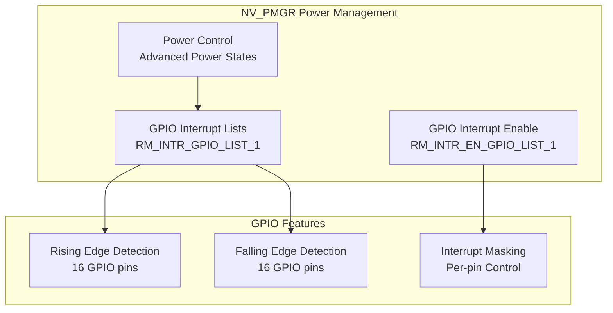
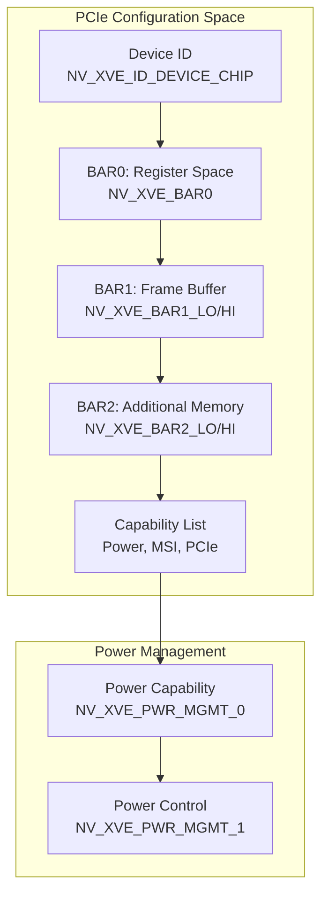
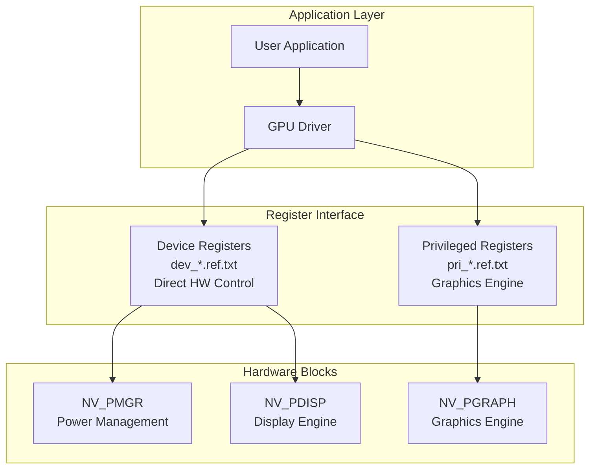
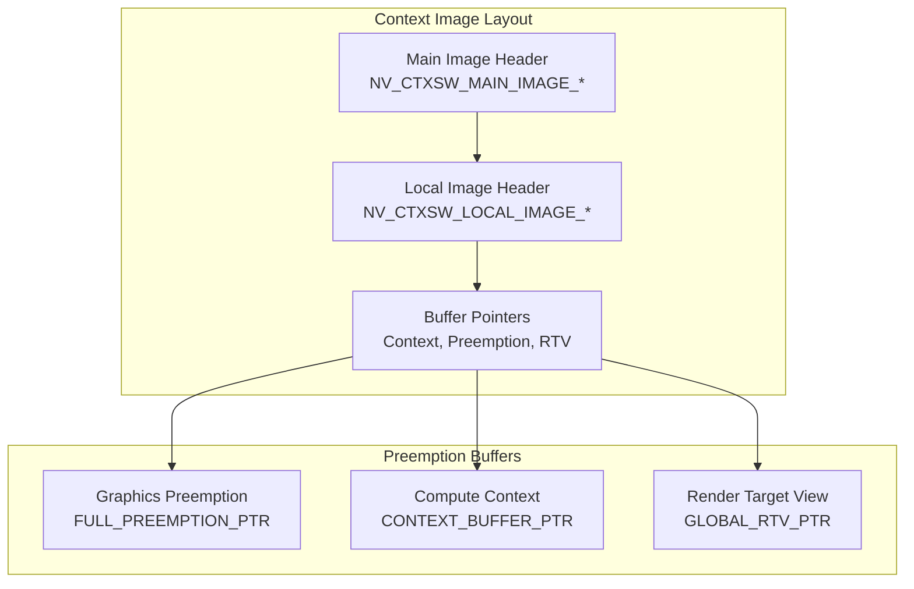

<!-- source: DeepWiki mcp.deepwiki.com · repo NVIDIA/open-gpu-doc · page 2.1 Turing Architecture · fetched 2026-10-26 -->

# Turing Architecture

Relevant source files

The following files were used as context for generating this wiki page:

- [manuals/ampere/ga100/dev_ctxsw.ref.txt](manuals/ampere/ga100/dev_ctxsw.ref.txt)
- [manuals/ampere/ga100/dev_nv_xve3g_fn0.ref.txt](manuals/ampere/ga100/dev_nv_xve3g_fn0.ref.txt)
- [manuals/ampere/ga100/dev_nv_xve3g_fn1.ref.txt](manuals/ampere/ga100/dev_nv_xve3g_fn1.ref.txt)
- [manuals/ampere/ga100/index.html](manuals/ampere/ga100/index.html)
- [manuals/ampere/ga100/pri_mme.ref.txt](manuals/ampere/ga100/pri_mme.ref.txt)
- [manuals/turing/tu102/dev_display_withoffset.ref.txt](manuals/turing/tu102/dev_display_withoffset.ref.txt)
- [manuals/turing/tu102/dev_nv_xve3g_fn0.ref.txt](manuals/turing/tu102/dev_nv_xve3g_fn0.ref.txt)
- [manuals/turing/tu102/dev_nv_xve3g_fn1.ref.txt](manuals/turing/tu102/dev_nv_xve3g_fn1.ref.txt)
- [manuals/turing/tu102/index.html](manuals/turing/tu102/index.html)
- [manuals/turing/tu104/dev_pmgr.ref.txt](manuals/turing/tu104/dev_pmgr.ref.txt)
- [manuals/turing/tu104/index.html](manuals/turing/tu104/index.html)

This document covers the Turing GPU architecture hardware specifications, register definitions, and programming interfaces. Turing encompasses the TU102 and TU104 chip variants and represents NVIDIA's first GPU architecture to include dedicated RT (Ray Tracing) cores alongside traditional graphics and compute capabilities.

For context switching mechanisms across GPU architectures, see [Context Switching](#4.2). For display system programming interfaces, see [Display System](#3.2).

## Architecture Overview

The Turing architecture introduces significant architectural enhancements over the previous Volta generation, including dedicated ray tracing hardware and enhanced Tensor cores for AI workloads. The architecture is implemented in two primary chip variants documented in this repository.

### Chip Variants

| Chip | Device ID Range | PCIe Function Files |
|------|----------------|-------------------|
| TU102 | 0x1E00-0x1E7F | [manuals/turing/tu102/dev_nv_xve3g_fn0.ref.txt](), [manuals/turing/tu102/dev_nv_xve3g_fn1.ref.txt]() |
| TU104 | 0x1E80-0x1EFF | [manuals/turing/tu104/dev_nv_xve3g_fn0.ref.txt](), [manuals/turing/tu104/dev_nv_xve3g_fn1.ref.txt]() |

**Turing Chip Architecture**

Sources: [manuals/turing/tu102/dev_nv_xve3g_fn0.ref.txt:85-98](), [manuals/turing/tu104/index.html:1-37]()

## Hardware Subsystems

The Turing architecture implements a comprehensive set of hardware subsystems, each with dedicated register interfaces and control mechanisms.

**Turing Hardware Block Organization**

Sources: [manuals/turing/tu104/index.html:5-36](), [manuals/turing/tu102/dev_display_withoffset.ref.txt:22-41]()

### Display Engine

The Turing display engine (`NV_PDISP`) supports up to 8 display heads with comprehensive hardware capabilities reporting and multi-channel architecture.

| Component | Register Prefix | Description |
|-----------|----------------|-------------|
| Display Front End | `NV_PDISP_FE` | Hardware capability and configuration |
| Display Channels | `NV_PDISP_CHN` | 84 total channels including core, window, cursor |
| Hardware Capabilities | `NV_PDISP_FE_HW_SYS_CAP` | Dynamic feature detection |

**Display Channel Architecture**

The display subsystem includes hardware capability registers for dynamic feature detection:

- `NV_PDISP_FE_HW_SYS_CAP`: Head and SOR existence detection
- `NV_PDISP_FE_HW_SYS_CAPB`: Window channel existence (up to 32 windows)
- `NV_PDISP_FE_MISC_CONFIGA`: Runtime configuration reporting

Sources: [manuals/turing/tu102/dev_display_withoffset.ref.txt:24-41](), [manuals/turing/tu102/dev_display_withoffset.ref.txt:79-135]()

### Power Management

The power management subsystem (`NV_PMGR`) provides comprehensive power control and GPIO interrupt handling capabilities.

Key power management registers:
- `NV_PMGR_IP_VER`: Version 3.2.0.0 for Turing
- `NV_PMGR_RM_INTR_GPIO_LIST_1`: 32-bit register supporting 16 GPIO pins with rising/falling edge detection
- `NV_PMGR_RM_INTR_EN_GPIO_LIST_1`: Individual interrupt enable control per GPIO pin

Sources: [manuals/turing/tu104/dev_pmgr.ref.txt:24-32](), [manuals/turing/tu104/dev_pmgr.ref.txt:33-203]()

### PCIe Interface

The PCIe interface is implemented through the `NV_XVE` (eXternal Vehicle Engine) subsystem with dual-function support.

| Function | Address Range | Configuration |
|----------|---------------|---------------|
| Function 0 | `NV_XVE` (0x0000-0x0FFF) | Primary GPU function |
| Function 1 | `NV_XVE1` (0x0000-0x0FFF) | Audio/auxiliary function |

**PCIe Configuration Structure**

Sources: [manuals/turing/tu102/dev_nv_xve3g_fn0.ref.txt:24-27](), [manuals/turing/tu102/dev_nv_xve3g_fn0.ref.txt:204-262]()

## Register Organization

The Turing architecture organizes registers into two primary categories with distinct addressing schemes and access patterns.

### Device Registers (`dev_*.ref.txt`)

Device registers provide direct hardware control and status interfaces. These registers are memory-mapped and accessible through BAR0.

| Register File | Hardware Block | Address Range |
|--------------|----------------|---------------|
| `dev_pmgr.ref.txt` | Power Manager | `NV_PMGR`: 0xD000-0xE7FF |
| `dev_display_withoffset.ref.txt` | Display Processor | `NV_PDISP`: 0x610000-0x64FFFF |
| `dev_ctxsw.ref.txt` | Context Switching | `NV_CTXSW`: 0x000000-0xFFFFFF |
| `dev_mmu.ref.txt` | Memory Management | `NV_MMU`: Various ranges |

### Privileged Registers (`pri_*.ref.txt`)

Privileged registers control graphics engine internal state and require elevated access permissions.

| Register File | Graphics Subsystem | Function |
|--------------|-------------------|----------|
| `pri_mme.ref.txt` | Macro Method Engine | Programmable command processing |
| `pri_sked.ref.txt` | Scheduler | Work distribution and load balancing |
| `pri_fe.ref.txt` | Front End | Command fetch and decode |
| `pri_eng.ref.txt` | Engine Control | Graphics pipeline management |

**Register Access Hierarchy**

Sources: [manuals/turing/tu104/index.html:5-36](), [manuals/turing/tu104/dev_pmgr.ref.txt:22-23]()

## Context Switching Architecture

Turing implements an advanced context switching system (`NV_CTXSW`) that enables efficient preemption and state management for graphics and compute workloads.

### Context Types and Preemption Modes

The context switching system supports multiple preemption granularities:

| Context Type | Register Field | Preemption Level |
|-------------|---------------|------------------|
| Graphics | `NV_CTXSW_MAIN_IMAGE_GRAPHICS_PREEMPTION_OPTIONS_CONTROL` | WFI, GFXP |
| Compute | `NV_CTXSW_MAIN_IMAGE_COMPUTE_PREEMPTION_OPTIONS_CONTROL` | WFI, CTA, CILP |
| OpenGL | `NV_CTXSW_MAIN_IMAGE_CTL_TYPE_OPENGL` | Traditional graphics |
| DirectX | `NV_CTXSW_MAIN_IMAGE_CTL_TYPE_DX11` | DirectX 11 contexts |

### Context Image Structure

The context image uses magic values for validation:
- `NV_CTXSW_MAIN_IMAGE_MAGIC_VALUE_1`: 0x600dc0de
- `NV_CTXSW_MAIN_IMAGE_MAGIC_VALUE_2`: 0xdeadce11  
- `NV_CTXSW_MAIN_IMAGE_MAGIC_VALUE_3`: 0xfaceb00c

Sources: [manuals/ampere/ga100/dev_ctxsw.ref.txt:36-52](), [manuals/ampere/ga100/dev_ctxsw.ref.txt:98-106]()

## Key Architectural Features

### Ray Tracing Integration

While the RT core register interfaces are not directly exposed in the provided register files, the Turing architecture's context switching system includes provisions for ray tracing workload management through the standard graphics preemption mechanisms.

### Enhanced Memory Management

The Turing MMU provides advanced virtual memory capabilities with support for:
- Multiple address spaces per context
- Fine-grained access control
- Hardware-accelerated page table walks
- Fault isolation and recovery

### Display Engine Enhancements

The Turing display engine supports:
- Up to 8 simultaneous display heads
- Hardware-accelerated composition with 32 window channels
- Real-time capability reporting for dynamic configuration
- Enhanced audio integration through `NV_HDACODEC`

This architecture represents a significant evolution in GPU design, balancing traditional graphics performance with specialized acceleration for ray tracing and AI workloads while maintaining compatibility with existing software stacks.

Sources: [manuals/turing/tu102/dev_display_withoffset.ref.txt:24-41](), [manuals/turing/tu104/dev_pmgr.ref.txt:22-32]()

---

