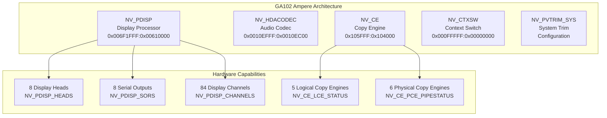
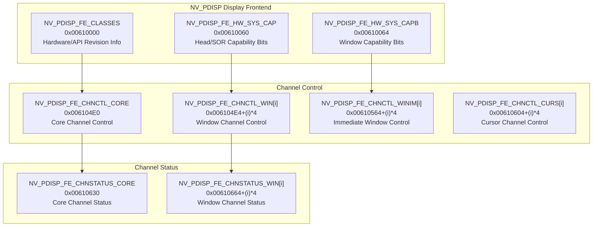
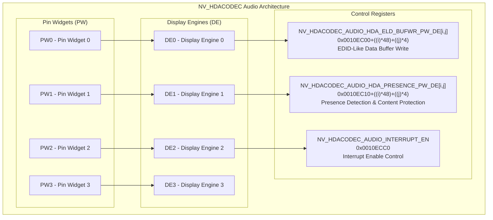
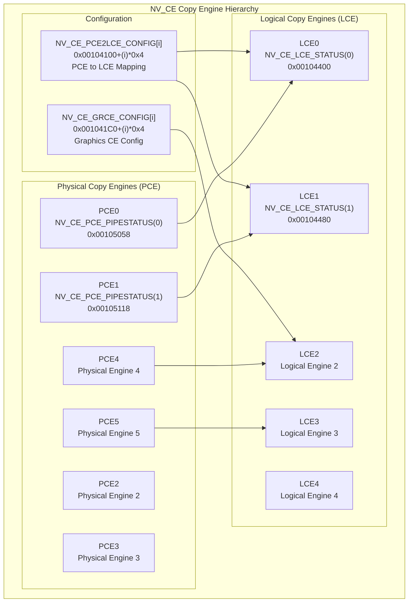
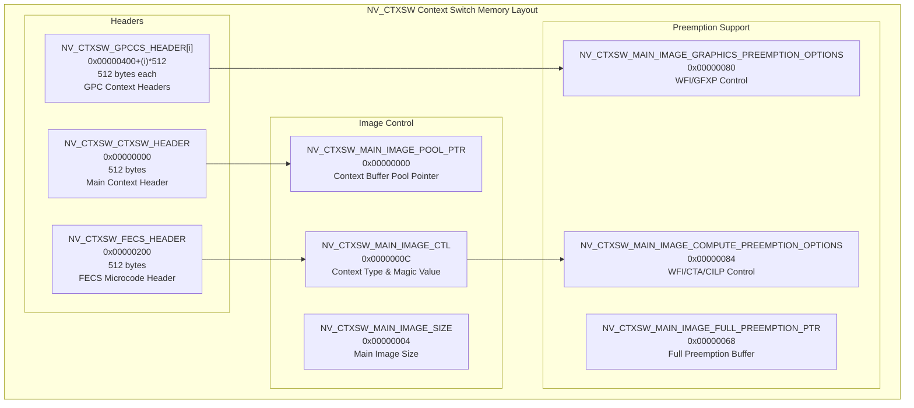
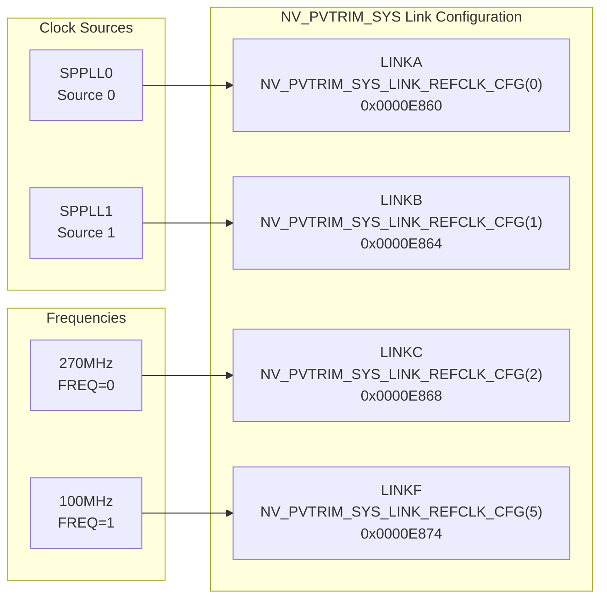

<!-- source: DeepWiki mcp.deepwiki.com · repo NVIDIA/open-gpu-doc · page 2.2 Ampere Architecture · fetched 2026-10-26 -->

# Ampere Architecture

Relevant source files

The following files were used as context for generating this wiki page:

- [manuals/ampere/ga102/dev_ce.ref.txt](manuals/ampere/ga102/dev_ce.ref.txt)
- [manuals/ampere/ga102/dev_ctxsw.ref.txt](manuals/ampere/ga102/dev_ctxsw.ref.txt)
- [manuals/ampere/ga102/dev_display_withoffset.ref.txt](manuals/ampere/ga102/dev_display_withoffset.ref.txt)
- [manuals/ampere/ga102/dev_hdacodec.ref.txt](manuals/ampere/ga102/dev_hdacodec.ref.txt)
- [manuals/ampere/ga102/dev_trim.ref.txt](manuals/ampere/ga102/dev_trim.ref.txt)
- [manuals/ampere/ga102/index.html](manuals/ampere/ga102/index.html)
- [manuals/turing/tu104/dev_display_withoffset.ref.txt](manuals/turing/tu104/dev_display_withoffset.ref.txt)

This document covers the hardware specifications and register definitions for NVIDIA's Ampere architecture GPUs, specifically the GA102 implementation. The material focuses on low-level hardware interfaces including display processing, audio codec functionality, copy engine operations, and context switching mechanisms.

For information about programming interfaces and software classes that interact with this hardware, see [Programming Interfaces](#3). For context switching software interfaces, see [Context Switching](#4.2).

## Architecture Overview

The GA102 Ampere architecture implements several key hardware subsystems that are documented through register reference files. Each subsystem provides memory-mapped register interfaces for direct hardware control and status monitoring.

**Sources:** [manuals/ampere/ga102/index.html:1-15](), [manuals/ampere/ga102/dev_display_withoffset.ref.txt:22-29](), [manuals/ampere/ga102/dev_ce.ref.txt:22-108]()

## Display Subsystem (NV_PDISP)

The display processor handles output generation and window composition across multiple display heads and output interfaces. The `NV_PDISP` block occupies memory range `0x006F1FFF:0x00610000` and supports up to 8 display heads and 8 serial output interfaces.

### Display Architecture Components

### Display Channel Configuration

The display subsystem supports 84 total channels organized as follows:

| Channel Type | Count | Channel Numbers | Purpose |
|--------------|-------|-----------------|---------|
| Core | 1 | 0 | `NV_PDISP_CHN_NUM_CORE` - Main display control |
| Window | 32 | 1-32 | `NV_PDISP_CHN_NUM_WIN(i)` - Window composition |
| Window Immediate | 32 | 33-64 | `NV_PDISP_CHN_NUM_WINIM(i)` - Immediate updates |
| Cursor | 8 | 73-80 | `NV_PDISP_CHN_NUM_CURS(i)` - Cursor overlays |
| Calculator | 1 | 82 | `NV_PDISP_CHN_NUM_PCALC` - Pipeline calculator |
| Supervisor | 1 | 83 | `NV_PDISP_CHN_NUM_SUPERVISOR` - Supervisor control |

**Sources:** [manuals/ampere/ga102/dev_display_withoffset.ref.txt:24-38](), [manuals/ampere/ga102/dev_display_withoffset.ref.txt:290-420]()

## Audio Subsystem (NV_HDACODEC)

The High Definition Audio codec provides audio output capabilities for HDMI and DisplayPort interfaces. The `NV_HDACODEC` block occupies memory range `0x0010EFFF:0x0010EC00`.

### Audio Hardware Configuration

The audio subsystem supports 4 pin widgets (`NV_HDACODEC_NUM_PW`) and 4 display engines (`NV_HDACODEC_NUM_DE`), allowing for simultaneous audio output to multiple display interfaces with independent content protection states.

**Sources:** [manuals/ampere/ga102/dev_hdacodec.ref.txt:22-25](), [manuals/ampere/ga102/dev_hdacodec.ref.txt:26-189](), [manuals/ampere/ga102/dev_hdacodec.ref.txt:223-314]()

## Copy Engine Subsystem (NV_CE)

The Copy Engine provides high-performance data movement capabilities between memory regions. The `NV_CE` block occupies memory range `0x105FFF:0x104000` and implements both logical and physical copy engine instances.

### Copy Engine Architecture

### Copy Engine Configuration

The copy engine supports mapping of 6 physical copy engines to 5 logical copy engines through the `NV_CE_PCE2LCE_CONFIG` registers. Default mappings assign:

- PCE4 → LCE2 (`NV_CE_PCE2LCE_CONFIG_4_PCE_ASSIGNED_LCE_INIT = 0x00000002`)
- PCE5 → LCE3 (`NV_CE_PCE2LCE_CONFIG_5_PCE_ASSIGNED_LCE_INIT = 0x00000003`)

**Sources:** [manuals/ampere/ga102/dev_ce.ref.txt:28-43](), [manuals/ampere/ga102/dev_ce.ref.txt:107-117](), [manuals/ampere/ga102/dev_ce.ref.txt:228-262]()

## Context Switching Subsystem (NV_CTXSW)

The context switching subsystem manages GPU state preservation and restoration during task preemption. The `NV_CTXSW` block occupies the full address range `0x000FFFFF:0x00000000`.

### Context Switch Data Structures

### Context Type Support

The context switching subsystem supports multiple context types defined in `NV_CTXSW_MAIN_IMAGE_CTL_TYPE`:

| Context Type | Value | Purpose |
|--------------|-------|---------|
| `TYPE_UNDEFINED` | 0x0 | Undefined context |
| `TYPE_OPENGL` | 0x8 | OpenGL graphics context |
| `TYPE_DX9` | 0x10 | DirectX 9 context |
| `TYPE_DX10` | 0x11 | DirectX 10 context |
| `TYPE_DX11` | 0x12 | DirectX 11 context |
| `TYPE_COMPUTE` | 0x20 | Compute context |
| `TYPE_PER_VEID_HEADER` | 0x21 | Per-VEID header context |

Preemption modes include Wait-For-Idle (WFI), Graphics Preemption (GFXP), Cooperative Thread Array (CTA), and Compute Instruction Level Preemption (CILP).

**Sources:** [manuals/ampere/ga102/dev_ctxsw.ref.txt:22-30](), [manuals/ampere/ga102/dev_ctxsw.ref.txt:31-50](), [manuals/ampere/ga102/dev_ctxsw.ref.txt:92-101]()

## System Configuration (NV_PVTRIM_SYS)

The system trim configuration provides control over display port reference clock settings. The `NV_PVTRIM_SYS_LINK_REFCLK_CFG` registers control reference clock frequency, source selection, and power management for up to 6 DisplayPort links (LINKA-LINKF).

Each link supports independent configuration of clock frequency (100MHz or 270MHz), clock source (SPPLL0 or SPPLL1), and powerdown control.

**Sources:** [manuals/ampere/ga102/dev_trim.ref.txt:23-43]()

---

