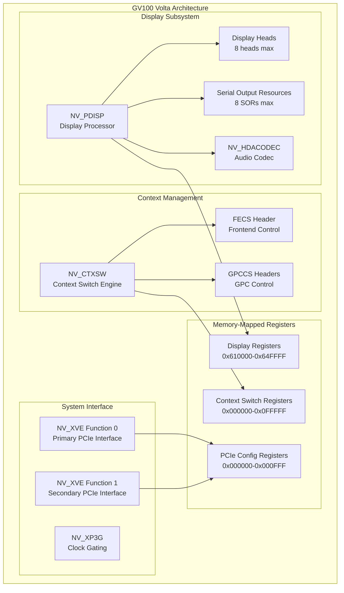
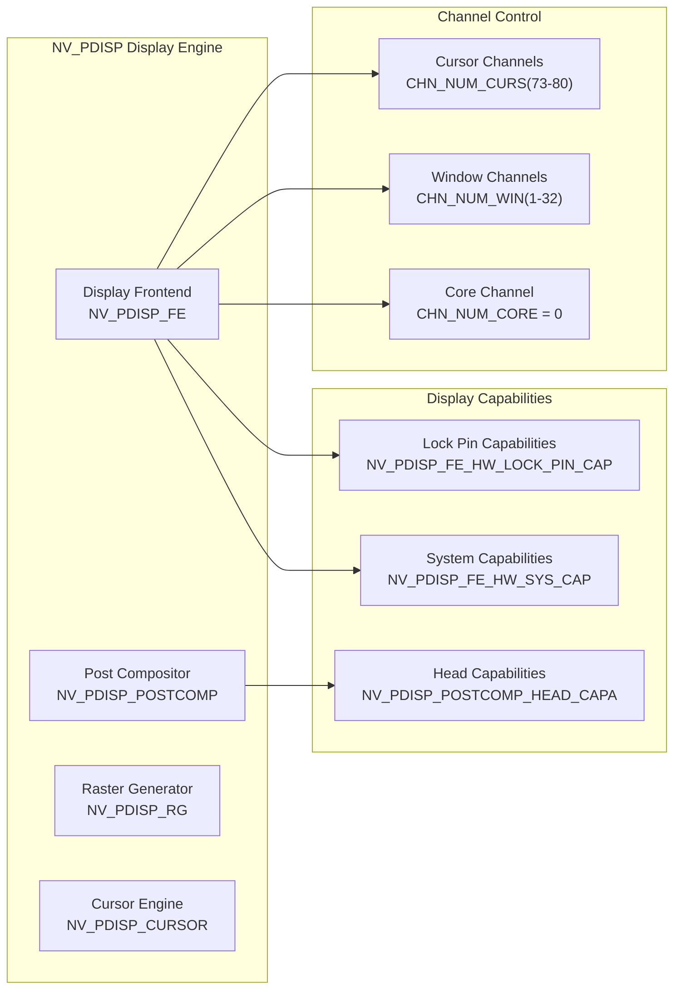
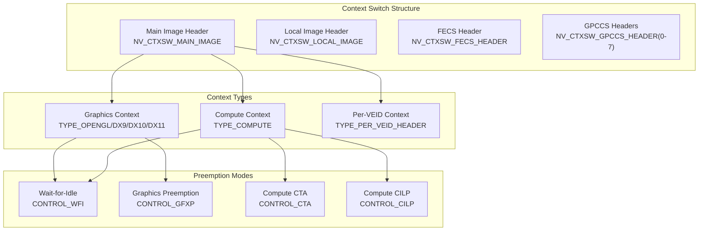
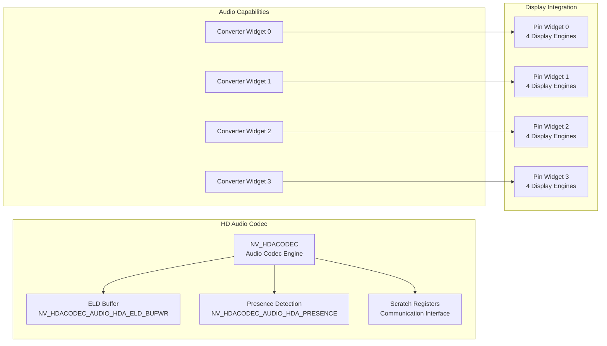
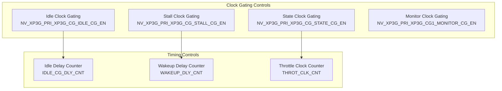

<!-- source: DeepWiki mcp.deepwiki.com · repo NVIDIA/open-gpu-doc · page 2.3 Volta Architecture · fetched 2026-10-26 -->

# Volta Architecture

Relevant source files

The following files were used as context for generating this wiki page:

- [manuals/volta/gv100/dev_ctxsw.ref.txt](manuals/volta/gv100/dev_ctxsw.ref.txt)
- [manuals/volta/gv100/dev_display_head.ref.txt](manuals/volta/gv100/dev_display_head.ref.txt)
- [manuals/volta/gv100/dev_display_withoffset.ref.txt](manuals/volta/gv100/dev_display_withoffset.ref.txt)
- [manuals/volta/gv100/dev_hdacodec.ref.txt](manuals/volta/gv100/dev_hdacodec.ref.txt)
- [manuals/volta/gv100/dev_nv_xp3g.ref.txt](manuals/volta/gv100/dev_nv_xp3g.ref.txt)
- [manuals/volta/gv100/dev_nv_xve3g_fn0.ref.txt](manuals/volta/gv100/dev_nv_xve3g_fn0.ref.txt)
- [manuals/volta/gv100/dev_nv_xve3g_fn1.ref.txt](manuals/volta/gv100/dev_nv_xve3g_fn1.ref.txt)
- [manuals/volta/gv100/index.html](manuals/volta/gv100/index.html)

## Purpose and Scope

This document covers the hardware specifications and register definitions for NVIDIA's Volta architecture GPUs, specifically the GV100 chip. It focuses on the low-level hardware interfaces, register mappings, and subsystem capabilities that enable display processing, context switching, and system integration.

For information about programming these hardware interfaces through software classes, see [Programming Interfaces](#3). For broader GPU command processing and system infrastructure that spans multiple architectures, see [System Components](#4).

## Architecture Overview

The Volta GV100 represents NVIDIA's compute-focused GPU architecture with enhanced display capabilities and advanced context switching mechanisms. The architecture is organized around several key hardware subsystems that are controlled through memory-mapped registers.

**Sources:** [manuals/volta/gv100/index.html:1-35](), [manuals/volta/gv100/dev_display_withoffset.ref.txt:22-31](), [manuals/volta/gv100/dev_ctxsw.ref.txt:22-25]()

## Display Processing Subsystem

The Volta display subsystem (`NV_PDISP`) provides comprehensive display output capabilities with support for multiple heads and output resources. The hardware supports up to 8 display heads and 8 Serial Output Resources (SORs) for driving various display interfaces.

### Display Engine Configuration

The display frontend provides hardware capability reporting through several registers:

- `NV_PDISP_FE_HW_SYS_CAP` - Reports which heads and SORs are present
- `NV_PDISP_FE_HW_SYS_CAPB` - Reports window channel availability  
- `NV_PDISP_FE_MISC_CONFIGA` - Provides head, SOR, and window counts

**Sources:** [manuals/volta/gv100/dev_display_withoffset.ref.txt:79-243](), [manuals/volta/gv100/dev_display_head.ref.txt:23-75]()

### Display Head Architecture

Each display head supports advanced post-processing capabilities including scaling, color space conversion, and look-up tables:

| Capability | Register | Description |
|------------|----------|-------------|
| Scaler | `NV_PDISP_POSTCOMP_HEAD_CAPA_SCALER` | Hardware scaling support |
| HSAT | `NV_PDISP_POSTCOMP_HEAD_CAPA_HSAT` | Hue/Saturation adjustment |
| OCSC | `NV_PDISP_POSTCOMP_HEAD_CAPA_OCSC` | Output color space conversion |
| LUT | `NV_PDISP_POSTCOMP_HEAD_CAPA_LUT_TYPE` | Look-up table type (257 or 1025 entries) |

**Sources:** [manuals/volta/gv100/dev_display_head.ref.txt:23-75]()

## Context Switching Engine

The Volta context switching subsystem (`NV_CTXSW`) manages GPU context state for graphics and compute workloads. It supports multiple preemption modes and maintains context data in structured memory buffers.

### Context Buffer Organization

The context switching engine organizes context data into several structured buffers:

- **Main Image**: Contains global context state and control information
- **Local Image**: Per-GPC context data with ramchain configurations  
- **Extended Buffers**: Additional context storage for complex workloads

Key registers for context control:

| Register | Purpose |
|----------|---------|
| `NV_CTXSW_MAIN_IMAGE_CTL` | Context type and magic value validation |
| `NV_CTXSW_MAIN_IMAGE_GRAPHICS_PREEMPTION_OPTIONS` | Graphics preemption control |
| `NV_CTXSW_MAIN_IMAGE_COMPUTE_PREEMPTION_OPTIONS` | Compute preemption control |
| `NV_CTXSW_LOCAL_IMAGE_CTL` | Local context configuration |

**Sources:** [manuals/volta/gv100/dev_ctxsw.ref.txt:23-174]()

## Audio Subsystem Integration

The Volta architecture includes integrated HD Audio codec support through the `NV_HDACODEC` subsystem, enabling HDMI audio output functionality.

The audio codec supports interrupt-driven communication and provides Enhanced Local Display (ELD) information for HDMI audio configuration.

**Sources:** [manuals/volta/gv100/dev_hdacodec.ref.txt:22-285]()

## PCIe Interface Architecture

Volta implements a dual-function PCIe interface supporting both primary graphics functionality and secondary audio/display functions through separate PCIe functions.

### PCIe Function Organization

| Function | Base Address | Purpose |
|----------|--------------|---------|
| Function 0 | `NV_XVE` | Primary GPU interface, memory BARs, MSI |
| Function 1 | `NV_XVE1` | Secondary interface, link control |

The primary function (`NV_XVE`) provides:
- Device identification (`NV_XVE_ID_DEVICE_CHIP_GV100 = 0x1D80`)
- Memory BAR configuration (`NV_XVE_BAR0`, `NV_XVE_BAR1`, `NV_XVE_BAR2`)
- Power management capabilities (`NV_XVE_PWR_MGMT`)
- MSI interrupt support (`NV_XVE_MSI_CTRL`)

**Sources:** [manuals/volta/gv100/dev_nv_xve3g_fn0.ref.txt:84-338](), [manuals/volta/gv100/dev_nv_xve3g_fn1.ref.txt:24-100]()

## Clock and Power Management

The `NV_XP3G` subsystem provides clock gating and power management controls for the Volta architecture:

Power management features include:
- Configurable clock gating delays
- Throttling controls for power reduction
- Monitor-based dynamic clock control

**Sources:** [manuals/volta/gv100/dev_nv_xp3g.ref.txt:22-74]()

## Register Address Space Organization

The Volta architecture organizes hardware registers into distinct address ranges for different subsystems:

| Address Range | Subsystem | Key Registers |
|---------------|-----------|---------------|
| `0x610000-0x615FFF` | Display Frontend | `NV_PDISP_FE_*` |
| `0x006100-0x006FFF` | Display Heads | `NV_PDISP_POSTCOMP_HEAD_*` |
| `0x000000-0x0FFFFF` | Context Switch | `NV_CTXSW_*` |
| `0x10EC00-0x10EDFF` | Audio Codec | `NV_HDACODEC_*` |
| `0x088000-0x088FFF` | PCIe Config | `NV_XVE_*` |
| `0x08E000-0x08E007` | Clock Gating | `NV_XP3G_*` |

This organization enables efficient subsystem access while maintaining hardware isolation between functional units.

**Sources:** [manuals/volta/gv100/index.html:1-35](), [manuals/volta/gv100/dev_display_withoffset.ref.txt:22-31](), [manuals/volta/gv100/dev_ctxsw.ref.txt:22-25]()

---

