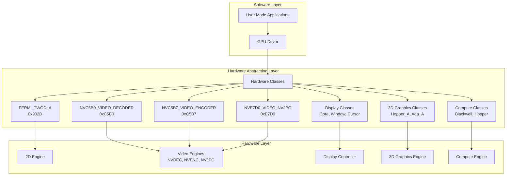
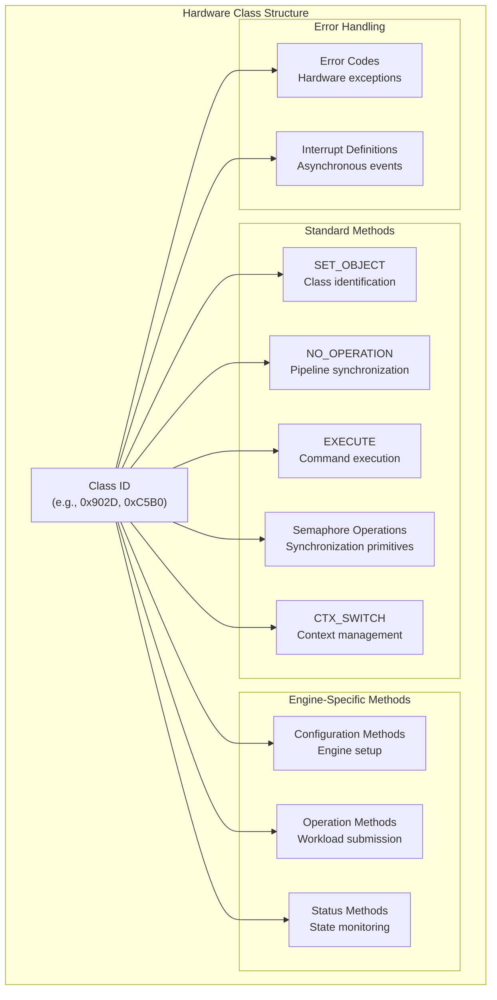
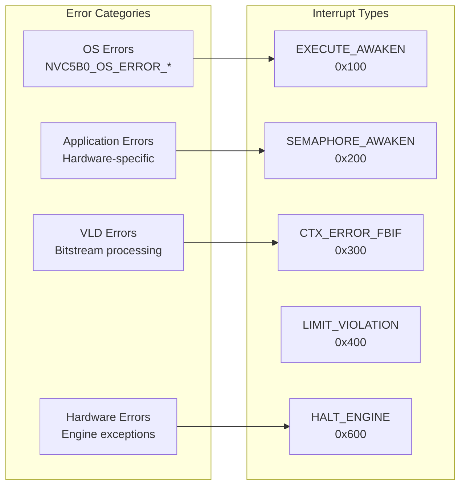

<!-- source: DeepWiki mcp.deepwiki.com · repo NVIDIA/open-gpu-doc · page 3 Programming Interfaces · fetched 2026-10-26 -->

# Programming Interfaces

Relevant source files

The following files were used as context for generating this wiki page:

- [classes/index.html](classes/index.html)
- [classes/twod/cl902d.h](classes/twod/cl902d.h)
- [classes/video/clc5b0.h](classes/video/clc5b0.h)
- [classes/video/clc5b7.h](classes/video/clc5b7.h)
- [classes/video/cle7d0.h](classes/video/cle7d0.h)
- [classes/video/index.html](classes/video/index.html)

This document provides an overview of the software programming interfaces for NVIDIA GPU hardware subsystems. These interfaces define the hardware abstraction layer that enables software to interact with GPU engines for graphics, compute, display, and video processing operations.

For detailed coverage of specific subsystem interfaces, see [3D Graphics System](#3.1), [Display System](#3.2), [Video Processing System](#3.3), and [Compute System](#3.4). For the underlying hardware architecture specifications, see [GPU Hardware Architecture](#2).

## Architecture Overview

The GPU programming interfaces are organized as a layered abstraction system where software interacts with hardware engines through standardized class interfaces. Each hardware engine exposes its functionality through a specific hardware class that defines methods, registers, and operational semantics.

### Interface Layer Architecture

Sources: [classes/index.html:1-14](), [classes/twod/cl902d.h:26-27](), [classes/video/clc5b0.h:31](), [classes/video/clc5b7.h:31](), [classes/video/cle7d0.h:31]()

## Hardware Class System

The programming interfaces are implemented through hardware classes that provide standardized method interfaces. Each class is identified by a unique class ID and defines a set of methods for controlling the associated hardware engine.

### Core Interface Categories

| Category | Description | Example Classes |
|----------|-------------|-----------------|
| **3D Graphics** | Rendering pipeline control | Hopper_A, Ada_A, Blackwell_A |
| **Display** | Output display management | Core, Window, Cursor channels |
| **Video Processing** | Encode/decode operations | NVC5B0 (decoder), NVC5B7 (encoder) |
| **2D Graphics** | Blitting and composition | FERMI_TWOD_A (0x902D) |
| **Compute** | GPGPU workload execution | Hopper, Blackwell compute classes |
| **Copy Engine** | Memory transfer operations | DMA copy classes |
| **Host Interface** | System interaction | Host configuration classes |

Sources: [classes/index.html:5-12]()

### Hardware Class Structure

Each hardware class follows a standardized structure with common method categories and register layouts:

Sources: [classes/twod/cl902d.h:230-249](), [classes/video/clc5b0.h:35-79](), [classes/video/clc5b7.h:35-105]()

## Common Interface Patterns

All hardware classes implement consistent patterns for basic operations, providing a uniform programming model across different GPU engines.

### Standard Method Interface

The following methods are present in virtually all hardware classes:

#### Object Management
- `SET_OBJECT`: Identifies the hardware class being used [classes/twod/cl902d.h:230-232]()
- `NO_OPERATION`: Provides pipeline synchronization points [classes/twod/cl902d.h:234-235]()

#### Execution Control  
- `EXECUTE`: Initiates command processing with notification options [classes/video/clc5b0.h:69-78]()
- `WAIT_FOR_IDLE`: Ensures engine completion [classes/twod/cl902d.h:248-249]()

#### Synchronization Primitives
- `SEMAPHORE_A/B/C/D`: Memory-based synchronization [classes/video/clc5b7.h:53-127]()
- Configurable notification and awakening mechanisms

#### Context Management
- `CTX_SWITCH`: Context save/restore operations [classes/video/clc5b0.h:57-68]()
- `CTX_SAVE_AREA`: Context storage location [classes/video/clc5b7.h:65-71]()

### Error and Interrupt Handling

Each interface defines comprehensive error reporting:

Sources: [classes/video/clc5b0.h:242-258](), [classes/video/clc5b7.h:464-481](), [classes/video/cle7d0.h:103-125]()

## Method Register Layout

Hardware class methods follow a consistent register addressing scheme with standardized field definitions:

### Address Space Organization
- **0x0000-0x00FF**: Object and control methods
- **0x0100-0x02FF**: Standard interface methods  
- **0x0300-0x03FF**: Execution and synchronization
- **0x0400+**: Engine-specific method ranges

### Field Encoding Patterns
- Bit field definitions use consistent naming: `METHOD_FIELD_NAME_BITRANGE`
- Address offsets specified as `METHOD_NAME (0xOffset)`
- Enumerated values follow `METHOD_NAME_VALUE` convention

Sources: [classes/twod/cl902d.h:230-300](), [classes/video/clc5b0.h:35-130]()

The programming interfaces provide a comprehensive abstraction layer that enables consistent software interaction with diverse GPU hardware engines while maintaining the flexibility needed for engine-specific optimizations and capabilities.

---

