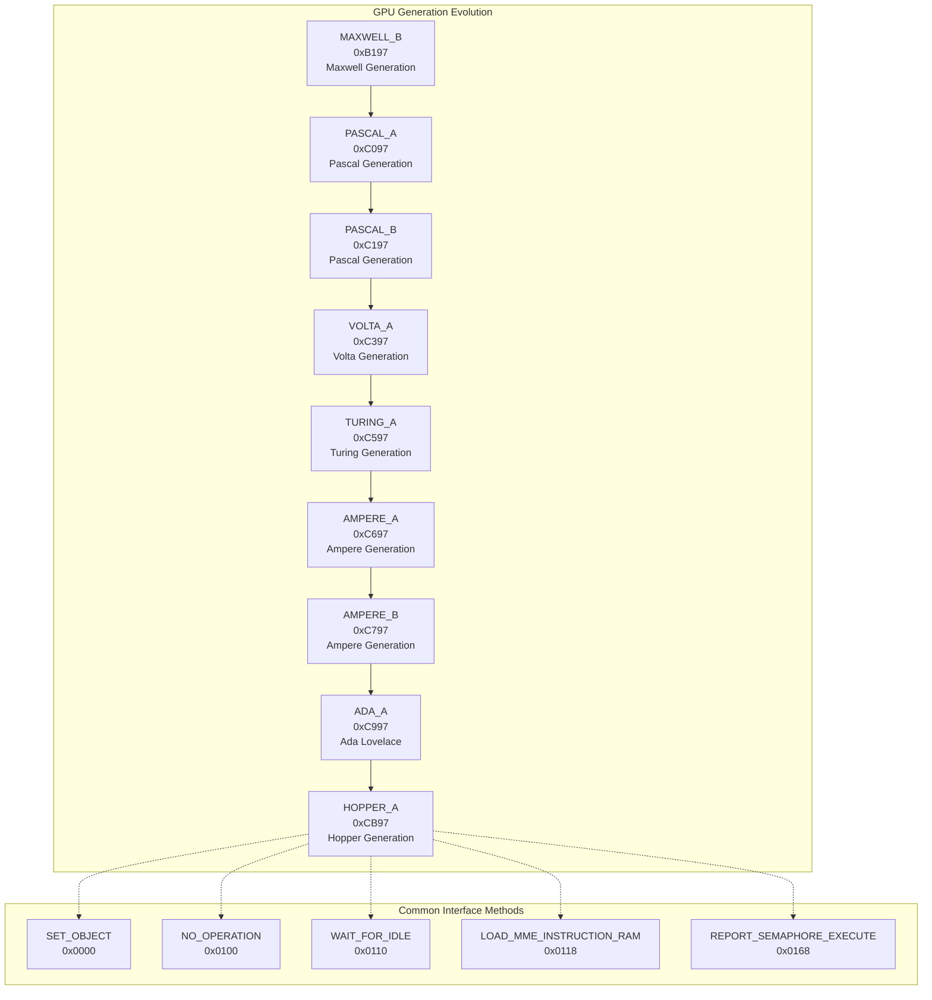
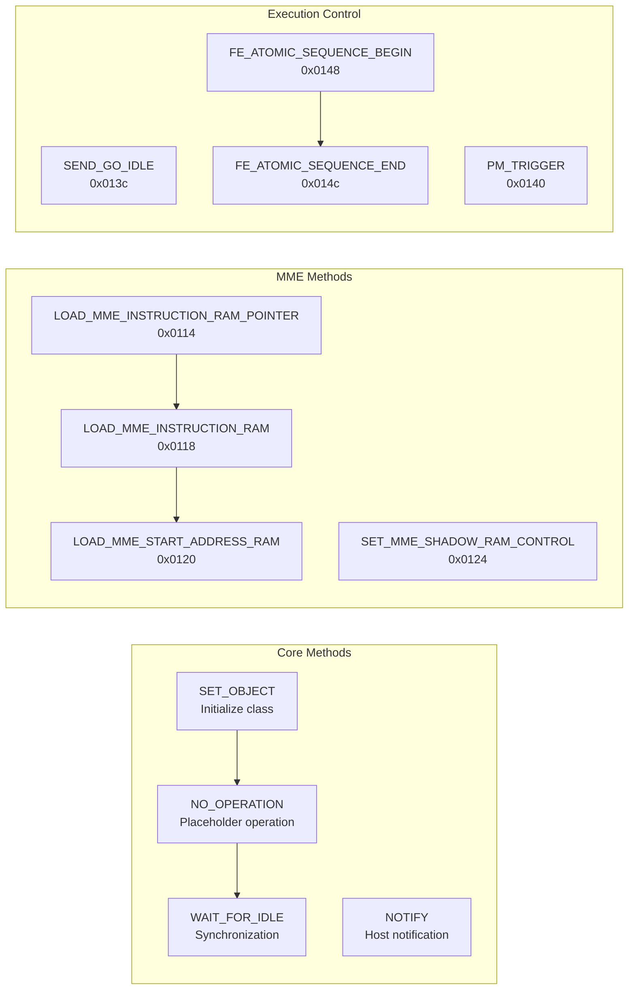

<!-- source: DeepWiki mcp.deepwiki.com · repo NVIDIA/open-gpu-doc · page 3.1 3D Graphics System · fetched 2026-10-26 -->

# 3D Graphics System

Relevant source files

The following files were used as context for generating this wiki page:

- [classes/3d/cla097sph.h](classes/3d/cla097sph.h)
- [classes/3d/clb197.h](classes/3d/clb197.h)
- [classes/3d/clc097.h](classes/3d/clc097.h)
- [classes/3d/clc197.h](classes/3d/clc197.h)
- [classes/3d/clc397.h](classes/3d/clc397.h)
- [classes/3d/clc597.h](classes/3d/clc597.h)
- [classes/3d/clc697.h](classes/3d/clc697.h)
- [classes/3d/clc797.h](classes/3d/clc797.h)
- [classes/3d/clc797sph.h](classes/3d/clc797sph.h)
- [classes/3d/clc997.h](classes/3d/clc997.h)
- [classes/3d/clcb97.h](classes/3d/clcb97.h)
- [classes/3d/clcb97sph.h](classes/3d/clcb97sph.h)

This document covers the hardware programming interfaces for NVIDIA GPU 3D graphics engines across multiple GPU architectures. The 3D graphics system provides the low-level hardware abstraction layer for GPU rendering operations, including vertex processing, geometry shading, pixel shading, and render output operations.

The material covers hardware class definitions, register interfaces, and shader program structures for 3D graphics workloads. For compute-specific programming interfaces, see [Compute System](#3.4). For display output control, see [Display System](#3.2).

## Architecture Overview

The 3D graphics system spans multiple GPU generations, each with its own hardware class identifier and feature set. The system provides a consistent programming model while exposing generation-specific capabilities and optimizations.

Sources: [classes/3d/clb197.h:32](), [classes/3d/clc097.h:32](), [classes/3d/clc197.h:32](), [classes/3d/clc397.h:32](), [classes/3d/clc597.h:32](), [classes/3d/clc697.h:32](), [classes/3d/clc797.h:32](), [classes/3d/clc997.h:32](), [classes/3d/clcb97.h:32]()

## Hardware Class Interface

Each GPU generation implements a hardware class with a unique identifier and a common set of method interfaces. The class interface provides register-level access to 3D graphics hardware functionality.

| Architecture | Class Name | Class ID | Key Features |
|--------------|------------|----------|--------------|
| Maxwell B | `MAXWELL_B` | `0xB197` | Basic 3D pipeline |
| Pascal A | `PASCAL_A` | `0xC097` | Enhanced memory |
| Pascal B | `PASCAL_B` | `0xC197` | Improved geometry |
| Volta A | `VOLTA_A` | `0xC397` | Tensor operations |
| Turing A | `TURING_A` | `0xC597` | RT cores |
| Ampere A | `AMPERE_A` | `0xC697` | Enhanced RT/AI |
| Ampere B | `AMPERE_B` | `0xC797` | Optimized Ampere |
| Ada Lovelace | `ADA_A` | `0xC997` | Advanced RT |
| Hopper | `HOPPER_A` | `0xCB97` | Compute focus |

The base interface methods are consistent across architectures:

Sources: [classes/3d/clcb97.h:34-106](), [classes/3d/clc997.h:34-106](), [classes/3d/clc597.h:34-107]()

## Macro Method Execution (MME)

The MME system allows loading and execution of custom GPU programs to accelerate common graphics operations. All modern architectures support MME with consistent programming interfaces.

The MME control methods include:
- `LOAD_MME_INSTRUCTION_RAM_POINTER` - Set instruction pointer
- `LOAD_MME_INSTRUCTION_RAM` - Load instruction data  
- `LOAD_MME_START_ADDRESS_RAM_POINTER` - Set start address pointer
- `LOAD_MME_START_ADDRESS_RAM` - Load start address
- `SET_MME_SHADOW_RAM_CONTROL` - Configure shadow RAM behavior

MME shadow RAM control modes:
- `METHOD_TRACK` (0x0) - Track method calls
- `METHOD_TRACK_WITH_FILTER` (0x1) - Track with filtering
- `METHOD_PASSTHROUGH` (0x2) - Direct passthrough
- `METHOD_REPLAY` (0x3) - Replay recorded methods

Sources: [classes/3d/clcb97.h:55-72](), [classes/3d/clc997.h:55-72](), [classes/3d/clc597.h:55-72]()

## Shader Program Headers

Shader programs require metadata headers that describe their input/output interfaces, resource requirements, and execution characteristics. The system supports multiple shader program header versions.

```mermaid
graph TB
    subgraph "Shader Types"
        VERTEX["VERTEX<br/>0x1<br/>Vertex processing"]
        TESS_INIT["TESSELLATION_INIT<br/>0x2<br/>Tessellation control"]
        TESSELLATION["TESSELLATION<br/>0x3<br/>Tessellation evaluation"]
        GEOMETRY["GEOMETRY<br/>0x4<br/>Geometry processing"]
        PIXEL["PIXEL<br/>0x5<br/>Fragment/pixel processing"]
    end
    
    subgraph "Header Components"
        SPH_TYPE["SPH_TYPE<br/>Header type identifier"]
        VERSION["VERSION<br/>Header format version"]
        SHADER_TYPE["SHADER_TYPE<br/>Shader stage type"]
        LOCAL_MEM["SHADER_LOCAL_MEMORY_SIZE<br/>Memory requirements"]
        IMAP["Input attribute mapping"]
        OMAP["Output attribute mapping"]
    end
    
    subgraph "Pipeline Flow"
        VERTEX --> TESS_INIT
        TESS_INIT --> TESSELLATION
        TESSELLATION --> GEOMETRY
        GEOMETRY --> PIXEL
    end
    
    SPH_TYPE --> VERSION
    VERSION --> SHADER_TYPE
    SHADER_TYPE --> LOCAL_MEM
    LOCAL_MEM --> IMAP
    IMAP --> OMAP
```

### Shader Program Header V4T1

The latest shader header format (`SPHV4T1`) provides comprehensive shader metadata:

Key fields include:
- `SPH_TYPE` - Header type (VTG=0x1, PS=0x2)
- `VERSION` - Format version 
- `SHADER_TYPE` - Pipeline stage identifier
- `SHADER_LOCAL_MEMORY_LOW_SIZE` / `SHADER_LOCAL_MEMORY_HIGH_SIZE` - Memory requirements
- `GENERIC_IMAP_X/Y/Z/W` - Generic attribute input mapping
- `GENERIC_OMAP_X/Y/Z/W` - Generic attribute output mapping

Sources: [classes/3d/clc797sph.h:32-105](), [classes/3d/clcb97sph.h:32-105]()

## Pipeline Control and Execution

The 3D graphics pipeline requires precise control over execution flow, synchronization, and resource management.

```mermaid
graph TB
    subgraph "Execution Control"
        GLOBAL_RENDER["SET_GLOBAL_RENDER_ENABLE<br/>Global rendering control"]
        RUN_DS["RUN_DS_NOW<br/>0x0200<br/>Execute vertex fetch"]
        EARLY_Z["SET_OPPORTUNISTIC_EARLY_Z_HYSTERESIS<br/>Early-Z optimization"]
        INVALIDATE["INVALIDATE_SHADER_CACHES<br/>Cache management"]
    end
    
    subgraph "Synchronization"
        WAIT_IDLE["WAIT_FOR_IDLE<br/>Pipeline synchronization"]
        GO_IDLE["SEND_GO_IDLE<br/>Request idle state"]
        PM_TRIGGER["PM_TRIGGER<br/>Performance monitoring"]
        ATOMIC_SEQ["Atomic sequence control"]
    end
    
    subgraph "Reporting"
        REPORT_SEM["REPORT_SEMAPHORE_EXECUTE<br/>Pipeline reporting"]
        TIMESTAMP["TIMESTAMP reports"]
        PIXEL_COUNT["Pixel count reports"]
        SHADER_STATS["Shader invocation stats"]
    end
    
    GLOBAL_RENDER --> RUN_DS
    RUN_DS --> EARLY_Z
    EARLY_Z --> INVALIDATE
    
    WAIT_IDLE --> GO_IDLE
    GO_IDLE --> PM_TRIGGER
    
    REPORT_SEM --> TIMESTAMP
    REPORT_SEM --> PIXEL_COUNT
    REPORT_SEM --> SHADER_STATS
```

### Pipeline Reporting

The `REPORT_SEMAPHORE_EXECUTE` method provides comprehensive pipeline statistics:

Report types include:
- `DA_VERTICES_GENERATED` - Data assembler vertex count
- `VS_INVOCATIONS` - Vertex shader invocations
- `GS_INVOCATIONS` - Geometry shader invocations  
- `PS_INVOCATIONS` - Pixel shader invocations
- `ZPASS_PIXEL_CNT` - Z-test passed pixels
- `TIMESTAMP` - Pipeline timestamps

Pipeline locations for reporting:
- `DATA_ASSEMBLER` (0x1)
- `VERTEX_SHADER` (0x2) 
- `GEOMETRY_SHADER` (0x6)
- `PIXEL_SHADER` (0xA)
- `DEPTH_TEST` (0xC)

Sources: [classes/3d/clcb97.h:127-214](), [classes/3d/clc997.h:127-214](), [classes/3d/clc597.h:278-395]()

## Memory and DMA Operations

The 3D graphics system provides integrated DMA capabilities for efficient data movement and processing.

### DMA Configuration

DMA operations support multiple memory layouts and completion modes:

Memory layouts:
- `BLOCKLINEAR` (0x0) - GPU-optimized tiled layout
- `PITCH` (0x1) - Linear pitch layout

Completion types:
- `FLUSH_DISABLE` (0x0) - No cache flushing
- `FLUSH_ONLY` (0x1) - Cache flush only
- `RELEASE_SEMAPHORE` (0x2) - Semaphore release

The `LAUNCH_DMA` method controls DMA execution with options for:
- Reduction operations (ADD, MIN, MAX, INC, DEC, AND, OR, XOR)
- Interrupt generation
- System memory barriers
- Semaphore structure sizes

### Inline Data Loading

The `LOAD_INLINE_DATA` method allows direct data injection into the GPU pipeline without separate DMA operations, useful for small constant uploads and immediate-mode rendering.

Sources: [classes/3d/clcb97.h:267-301](), [classes/3d/clc997.h:267-301](), [classes/3d/clc597.h:166-200]()

---

