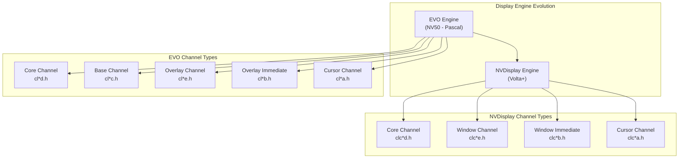
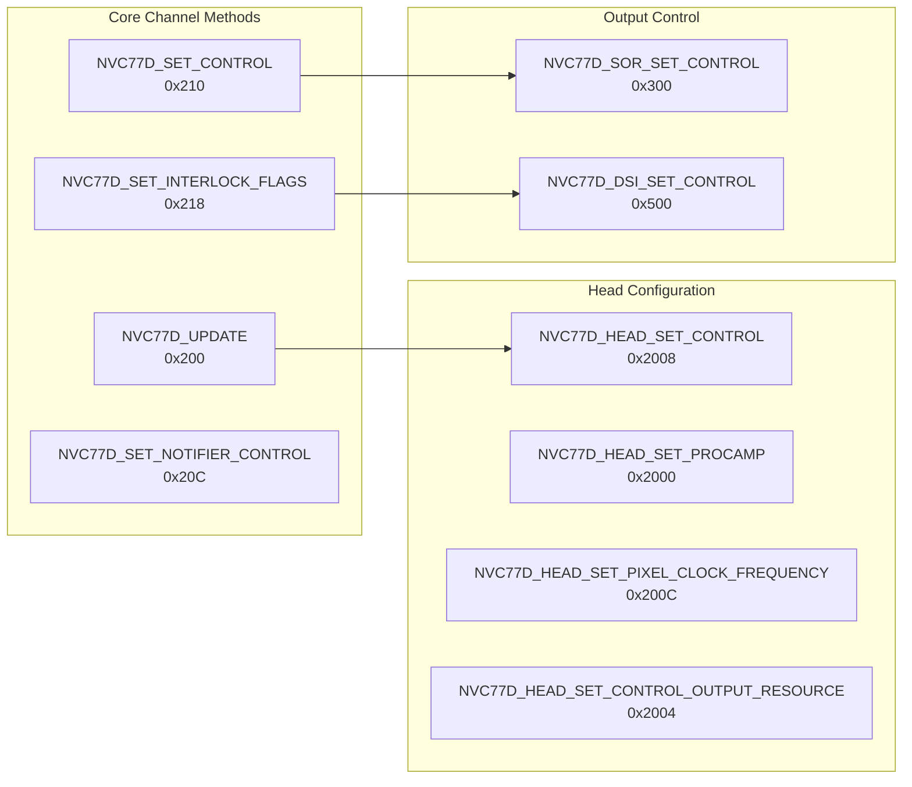
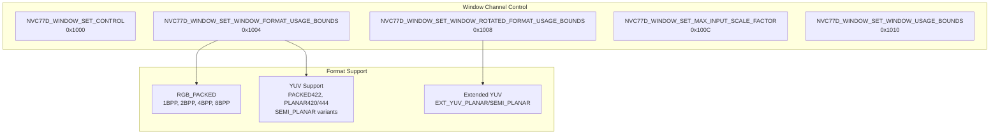
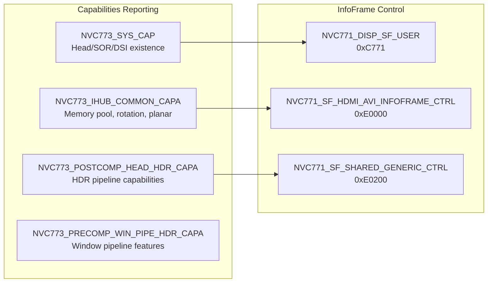
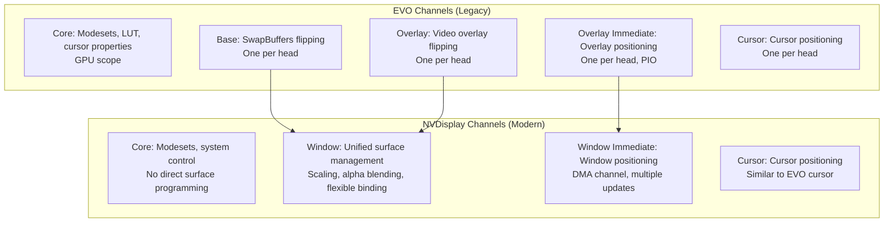
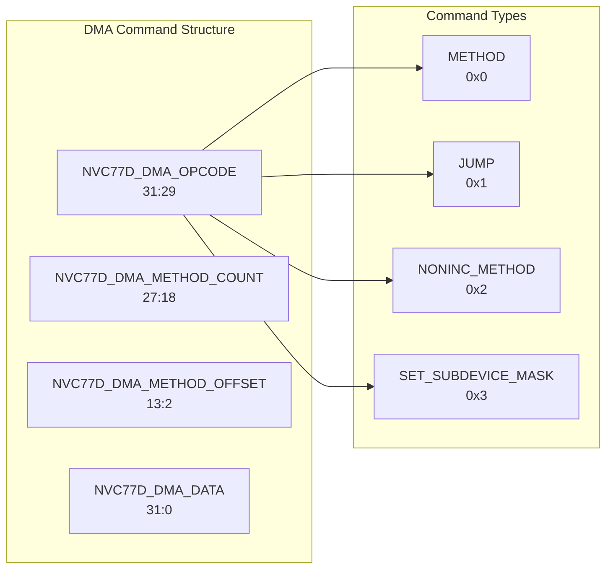
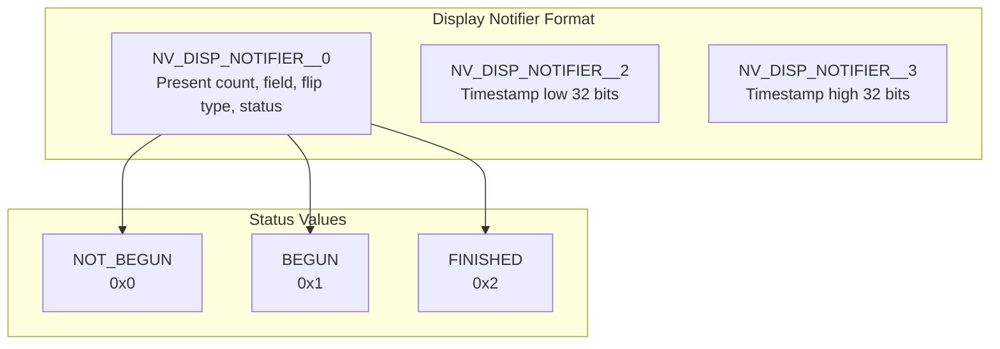

<!-- source: DeepWiki mcp.deepwiki.com · repo NVIDIA/open-gpu-doc · page 3.2 Display System · fetched 2026-10-26 -->

# Display System

Relevant source files

The following files were used as context for generating this wiki page:

- [classes/display/README.txt](classes/display/README.txt)
- [classes/display/clc771.h](classes/display/clc771.h)
- [classes/display/clc773.h](classes/display/clc773.h)
- [classes/display/clc77d.h](classes/display/clc77d.h)
- [classes/display/index.html](classes/display/index.html)

The Display System provides hardware programming interfaces for GPU display output functionality across multiple NVIDIA GPU generations. This documentation covers the channel-based display architecture, hardware abstraction layers, and programming interfaces from the legacy EVO engine through the modern NVDisplay engine.

For information about 3D graphics rendering, see [3D Graphics System](#3.1). For video processing capabilities, see [Video Processing System](#3.3).

## Display Engine Architecture

The NVIDIA display subsystem has evolved through two major architectures:

### EVO Display Engine (Legacy)
The EVO engine was introduced with NV50 and incrementally updated across GPU generations. It provides a channel-based architecture where each channel serves a specific display function.

### NVDisplay Engine (Modern)
NVDisplay was introduced with Volta as a major architectural improvement over EVO, offering more flexible channel usage and enhanced capabilities including scaling, alpha blending, and improved window management.

Sources: [classes/display/README.txt:1-50]()

## Channel Architecture and Programming Interface

### Core Channel Interface
The core channel handles display controller configuration, mode setting, and system-wide display state management. In NVDisplay, it does not support direct surface programming as a base layer.

Sources: [classes/display/clc77d.h:76-332]()

### Window Channel Interface
Window channels in NVDisplay replace the separate base and overlay channels from EVO, providing unified surface management with enhanced capabilities.

Sources: [classes/display/clc77d.h:351-488]()

## Hardware Capabilities and InfoFrame Control

### Display Capabilities Interface
The capabilities interface provides runtime discovery of display hardware features and limitations across different GPU generations.

### InfoFrame and Serial Frontend Control
The `DISP_SF_USER` class provides direct access to Serial Frontend registers for HDMI InfoFrame programming and signaling control.

Sources: [classes/display/clc773.h:38-667](), [classes/display/clc771.h:31-257]()

## GPU Generation and Class Mapping

The display system supports a wide range of GPU generations, each with specific software class numbers and channel implementations:

| Class Name | Software Class | GPU Generation | Core Channel | Window/Base Channel | Cursor Channel |
|------------|----------------|----------------|--------------|-------------------|----------------|
| DISP010X | 5070 | nv50 | `cl507d.h` | `cl507c.h` | `cl507a.h` |
| DISP021X | 9170 | gk104, gk106, gk107 | `cl917d.h` | `cl917c.h` | `cl917a.h` |
| NVD_20 | C370 | gv100 | `clc37d.h` | `clc37e.h` | `clc37a.h` |
| NVD_30 | C570 | tu102, tu104, tu106 | `clc57d.h` | `clc57e.h` | `clc57a.h` |
| NVD_40 | C670/C770 | ga102, ad102+ | `clc67d.h`/`clc77d.h` | `clc67e.h` | `clc67a.h` |

### Channel Type Evolution

Sources: [classes/display/README.txt:63-243]()

## DMA Command Interface

The display channels use a standardized DMA command format for method submission:

The display notifier structure provides completion status and timestamp information:

Sources: [classes/display/clc77d.h:57-70](), [classes/display/clc77d.h:34-55]()

---

