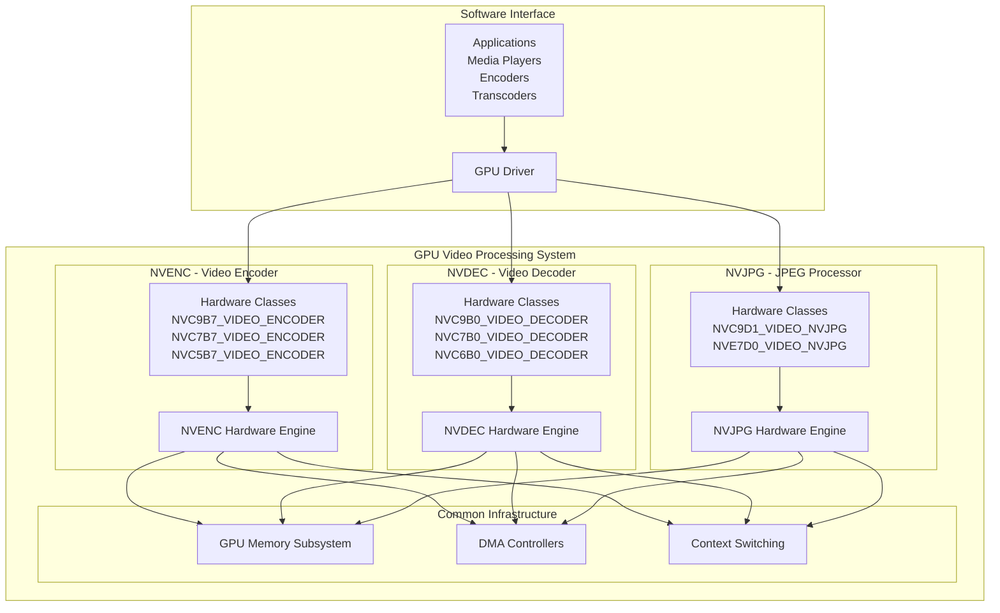
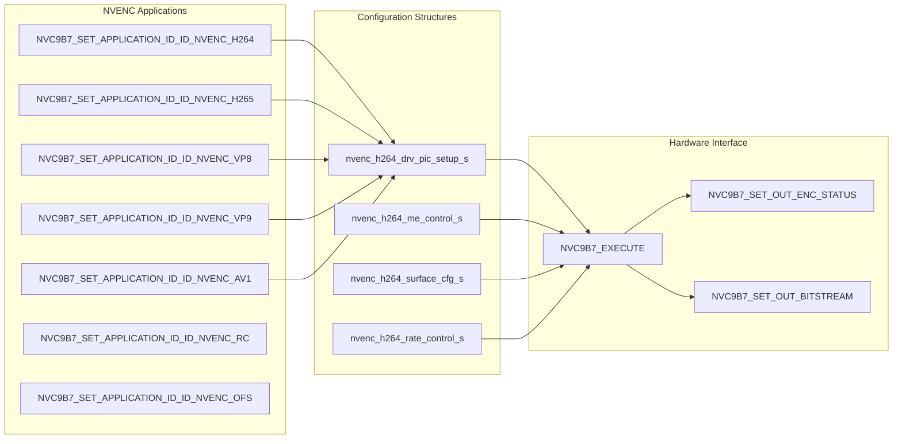
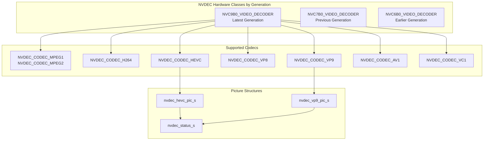
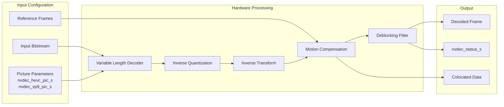
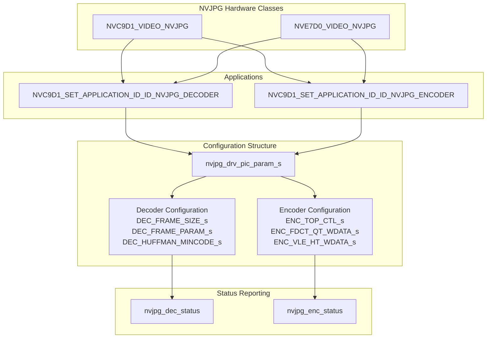
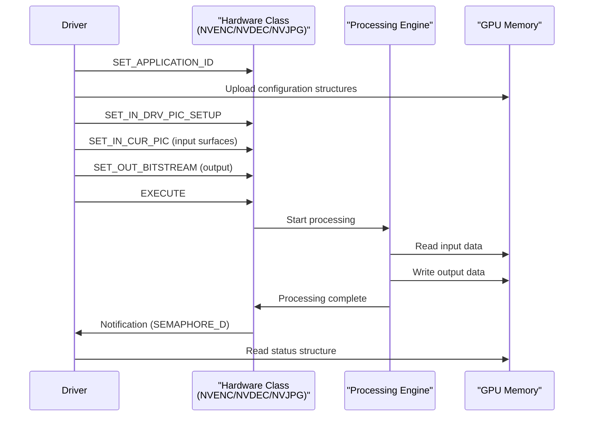

<!-- source: DeepWiki mcp.deepwiki.com · repo NVIDIA/open-gpu-doc · page 3.3 Video Processing System · fetched 2026-10-26 -->

# Video Processing System

Relevant source files

The following files were used as context for generating this wiki page:

- [classes/index.html](classes/index.html)
- [classes/twod/cl902d.h](classes/twod/cl902d.h)
- [classes/video/clc5b0.h](classes/video/clc5b0.h)
- [classes/video/clc5b7.h](classes/video/clc5b7.h)
- [classes/video/clc6b0.h](classes/video/clc6b0.h)
- [classes/video/clc7b0.h](classes/video/clc7b0.h)
- [classes/video/clc7b7.h](classes/video/clc7b7.h)
- [classes/video/clc9b0.h](classes/video/clc9b0.h)
- [classes/video/clc9b7.h](classes/video/clc9b7.h)
- [classes/video/clc9d1.h](classes/video/clc9d1.h)
- [classes/video/cle7d0.h](classes/video/cle7d0.h)
- [classes/video/index.html](classes/video/index.html)
- [classes/video/nvdec_drv.h](classes/video/nvdec_drv.h)
- [classes/video/nvenc_drv.h](classes/video/nvenc_drv.h)
- [classes/video/nvjpg_drv.h](classes/video/nvjpg_drv.h)

## Purpose and Scope

This document covers the video processing hardware subsystems in NVIDIA GPUs, including video encoding (NVENC), video decoding (NVDEC), and JPEG processing (NVJPG). These subsystems provide dedicated hardware acceleration for multimedia applications through well-defined programming interfaces and configuration structures.

The video processing system operates independently from the main 3D graphics pipeline and provides specialized engines for different video codecs and image formats. For information about 3D graphics processing, see [3D Graphics System](#3.1). For display output functionality, see [Display System](#3.2).

## System Architecture Overview

The video processing system consists of three primary hardware engines, each with its own hardware class interface and configuration mechanisms:

Sources: [classes/video/clc9b7.h:33](), [classes/video/clc9b0.h:33](), [classes/video/clc9d1.h:33](), [classes/video/nvenc_drv.h:27](), [classes/video/nvdec_drv.h:24](), [classes/video/nvjpg_drv.h:24]()

## NVENC Video Encoder Subsystem

NVENC provides hardware-accelerated video encoding with support for multiple codecs and advanced encoding features including motion estimation, rate control, and multi-pass encoding.

### Supported Codecs and Applications

Sources: [classes/video/clc9b7.h:43-49](), [classes/video/nvenc_drv.h:102-370](), [classes/video/clc9b7.h:62-78]()

### NVENC Picture Setup and Configuration

The `nvenc_h264_drv_pic_setup_s` structure serves as the main configuration interface, containing sequence parameters, picture parameters, motion estimation settings, and rate control configuration.

| Configuration Area | Key Structures | Purpose |
|-------------------|----------------|---------|
| Sequence Parameters | `nvenc_h264_sps_data_s` | Profile, level, frame format |
| Picture Parameters | `nvenc_h264_pps_data_s` | QP settings, entropy coding mode |
| Motion Estimation | `nvenc_h264_me_control_s` | Search patterns, hint processing |
| Rate Control | `nvenc_h264_rate_control_s` | Bitrate targets, QP ranges |
| Surface Configuration | `nvenc_h264_surface_cfg_s` | Input format, memory layout |

Sources: [classes/video/nvenc_drv.h:147-179](), [classes/video/nvenc_drv.h:294-370](), [classes/video/nvenc_drv.h:125-145]()

## NVDEC Video Decoder Subsystem

NVDEC provides hardware-accelerated video decoding with support for modern video codecs, error concealment, and secure content processing capabilities.

### Codec Support and Hardware Classes

Sources: [classes/video/nvdec_drv.h:43-54](), [classes/video/clc9b0.h:136-146](), [classes/video/nvdec_drv.h:353-487](), [classes/video/nvdec_drv.h:579-731]()

### NVDEC Configuration and Data Flow

The NVDEC subsystem uses codec-specific picture structures to configure decoding parameters, with separate structures for each supported codec format.

Sources: [classes/video/nvdec_drv.h:30-37](), [classes/video/nvdec_drv.h:254-267](), [classes/video/clc9b0.h:164-185]()

## NVJPG JPEG Processing Subsystem

NVJPG provides dedicated hardware for JPEG encoding and decoding operations, supporting both baseline sequential and progressive JPEG formats.

### NVJPG Hardware Classes and Applications

Sources: [classes/video/clc9d1.h:41-42](), [classes/video/nvjpg_drv.h:35-90](), [classes/video/nvjpg_drv.h:183-230](), [classes/video/nvjpg_drv.h:232-250]()

### NVJPG Picture Parameter Structure

The `nvjpg_drv_pic_param_s` structure contains separate configuration sections for encoding and decoding operations, with shared PDMA and SDMA configuration for picture data management.

| Section | Components | Purpose |
|---------|------------|---------|
| Encoder Config | `ENC_TOP_CTL_s`, `ENC_FDCT_QT_WDATA_s`, `ENC_VLE_HT_WDATA_s` | Chroma format, quantization tables, Huffman tables |
| PDMA Config | `PDMA_PIC_INFO_s`, `PDMA_PIC_INFO1_s` | Picture dimensions, memory layout, tiling mode |
| SDMA Config | Bitstream offset and size | Input/output bitstream management |
| Decoder Config | `DEC_FRAME_SIZE_s`, `DEC_FRAME_PARAM_s`, `DEC_HUFFMAN_MINCODE_s` | Frame parameters, component info, Huffman decode tables |

Sources: [classes/video/nvjpg_drv.h:183-230](), [classes/video/nvjpg_drv.h:92-139](), [classes/video/nvjpg_drv.h:152-181]()

## Hardware Interface Methods and Execution

All video processing engines share common hardware interface patterns for command submission, execution control, and status reporting.

### Common Hardware Interface Pattern

Sources: [classes/video/clc9b7.h:62-78](), [classes/video/clc9b0.h:90-105](), [classes/video/clc9d1.h:67-76]()

### Context Switching and Multi-Application Support

The video processing engines support context switching to enable multiple applications to share the hardware resources efficiently.

| Context Switch Operation | Register/Field | Purpose |
|-------------------------|----------------|---------|
| Context Save | `CTX_SAVE_AREA`, `CTX_SWITCH_OP_CTX_SAVE` | Save current context state |
| Context Restore | `CTX_SWITCH_OP_CTX_RESTORE` | Restore previous context |
| Context Update | `CTX_SWITCH_OP_CTX_UPDATE` | Update context without switch |
| Force Restore | `CTX_SWITCH_OP_CTX_FORCERESTORE` | Force context restoration |

Sources: [classes/video/clc9b0.h:68-75](), [classes/video/clc9d1.h:51-62](), [classes/video/clc7b0.h:68-75]()

---

