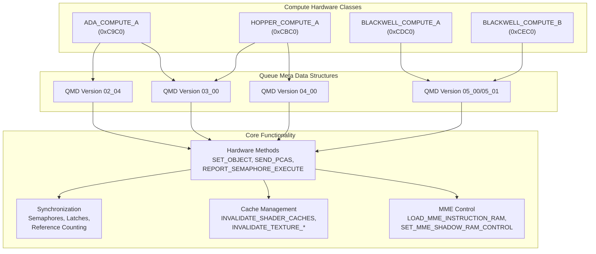
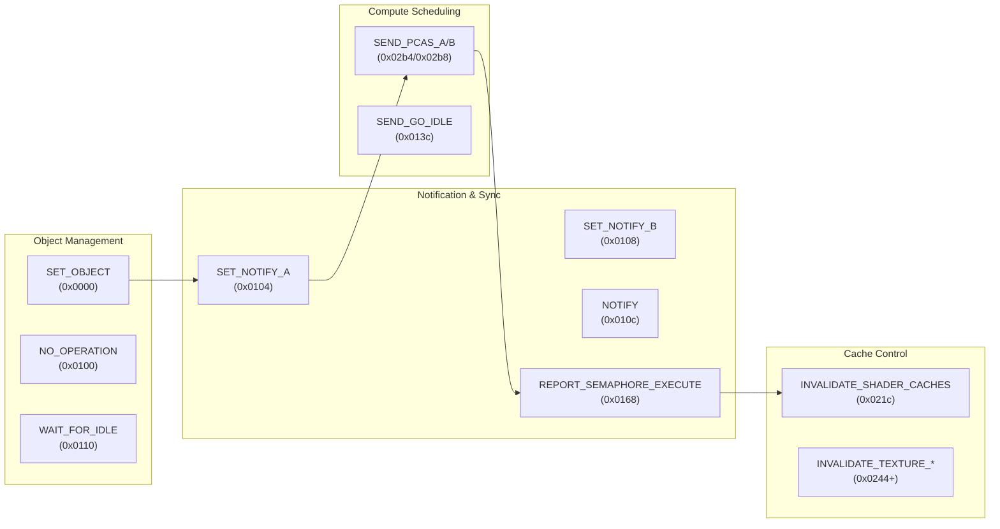
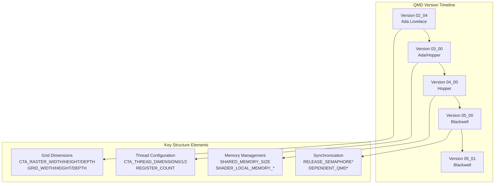
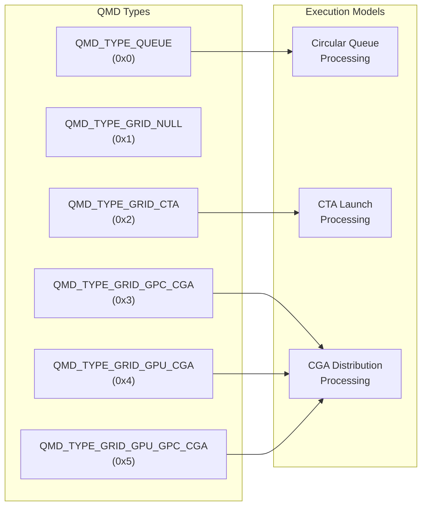
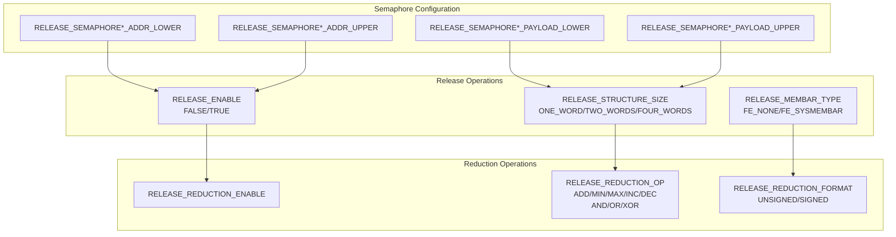
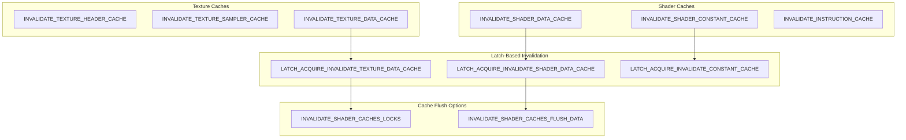

<!-- source: DeepWiki mcp.deepwiki.com · repo NVIDIA/open-gpu-doc · page 3.4 Compute System · fetched 2026-10-26 -->

# Compute System

Relevant source files

The following files were used as context for generating this wiki page:

- [classes/compute/clc9c0.h](classes/compute/clc9c0.h)
- [classes/compute/clc9c0qmd.h](classes/compute/clc9c0qmd.h)
- [classes/compute/clcbc0.h](classes/compute/clcbc0.h)
- [classes/compute/clcbc0qmd.h](classes/compute/clcbc0qmd.h)
- [classes/compute/clcdc0.h](classes/compute/clcdc0.h)
- [classes/compute/clcdc0qmd.h](classes/compute/clcdc0qmd.h)
- [classes/compute/clcec0.h](classes/compute/clcec0.h)
- [classes/compute/clcec0qmd.h](classes/compute/clcec0qmd.h)

This document covers the GPU compute system interfaces and programming structures for NVIDIA GPUs. The compute system enables execution of general-purpose parallel workloads through specialized hardware classes, Queue Meta Data (QMD) structures, and synchronization mechanisms. For 3D graphics programming interfaces, see [3D Graphics System](#3.1). For display-related compute operations, see [Display System](#3.2).

## Architecture Overview

The compute system consists of hardware classes that provide programming interfaces to the GPU's compute engines, along with Queue Meta Data structures that describe compute workloads and their execution parameters.

Sources: [classes/compute/clcdc0.h:29](), [classes/compute/clcec0.h:29](), [classes/compute/clc9c0.h:32](), [classes/compute/clcbc0.h:32]()

## Compute Hardware Classes

### Class Hierarchy and Identifiers

The compute system defines hardware classes for different GPU generations, each with specific class identifiers and method sets:

| Architecture | Class Name | Class ID | Header File |
|--------------|------------|----------|-------------|
| Blackwell | `BLACKWELL_COMPUTE_A` | 0xCDC0 | [clcdc0.h]() |
| Blackwell | `BLACKWELL_COMPUTE_B` | 0xCEC0 | [clcec0.h]() |
| Ada Lovelace | `ADA_COMPUTE_A` | 0xC9C0 | [clc9c0.h]() |
| Hopper | `HOPPER_COMPUTE_A` | 0xCBC0 | [clcbc0.h]() |

### Core Hardware Methods

All compute classes share a common set of fundamental methods for basic operations:

Sources: [classes/compute/clcdc0.h:31-49](), [classes/compute/clcec0.h:31-49](), [classes/compute/clc9c0.h:34-52](), [classes/compute/clcbc0.h:34-52]()

### PCAS (Pre-Computed Architecture Scheduling)

The `SEND_PCAS` methods initiate compute workload execution by providing Queue Meta Data addresses:

- `SEND_PCAS_A` ([classes/compute/clcdc0.h:363]()): Contains QMD address shifted by 8 bits
- `SEND_PCAS_B` ([classes/compute/clcdc0.h:366]()): Contains source range and delta parameters

Sources: [classes/compute/clcdc0.h:363-368](), [classes/compute/clcec0.h:363-368]()

## Queue Meta Data (QMD) Structures

### QMD Version Evolution

Queue Meta Data structures define compute workload parameters and have evolved across GPU generations:

Sources: [classes/compute/clc9c0qmd.h:30](), [classes/compute/clcbc0qmd.h:30](), [classes/compute/clcdc0qmd.h:28]()

### QMD Structure Layout

The QMD structures contain multiple categories of fields:

| Field Category | Purpose | Example Fields |
|----------------|---------|----------------|
| Grid Configuration | Define compute grid dimensions | `GRID_WIDTH`, `GRID_HEIGHT`, `GRID_DEPTH` |
| Thread Configuration | Set thread block parameters | `CTA_THREAD_DIMENSION0/1/2`, `REGISTER_COUNT` |
| Memory Configuration | Configure memory usage | `SHARED_MEMORY_SIZE`, `SHADER_LOCAL_MEMORY_*` |
| Synchronization | Control execution dependencies | `RELEASE_SEMAPHORE*`, `DEPENDENT_QMD*` |
| Cache Control | Manage cache invalidation | `INVALIDATE_TEXTURE_*`, `INVALIDATE_SHADER_*` |

### QMD Types and Execution Models

QMD structures support different execution models through the `QMD_TYPE` field:

Sources: [classes/compute/clcdc0qmd.h:46-52](), [classes/compute/clcec0qmd.h:46-52]()

## Synchronization Mechanisms

### Semaphore Operations

The compute system provides extensive semaphore support for workload synchronization:

Sources: [classes/compute/clcdc0qmd.h:67-100](), [classes/compute/clcec0qmd.h:67-100]()

### Dependent QMD Management

The system supports chaining compute workloads through dependent QMD mechanisms:

- `DEPENDENT_QMD0_ENABLE`/`DEPENDENT_QMD1_ENABLE`: Enable dependent QMD execution
- `DEPENDENT_QMD0_ACTION`/`DEPENDENT_QMD1_ACTION`: Define dependency actions (increment, schedule, invalidate)
- `DEPENDENT_QMD0_POINTER`/`DEPENDENT_QMD1_POINTER`: Point to dependent QMD structures

Sources: [classes/compute/clcdc0qmd.h:101-143](), [classes/compute/clcec0qmd.h:101-143]()

### CWD Reference Counting

Cooperative Work Distribution (CWD) reference counting provides fine-grained synchronization:

- `CWD_REFERENCE_COUNT_ID`: Identifies the reference counter
- `CWD_REFERENCE_COUNT_DELTA_MINUS_ONE`: Specifies increment/decrement amount
- `CWD_REFERENCE_COUNT_INCR_ENABLE`/`CWD_REFERENCE_COUNT_DECR_ENABLE`: Control operations
- `CWD_MEMBAR_TYPE`: Configure memory barrier behavior

Sources: [classes/compute/clcdc0qmd.h:182-194](), [classes/compute/clcec0qmd.h:182-194]()

## Memory and Cache Management

### Cache Invalidation Controls

The compute system provides extensive cache invalidation capabilities:

Sources: [classes/compute/clcdc0qmd.h:154-177](), [classes/compute/clcdc0.h:254-277]()

### Memory Configuration

QMD structures configure various memory parameters:

| Memory Type | Configuration Fields | Purpose |
|-------------|---------------------|---------|
| Shared Memory | `SHARED_MEMORY_SIZE`, `MIN/MAX/TARGET_SM_CONFIG_SHARED_MEM_SIZE` | Configure SM shared memory allocation |
| Local Memory | `SHADER_LOCAL_MEMORY_LOW/HIGH_SIZE` | Set per-thread local memory size |
| Constant Buffers | `CONSTANT_BUFFER_ADDR_*/SIZE_*`, `CONSTANT_BUFFER_VALID` | Configure constant buffer bindings |
| Program Memory | `PROGRAM_ADDRESS_*`, `PROGRAM_PREFETCH_*` | Set shader program location and prefetch |

Sources: [classes/compute/clcdc0qmd.h:252-276](), [classes/compute/clcdc0qmd.h:263-275]()

### MME (Macro Method Execution) Control

The compute classes provide MME control for macro instruction execution:

- `LOAD_MME_INSTRUCTION_RAM_POINTER`/`LOAD_MME_INSTRUCTION_RAM`: Load macro instructions
- `LOAD_MME_START_ADDRESS_RAM_POINTER`/`LOAD_MME_START_ADDRESS_RAM`: Set macro entry points  
- `SET_MME_SHADOW_RAM_CONTROL`: Configure macro execution modes (track, passthrough, replay)

Sources: [classes/compute/clcdc0.h:52-69](), [classes/compute/clcec0.h:52-69]()

---

