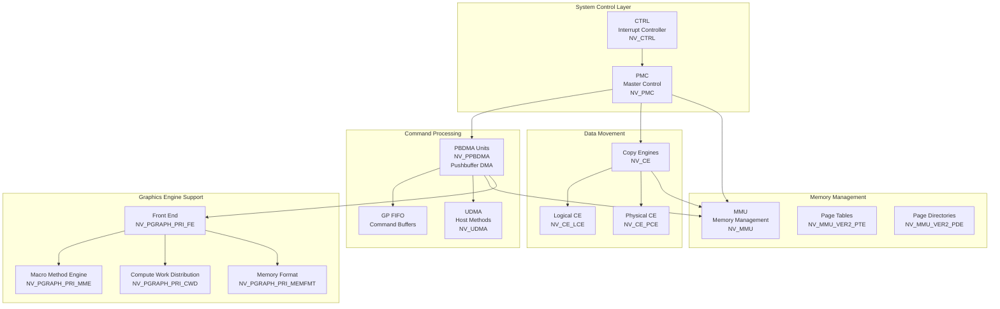
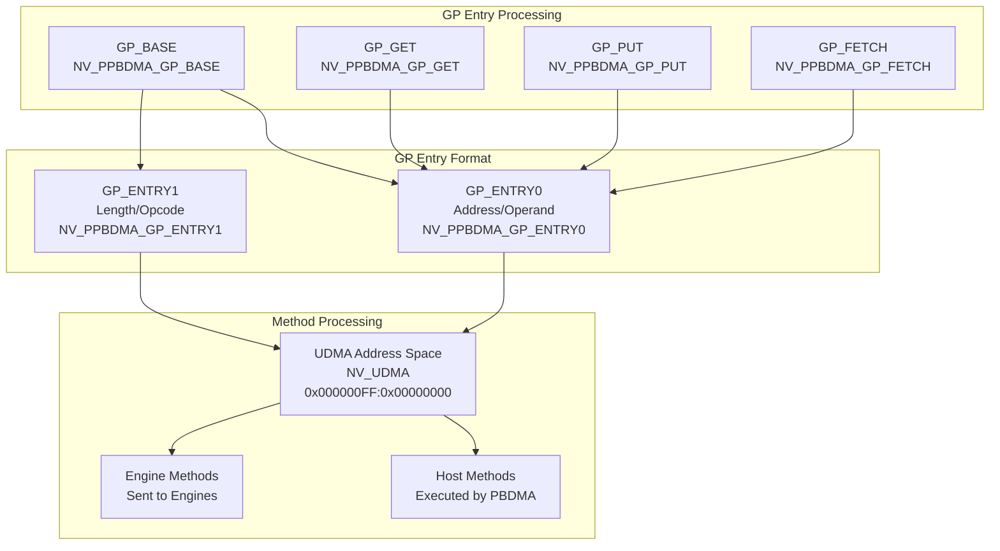
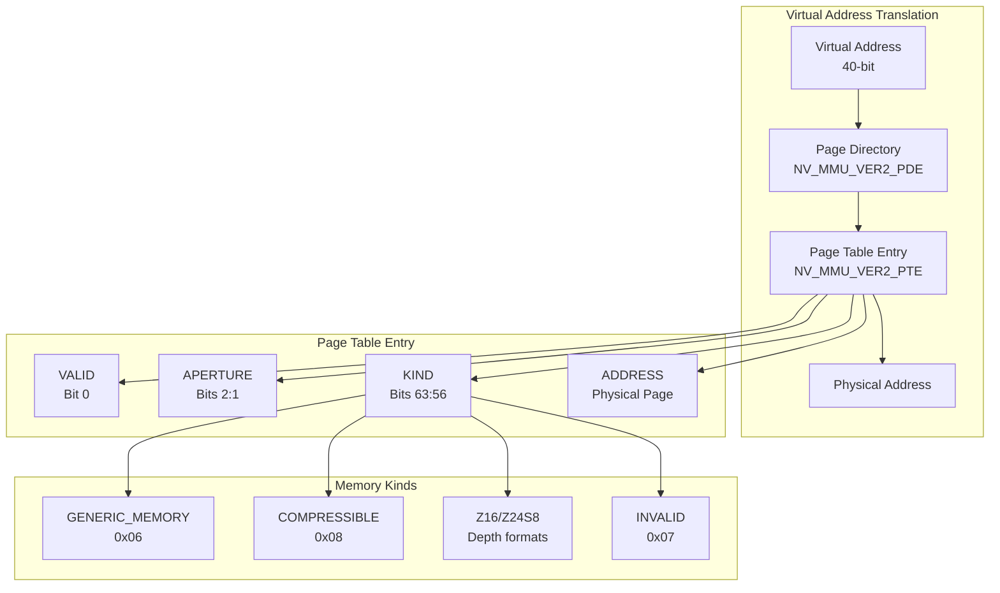
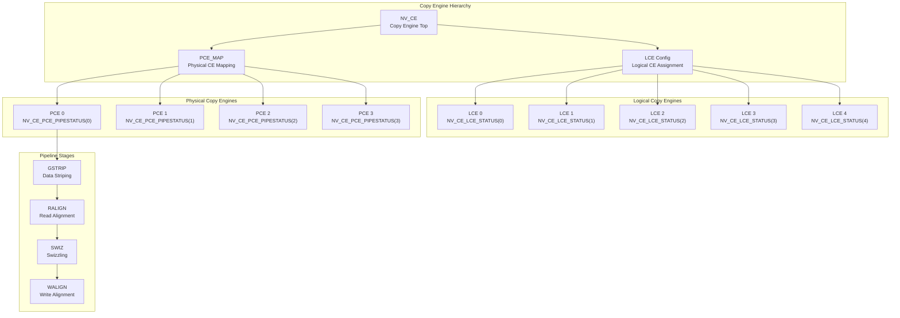
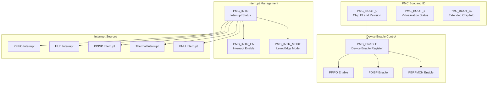
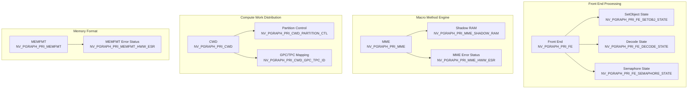

<!-- source: DeepWiki mcp.deepwiki.com · repo NVIDIA/open-gpu-doc · page 4 System Components · fetched 2026-10-26 -->

# System Components

Relevant source files

The following files were used as context for generating this wiki page:

- [manuals/turing/tu104/dev_ce.ref.txt](manuals/turing/tu104/dev_ce.ref.txt)
- [manuals/turing/tu104/dev_ctrl.ref.txt](manuals/turing/tu104/dev_ctrl.ref.txt)
- [manuals/turing/tu104/dev_master.ref.txt](manuals/turing/tu104/dev_master.ref.txt)
- [manuals/turing/tu104/dev_mmu.ref.txt](manuals/turing/tu104/dev_mmu.ref.txt)
- [manuals/turing/tu104/dev_pbdma.ref.txt](manuals/turing/tu104/dev_pbdma.ref.txt)
- [manuals/turing/tu104/pri_cwd.ref.txt](manuals/turing/tu104/pri_cwd.ref.txt)
- [manuals/turing/tu104/pri_eng.ref.txt](manuals/turing/tu104/pri_eng.ref.txt)
- [manuals/turing/tu104/pri_fe.ref.txt](manuals/turing/tu104/pri_fe.ref.txt)
- [manuals/turing/tu104/pri_memfmt.ref.txt](manuals/turing/tu104/pri_memfmt.ref.txt)
- [manuals/turing/tu104/pri_mme.ref.txt](manuals/turing/tu104/pri_mme.ref.txt)
- [manuals/volta/gv100/dev_mmu.ref.txt](manuals/volta/gv100/dev_mmu.ref.txt)

This document covers the core system infrastructure components that provide fundamental services for GPU operation, including command processing, memory management, data movement, and system control. These components form the foundation that enables higher-level GPU subsystems to function.

For information about specific programming interfaces and hardware classes, see [Programming Interfaces](#3). For context switching mechanisms and preemption, see [Context Switching](#4.2). For command submission and processing details, see [Command Processing](#4.1).

## Overview

The GPU system infrastructure consists of several interconnected hardware units that manage fundamental operations:

- **Command Processing**: PBDMA units fetch and process pushbuffer commands
- **Memory Management**: MMU provides virtual memory translation and protection
- **Data Movement**: Copy engines handle bulk data transfers and memory operations
- **System Control**: PMC and CTRL units manage interrupts, resets, and device coordination
- **Graphics Support**: Specialized units like MME, FE, and CWD support graphics workloads

## System Infrastructure Architecture

Sources: [manuals/turing/tu104/dev_master.ref.txt:22-329](), [manuals/turing/tu104/dev_pbdma.ref.txt:53-54](), [manuals/turing/tu104/dev_ce.ref.txt:22-245](), [manuals/turing/tu104/dev_ctrl.ref.txt:22-194]()

## Command Processing Infrastructure

The command processing infrastructure centers around PBDMA (Push Buffer DMA) units that fetch and execute commands from memory-resident pushbuffers.

### PBDMA Architecture

The PBDMA units operate on GP (General Purpose) entries stored in circular buffers. Each GP entry can either specify a pushbuffer segment to execute or contain control operations.

**Key PBDMA Components:**
- `NV_PPBDMA_GP_BASE`: Base address and size of GP entry circular buffer
- `NV_PPBDMA_GP_GET`: Next GP entry to process  
- `NV_PPBDMA_GP_PUT`: Next GP entry to write
- `NV_PPBDMA_GP_FETCH`: Next GP entry to fetch from memory

Sources: [manuals/turing/tu104/dev_pbdma.ref.txt:272-328](), [manuals/turing/tu104/dev_pbdma.ref.txt:374-427](), [manuals/turing/tu104/dev_pbdma.ref.txt:228-254]()

### GP Entry Format

GP entries use a two-word format that can specify either pushbuffer segments or control operations:

| Field | Purpose |
|-------|---------|
| `NV_PPBDMA_GP_ENTRY0_GET` | Pushbuffer segment start address (bits 31:2) |
| `NV_PPBDMA_GP_ENTRY0_FETCH` | Conditional/unconditional fetch control |
| `NV_PPBDMA_GP_ENTRY1_LENGTH` | Pushbuffer segment length or 0 for control |
| `NV_PPBDMA_GP_ENTRY1_OPCODE` | Control operation when LENGTH=0 |
| `NV_PPBDMA_GP_ENTRY1_SYNC` | Synchronization requirements |

**Control Opcodes:**
- `OPCODE_NOP`: No operation
- `OPCODE_GP_CRC`: Verify GP entry CRC
- `OPCODE_PB_CRC`: Verify pushbuffer CRC

Sources: [manuals/turing/tu104/dev_pbdma.ref.txt:230-254]()

## Memory Management

The Memory Management Unit (MMU) provides virtual memory translation using a hierarchical page table structure.

### MMU Page Table Hierarchy

**Aperture Types:**
- `VIDEO_MEMORY`: Local GPU memory
- `SYSTEM_COHERENT_MEMORY`: Coherent system memory
- `SYSTEM_NON_COHERENT_MEMORY`: Non-coherent system memory
- `PEER_MEMORY`: Peer GPU memory

Sources: [manuals/turing/tu104/dev_mmu.ref.txt:104-149](), [manuals/turing/tu104/dev_mmu.ref.txt:22-148](), [manuals/volta/gv100/dev_mmu.ref.txt:268-337]()

### Memory Kinds

The MMU supports different memory kinds that specify surface formats and compression:

| Kind | Value | Purpose |
|------|-------|---------|
| `NV_MMU_PTE_KIND_GENERIC_MEMORY` | 0x06 | General memory surfaces |
| `NV_MMU_PTE_KIND_GENERIC_MEMORY_COMPRESSIBLE` | 0x08 | Compressible generic memory |
| `NV_MMU_PTE_KIND_Z16` | 0x01 | 16-bit depth buffer |
| `NV_MMU_PTE_KIND_S8Z24` | 0x03 | 8-bit stencil + 24-bit depth |
| `NV_MMU_PTE_KIND_INVALID` | 0x07 | Invalid/unmapped memory |

Sources: [manuals/turing/tu104/dev_mmu.ref.txt:22-36](), [manuals/volta/gv100/dev_mmu.ref.txt:22-267]()

## Data Movement Infrastructure

Copy engines handle bulk data transfers and memory operations between different memory spaces.

### Copy Engine Architecture

**Copy Engine Configuration:**
- `NV_CE_PCE2LCE_CONFIG`: Maps physical CEs to logical CEs
- `NV_CE_GRCE_CONFIG`: Graphics copy engine sharing configuration
- `NV_CE_LCE_STATUS`: Logical CE activity status
- `NV_CE_PCE_PIPESTATUS`: Physical CE pipeline status

Sources: [manuals/turing/tu104/dev_ce.ref.txt:22-45](), [manuals/turing/tu104/dev_ce.ref.txt:102-244]()

### Copy Engine Error Handling

Copy engines provide comprehensive error detection and reporting:

| Error Type | Register Field | Purpose |
|------------|----------------|---------|
| Launch Error | `NV_CE_LCE_LAUNCHERR_REPORT` | Invalid copy parameters |
| Method Buffer Fault | `NV_CE_LCE_INTR_STATUS_MTHD_BUFFER_FAULT` | Method access violations |
| Invalid Configuration | `NV_CE_LCE_INTR_STATUS_INVALID_CONFIG` | CE setup errors |
| CRC Failure | `NV_CE_LCE_INTR_STATUS_FBUF_CRC_FAIL` | Data integrity errors |

Sources: [manuals/turing/tu104/dev_ce.ref.txt:184-201](), [manuals/turing/tu104/dev_ce.ref.txt:139-168]()

## System Control and Interrupts

The PMC (Master Control) and CTRL units manage system-wide control, interrupts, and device coordination.

### PMC Master Control

**PMC Architecture Identification:**
- `NV_PMC_BOOT_0_ARCHITECTURE`: GPU architecture (Turing = 0x15)
- `NV_PMC_BOOT_42_CHIP_ID`: Specific chip identification
- `NV_PMC_BOOT_1_VGPU`: Virtual GPU status

Sources: [manuals/turing/tu104/dev_master.ref.txt:23-196](), [manuals/turing/tu104/dev_master.ref.txt:303-329]()

### CTRL Interrupt Controller

The CTRL unit provides advanced interrupt management with CPU notification and doorbell mechanisms:

**Key CTRL Features:**
- `NV_CTRL_CPU_INTR_TOP`: Top-level interrupt aggregation
- `NV_CTRL_CPU_INTR_LEAF`: Leaf-level interrupt status  
- `NV_CTRL_DOORBELL`: Host-to-GPU notification mechanism
- `NV_CTRL_VIRTUAL_INTR_LEAF`: Virtual interrupt management

Sources: [manuals/turing/tu104/dev_ctrl.ref.txt:23-118]()

## Graphics Engine Support Components

Several specialized units support graphics workload processing and method execution.

### Graphics Pipeline Support

**Component Functions:**
- **Front End (FE)**: Method decoding and subchannel management
- **MME**: Macro method execution and expansion
- **CWD**: Compute workload distribution to SMs
- **MEMFMT**: Memory format and inline data handling

Sources: [manuals/turing/tu104/pri_fe.ref.txt:22-285](), [manuals/turing/tu104/pri_mme.ref.txt:22-112](), [manuals/turing/tu104/pri_cwd.ref.txt:22-134](), [manuals/turing/tu104/pri_memfmt.ref.txt:22-40]()

---

