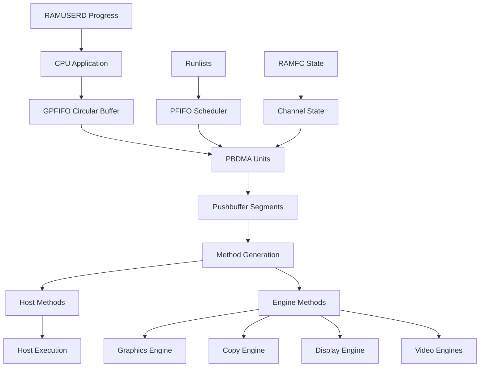
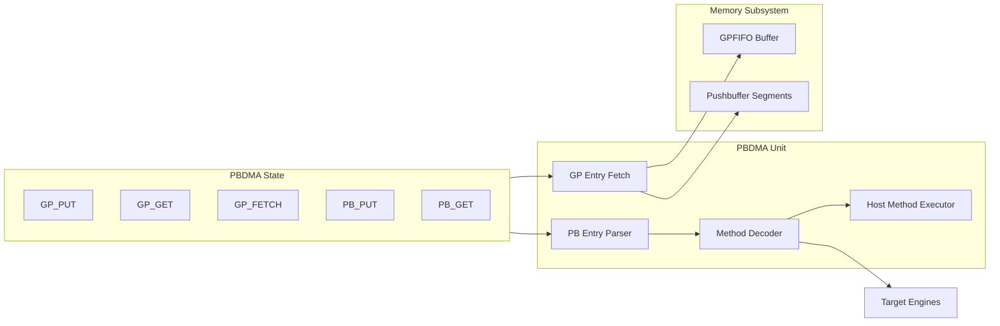
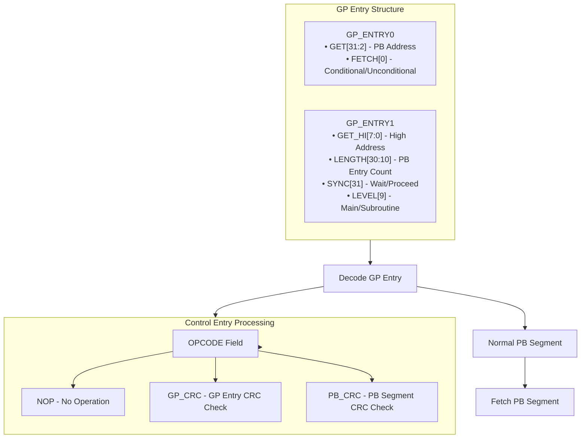
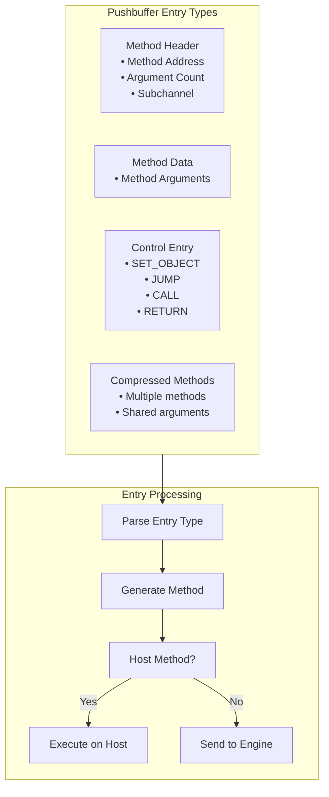
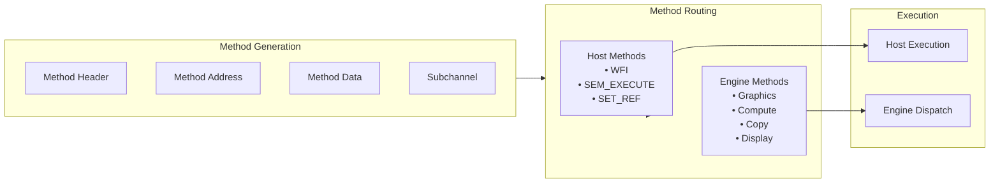
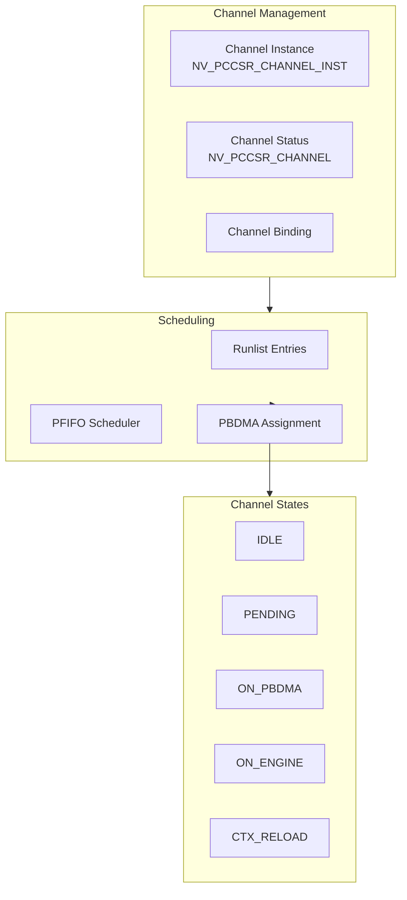
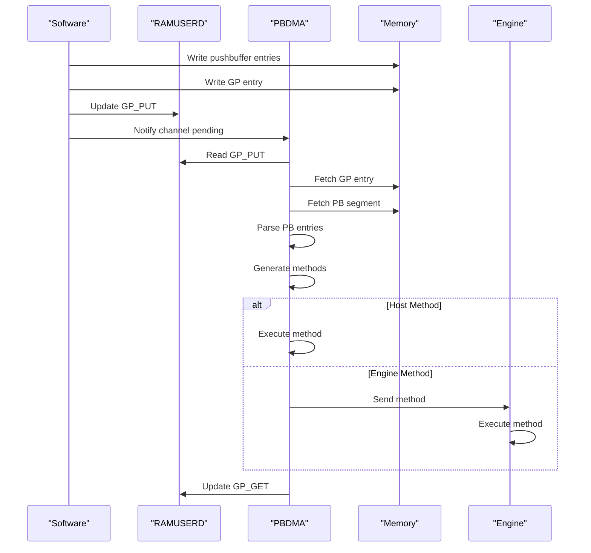

<!-- source: DeepWiki mcp.deepwiki.com · repo NVIDIA/open-gpu-doc · page 4.1 Command Processing · fetched 2026-10-26 -->

# Command Processing

Relevant source files

The following files were used as context for generating this wiki page:

- [manuals/turing/tu104/dev_ce.ref.txt](manuals/turing/tu104/dev_ce.ref.txt)
- [manuals/turing/tu104/dev_ctrl.ref.txt](manuals/turing/tu104/dev_ctrl.ref.txt)
- [manuals/turing/tu104/dev_master.ref.txt](manuals/turing/tu104/dev_master.ref.txt)
- [manuals/turing/tu104/dev_mmu.ref.txt](manuals/turing/tu104/dev_mmu.ref.txt)
- [manuals/turing/tu104/dev_pbdma.ref.txt](manuals/turing/tu104/dev_pbdma.ref.txt)
- [manuals/turing/tu104/pri_cwd.ref.txt](manuals/turing/tu104/pri_cwd.ref.txt)
- [manuals/turing/tu104/pri_eng.ref.txt](manuals/turing/tu104/pri_eng.ref.txt)
- [manuals/turing/tu104/pri_fe.ref.txt](manuals/turing/tu104/pri_fe.ref.txt)
- [manuals/turing/tu104/pri_memfmt.ref.txt](manuals/turing/tu104/pri_memfmt.ref.txt)
- [manuals/turing/tu104/pri_mme.ref.txt](manuals/turing/tu104/pri_mme.ref.txt)
- [manuals/volta/gv100/dev_bus.ref.txt](manuals/volta/gv100/dev_bus.ref.txt)
- [manuals/volta/gv100/dev_fifo.ref.txt](manuals/volta/gv100/dev_fifo.ref.txt)
- [manuals/volta/gv100/dev_master.ref.txt](manuals/volta/gv100/dev_master.ref.txt)
- [manuals/volta/gv100/dev_mmu.ref.txt](manuals/volta/gv100/dev_mmu.ref.txt)
- [manuals/volta/gv100/dev_mmu_fault.ref.txt](manuals/volta/gv100/dev_mmu_fault.ref.txt)
- [manuals/volta/gv100/dev_pbdma.ref.txt](manuals/volta/gv100/dev_pbdma.ref.txt)
- [manuals/volta/gv100/dev_ram.ref.txt](manuals/volta/gv100/dev_ram.ref.txt)
- [manuals/volta/gv100/dev_timer.ref.txt](manuals/volta/gv100/dev_timer.ref.txt)
- [manuals/volta/gv100/dev_usermode.ref.txt](manuals/volta/gv100/dev_usermode.ref.txt)

Command processing is the foundational system responsible for fetching, parsing, and executing GPU commands submitted by software. This system manages the flow of work from CPU-submitted command buffers through the GPU's execution engines, handling command scheduling, memory management, and inter-engine coordination.

This document covers the PBDMA (Pushbuffer DMA) units, GPFIFO management, pushbuffer processing, and channel scheduling mechanisms. For information about context switching between GPU workloads, see [Context Switching](#4.2). For details about specific engine programming interfaces, see [3D Graphics System](#3.1), [Display System](#3.2), [Video Processing System](#3.3), and [Compute System](#3.4).

## Architecture Overview

The GPU command processing system consists of several key components that work together to process commands from software applications to hardware execution engines.

### Command Processing Flow

**Sources:** [manuals/volta/gv100/dev_pbdma.ref.txt:35-45](), [manuals/volta/gv100/dev_fifo.ref.txt:22-60]()

### PBDMA Architecture

PBDMA (Pushbuffer DMA) units are the core command processing engines that fetch pushbuffer data from memory and generate methods for execution.

**Sources:** [manuals/volta/gv100/dev_pbdma.ref.txt:35-45](), [manuals/turing/tu104/dev_pbdma.ref.txt:35-45]()

## PBDMA Command Processing Pipeline

### GP Entry Processing

GP (Graphics Processor) entries specify the location and size of pushbuffer segments in memory. Each GP entry is 8 bytes and contains addressing information and control flags.

**Sources:** [manuals/volta/gv100/dev_pbdma.ref.txt:62-256](), [manuals/turing/tu104/dev_pbdma.ref.txt:62-256]()

### GPFIFO Management

The GPFIFO is a circular buffer containing GP entries that specify pushbuffer work for the GPU to process.

```mermaid
flowchart LR
    subgraph GPFIFO_BUFFER["GPFIFO Circular Buffer"]
        BASE["GP_BASE + GP_BASE_HI<br/>Buffer Base Address"]
        LIMIT["LIMIT2 Field<br/>Log2(Buffer Size)"]
        ENTRIES["GP Entry 0<br/>GP Entry 1<br/>...<br/>GP Entry N"]
    end
    
    subgraph POINTERS["GPFIFO Pointers"]
        PUT["GP_PUT<br/>Next Entry to Write"]
        GET["GP_GET<br/>Next Entry to Process"] 
        FETCH["GP_FETCH<br/>Next Entry to Fetch"]
    end
    
    subgraph REGISTERS["Key Registers"]
        PUT_REG["NV_PPBDMA_GP_PUT"]
        GET_REG["NV_PPBDMA_GP_GET"]
        FETCH_REG["NV_PPBDMA_GP_FETCH"]
        BASE_REG["NV_PPBDMA_GP_BASE"]
        BASEHI_REG["NV_PPBDMA_GP_BASE_HI"]
    end
    
    POINTERS --> GPFIFO_BUFFER
    REGISTERS --> POINTERS
```

**Sources:** [manuals/volta/gv100/dev_pbdma.ref.txt:274-330](), [manuals/volta/gv100/dev_pbdma.ref.txt:425-462]()

## Pushbuffer Processing

### Pushbuffer Entry Format

Pushbuffer entries contain the actual GPU commands that get parsed into methods for execution.

**Sources:** [manuals/volta/gv100/dev_ram.ref.txt:1350-1450](), [manuals/volta/gv100/dev_pbdma.ref.txt:126-142]()

### Method Generation and Routing

**Sources:** [manuals/volta/gv100/dev_pbdma.ref.txt:128-130](), [manuals/volta/gv100/dev_ram.ref.txt:44-45]()

## Channel Scheduling and FIFO Management

### Channel State Management

**Sources:** [manuals/volta/gv100/dev_fifo.ref.txt:54-108](), [manuals/volta/gv100/dev_fifo.ref.txt:109-137]()

### Runlist Processing

Runlists determine which channels are eligible for scheduling and execution.

```mermaid
flowchart LR
    subgraph RUNLIST_MEM["Runlist Memory"]
        RL_BASE["NV_PFIFO_RUNLIST_BASE"]
        RL_LENGTH["NV_PFIFO_RUNLIST_LENGTH"]
        RL_ENTRIES["Runlist Entries<br/>Channel IDs"]
    end
    
    subgraph ENGINE_RUNLISTS["Engine Runlists"]
        ENG_BASE["NV_PFIFO_ENG_RUNLIST_BASE"]
        ENG_LENGTH["NV_PFIFO_ENG_RUNLIST_LENGTH"]
        ENG_PENDING["NV_PFIFO_ENG_RUNLIST_PENDING"]
    end
    
    subgraph PBDMA_MAP["PBDMA Mapping"]
        PBDMA_MAP_REG["NV_PFIFO_PBDMA_MAP"]
        RUNLIST_MASK["Runlist Mask"]
    end
    
    RUNLIST_MEM --> ENGINE_RUNLISTS
    ENGINE_RUNLISTS --> PBDMA_MAP
```

**Sources:** [manuals/volta/gv100/dev_fifo.ref.txt:109-140](), [manuals/volta/gv100/dev_fifo.ref.txt:138-149]()

## Memory Structures and State Management

### RAMFC Structure

RAMFC (FIFO Context RAM) stores the state of Host/PBDMA contexts for channels.

| Field | Description | Register Reference |
|-------|-------------|-------------------|
| `GP_BASE` | GPFIFO base address | `NV_RAMFC_GP_BASE` |
| `GP_PUT` | GPFIFO write pointer | `NV_RAMFC_GP_PUT` |
| `GP_GET` | GPFIFO read pointer | `NV_RAMFC_GP_GET` |
| `GP_FETCH` | GPFIFO fetch pointer | `NV_RAMFC_GP_FETCH` |
| `PB_PUT` | Pushbuffer write pointer | `NV_RAMFC_PB_PUT` |
| `PB_GET` | Pushbuffer read pointer | `NV_RAMFC_PB_GET` |
| `CONFIG` | Channel configuration | `NV_RAMFC_CONFIG` |

**Sources:** [manuals/volta/gv100/dev_ram.ref.txt:587-750](), [manuals/volta/gv100/dev_pbdma.ref.txt:295-306]()

### RAMUSERD Structure

RAMUSERD (User-Driver Accessible RAM) provides software-accessible progress monitoring.

| Field | Description | Purpose |
|-------|-------------|---------|
| `GP_PUT` | Software write pointer | Submit new work |
| `GP_GET` | Hardware read pointer | Monitor progress |
| `TOP_LEVEL_GET` | Top-level progress | Track main execution |
| `CHANNEL_GET` | Channel-specific progress | Per-channel monitoring |

**Sources:** [manuals/volta/gv100/dev_ram.ref.txt:751-850](), [manuals/volta/gv100/dev_pbdma.ref.txt:194-209]()

### Command Submission Flow

**Sources:** [manuals/volta/gv100/dev_pbdma.ref.txt:434-462](), [manuals/volta/gv100/dev_usermode.ref.txt:121-147]()

## Key Register Interfaces

### PBDMA Registers

| Register | Purpose | Address Range |
|----------|---------|---------------|
| `NV_PPBDMA_GP_BASE` | GPFIFO base address | `0x00040048 + i*8192` |
| `NV_PPBDMA_GP_PUT` | GPFIFO write pointer | `0x00040000 + i*8192` |
| `NV_PPBDMA_GP_GET` | GPFIFO read pointer | `0x00040014 + i*8192` |
| `NV_PPBDMA_STATUS` | PBDMA status | `0x00040004 + i*8192` |
| `NV_PPBDMA_CHANNEL` | Channel binding | `0x00040008 + i*8192` |

**Sources:** [manuals/volta/gv100/dev_pbdma.ref.txt:309-330](), [manuals/volta/gv100/dev_pbdma.ref.txt:425-430]()

### PFIFO Registers  

| Register | Purpose | Address Range |
|----------|---------|---------------|
| `NV_PFIFO_RUNLIST_BASE` | Runlist base address | `0x00002270` |
| `NV_PFIFO_PBDMA_MAP` | PBDMA to runlist mapping | `0x00002390 + i*4` |
| `NV_PCCSR_CHANNEL_INST` | Channel instance pointer | `0x00800000 + i*8` |
| `NV_PCCSR_CHANNEL` | Channel control | `0x00800004 + i*8` |

**Sources:** [manuals/volta/gv100/dev_fifo.ref.txt:54-108](), [manuals/volta/gv100/dev_fifo.ref.txt:109-140]()

This command processing system provides the foundation for all GPU work submission and execution, managing the flow from software command buffers through hardware execution engines while maintaining proper synchronization and state management.

---

