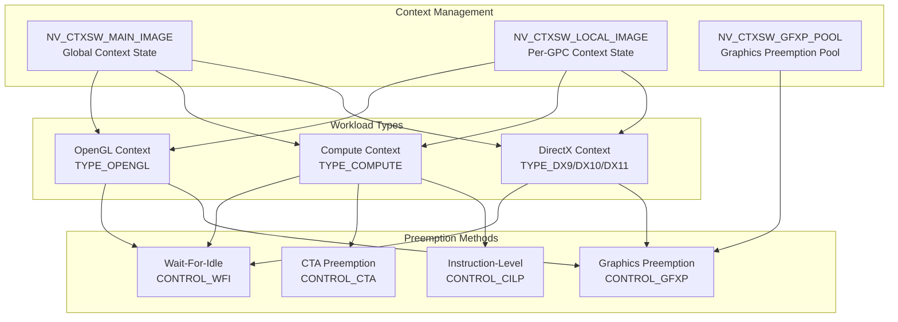
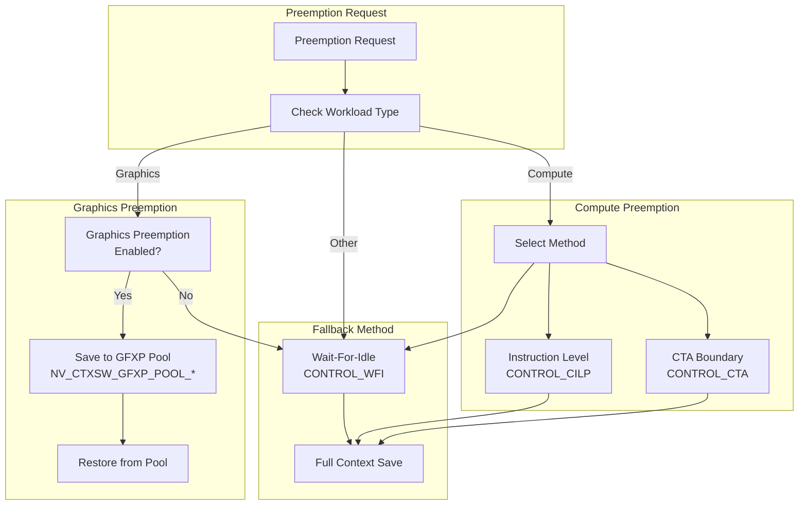
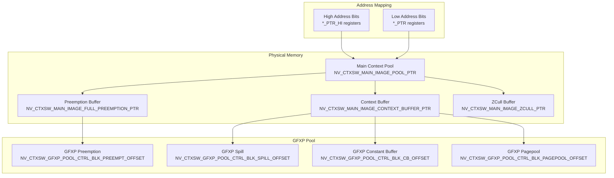

<!-- source: DeepWiki mcp.deepwiki.com · repo NVIDIA/open-gpu-doc · page 4.2 Context Switching · fetched 2026-10-26 -->

# Context Switching

Relevant source files

The following files were used as context for generating this wiki page:

- [manuals/turing/tu104/dev_ctxsw.ref.txt](manuals/turing/tu104/dev_ctxsw.ref.txt)
- [manuals/turing/tu104/dev_nv_xve3g_fn0.ref.txt](manuals/turing/tu104/dev_nv_xve3g_fn0.ref.txt)
- [manuals/turing/tu104/dev_nv_xve3g_fn1.ref.txt](manuals/turing/tu104/dev_nv_xve3g_fn1.ref.txt)

This document covers GPU context switching mechanisms, preemption options, and state management across different workload types in NVIDIA GPU hardware. Context switching enables time-sharing of GPU resources between multiple processes and workloads by saving and restoring execution state.

For information about command processing and FIFO management that works with context switching, see [Command Processing](#4.1). For details about 3D graphics workload programming, see [3D Graphics System](#3.1).

## Overview

GPU context switching allows multiple applications to share GPU execution units by preserving the complete execution state of one workload before switching to another. The context switching subsystem manages state preservation for graphics, compute, and video processing workloads across all GPU processing clusters.

The system supports multiple preemption granularities depending on workload type, from coarse-grained wait-for-idle to fine-grained instruction-level preemption for graphics workloads.

**Context Switching Architecture**

Sources: [manuals/turing/tu104/dev_ctxsw.ref.txt:22-258]()

## Context Image Structure

Context switching uses a two-level hierarchy: main context images contain global GPU state, while local context images contain per-Graphics Processing Cluster (GPC) state. Each context maintains both image types to enable complete state preservation.

**Context Image Hierarchy**

```mermaid
graph TB
    subgraph "Main Context Image"
        POOL_PTR["NV_CTXSW_MAIN_IMAGE_POOL_PTR<br/>0x00000000"]
        IMAGE_SIZE["NV_CTXSW_MAIN_IMAGE_SIZE<br/>0x00000004"]
        CTL_REG["NV_CTXSW_MAIN_IMAGE_CTL<br/>0x0000000C"]
        PREEMPT_PTR["NV_CTXSW_MAIN_IMAGE_FULL_PREEMPTION_PTR<br/>0x00000068"]
        CONTEXT_PTR["NV_CTXSW_MAIN_IMAGE_CONTEXT_BUFFER_PTR<br/>0x0000007C"]
    end
    
    subgraph "Local Context Images"
        LOCAL_SIZE["NV_CTXSW_LOCAL_IMAGE_SIZE<br/>0x00000000"]
        LOCAL_CTL["NV_CTXSW_LOCAL_IMAGE_CTL<br/>0x00000004"]
        RAMCHAIN_CTL["NV_CTXSW_LOCAL_RAMCHAIN_CTL(i)<br/>0x00000014+(i)*8"]
        PPC_INFO["NV_CTXSW_LOCAL_IMAGE_PPC_INFO<br/>0x000000F4"]
    end
    
    subgraph "Memory Layout"
        MAIN_MEM["Main Image Memory<br/>Global State"]
        LOCAL_MEM_0["Local Image 0<br/>GPC 0 State"]  
        LOCAL_MEM_1["Local Image 1<br/>GPC 1 State"]
        LOCAL_MEM_N["Local Image N<br/>GPC N State"]
    end
    
    POOL_PTR --> MAIN_MEM
    CONTEXT_PTR --> LOCAL_MEM_0
    CONTEXT_PTR --> LOCAL_MEM_1
    CONTEXT_PTR --> LOCAL_MEM_N
    
    LOCAL_CTL --> LOCAL_MEM_0
    LOCAL_CTL --> LOCAL_MEM_1
    LOCAL_CTL --> LOCAL_MEM_N
```

Sources: [manuals/turing/tu104/dev_ctxsw.ref.txt:27-121](), [manuals/turing/tu104/dev_ctxsw.ref.txt:179-206]()

### Main Context Image

The main context image contains GPU-wide state and control information. Key components include:

| Register | Offset | Purpose |
|----------|--------|---------|
| `NV_CTXSW_MAIN_IMAGE_POOL_PTR` | 0x00000000 | Base address of context memory pool |
| `NV_CTXSW_MAIN_IMAGE_CTL` | 0x0000000C | Context type and control flags |
| `NV_CTXSW_MAIN_IMAGE_GRAPHICS_PREEMPTION_OPTIONS` | 0x00000080 | Graphics preemption configuration |
| `NV_CTXSW_MAIN_IMAGE_COMPUTE_PREEMPTION_OPTIONS` | 0x00000084 | Compute preemption configuration |

The control register `NV_CTXSW_MAIN_IMAGE_CTL` specifies the workload type using these values:
- `TYPE_OPENGL` (0x8): OpenGL graphics context
- `TYPE_COMPUTE` (0x20): CUDA/OpenCL compute context  
- `TYPE_DX9` (0x10), `TYPE_DX10` (0x11), `TYPE_DX11` (0x12): DirectX graphics contexts

Sources: [manuals/turing/tu104/dev_ctxsw.ref.txt:27-48](), [manuals/turing/tu104/dev_ctxsw.ref.txt:122-130]()

### Local Context Image

Local context images store per-GPC state including ramchain data and processing cluster configuration. The `NV_CTXSW_LOCAL_IMAGE_CTL` register controls ramchain count and graphics preemption features.

Sources: [manuals/turing/tu104/dev_ctxsw.ref.txt:179-206]()

## Preemption Mechanisms

The GPU supports multiple preemption granularities to balance context switch overhead with responsiveness requirements. Preemption method selection depends on workload type and system requirements.

**Preemption Flow and Methods**

Sources: [manuals/turing/tu104/dev_ctxsw.ref.txt:122-130]()

### Preemption Types

| Preemption Type | Code | Granularity | Use Case |
|----------------|------|-------------|----------|
| Wait-For-Idle | `CONTROL_WFI` (0) | Completion boundary | Legacy compatibility, simple workloads |
| CTA Preemption | `CONTROL_CTA` (1) | Cooperative Thread Array | Compute workloads with natural boundaries |
| CILP Preemption | `CONTROL_CILP` (2) | Instruction level | Fine-grained compute preemption |
| Graphics Preemption | `CONTROL_GFXP` (1) | Pixel/primitive boundary | Graphics rendering workloads |

Graphics preemption requires additional pool memory management through `NV_CTXSW_GFXP_POOL_CTRL_BLK_*` registers for storing intermediate rendering state.

Sources: [manuals/turing/tu104/dev_ctxsw.ref.txt:124-130](), [manuals/turing/tu104/dev_ctxsw.ref.txt:207-258]()

## Context Memory Management

Context switching requires careful memory management for storing execution state. The system uses multiple memory regions optimized for different data types and access patterns.

### Memory Pool Organization

The context memory pool contains several specialized regions:

| Pool Component | Register Prefix | Purpose |
|---------------|----------------|---------|
| Preemption Buffer | `FULL_PREEMPTION_PTR` | Primary preemption state storage |
| Context Buffer | `CONTEXT_BUFFER_PTR` | Main context data storage |
| ZCull Buffer | `ZCULL_PTR` | Z-buffer compression state |
| Performance Monitor | `PM_PTR` | Performance monitoring context |
| Global Pagepool | `GLOBAL_PAGEPOOL_PTR` | Shared memory pool management |

**Memory Layout for Context Switching**

Sources: [manuals/turing/tu104/dev_ctxsw.ref.txt:52-169](), [manuals/turing/tu104/dev_ctxsw.ref.txt:207-258]()

### Context Save/Restore Operations

The hardware tracks save and restore operation counts for performance monitoring and debugging:

- `NV_CTXSW_MAIN_IMAGE_NUM_SAVE_OPERATIONS`: Total context save operations performed
- `NV_CTXSW_MAIN_IMAGE_NUM_RESTORE_OPERATIONS`: Total context restore operations performed  
- `NV_CTXSW_MAIN_IMAGE_NUM_*_SAVE_OPERATIONS`: Per-preemption-type operation counts

Context images include magic values for validation:
- Main image: `0x600dc0de` at `NV_CTXSW_MAIN_IMAGE_MAGIC_VALUE`
- Local image: `0xad0becab` at `NV_CTXSW_LOCAL_MAGIC_VALUE`

Sources: [manuals/turing/tu104/dev_ctxsw.ref.txt:174-178](), [manuals/turing/tu104/dev_ctxsw.ref.txt:204-206]()