# Page: Overview

# Overview

<details>
<summary>Relevant source files</summary>

The following files were used as context for generating this wiki page:

- [index.html](index.html)
- [turing/index.html](turing/index.html)
- [turing/tu102/index.html](turing/tu102/index.html)
- [turing/tu102/kind_macros.h](turing/tu102/kind_macros.h)
- [volta/gv100/index.html](volta/gv100/index.html)
- [volta/gv100/kind_macros.h](volta/gv100/kind_macros.h)
- [volta/index.html](volta/index.html)

</details>


This document provides an overview of the open-gpu-doc repository, NVIDIA's open-source GPU hardware documentation covering register definitions, hardware specifications, and programming interfaces across multiple GPU generations. The repository serves as a comprehensive technical reference for GPU hardware developers, driver writers, and system integrators working with NVIDIA GPU architectures.

For information about specific GPU architecture implementations, see [GPU Hardware Architecture](#2). For details about programming different GPU subsystems, see [Programming Interfaces](#3). For core system infrastructure documentation, see [System Components](#4).

## Repository Structure and Organization

The open-gpu-doc repository is organized into several key areas covering different aspects of GPU hardware documentation:

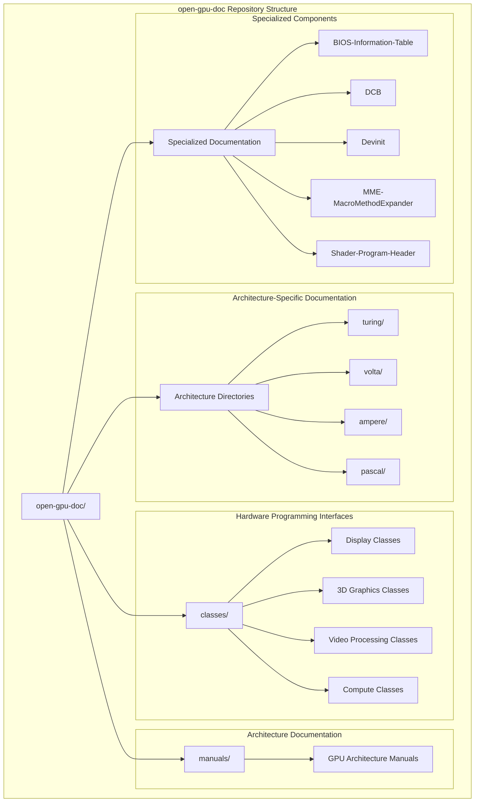

**Sources:** [index.html:1-26](), [turing/index.html:1-8](), [volta/index.html:1-7]()

## GPU Architecture Coverage

The repository provides comprehensive documentation across multiple NVIDIA GPU architecture generations, with varying levels of detail based on the maturity and public availability of each architecture:

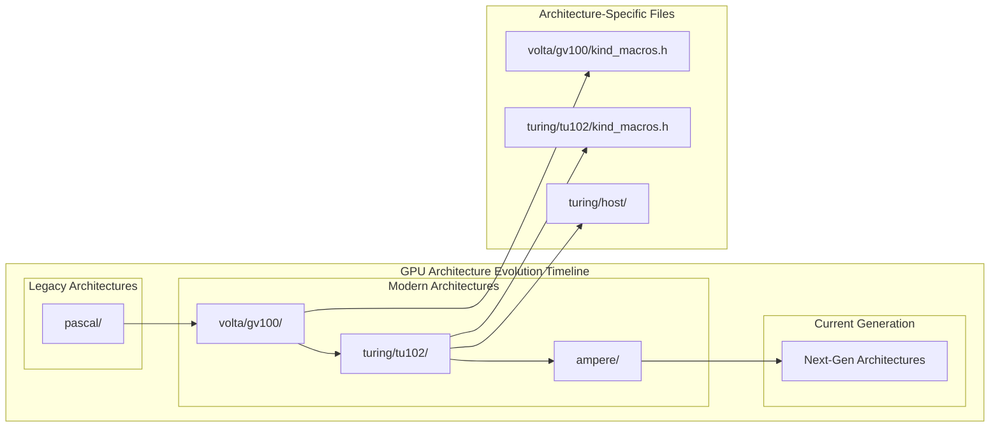

Each architecture directory contains specific hardware definitions, memory management macros, and register specifications tailored to that GPU generation's capabilities and features.

**Sources:** [volta/index.html:1-7](), [turing/index.html:1-8](), [volta/gv100/index.html:1-7](), [turing/tu102/index.html:1-7]()

## Documentation Types and Key Components

The repository contains several distinct types of technical documentation:

### Hardware Register Definitions
Architecture-specific register definitions and hardware interface specifications, including memory management unit (MMU) configurations and page table entry (PTE) kind definitions.

### Memory Kind Macros
Comprehensive macro definitions for memory types and formats, such as those found in `kind_macros.h` files. These macros define surface formats, compression types, and memory layout characteristics:

| Macro Category | Example Macros | Purpose |
|---------------|----------------|---------|
| Memory Kinds | `KIND_INVALID`, `KIND_BLOCKLINEAR` | Define basic memory layout types |
| Surface Types | `KIND_Z16`, `KIND_Z24S8`, `KIND_C32` | Specify surface format characteristics |
| Compression | `KIND_COMPRESSIBLE`, `PTEKIND_COMPRESSIBLE` | Control memory compression features |
| Memory Support | `KIND_SYSMEM_SUPPORTED`, `KIND_LOCALMEM_SUPPORTED` | Define memory location compatibility |

### Programming Interface Classes
Hardware abstraction layer definitions organized by functional subsystem, providing software interfaces to GPU hardware blocks.

### Architecture Manuals
High-level architectural documentation explaining GPU design principles, pipeline organization, and system integration requirements.

**Sources:** [turing/tu102/kind_macros.h:27-96](), [volta/gv100/kind_macros.h:26-96]()

## File Organization Patterns

The repository follows consistent organizational patterns across different GPU architectures:

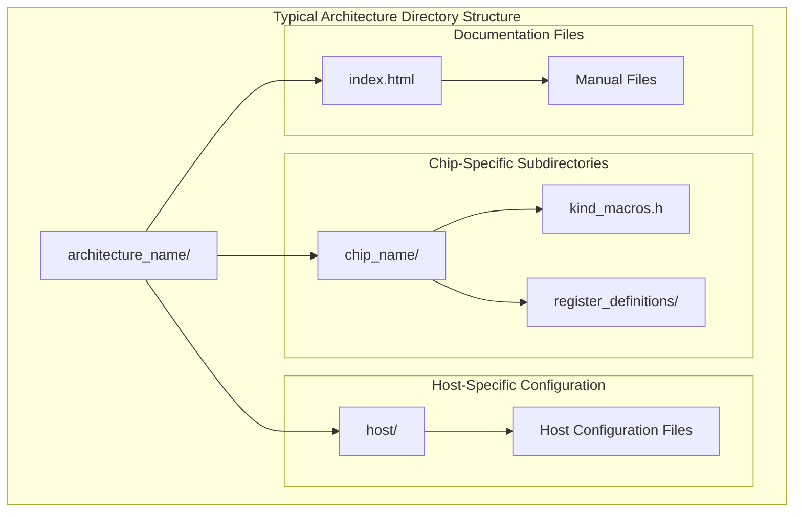

Each architecture directory typically contains chip-specific subdirectories (like `tu102/` for Turing or `gv100/` for Volta) with their respective hardware definition files, particularly the critical `kind_macros.h` files that define memory and surface format macros.

**Sources:** [turing/index.html:5-6](), [volta/index.html:5](), [turing/tu102/index.html:5](), [volta/gv100/index.html:5]()

## Key File Types and Their Functions

The repository contains several critical file types that serve different documentation purposes:

- **`kind_macros.h`** - Auto-generated macro definitions for memory kinds, surface formats, and hardware capabilities
- **`*.ref.txt`** - Register reference files containing detailed hardware register specifications  
- **`index.html`** - Navigation files providing structured access to documentation components
- **Hardware class files** - Programming interface definitions for different GPU subsystems
- **Manual files** - Comprehensive architectural documentation and programming guides

These files work together to provide a complete technical reference for GPU hardware programming, from low-level register access to high-level programming interfaces.

**Sources:** [turing/tu102/kind_macros.h:23](), [volta/gv100/kind_macros.h:23](), [index.html:1-26]()

---

# Page: GPU Hardware Architecture

# GPU Hardware Architecture

<details>
<summary>Relevant source files</summary>

The following files were used as context for generating this wiki page:

- [manuals/ampere/ga100/dev_ctxsw.ref.txt](manuals/ampere/ga100/dev_ctxsw.ref.txt)
- [manuals/ampere/ga100/dev_nv_xve3g_fn0.ref.txt](manuals/ampere/ga100/dev_nv_xve3g_fn0.ref.txt)
- [manuals/ampere/ga100/dev_nv_xve3g_fn1.ref.txt](manuals/ampere/ga100/dev_nv_xve3g_fn1.ref.txt)
- [manuals/ampere/ga100/index.html](manuals/ampere/ga100/index.html)
- [manuals/ampere/ga100/pri_mme.ref.txt](manuals/ampere/ga100/pri_mme.ref.txt)
- [manuals/turing/tu104/dev_pmgr.ref.txt](manuals/turing/tu104/dev_pmgr.ref.txt)
- [manuals/turing/tu104/index.html](manuals/turing/tu104/index.html)

</details>


This document covers the hardware specifications, register definitions, and low-level programming interfaces for NVIDIA GPU architectures. It provides comprehensive documentation of hardware blocks, register maps, and system interfaces across multiple GPU generations including Turing, Ampere, Volta, and others.

For higher-level programming interfaces and hardware classes, see [Programming Interfaces](#3). For specific implementation details of command processing and memory management, see [System Components](#4).

## Architecture Overview

The NVIDIA GPU hardware architecture consists of multiple specialized processing units, each with dedicated register interfaces and control mechanisms. The architecture is organized around core processing engines, display subsystems, memory management units, and system control blocks.

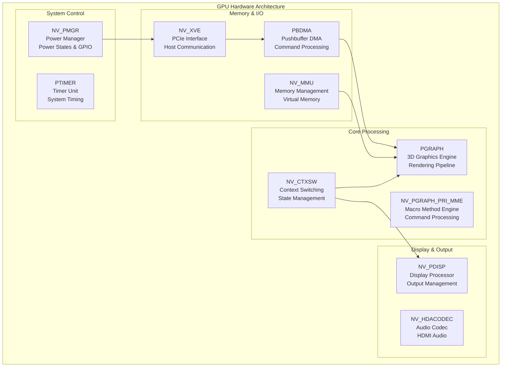

**Sources:** [manuals/turing/tu104/index.html:1-37](), [manuals/ampere/ga100/index.html:1-24]()

## GPU Generation Coverage

The documentation spans multiple GPU architecture generations, each with specific hardware capabilities and register interfaces:

| Architecture | Chip Examples | Key Features | Documentation Coverage |
|--------------|---------------|--------------|----------------------|
| **Turing** | TU104, TU102 | RT Cores, Enhanced Context Switching | Complete register definitions |
| **Ampere** | GA100, GA102 | Enhanced AI, Advanced Compute | Core system blocks |
| **Volta** | GV100 | Tensor Cores, Display Processing | Context switching focus |
| **Pascal** | GP100-GP108 | Enhanced Memory, Basic Features | Limited coverage |

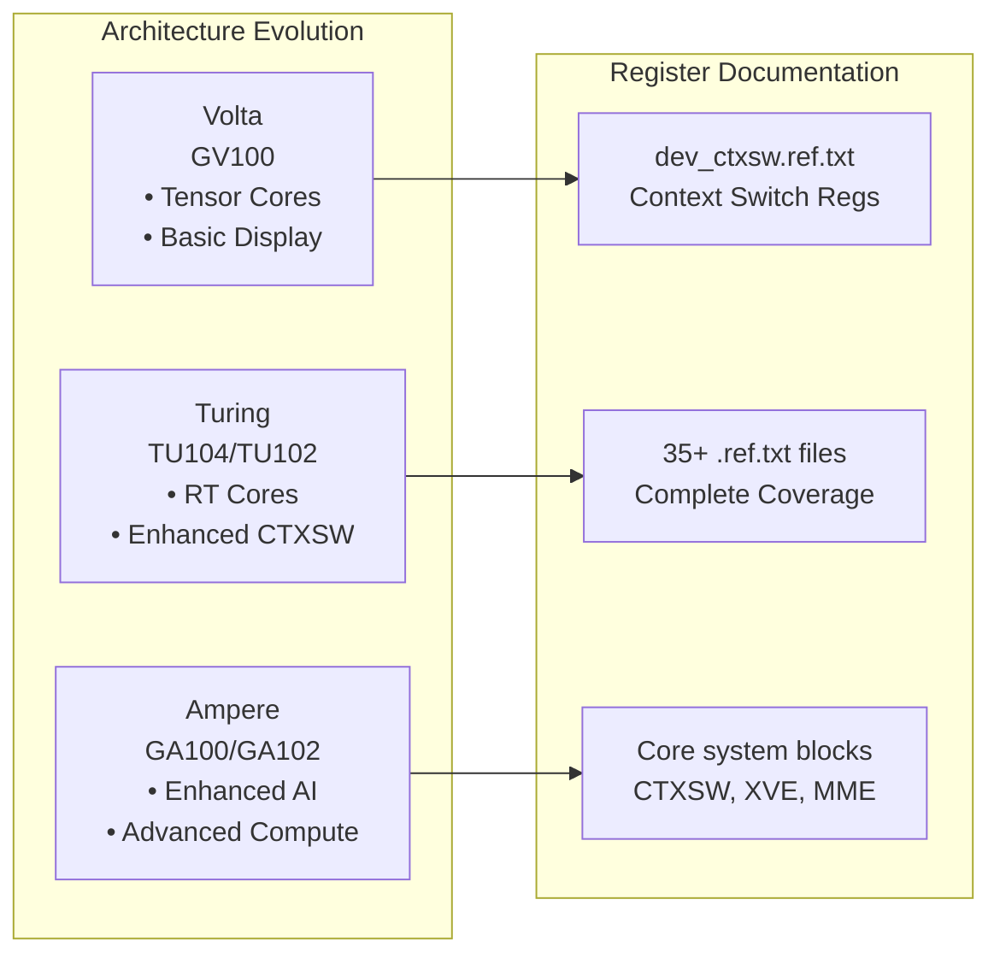

**Sources:** [manuals/turing/tu104/index.html:1-37](), [manuals/ampere/ga100/index.html:1-24]()

## Context Switching Hardware

The `NV_CTXSW` block manages GPU context switching and preemption across different workload types. It provides hardware-level state management for graphics, compute, and display contexts.

### Context Switch Image Structure

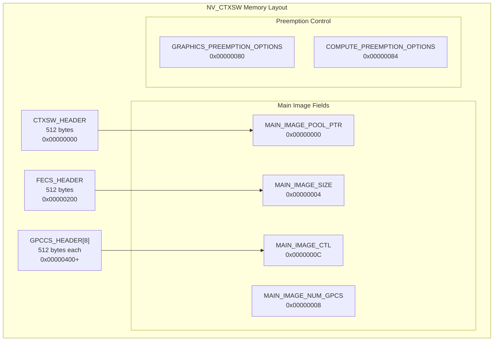

### Preemption Types

The context switching hardware supports multiple preemption granularities:

| Preemption Type | Graphics Control | Compute Control | Use Case |
|-----------------|------------------|-----------------|----------|
| **WFI** | `CONTROL_WFI` (0x0) | `CONTROL_WFI` (0x0) | Wait for idle |
| **GFXP** | `CONTROL_GFXP` (0x1) | N/A | Graphics preemption |
| **CTA** | N/A | `CONTROL_CTA` (0x1) | Cooperative thread array |
| **CILP** | N/A | `CONTROL_CILP` (0x2) | Compute instruction level |

**Sources:** [manuals/ampere/ga100/dev_ctxsw.ref.txt:98-106]()

## Power Management and System Control

The `NV_PMGR` block handles power management, GPIO control, and system-level interrupts. It provides interfaces for power state transitions and peripheral control.

### GPIO and Interrupt Control

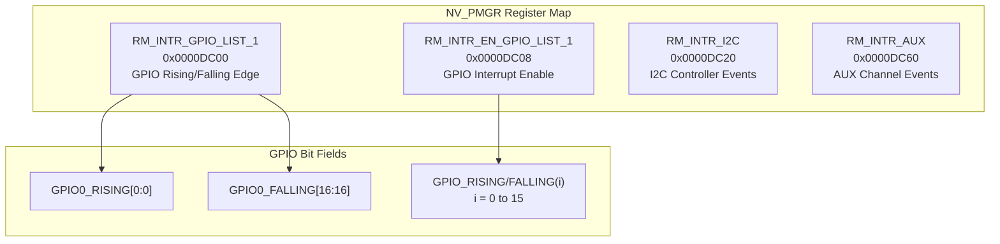

**Sources:** [manuals/turing/tu104/dev_pmgr.ref.txt:33-203]()

## PCIe Interface Hardware

The `NV_XVE` block implements the PCIe interface and provides host communication capabilities. It includes standard PCIe configuration space and NVIDIA-specific extensions.

### PCIe Configuration Space

The PCIe interface supports multiple device IDs across GPU generations:

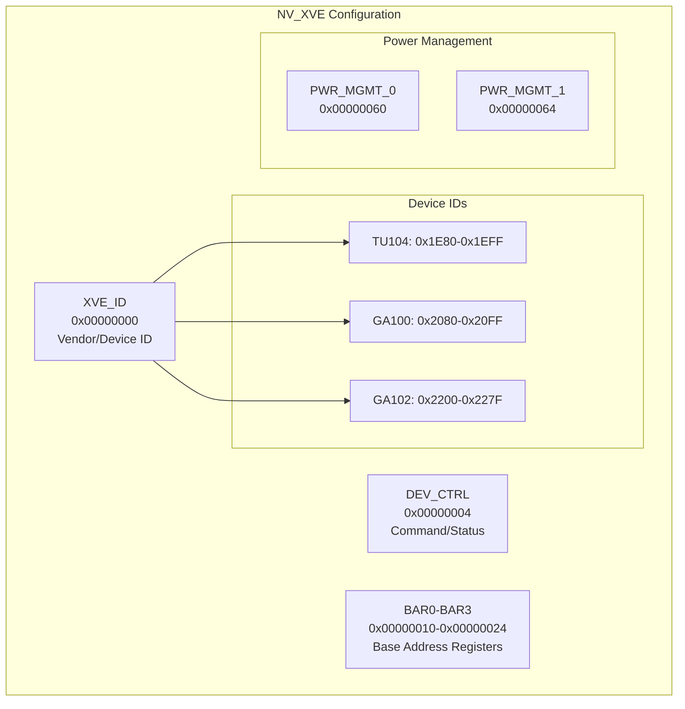

**Sources:** [manuals/ampere/ga100/dev_nv_xve3g_fn0.ref.txt:24-139]()

## Macro Method Engine (MME)

The `NV_PGRAPH_PRI_MME` provides hardware acceleration for repetitive GPU operations through programmable macro execution.

### MME Register Interface

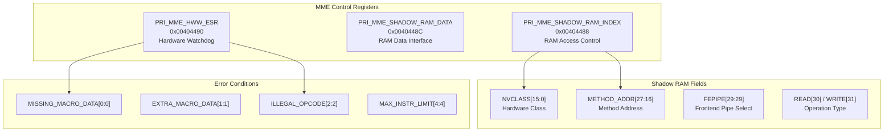

**Sources:** [manuals/ampere/ga100/pri_mme.ref.txt:22-87]()

## Register Definition Format

All hardware registers follow a standardized format with 5-field access codes:

| Field | Values | Description |
|-------|--------|-------------|
| **Read** | `R`, `C`, `-` | Read capability and constant values |
| **Write** | `W`, `-` | Write capability |
| **Internal State** | `I`, `E`, `B`, `C`, `V`, `X` | Reset behavior and initialization |
| **Declaration/Size** | `1`, `2`, `4`, `8`, `V`, `U`, `S`, `F` | Data type and size |
| **Define Indicator** | `R`, `F`, `V`, `D`, `A` | Register, field, value, device, array |

Example register definition:
```
#define NV_CTXSW_MAIN_IMAGE_CTL                        0x0000000C /* RW-4R */
#define NV_CTXSW_MAIN_IMAGE_CTL_TYPE                          5:0 /* RWXVF */
#define NV_CTXSW_MAIN_IMAGE_CTL_TYPE_OPENGL                   0x8 /* RW--V */
```

**Sources:** [manuals/ampere/ga100/dev_ctxsw.ref.txt:272-343]()

---

# Page: Turing Architecture

# Turing Architecture

<details>
<summary>Relevant source files</summary>

The following files were used as context for generating this wiki page:

- [manuals/ampere/ga100/dev_ctxsw.ref.txt](manuals/ampere/ga100/dev_ctxsw.ref.txt)
- [manuals/ampere/ga100/dev_nv_xve3g_fn0.ref.txt](manuals/ampere/ga100/dev_nv_xve3g_fn0.ref.txt)
- [manuals/ampere/ga100/dev_nv_xve3g_fn1.ref.txt](manuals/ampere/ga100/dev_nv_xve3g_fn1.ref.txt)
- [manuals/ampere/ga100/index.html](manuals/ampere/ga100/index.html)
- [manuals/ampere/ga100/pri_mme.ref.txt](manuals/ampere/ga100/pri_mme.ref.txt)
- [manuals/turing/tu102/dev_display_withoffset.ref.txt](manuals/turing/tu102/dev_display_withoffset.ref.txt)
- [manuals/turing/tu102/dev_nv_xve3g_fn0.ref.txt](manuals/turing/tu102/dev_nv_xve3g_fn0.ref.txt)
- [manuals/turing/tu102/dev_nv_xve3g_fn1.ref.txt](manuals/turing/tu102/dev_nv_xve3g_fn1.ref.txt)
- [manuals/turing/tu102/index.html](manuals/turing/tu102/index.html)
- [manuals/turing/tu104/dev_pmgr.ref.txt](manuals/turing/tu104/dev_pmgr.ref.txt)
- [manuals/turing/tu104/index.html](manuals/turing/tu104/index.html)

</details>


This document covers the Turing GPU architecture hardware specifications, register definitions, and programming interfaces. Turing encompasses the TU102 and TU104 chip variants and represents NVIDIA's first GPU architecture to include dedicated RT (Ray Tracing) cores alongside traditional graphics and compute capabilities.

For context switching mechanisms across GPU architectures, see [Context Switching](#4.2). For display system programming interfaces, see [Display System](#3.2).

## Architecture Overview

The Turing architecture introduces significant architectural enhancements over the previous Volta generation, including dedicated ray tracing hardware and enhanced Tensor cores for AI workloads. The architecture is implemented in two primary chip variants documented in this repository.

### Chip Variants

| Chip | Device ID Range | PCIe Function Files |
|------|----------------|-------------------|
| TU102 | 0x1E00-0x1E7F | [manuals/turing/tu102/dev_nv_xve3g_fn0.ref.txt](), [manuals/turing/tu102/dev_nv_xve3g_fn1.ref.txt]() |
| TU104 | 0x1E80-0x1EFF | [manuals/turing/tu104/dev_nv_xve3g_fn0.ref.txt](), [manuals/turing/tu104/dev_nv_xve3g_fn1.ref.txt]() |

**Turing Chip Architecture**
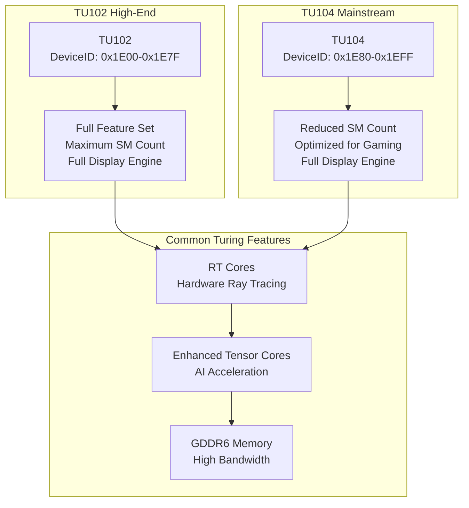

Sources: [manuals/turing/tu102/dev_nv_xve3g_fn0.ref.txt:85-98](), [manuals/turing/tu104/index.html:1-37]()

## Hardware Subsystems

The Turing architecture implements a comprehensive set of hardware subsystems, each with dedicated register interfaces and control mechanisms.

**Turing Hardware Block Organization**
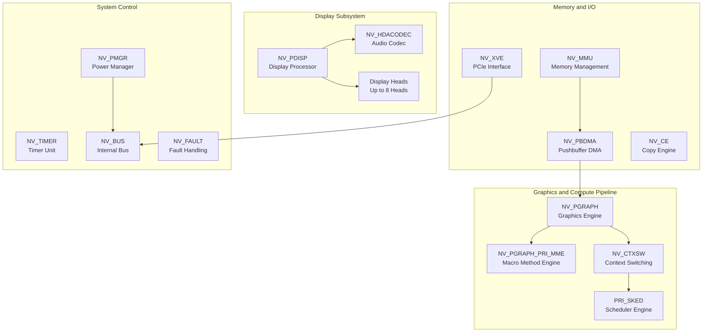

Sources: [manuals/turing/tu104/index.html:5-36](), [manuals/turing/tu102/dev_display_withoffset.ref.txt:22-41]()

### Display Engine

The Turing display engine (`NV_PDISP`) supports up to 8 display heads with comprehensive hardware capabilities reporting and multi-channel architecture.

| Component | Register Prefix | Description |
|-----------|----------------|-------------|
| Display Front End | `NV_PDISP_FE` | Hardware capability and configuration |
| Display Channels | `NV_PDISP_CHN` | 84 total channels including core, window, cursor |
| Hardware Capabilities | `NV_PDISP_FE_HW_SYS_CAP` | Dynamic feature detection |

**Display Channel Architecture**
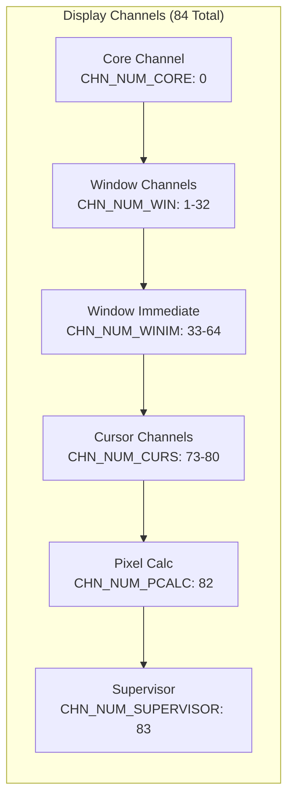

The display subsystem includes hardware capability registers for dynamic feature detection:

- `NV_PDISP_FE_HW_SYS_CAP`: Head and SOR existence detection
- `NV_PDISP_FE_HW_SYS_CAPB`: Window channel existence (up to 32 windows)
- `NV_PDISP_FE_MISC_CONFIGA`: Runtime configuration reporting

Sources: [manuals/turing/tu102/dev_display_withoffset.ref.txt:24-41](), [manuals/turing/tu102/dev_display_withoffset.ref.txt:79-135]()

### Power Management

The power management subsystem (`NV_PMGR`) provides comprehensive power control and GPIO interrupt handling capabilities.

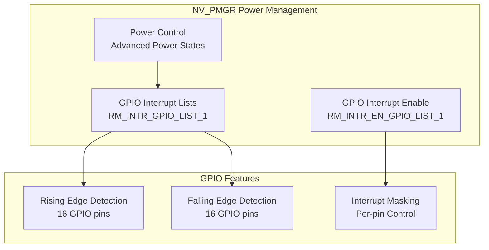

Key power management registers:
- `NV_PMGR_IP_VER`: Version 3.2.0.0 for Turing
- `NV_PMGR_RM_INTR_GPIO_LIST_1`: 32-bit register supporting 16 GPIO pins with rising/falling edge detection
- `NV_PMGR_RM_INTR_EN_GPIO_LIST_1`: Individual interrupt enable control per GPIO pin

Sources: [manuals/turing/tu104/dev_pmgr.ref.txt:24-32](), [manuals/turing/tu104/dev_pmgr.ref.txt:33-203]()

### PCIe Interface

The PCIe interface is implemented through the `NV_XVE` (eXternal Vehicle Engine) subsystem with dual-function support.

| Function | Address Range | Configuration |
|----------|---------------|---------------|
| Function 0 | `NV_XVE` (0x0000-0x0FFF) | Primary GPU function |
| Function 1 | `NV_XVE1` (0x0000-0x0FFF) | Audio/auxiliary function |

**PCIe Configuration Structure**
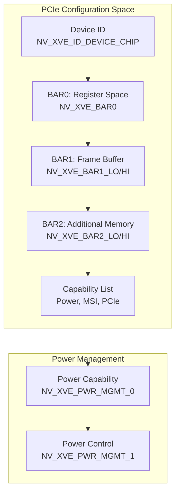

Sources: [manuals/turing/tu102/dev_nv_xve3g_fn0.ref.txt:24-27](), [manuals/turing/tu102/dev_nv_xve3g_fn0.ref.txt:204-262]()

## Register Organization

The Turing architecture organizes registers into two primary categories with distinct addressing schemes and access patterns.

### Device Registers (`dev_*.ref.txt`)

Device registers provide direct hardware control and status interfaces. These registers are memory-mapped and accessible through BAR0.

| Register File | Hardware Block | Address Range |
|--------------|----------------|---------------|
| `dev_pmgr.ref.txt` | Power Manager | `NV_PMGR`: 0xD000-0xE7FF |
| `dev_display_withoffset.ref.txt` | Display Processor | `NV_PDISP`: 0x610000-0x64FFFF |
| `dev_ctxsw.ref.txt` | Context Switching | `NV_CTXSW`: 0x000000-0xFFFFFF |
| `dev_mmu.ref.txt` | Memory Management | `NV_MMU`: Various ranges |

### Privileged Registers (`pri_*.ref.txt`)

Privileged registers control graphics engine internal state and require elevated access permissions.

| Register File | Graphics Subsystem | Function |
|--------------|-------------------|----------|
| `pri_mme.ref.txt` | Macro Method Engine | Programmable command processing |
| `pri_sked.ref.txt` | Scheduler | Work distribution and load balancing |
| `pri_fe.ref.txt` | Front End | Command fetch and decode |
| `pri_eng.ref.txt` | Engine Control | Graphics pipeline management |

**Register Access Hierarchy**
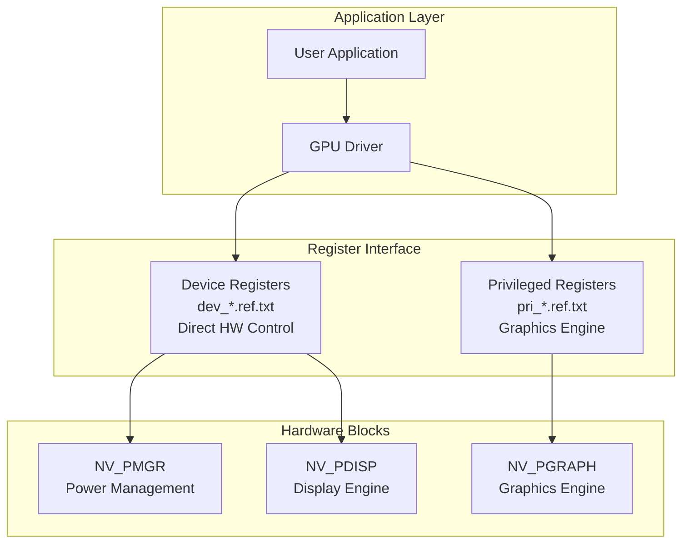

Sources: [manuals/turing/tu104/index.html:5-36](), [manuals/turing/tu104/dev_pmgr.ref.txt:22-23]()

## Context Switching Architecture

Turing implements an advanced context switching system (`NV_CTXSW`) that enables efficient preemption and state management for graphics and compute workloads.

### Context Types and Preemption Modes

The context switching system supports multiple preemption granularities:

| Context Type | Register Field | Preemption Level |
|-------------|---------------|------------------|
| Graphics | `NV_CTXSW_MAIN_IMAGE_GRAPHICS_PREEMPTION_OPTIONS_CONTROL` | WFI, GFXP |
| Compute | `NV_CTXSW_MAIN_IMAGE_COMPUTE_PREEMPTION_OPTIONS_CONTROL` | WFI, CTA, CILP |
| OpenGL | `NV_CTXSW_MAIN_IMAGE_CTL_TYPE_OPENGL` | Traditional graphics |
| DirectX | `NV_CTXSW_MAIN_IMAGE_CTL_TYPE_DX11` | DirectX 11 contexts |

### Context Image Structure

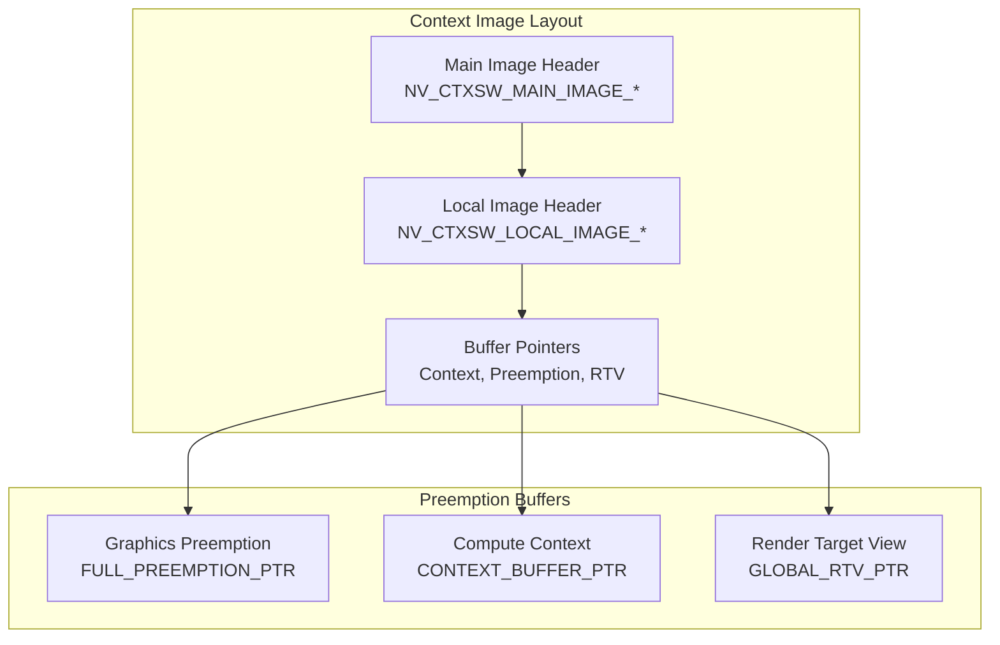

The context image uses magic values for validation:
- `NV_CTXSW_MAIN_IMAGE_MAGIC_VALUE_1`: 0x600dc0de
- `NV_CTXSW_MAIN_IMAGE_MAGIC_VALUE_2`: 0xdeadce11  
- `NV_CTXSW_MAIN_IMAGE_MAGIC_VALUE_3`: 0xfaceb00c

Sources: [manuals/ampere/ga100/dev_ctxsw.ref.txt:36-52](), [manuals/ampere/ga100/dev_ctxsw.ref.txt:98-106]()

## Key Architectural Features

### Ray Tracing Integration

While the RT core register interfaces are not directly exposed in the provided register files, the Turing architecture's context switching system includes provisions for ray tracing workload management through the standard graphics preemption mechanisms.

### Enhanced Memory Management

The Turing MMU provides advanced virtual memory capabilities with support for:
- Multiple address spaces per context
- Fine-grained access control
- Hardware-accelerated page table walks
- Fault isolation and recovery

### Display Engine Enhancements

The Turing display engine supports:
- Up to 8 simultaneous display heads
- Hardware-accelerated composition with 32 window channels
- Real-time capability reporting for dynamic configuration
- Enhanced audio integration through `NV_HDACODEC`

This architecture represents a significant evolution in GPU design, balancing traditional graphics performance with specialized acceleration for ray tracing and AI workloads while maintaining compatibility with existing software stacks.

Sources: [manuals/turing/tu102/dev_display_withoffset.ref.txt:24-41](), [manuals/turing/tu104/dev_pmgr.ref.txt:22-32]()

---

# Page: Ampere Architecture

# Ampere Architecture

<details>
<summary>Relevant source files</summary>

The following files were used as context for generating this wiki page:

- [manuals/ampere/ga102/dev_ce.ref.txt](manuals/ampere/ga102/dev_ce.ref.txt)
- [manuals/ampere/ga102/dev_ctxsw.ref.txt](manuals/ampere/ga102/dev_ctxsw.ref.txt)
- [manuals/ampere/ga102/dev_display_withoffset.ref.txt](manuals/ampere/ga102/dev_display_withoffset.ref.txt)
- [manuals/ampere/ga102/dev_hdacodec.ref.txt](manuals/ampere/ga102/dev_hdacodec.ref.txt)
- [manuals/ampere/ga102/dev_trim.ref.txt](manuals/ampere/ga102/dev_trim.ref.txt)
- [manuals/ampere/ga102/index.html](manuals/ampere/ga102/index.html)
- [manuals/turing/tu104/dev_display_withoffset.ref.txt](manuals/turing/tu104/dev_display_withoffset.ref.txt)

</details>


This document covers the hardware specifications and register definitions for NVIDIA's Ampere architecture GPUs, specifically the GA102 implementation. The material focuses on low-level hardware interfaces including display processing, audio codec functionality, copy engine operations, and context switching mechanisms.

For information about programming interfaces and software classes that interact with this hardware, see [Programming Interfaces](#3). For context switching software interfaces, see [Context Switching](#4.2).

## Architecture Overview

The GA102 Ampere architecture implements several key hardware subsystems that are documented through register reference files. Each subsystem provides memory-mapped register interfaces for direct hardware control and status monitoring.

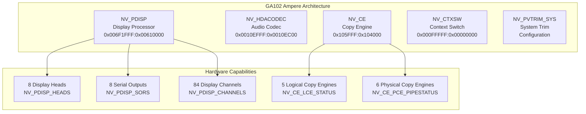

**Sources:** [manuals/ampere/ga102/index.html:1-15](), [manuals/ampere/ga102/dev_display_withoffset.ref.txt:22-29](), [manuals/ampere/ga102/dev_ce.ref.txt:22-108]()

## Display Subsystem (NV_PDISP)

The display processor handles output generation and window composition across multiple display heads and output interfaces. The `NV_PDISP` block occupies memory range `0x006F1FFF:0x00610000` and supports up to 8 display heads and 8 serial output interfaces.

### Display Architecture Components

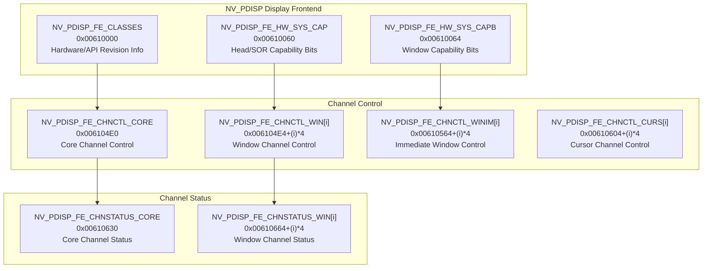

### Display Channel Configuration

The display subsystem supports 84 total channels organized as follows:

| Channel Type | Count | Channel Numbers | Purpose |
|--------------|-------|-----------------|---------|
| Core | 1 | 0 | `NV_PDISP_CHN_NUM_CORE` - Main display control |
| Window | 32 | 1-32 | `NV_PDISP_CHN_NUM_WIN(i)` - Window composition |
| Window Immediate | 32 | 33-64 | `NV_PDISP_CHN_NUM_WINIM(i)` - Immediate updates |
| Cursor | 8 | 73-80 | `NV_PDISP_CHN_NUM_CURS(i)` - Cursor overlays |
| Calculator | 1 | 82 | `NV_PDISP_CHN_NUM_PCALC` - Pipeline calculator |
| Supervisor | 1 | 83 | `NV_PDISP_CHN_NUM_SUPERVISOR` - Supervisor control |

**Sources:** [manuals/ampere/ga102/dev_display_withoffset.ref.txt:24-38](), [manuals/ampere/ga102/dev_display_withoffset.ref.txt:290-420]()

## Audio Subsystem (NV_HDACODEC)

The High Definition Audio codec provides audio output capabilities for HDMI and DisplayPort interfaces. The `NV_HDACODEC` block occupies memory range `0x0010EFFF:0x0010EC00`.

### Audio Hardware Configuration

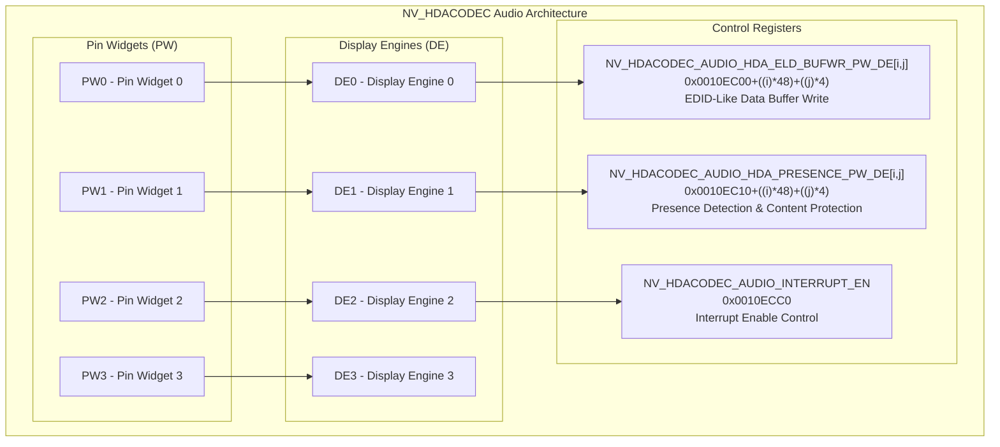

The audio subsystem supports 4 pin widgets (`NV_HDACODEC_NUM_PW`) and 4 display engines (`NV_HDACODEC_NUM_DE`), allowing for simultaneous audio output to multiple display interfaces with independent content protection states.

**Sources:** [manuals/ampere/ga102/dev_hdacodec.ref.txt:22-25](), [manuals/ampere/ga102/dev_hdacodec.ref.txt:26-189](), [manuals/ampere/ga102/dev_hdacodec.ref.txt:223-314]()

## Copy Engine Subsystem (NV_CE)

The Copy Engine provides high-performance data movement capabilities between memory regions. The `NV_CE` block occupies memory range `0x105FFF:0x104000` and implements both logical and physical copy engine instances.

### Copy Engine Architecture

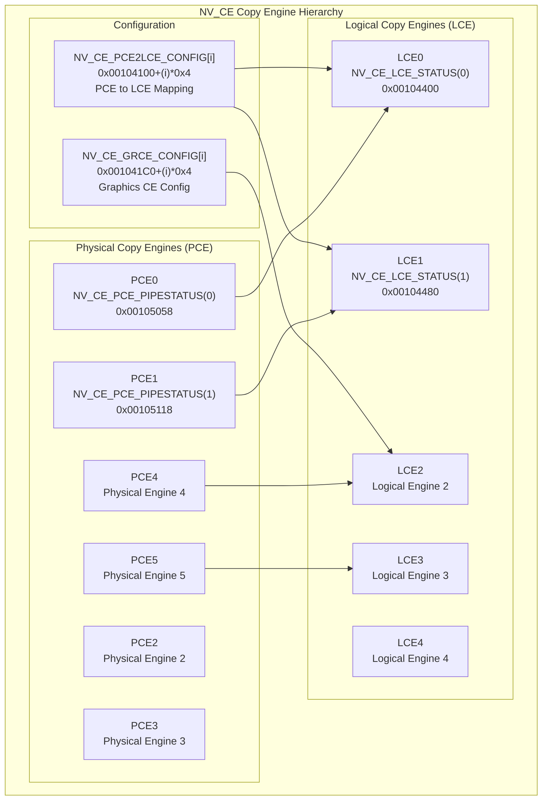

### Copy Engine Configuration

The copy engine supports mapping of 6 physical copy engines to 5 logical copy engines through the `NV_CE_PCE2LCE_CONFIG` registers. Default mappings assign:

- PCE4 → LCE2 (`NV_CE_PCE2LCE_CONFIG_4_PCE_ASSIGNED_LCE_INIT = 0x00000002`)
- PCE5 → LCE3 (`NV_CE_PCE2LCE_CONFIG_5_PCE_ASSIGNED_LCE_INIT = 0x00000003`)

**Sources:** [manuals/ampere/ga102/dev_ce.ref.txt:28-43](), [manuals/ampere/ga102/dev_ce.ref.txt:107-117](), [manuals/ampere/ga102/dev_ce.ref.txt:228-262]()

## Context Switching Subsystem (NV_CTXSW)

The context switching subsystem manages GPU state preservation and restoration during task preemption. The `NV_CTXSW` block occupies the full address range `0x000FFFFF:0x00000000`.

### Context Switch Data Structures

```mermaid
graph TB
    subgraph "NV_CTXSW Context Switch Memory Layout"
        subgraph "Headers"
            CTXSW_HEADER["NV_CTXSW_CTXSW_HEADER<br/>0x00000000<br/>512 bytes<br/>Main Context Header"]
            FECS_HEADER["NV_CTXSW_FECS_HEADER<br/>0x00000200<br/>512 bytes<br/>FECS Microcode Header"]
            GPCCS_HEADER["NV_CTXSW_GPCCS_HEADER[i]<br/>0x00000400+(i)*512<br/>512 bytes each<br/>GPC Context Headers"]
        end
        
        subgraph "Image Control"
            MAIN_IMAGE_POOL_PTR["NV_CTXSW_MAIN_IMAGE_POOL_PTR<br/>0x00000000<br/>Context Buffer Pool Pointer"]
            MAIN_IMAGE_CTL["NV_CTXSW_MAIN_IMAGE_CTL<br/>0x0000000C<br/>Context Type & Magic Value"]
            MAIN_IMAGE_SIZE["NV_CTXSW_MAIN_IMAGE_SIZE<br/>0x00000004<br/>Main Image Size"]
        end
        
        subgraph "Preemption Support"
            GRAPHICS_PREEMPTION["NV_CTXSW_MAIN_IMAGE_GRAPHICS_PREEMPTION_OPTIONS<br/>0x00000080<br/>WFI/GFXP Control"]
            COMPUTE_PREEMPTION["NV_CTXSW_MAIN_IMAGE_COMPUTE_PREEMPTION_OPTIONS<br/>0x00000084<br/>WFI/CTA/CILP Control"]
            FULL_PREEMPTION_PTR["NV_CTXSW_MAIN_IMAGE_FULL_PREEMPTION_PTR<br/>0x00000068<br/>Full Preemption Buffer"]
        end
    end
    
    CTXSW_HEADER --> MAIN_IMAGE_POOL_PTR
    FECS_HEADER --> MAIN_IMAGE_CTL
    GPCCS_HEADER --> GRAPHICS_PREEMPTION
    MAIN_IMAGE_CTL --> COMPUTE_PREEMPTION
```

### Context Type Support

The context switching subsystem supports multiple context types defined in `NV_CTXSW_MAIN_IMAGE_CTL_TYPE`:

| Context Type | Value | Purpose |
|--------------|-------|---------|
| `TYPE_UNDEFINED` | 0x0 | Undefined context |
| `TYPE_OPENGL` | 0x8 | OpenGL graphics context |
| `TYPE_DX9` | 0x10 | DirectX 9 context |
| `TYPE_DX10` | 0x11 | DirectX 10 context |
| `TYPE_DX11` | 0x12 | DirectX 11 context |
| `TYPE_COMPUTE` | 0x20 | Compute context |
| `TYPE_PER_VEID_HEADER` | 0x21 | Per-VEID header context |

Preemption modes include Wait-For-Idle (WFI), Graphics Preemption (GFXP), Cooperative Thread Array (CTA), and Compute Instruction Level Preemption (CILP).

**Sources:** [manuals/ampere/ga102/dev_ctxsw.ref.txt:22-30](), [manuals/ampere/ga102/dev_ctxsw.ref.txt:31-50](), [manuals/ampere/ga102/dev_ctxsw.ref.txt:92-101]()

## System Configuration (NV_PVTRIM_SYS)

The system trim configuration provides control over display port reference clock settings. The `NV_PVTRIM_SYS_LINK_REFCLK_CFG` registers control reference clock frequency, source selection, and power management for up to 6 DisplayPort links (LINKA-LINKF).

```mermaid
graph LR
    subgraph "NV_PVTRIM_SYS Link Configuration"
        LINK0["LINKA<br/>NV_PVTRIM_SYS_LINK_REFCLK_CFG(0)<br/>0x0000E860"]
        LINK1["LINKB<br/>NV_PVTRIM_SYS_LINK_REFCLK_CFG(1)<br/>0x0000E864"]
        LINK2["LINKC<br/>NV_PVTRIM_SYS_LINK_REFCLK_CFG(2)<br/>0x0000E868"]
        LINK5["LINKF<br/>NV_PVTRIM_SYS_LINK_REFCLK_CFG(5)<br/>0x0000E874"]
    end
    
    subgraph "Clock Sources"
        SPPLL0["SPPLL0<br/>Source 0"]
        SPPLL1["SPPLL1<br/>Source 1"]
    end
    
    subgraph "Frequencies"
        FREQ270["270MHz<br/>FREQ=0"]
        FREQ100["100MHz<br/>FREQ=1"]
    end
    
    SPPLL0 --> LINK0
    SPPLL1 --> LINK1
    FREQ270 --> LINK2
    FREQ100 --> LINK5
```

Each link supports independent configuration of clock frequency (100MHz or 270MHz), clock source (SPPLL0 or SPPLL1), and powerdown control.

**Sources:** [manuals/ampere/ga102/dev_trim.ref.txt:23-43]()

---

# Page: Volta Architecture

# Volta Architecture

<details>
<summary>Relevant source files</summary>

The following files were used as context for generating this wiki page:

- [manuals/volta/gv100/dev_ctxsw.ref.txt](manuals/volta/gv100/dev_ctxsw.ref.txt)
- [manuals/volta/gv100/dev_display_head.ref.txt](manuals/volta/gv100/dev_display_head.ref.txt)
- [manuals/volta/gv100/dev_display_withoffset.ref.txt](manuals/volta/gv100/dev_display_withoffset.ref.txt)
- [manuals/volta/gv100/dev_hdacodec.ref.txt](manuals/volta/gv100/dev_hdacodec.ref.txt)
- [manuals/volta/gv100/dev_nv_xp3g.ref.txt](manuals/volta/gv100/dev_nv_xp3g.ref.txt)
- [manuals/volta/gv100/dev_nv_xve3g_fn0.ref.txt](manuals/volta/gv100/dev_nv_xve3g_fn0.ref.txt)
- [manuals/volta/gv100/dev_nv_xve3g_fn1.ref.txt](manuals/volta/gv100/dev_nv_xve3g_fn1.ref.txt)
- [manuals/volta/gv100/index.html](manuals/volta/gv100/index.html)

</details>


## Purpose and Scope

This document covers the hardware specifications and register definitions for NVIDIA's Volta architecture GPUs, specifically the GV100 chip. It focuses on the low-level hardware interfaces, register mappings, and subsystem capabilities that enable display processing, context switching, and system integration.

For information about programming these hardware interfaces through software classes, see [Programming Interfaces](#3). For broader GPU command processing and system infrastructure that spans multiple architectures, see [System Components](#4).

## Architecture Overview

The Volta GV100 represents NVIDIA's compute-focused GPU architecture with enhanced display capabilities and advanced context switching mechanisms. The architecture is organized around several key hardware subsystems that are controlled through memory-mapped registers.

```mermaid
graph TB
    subgraph "GV100 Volta Architecture"
        subgraph "Display Subsystem"
            PDISP["NV_PDISP<br/>Display Processor"]
            HEADS["Display Heads<br/>8 heads max"]
            SORS["Serial Output Resources<br/>8 SORs max"]
            HDACODEC["NV_HDACODEC<br/>Audio Codec"]
        end
        
        subgraph "Context Management"
            CTXSW["NV_CTXSW<br/>Context Switch Engine"]
            FECS["FECS Header<br/>Frontend Control"]
            GPCCS["GPCCS Headers<br/>GPC Control"]
        end
        
        subgraph "System Interface"
            XVE_FN0["NV_XVE Function 0<br/>Primary PCIe Interface"]
            XVE_FN1["NV_XVE Function 1<br/>Secondary PCIe Interface"]
            XP3G["NV_XP3G<br/>Clock Gating"]
        end
        
        subgraph "Memory-Mapped Registers"
            DISPLAY_REGS["Display Registers<br/>0x610000-0x64FFFF"]
            CTXSW_REGS["Context Switch Registers<br/>0x000000-0x0FFFFF"]
            PCIE_REGS["PCIe Config Registers<br/>0x000000-0x000FFF"]
        end
    end
    
    PDISP --> HEADS
    PDISP --> SORS
    PDISP --> HDACODEC
    CTXSW --> FECS
    CTXSW --> GPCCS
    
    PDISP --> DISPLAY_REGS
    CTXSW --> CTXSW_REGS
    XVE_FN0 --> PCIE_REGS
    XVE_FN1 --> PCIE_REGS
```

**Sources:** [manuals/volta/gv100/index.html:1-35](), [manuals/volta/gv100/dev_display_withoffset.ref.txt:22-31](), [manuals/volta/gv100/dev_ctxsw.ref.txt:22-25]()

## Display Processing Subsystem

The Volta display subsystem (`NV_PDISP`) provides comprehensive display output capabilities with support for multiple heads and output resources. The hardware supports up to 8 display heads and 8 Serial Output Resources (SORs) for driving various display interfaces.

### Display Engine Configuration

```mermaid
graph LR
    subgraph "NV_PDISP Display Engine"
        FE["Display Frontend<br/>NV_PDISP_FE"]
        POSTCOMP["Post Compositor<br/>NV_PDISP_POSTCOMP"]
        RG["Raster Generator<br/>NV_PDISP_RG"]
        CURSOR["Cursor Engine<br/>NV_PDISP_CURSOR"]
    end
    
    subgraph "Display Capabilities"
        SYS_CAP["System Capabilities<br/>NV_PDISP_FE_HW_SYS_CAP"]
        HEAD_CAP["Head Capabilities<br/>NV_PDISP_POSTCOMP_HEAD_CAPA"]
        LOCK_CAP["Lock Pin Capabilities<br/>NV_PDISP_FE_HW_LOCK_PIN_CAP"]
    end
    
    subgraph "Channel Control"
        CORE_CHN["Core Channel<br/>CHN_NUM_CORE = 0"]
        WIN_CHN["Window Channels<br/>CHN_NUM_WIN(1-32)"]
        CURS_CHN["Cursor Channels<br/>CHN_NUM_CURS(73-80)"]
    end
    
    FE --> SYS_CAP
    POSTCOMP --> HEAD_CAP  
    FE --> LOCK_CAP
    FE --> CORE_CHN
    FE --> WIN_CHN
    FE --> CURS_CHN
```

The display frontend provides hardware capability reporting through several registers:

- `NV_PDISP_FE_HW_SYS_CAP` - Reports which heads and SORs are present
- `NV_PDISP_FE_HW_SYS_CAPB` - Reports window channel availability  
- `NV_PDISP_FE_MISC_CONFIGA` - Provides head, SOR, and window counts

**Sources:** [manuals/volta/gv100/dev_display_withoffset.ref.txt:79-243](), [manuals/volta/gv100/dev_display_head.ref.txt:23-75]()

### Display Head Architecture

Each display head supports advanced post-processing capabilities including scaling, color space conversion, and look-up tables:

| Capability | Register | Description |
|------------|----------|-------------|
| Scaler | `NV_PDISP_POSTCOMP_HEAD_CAPA_SCALER` | Hardware scaling support |
| HSAT | `NV_PDISP_POSTCOMP_HEAD_CAPA_HSAT` | Hue/Saturation adjustment |
| OCSC | `NV_PDISP_POSTCOMP_HEAD_CAPA_OCSC` | Output color space conversion |
| LUT | `NV_PDISP_POSTCOMP_HEAD_CAPA_LUT_TYPE` | Look-up table type (257 or 1025 entries) |

**Sources:** [manuals/volta/gv100/dev_display_head.ref.txt:23-75]()

## Context Switching Engine

The Volta context switching subsystem (`NV_CTXSW`) manages GPU context state for graphics and compute workloads. It supports multiple preemption modes and maintains context data in structured memory buffers.

```mermaid
graph TB
    subgraph "Context Switch Structure"
        MAIN_IMG["Main Image Header<br/>NV_CTXSW_MAIN_IMAGE"]
        LOCAL_IMG["Local Image Header<br/>NV_CTXSW_LOCAL_IMAGE"]
        FECS_HDR["FECS Header<br/>NV_CTXSW_FECS_HEADER"]
        GPCCS_HDR["GPCCS Headers<br/>NV_CTXSW_GPCCS_HEADER(0-7)"]
    end
    
    subgraph "Context Types"
        GRAPHICS["Graphics Context<br/>TYPE_OPENGL/DX9/DX10/DX11"]
        COMPUTE["Compute Context<br/>TYPE_COMPUTE"]
        VEID["Per-VEID Context<br/>TYPE_PER_VEID_HEADER"]
    end
    
    subgraph "Preemption Modes"
        WFI["Wait-for-Idle<br/>CONTROL_WFI"]
        GFXP["Graphics Preemption<br/>CONTROL_GFXP"]
        CTA["Compute CTA<br/>CONTROL_CTA"]
        CILP["Compute CILP<br/>CONTROL_CILP"]
    end
    
    MAIN_IMG --> GRAPHICS
    MAIN_IMG --> COMPUTE  
    MAIN_IMG --> VEID
    
    GRAPHICS --> WFI
    GRAPHICS --> GFXP
    COMPUTE --> WFI
    COMPUTE --> CTA
    COMPUTE --> CILP
```

### Context Buffer Organization

The context switching engine organizes context data into several structured buffers:

- **Main Image**: Contains global context state and control information
- **Local Image**: Per-GPC context data with ramchain configurations  
- **Extended Buffers**: Additional context storage for complex workloads

Key registers for context control:

| Register | Purpose |
|----------|---------|
| `NV_CTXSW_MAIN_IMAGE_CTL` | Context type and magic value validation |
| `NV_CTXSW_MAIN_IMAGE_GRAPHICS_PREEMPTION_OPTIONS` | Graphics preemption control |
| `NV_CTXSW_MAIN_IMAGE_COMPUTE_PREEMPTION_OPTIONS` | Compute preemption control |
| `NV_CTXSW_LOCAL_IMAGE_CTL` | Local context configuration |

**Sources:** [manuals/volta/gv100/dev_ctxsw.ref.txt:23-174]()

## Audio Subsystem Integration

The Volta architecture includes integrated HD Audio codec support through the `NV_HDACODEC` subsystem, enabling HDMI audio output functionality.

```mermaid
graph LR
    subgraph "HD Audio Codec"
        CODEC["NV_HDACODEC<br/>Audio Codec Engine"]
        ELD_BUF["ELD Buffer<br/>NV_HDACODEC_AUDIO_HDA_ELD_BUFWR"]
        PRESENCE["Presence Detection<br/>NV_HDACODEC_AUDIO_HDA_PRESENCE"]
        SCRATCH["Scratch Registers<br/>Communication Interface"]
    end
    
    subgraph "Audio Capabilities"
        CW0["Converter Widget 0"]
        CW1["Converter Widget 1"] 
        CW2["Converter Widget 2"]
        CW3["Converter Widget 3"]
    end
    
    subgraph "Display Integration"
        PW0["Pin Widget 0<br/>4 Display Engines"]
        PW1["Pin Widget 1<br/>4 Display Engines"]
        PW2["Pin Widget 2<br/>4 Display Engines"] 
        PW3["Pin Widget 3<br/>4 Display Engines"]
    end
    
    CODEC --> ELD_BUF
    CODEC --> PRESENCE
    CODEC --> SCRATCH
    
    CW0 --> PW0
    CW1 --> PW1
    CW2 --> PW2
    CW3 --> PW3
```

The audio codec supports interrupt-driven communication and provides Enhanced Local Display (ELD) information for HDMI audio configuration.

**Sources:** [manuals/volta/gv100/dev_hdacodec.ref.txt:22-285]()

## PCIe Interface Architecture

Volta implements a dual-function PCIe interface supporting both primary graphics functionality and secondary audio/display functions through separate PCIe functions.

### PCIe Function Organization

| Function | Base Address | Purpose |
|----------|--------------|---------|
| Function 0 | `NV_XVE` | Primary GPU interface, memory BARs, MSI |
| Function 1 | `NV_XVE1` | Secondary interface, link control |

The primary function (`NV_XVE`) provides:
- Device identification (`NV_XVE_ID_DEVICE_CHIP_GV100 = 0x1D80`)
- Memory BAR configuration (`NV_XVE_BAR0`, `NV_XVE_BAR1`, `NV_XVE_BAR2`)
- Power management capabilities (`NV_XVE_PWR_MGMT`)
- MSI interrupt support (`NV_XVE_MSI_CTRL`)

**Sources:** [manuals/volta/gv100/dev_nv_xve3g_fn0.ref.txt:84-338](), [manuals/volta/gv100/dev_nv_xve3g_fn1.ref.txt:24-100]()

## Clock and Power Management

The `NV_XP3G` subsystem provides clock gating and power management controls for the Volta architecture:

```mermaid
graph TB
    subgraph "Clock Gating Controls"
        IDLE_CG["Idle Clock Gating<br/>NV_XP3G_PRI_XP3G_CG_IDLE_CG_EN"]
        STATE_CG["State Clock Gating<br/>NV_XP3G_PRI_XP3G_CG_STATE_CG_EN"] 
        STALL_CG["Stall Clock Gating<br/>NV_XP3G_PRI_XP3G_CG_STALL_CG_EN"]
        MONITOR_CG["Monitor Clock Gating<br/>NV_XP3G_PRI_XP3G_CG1_MONITOR_CG_EN"]
    end
    
    subgraph "Timing Controls"
        IDLE_DLY["Idle Delay Counter<br/>IDLE_CG_DLY_CNT"]
        WAKEUP_DLY["Wakeup Delay Counter<br/>WAKEUP_DLY_CNT"]
        THROT_CNT["Throttle Clock Counter<br/>THROT_CLK_CNT"]
    end
    
    IDLE_CG --> IDLE_DLY
    STALL_CG --> WAKEUP_DLY  
    STATE_CG --> THROT_CNT
```

Power management features include:
- Configurable clock gating delays
- Throttling controls for power reduction
- Monitor-based dynamic clock control

**Sources:** [manuals/volta/gv100/dev_nv_xp3g.ref.txt:22-74]()

## Register Address Space Organization

The Volta architecture organizes hardware registers into distinct address ranges for different subsystems:

| Address Range | Subsystem | Key Registers |
|---------------|-----------|---------------|
| `0x610000-0x615FFF` | Display Frontend | `NV_PDISP_FE_*` |
| `0x006100-0x006FFF` | Display Heads | `NV_PDISP_POSTCOMP_HEAD_*` |
| `0x000000-0x0FFFFF` | Context Switch | `NV_CTXSW_*` |
| `0x10EC00-0x10EDFF` | Audio Codec | `NV_HDACODEC_*` |
| `0x088000-0x088FFF` | PCIe Config | `NV_XVE_*` |
| `0x08E000-0x08E007` | Clock Gating | `NV_XP3G_*` |

This organization enables efficient subsystem access while maintaining hardware isolation between functional units.

**Sources:** [manuals/volta/gv100/index.html:1-35](), [manuals/volta/gv100/dev_display_withoffset.ref.txt:22-31](), [manuals/volta/gv100/dev_ctxsw.ref.txt:22-25]()

---

# Page: Programming Interfaces

# Programming Interfaces

<details>
<summary>Relevant source files</summary>

The following files were used as context for generating this wiki page:

- [classes/index.html](classes/index.html)
- [classes/twod/cl902d.h](classes/twod/cl902d.h)
- [classes/video/clc5b0.h](classes/video/clc5b0.h)
- [classes/video/clc5b7.h](classes/video/clc5b7.h)
- [classes/video/cle7d0.h](classes/video/cle7d0.h)
- [classes/video/index.html](classes/video/index.html)

</details>


This document provides an overview of the software programming interfaces for NVIDIA GPU hardware subsystems. These interfaces define the hardware abstraction layer that enables software to interact with GPU engines for graphics, compute, display, and video processing operations.

For detailed coverage of specific subsystem interfaces, see [3D Graphics System](#3.1), [Display System](#3.2), [Video Processing System](#3.3), and [Compute System](#3.4). For the underlying hardware architecture specifications, see [GPU Hardware Architecture](#2).

## Architecture Overview

The GPU programming interfaces are organized as a layered abstraction system where software interacts with hardware engines through standardized class interfaces. Each hardware engine exposes its functionality through a specific hardware class that defines methods, registers, and operational semantics.

### Interface Layer Architecture

```mermaid
graph TB
    subgraph "Software Layer"
        USERMODE["User Mode Applications"]
        DRIVER["GPU Driver"]
    end
    
    subgraph "Hardware Abstraction Layer"
        CLASSES["Hardware Classes"]
        TWOD_CLASS["FERMI_TWOD_A<br/>0x902D"]
        VIDEO_DEC["NVC5B0_VIDEO_DECODER<br/>0xC5B0"] 
        VIDEO_ENC["NVC5B7_VIDEO_ENCODER<br/>0xC5B7"]
        NVJPG_CLASS["NVE7D0_VIDEO_NVJPG<br/>0xE7D0"]
        DISPLAY_CLASSES["Display Classes<br/>Core, Window, Cursor"]
        GRAPHICS_CLASSES["3D Graphics Classes<br/>Hopper_A, Ada_A"]
        COMPUTE_CLASSES["Compute Classes<br/>Blackwell, Hopper"]
    end
    
    subgraph "Hardware Layer"
        TWOD_ENGINE["2D Engine"]
        VIDEO_ENGINES["Video Engines<br/>NVDEC, NVENC, NVJPG"]
        DISPLAY_ENGINE["Display Controller"]
        GRAPHICS_ENGINE["3D Graphics Engine"]
        COMPUTE_ENGINE["Compute Engine"]
    end
    
    USERMODE --> DRIVER
    DRIVER --> CLASSES
    
    CLASSES --> TWOD_CLASS
    CLASSES --> VIDEO_DEC
    CLASSES --> VIDEO_ENC
    CLASSES --> NVJPG_CLASS
    CLASSES --> DISPLAY_CLASSES
    CLASSES --> GRAPHICS_CLASSES
    CLASSES --> COMPUTE_CLASSES
    
    TWOD_CLASS --> TWOD_ENGINE
    VIDEO_DEC --> VIDEO_ENGINES
    VIDEO_ENC --> VIDEO_ENGINES
    NVJPG_CLASS --> VIDEO_ENGINES
    DISPLAY_CLASSES --> DISPLAY_ENGINE
    GRAPHICS_CLASSES --> GRAPHICS_ENGINE
    COMPUTE_CLASSES --> COMPUTE_ENGINE
```

Sources: [classes/index.html:1-14](), [classes/twod/cl902d.h:26-27](), [classes/video/clc5b0.h:31](), [classes/video/clc5b7.h:31](), [classes/video/cle7d0.h:31]()

## Hardware Class System

The programming interfaces are implemented through hardware classes that provide standardized method interfaces. Each class is identified by a unique class ID and defines a set of methods for controlling the associated hardware engine.

### Core Interface Categories

| Category | Description | Example Classes |
|----------|-------------|-----------------|
| **3D Graphics** | Rendering pipeline control | Hopper_A, Ada_A, Blackwell_A |
| **Display** | Output display management | Core, Window, Cursor channels |
| **Video Processing** | Encode/decode operations | NVC5B0 (decoder), NVC5B7 (encoder) |
| **2D Graphics** | Blitting and composition | FERMI_TWOD_A (0x902D) |
| **Compute** | GPGPU workload execution | Hopper, Blackwell compute classes |
| **Copy Engine** | Memory transfer operations | DMA copy classes |
| **Host Interface** | System interaction | Host configuration classes |

Sources: [classes/index.html:5-12]()

### Hardware Class Structure

Each hardware class follows a standardized structure with common method categories and register layouts:

```mermaid
graph TD
    subgraph "Hardware Class Structure"
        CLASS_ID["Class ID<br/>(e.g., 0x902D, 0xC5B0)"]
        
        subgraph "Standard Methods"
            SET_OBJECT["SET_OBJECT<br/>Class identification"]
            NO_OPERATION["NO_OPERATION<br/>Pipeline synchronization"]
            EXECUTE["EXECUTE<br/>Command execution"]
            SEMAPHORE["Semaphore Operations<br/>Synchronization primitives"]
            CTX_SWITCH["CTX_SWITCH<br/>Context management"]
        end
        
        subgraph "Engine-Specific Methods"
            CONFIG_METHODS["Configuration Methods<br/>Engine setup"]
            OPERATION_METHODS["Operation Methods<br/>Workload submission"]
            STATUS_METHODS["Status Methods<br/>State monitoring"]
        end
        
        subgraph "Error Handling"
            ERROR_CODES["Error Codes<br/>Hardware exceptions"]
            INTERRUPTS["Interrupt Definitions<br/>Asynchronous events"]
        end
    end
    
    CLASS_ID --> SET_OBJECT
    CLASS_ID --> NO_OPERATION
    CLASS_ID --> EXECUTE
    CLASS_ID --> SEMAPHORE
    CLASS_ID --> CTX_SWITCH
    CLASS_ID --> CONFIG_METHODS
    CLASS_ID --> OPERATION_METHODS
    CLASS_ID --> STATUS_METHODS
    CLASS_ID --> ERROR_CODES
    CLASS_ID --> INTERRUPTS
```

Sources: [classes/twod/cl902d.h:230-249](), [classes/video/clc5b0.h:35-79](), [classes/video/clc5b7.h:35-105]()

## Common Interface Patterns

All hardware classes implement consistent patterns for basic operations, providing a uniform programming model across different GPU engines.

### Standard Method Interface

The following methods are present in virtually all hardware classes:

#### Object Management
- `SET_OBJECT`: Identifies the hardware class being used [classes/twod/cl902d.h:230-232]()
- `NO_OPERATION`: Provides pipeline synchronization points [classes/twod/cl902d.h:234-235]()

#### Execution Control  
- `EXECUTE`: Initiates command processing with notification options [classes/video/clc5b0.h:69-78]()
- `WAIT_FOR_IDLE`: Ensures engine completion [classes/twod/cl902d.h:248-249]()

#### Synchronization Primitives
- `SEMAPHORE_A/B/C/D`: Memory-based synchronization [classes/video/clc5b7.h:53-127]()
- Configurable notification and awakening mechanisms

#### Context Management
- `CTX_SWITCH`: Context save/restore operations [classes/video/clc5b0.h:57-68]()
- `CTX_SAVE_AREA`: Context storage location [classes/video/clc5b7.h:65-71]()

### Error and Interrupt Handling

Each interface defines comprehensive error reporting:

```mermaid
graph LR
    subgraph "Error Categories"
        OS_ERRORS["OS Errors<br/>NVC5B0_OS_ERROR_*"]
        APP_ERRORS["Application Errors<br/>Hardware-specific"]
        VLD_ERRORS["VLD Errors<br/>Bitstream processing"]
        HW_ERRORS["Hardware Errors<br/>Engine exceptions"]
    end
    
    subgraph "Interrupt Types"
        EXECUTE_AWAKEN["EXECUTE_AWAKEN<br/>0x100"]
        SEMAPHORE_AWAKEN["SEMAPHORE_AWAKEN<br/>0x200"] 
        CTX_ERROR["CTX_ERROR_FBIF<br/>0x300"]
        LIMIT_VIOLATION["LIMIT_VIOLATION<br/>0x400"]
        HALT_ENGINE["HALT_ENGINE<br/>0x600"]
    end
    
    OS_ERRORS --> EXECUTE_AWAKEN
    APP_ERRORS --> SEMAPHORE_AWAKEN
    VLD_ERRORS --> CTX_ERROR
    HW_ERRORS --> HALT_ENGINE
```

Sources: [classes/video/clc5b0.h:242-258](), [classes/video/clc5b7.h:464-481](), [classes/video/cle7d0.h:103-125]()

## Method Register Layout

Hardware class methods follow a consistent register addressing scheme with standardized field definitions:

### Address Space Organization
- **0x0000-0x00FF**: Object and control methods
- **0x0100-0x02FF**: Standard interface methods  
- **0x0300-0x03FF**: Execution and synchronization
- **0x0400+**: Engine-specific method ranges

### Field Encoding Patterns
- Bit field definitions use consistent naming: `METHOD_FIELD_NAME_BITRANGE`
- Address offsets specified as `METHOD_NAME (0xOffset)`
- Enumerated values follow `METHOD_NAME_VALUE` convention

Sources: [classes/twod/cl902d.h:230-300](), [classes/video/clc5b0.h:35-130]()

The programming interfaces provide a comprehensive abstraction layer that enables consistent software interaction with diverse GPU hardware engines while maintaining the flexibility needed for engine-specific optimizations and capabilities.

---

# Page: 3D Graphics System

# 3D Graphics System

<details>
<summary>Relevant source files</summary>

The following files were used as context for generating this wiki page:

- [classes/3d/cla097sph.h](classes/3d/cla097sph.h)
- [classes/3d/clb197.h](classes/3d/clb197.h)
- [classes/3d/clc097.h](classes/3d/clc097.h)
- [classes/3d/clc197.h](classes/3d/clc197.h)
- [classes/3d/clc397.h](classes/3d/clc397.h)
- [classes/3d/clc597.h](classes/3d/clc597.h)
- [classes/3d/clc697.h](classes/3d/clc697.h)
- [classes/3d/clc797.h](classes/3d/clc797.h)
- [classes/3d/clc797sph.h](classes/3d/clc797sph.h)
- [classes/3d/clc997.h](classes/3d/clc997.h)
- [classes/3d/clcb97.h](classes/3d/clcb97.h)
- [classes/3d/clcb97sph.h](classes/3d/clcb97sph.h)

</details>


This document covers the hardware programming interfaces for NVIDIA GPU 3D graphics engines across multiple GPU architectures. The 3D graphics system provides the low-level hardware abstraction layer for GPU rendering operations, including vertex processing, geometry shading, pixel shading, and render output operations.

The material covers hardware class definitions, register interfaces, and shader program structures for 3D graphics workloads. For compute-specific programming interfaces, see [Compute System](#3.4). For display output control, see [Display System](#3.2).

## Architecture Overview

The 3D graphics system spans multiple GPU generations, each with its own hardware class identifier and feature set. The system provides a consistent programming model while exposing generation-specific capabilities and optimizations.

```mermaid
graph TB
    subgraph "GPU Generation Evolution"
        MAXWELL_B["MAXWELL_B<br/>0xB197<br/>Maxwell Generation"]
        PASCAL_A["PASCAL_A<br/>0xC097<br/>Pascal Generation"]
        PASCAL_B["PASCAL_B<br/>0xC197<br/>Pascal Generation"]
        VOLTA_A["VOLTA_A<br/>0xC397<br/>Volta Generation"]
        TURING_A["TURING_A<br/>0xC597<br/>Turing Generation"]
        AMPERE_A["AMPERE_A<br/>0xC697<br/>Ampere Generation"]
        AMPERE_B["AMPERE_B<br/>0xC797<br/>Ampere Generation"]
        ADA_A["ADA_A<br/>0xC997<br/>Ada Lovelace"]
        HOPPER_A["HOPPER_A<br/>0xCB97<br/>Hopper Generation"]
    end
    
    subgraph "Common Interface Methods"
        SET_OBJECT["SET_OBJECT<br/>0x0000"]
        NO_OPERATION["NO_OPERATION<br/>0x0100"]
        WAIT_FOR_IDLE["WAIT_FOR_IDLE<br/>0x0110"]
        LOAD_MME["LOAD_MME_INSTRUCTION_RAM<br/>0x0118"]
        REPORT_SEM["REPORT_SEMAPHORE_EXECUTE<br/>0x0168"]
    end
    
    MAXWELL_B --> PASCAL_A
    PASCAL_A --> PASCAL_B
    PASCAL_B --> VOLTA_A
    VOLTA_A --> TURING_A
    TURING_A --> AMPERE_A
    AMPERE_A --> AMPERE_B
    AMPERE_B --> ADA_A
    ADA_A --> HOPPER_A
    
    HOPPER_A -.-> SET_OBJECT
    HOPPER_A -.-> NO_OPERATION
    HOPPER_A -.-> WAIT_FOR_IDLE
    HOPPER_A -.-> LOAD_MME
    HOPPER_A -.-> REPORT_SEM
```

Sources: [classes/3d/clb197.h:32](), [classes/3d/clc097.h:32](), [classes/3d/clc197.h:32](), [classes/3d/clc397.h:32](), [classes/3d/clc597.h:32](), [classes/3d/clc697.h:32](), [classes/3d/clc797.h:32](), [classes/3d/clc997.h:32](), [classes/3d/clcb97.h:32]()

## Hardware Class Interface

Each GPU generation implements a hardware class with a unique identifier and a common set of method interfaces. The class interface provides register-level access to 3D graphics hardware functionality.

| Architecture | Class Name | Class ID | Key Features |
|--------------|------------|----------|--------------|
| Maxwell B | `MAXWELL_B` | `0xB197` | Basic 3D pipeline |
| Pascal A | `PASCAL_A` | `0xC097` | Enhanced memory |
| Pascal B | `PASCAL_B` | `0xC197` | Improved geometry |
| Volta A | `VOLTA_A` | `0xC397` | Tensor operations |
| Turing A | `TURING_A` | `0xC597` | RT cores |
| Ampere A | `AMPERE_A` | `0xC697` | Enhanced RT/AI |
| Ampere B | `AMPERE_B` | `0xC797` | Optimized Ampere |
| Ada Lovelace | `ADA_A` | `0xC997` | Advanced RT |
| Hopper | `HOPPER_A` | `0xCB97` | Compute focus |

The base interface methods are consistent across architectures:

```mermaid
graph LR
    subgraph "Core Methods"
        SET_OBJ["SET_OBJECT<br/>Initialize class"]
        NO_OP["NO_OPERATION<br/>Placeholder operation"]
        WAIT_IDLE["WAIT_FOR_IDLE<br/>Synchronization"]
        NOTIFY["NOTIFY<br/>Host notification"]
    end
    
    subgraph "MME Methods"
        LOAD_MME_PTR["LOAD_MME_INSTRUCTION_RAM_POINTER<br/>0x0114"]
        LOAD_MME_RAM["LOAD_MME_INSTRUCTION_RAM<br/>0x0118"]
        LOAD_MME_START["LOAD_MME_START_ADDRESS_RAM<br/>0x0120"]
        SET_MME_CTRL["SET_MME_SHADOW_RAM_CONTROL<br/>0x0124"]
    end
    
    subgraph "Execution Control"
        SEND_GO_IDLE["SEND_GO_IDLE<br/>0x013c"]
        PM_TRIGGER["PM_TRIGGER<br/>0x0140"]
        ATOMIC_BEGIN["FE_ATOMIC_SEQUENCE_BEGIN<br/>0x0148"]
        ATOMIC_END["FE_ATOMIC_SEQUENCE_END<br/>0x014c"]
    end
    
    SET_OBJ --> NO_OP
    NO_OP --> WAIT_IDLE
    LOAD_MME_PTR --> LOAD_MME_RAM
    LOAD_MME_RAM --> LOAD_MME_START
    ATOMIC_BEGIN --> ATOMIC_END
```

Sources: [classes/3d/clcb97.h:34-106](), [classes/3d/clc997.h:34-106](), [classes/3d/clc597.h:34-107]()

## Macro Method Execution (MME)

The MME system allows loading and execution of custom GPU programs to accelerate common graphics operations. All modern architectures support MME with consistent programming interfaces.

The MME control methods include:
- `LOAD_MME_INSTRUCTION_RAM_POINTER` - Set instruction pointer
- `LOAD_MME_INSTRUCTION_RAM` - Load instruction data  
- `LOAD_MME_START_ADDRESS_RAM_POINTER` - Set start address pointer
- `LOAD_MME_START_ADDRESS_RAM` - Load start address
- `SET_MME_SHADOW_RAM_CONTROL` - Configure shadow RAM behavior

MME shadow RAM control modes:
- `METHOD_TRACK` (0x0) - Track method calls
- `METHOD_TRACK_WITH_FILTER` (0x1) - Track with filtering
- `METHOD_PASSTHROUGH` (0x2) - Direct passthrough
- `METHOD_REPLAY` (0x3) - Replay recorded methods

Sources: [classes/3d/clcb97.h:55-72](), [classes/3d/clc997.h:55-72](), [classes/3d/clc597.h:55-72]()

## Shader Program Headers

Shader programs require metadata headers that describe their input/output interfaces, resource requirements, and execution characteristics. The system supports multiple shader program header versions.

```mermaid
graph TB
    subgraph "Shader Types"
        VERTEX["VERTEX<br/>0x1<br/>Vertex processing"]
        TESS_INIT["TESSELLATION_INIT<br/>0x2<br/>Tessellation control"]
        TESSELLATION["TESSELLATION<br/>0x3<br/>Tessellation evaluation"]
        GEOMETRY["GEOMETRY<br/>0x4<br/>Geometry processing"]
        PIXEL["PIXEL<br/>0x5<br/>Fragment/pixel processing"]
    end
    
    subgraph "Header Components"
        SPH_TYPE["SPH_TYPE<br/>Header type identifier"]
        VERSION["VERSION<br/>Header format version"]
        SHADER_TYPE["SHADER_TYPE<br/>Shader stage type"]
        LOCAL_MEM["SHADER_LOCAL_MEMORY_SIZE<br/>Memory requirements"]
        IMAP["Input attribute mapping"]
        OMAP["Output attribute mapping"]
    end
    
    subgraph "Pipeline Flow"
        VERTEX --> TESS_INIT
        TESS_INIT --> TESSELLATION
        TESSELLATION --> GEOMETRY
        GEOMETRY --> PIXEL
    end
    
    SPH_TYPE --> VERSION
    VERSION --> SHADER_TYPE
    SHADER_TYPE --> LOCAL_MEM
    LOCAL_MEM --> IMAP
    IMAP --> OMAP
```

### Shader Program Header V4T1

The latest shader header format (`SPHV4T1`) provides comprehensive shader metadata:

Key fields include:
- `SPH_TYPE` - Header type (VTG=0x1, PS=0x2)
- `VERSION` - Format version 
- `SHADER_TYPE` - Pipeline stage identifier
- `SHADER_LOCAL_MEMORY_LOW_SIZE` / `SHADER_LOCAL_MEMORY_HIGH_SIZE` - Memory requirements
- `GENERIC_IMAP_X/Y/Z/W` - Generic attribute input mapping
- `GENERIC_OMAP_X/Y/Z/W` - Generic attribute output mapping

Sources: [classes/3d/clc797sph.h:32-105](), [classes/3d/clcb97sph.h:32-105]()

## Pipeline Control and Execution

The 3D graphics pipeline requires precise control over execution flow, synchronization, and resource management.

```mermaid
graph TB
    subgraph "Execution Control"
        GLOBAL_RENDER["SET_GLOBAL_RENDER_ENABLE<br/>Global rendering control"]
        RUN_DS["RUN_DS_NOW<br/>0x0200<br/>Execute vertex fetch"]
        EARLY_Z["SET_OPPORTUNISTIC_EARLY_Z_HYSTERESIS<br/>Early-Z optimization"]
        INVALIDATE["INVALIDATE_SHADER_CACHES<br/>Cache management"]
    end
    
    subgraph "Synchronization"
        WAIT_IDLE["WAIT_FOR_IDLE<br/>Pipeline synchronization"]
        GO_IDLE["SEND_GO_IDLE<br/>Request idle state"]
        PM_TRIGGER["PM_TRIGGER<br/>Performance monitoring"]
        ATOMIC_SEQ["Atomic sequence control"]
    end
    
    subgraph "Reporting"
        REPORT_SEM["REPORT_SEMAPHORE_EXECUTE<br/>Pipeline reporting"]
        TIMESTAMP["TIMESTAMP reports"]
        PIXEL_COUNT["Pixel count reports"]
        SHADER_STATS["Shader invocation stats"]
    end
    
    GLOBAL_RENDER --> RUN_DS
    RUN_DS --> EARLY_Z
    EARLY_Z --> INVALIDATE
    
    WAIT_IDLE --> GO_IDLE
    GO_IDLE --> PM_TRIGGER
    
    REPORT_SEM --> TIMESTAMP
    REPORT_SEM --> PIXEL_COUNT
    REPORT_SEM --> SHADER_STATS
```

### Pipeline Reporting

The `REPORT_SEMAPHORE_EXECUTE` method provides comprehensive pipeline statistics:

Report types include:
- `DA_VERTICES_GENERATED` - Data assembler vertex count
- `VS_INVOCATIONS` - Vertex shader invocations
- `GS_INVOCATIONS` - Geometry shader invocations  
- `PS_INVOCATIONS` - Pixel shader invocations
- `ZPASS_PIXEL_CNT` - Z-test passed pixels
- `TIMESTAMP` - Pipeline timestamps

Pipeline locations for reporting:
- `DATA_ASSEMBLER` (0x1)
- `VERTEX_SHADER` (0x2) 
- `GEOMETRY_SHADER` (0x6)
- `PIXEL_SHADER` (0xA)
- `DEPTH_TEST` (0xC)

Sources: [classes/3d/clcb97.h:127-214](), [classes/3d/clc997.h:127-214](), [classes/3d/clc597.h:278-395]()

## Memory and DMA Operations

The 3D graphics system provides integrated DMA capabilities for efficient data movement and processing.

### DMA Configuration

DMA operations support multiple memory layouts and completion modes:

Memory layouts:
- `BLOCKLINEAR` (0x0) - GPU-optimized tiled layout
- `PITCH` (0x1) - Linear pitch layout

Completion types:
- `FLUSH_DISABLE` (0x0) - No cache flushing
- `FLUSH_ONLY` (0x1) - Cache flush only
- `RELEASE_SEMAPHORE` (0x2) - Semaphore release

The `LAUNCH_DMA` method controls DMA execution with options for:
- Reduction operations (ADD, MIN, MAX, INC, DEC, AND, OR, XOR)
- Interrupt generation
- System memory barriers
- Semaphore structure sizes

### Inline Data Loading

The `LOAD_INLINE_DATA` method allows direct data injection into the GPU pipeline without separate DMA operations, useful for small constant uploads and immediate-mode rendering.

Sources: [classes/3d/clcb97.h:267-301](), [classes/3d/clc997.h:267-301](), [classes/3d/clc597.h:166-200]()

---

# Page: Display System

# Display System

<details>
<summary>Relevant source files</summary>

The following files were used as context for generating this wiki page:

- [classes/display/README.txt](classes/display/README.txt)
- [classes/display/clc771.h](classes/display/clc771.h)
- [classes/display/clc773.h](classes/display/clc773.h)
- [classes/display/clc77d.h](classes/display/clc77d.h)
- [classes/display/index.html](classes/display/index.html)

</details>


The Display System provides hardware programming interfaces for GPU display output functionality across multiple NVIDIA GPU generations. This documentation covers the channel-based display architecture, hardware abstraction layers, and programming interfaces from the legacy EVO engine through the modern NVDisplay engine.

For information about 3D graphics rendering, see [3D Graphics System](#3.1). For video processing capabilities, see [Video Processing System](#3.3).

## Display Engine Architecture

The NVIDIA display subsystem has evolved through two major architectures:

### EVO Display Engine (Legacy)
The EVO engine was introduced with NV50 and incrementally updated across GPU generations. It provides a channel-based architecture where each channel serves a specific display function.

### NVDisplay Engine (Modern)
NVDisplay was introduced with Volta as a major architectural improvement over EVO, offering more flexible channel usage and enhanced capabilities including scaling, alpha blending, and improved window management.

```mermaid
graph TB
    subgraph "Display Engine Evolution"
        EVO["EVO Engine<br/>(NV50 - Pascal)"]
        NVDISP["NVDisplay Engine<br/>(Volta+)"]
    end
    
    subgraph "EVO Channel Types"
        EVO_CORE["Core Channel<br/>cl*d.h"]
        EVO_BASE["Base Channel<br/>cl*c.h"]
        EVO_OVERLAY["Overlay Channel<br/>cl*e.h"]
        EVO_OV_IMM["Overlay Immediate<br/>cl*b.h"]
        EVO_CURSOR["Cursor Channel<br/>cl*a.h"]
    end
    
    subgraph "NVDisplay Channel Types"
        NVD_CORE["Core Channel<br/>clc*d.h"]
        NVD_WINDOW["Window Channel<br/>clc*e.h"]
        NVD_WIN_IMM["Window Immediate<br/>clc*b.h"]
        NVD_CURSOR["Cursor Channel<br/>clc*a.h"]
    end
    
    EVO --> EVO_CORE
    EVO --> EVO_BASE
    EVO --> EVO_OVERLAY
    EVO --> EVO_OV_IMM
    EVO --> EVO_CURSOR
    
    NVDISP --> NVD_CORE
    NVDISP --> NVD_WINDOW
    NVDISP --> NVD_WIN_IMM
    NVDISP --> NVD_CURSOR
    
    EVO --> NVDISP
```

Sources: [classes/display/README.txt:1-50]()

## Channel Architecture and Programming Interface

### Core Channel Interface
The core channel handles display controller configuration, mode setting, and system-wide display state management. In NVDisplay, it does not support direct surface programming as a base layer.

```mermaid
graph LR
    subgraph "Core Channel Methods"
        UPDATE["NVC77D_UPDATE<br/>0x200"]
        SET_CONTROL["NVC77D_SET_CONTROL<br/>0x210"]
        SET_INTERLOCK["NVC77D_SET_INTERLOCK_FLAGS<br/>0x218"]
        SET_NOTIFIER["NVC77D_SET_NOTIFIER_CONTROL<br/>0x20C"]
    end
    
    subgraph "Head Configuration"
        HEAD_CONTROL["NVC77D_HEAD_SET_CONTROL<br/>0x2008"]
        HEAD_PROCAMP["NVC77D_HEAD_SET_PROCAMP<br/>0x2000"]
        HEAD_PIXEL_CLK["NVC77D_HEAD_SET_PIXEL_CLOCK_FREQUENCY<br/>0x200C"]
        HEAD_OUTPUT_RESOURCE["NVC77D_HEAD_SET_CONTROL_OUTPUT_RESOURCE<br/>0x2004"]
    end
    
    subgraph "Output Control"
        SOR_CONTROL["NVC77D_SOR_SET_CONTROL<br/>0x300"]
        DSI_CONTROL["NVC77D_DSI_SET_CONTROL<br/>0x500"]
    end
    
    UPDATE --> HEAD_CONTROL
    SET_CONTROL --> SOR_CONTROL
    SET_INTERLOCK --> DSI_CONTROL
```

Sources: [classes/display/clc77d.h:76-332]()

### Window Channel Interface
Window channels in NVDisplay replace the separate base and overlay channels from EVO, providing unified surface management with enhanced capabilities.

```mermaid
graph TB
    subgraph "Window Channel Control"
        WIN_CONTROL["NVC77D_WINDOW_SET_CONTROL<br/>0x1000"]
        WIN_FORMAT["NVC77D_WINDOW_SET_WINDOW_FORMAT_USAGE_BOUNDS<br/>0x1004"]
        WIN_ROTATED_FORMAT["NVC77D_WINDOW_SET_WINDOW_ROTATED_FORMAT_USAGE_BOUNDS<br/>0x1008"]
        WIN_SCALE_FACTOR["NVC77D_WINDOW_SET_MAX_INPUT_SCALE_FACTOR<br/>0x100C"]
        WIN_USAGE_BOUNDS["NVC77D_WINDOW_SET_WINDOW_USAGE_BOUNDS<br/>0x1010"]
    end
    
    subgraph "Format Support"
        RGB_FORMATS["RGB_PACKED<br/>1BPP, 2BPP, 4BPP, 8BPP"]
        YUV_FORMATS["YUV Support<br/>PACKED422, PLANAR420/444<br/>SEMI_PLANAR variants"]
        EXT_YUV["Extended YUV<br/>EXT_YUV_PLANAR/SEMI_PLANAR"]
    end
    
    WIN_FORMAT --> RGB_FORMATS
    WIN_FORMAT --> YUV_FORMATS
    WIN_ROTATED_FORMAT --> EXT_YUV
```

Sources: [classes/display/clc77d.h:351-488]()

## Hardware Capabilities and InfoFrame Control

### Display Capabilities Interface
The capabilities interface provides runtime discovery of display hardware features and limitations across different GPU generations.

### InfoFrame and Serial Frontend Control
The `DISP_SF_USER` class provides direct access to Serial Frontend registers for HDMI InfoFrame programming and signaling control.

```mermaid
graph LR
    subgraph "Capabilities Reporting"
        SYS_CAP["NVC773_SYS_CAP<br/>Head/SOR/DSI existence"]
        IHUB_CAP["NVC773_IHUB_COMMON_CAPA<br/>Memory pool, rotation, planar"]
        POSTCOMP_CAP["NVC773_POSTCOMP_HEAD_HDR_CAPA<br/>HDR pipeline capabilities"]
        PRECOMP_CAP["NVC773_PRECOMP_WIN_PIPE_HDR_CAPA<br/>Window pipeline features"]
    end
    
    subgraph "InfoFrame Control"
        SF_USER["NVC771_DISP_SF_USER<br/>0xC771"]
        HDMI_AVI["NVC771_SF_HDMI_AVI_INFOFRAME_CTRL<br/>0xE0000"]
        GENERIC_INFO["NVC771_SF_SHARED_GENERIC_CTRL<br/>0xE0200"]
    end
    
    SYS_CAP --> SF_USER
    IHUB_CAP --> HDMI_AVI
    POSTCOMP_CAP --> GENERIC_INFO
```

Sources: [classes/display/clc773.h:38-667](), [classes/display/clc771.h:31-257]()

## GPU Generation and Class Mapping

The display system supports a wide range of GPU generations, each with specific software class numbers and channel implementations:

| Class Name | Software Class | GPU Generation | Core Channel | Window/Base Channel | Cursor Channel |
|------------|----------------|----------------|--------------|-------------------|----------------|
| DISP010X | 5070 | nv50 | `cl507d.h` | `cl507c.h` | `cl507a.h` |
| DISP021X | 9170 | gk104, gk106, gk107 | `cl917d.h` | `cl917c.h` | `cl917a.h` |
| NVD_20 | C370 | gv100 | `clc37d.h` | `clc37e.h` | `clc37a.h` |
| NVD_30 | C570 | tu102, tu104, tu106 | `clc57d.h` | `clc57e.h` | `clc57a.h` |
| NVD_40 | C670/C770 | ga102, ad102+ | `clc67d.h`/`clc77d.h` | `clc67e.h` | `clc67a.h` |

### Channel Type Evolution

```mermaid
graph TB
    subgraph "EVO Channels (Legacy)"
        EVO_CORE_FUNC["Core: Modesets, LUT, cursor properties<br/>GPU scope"]
        EVO_BASE_FUNC["Base: SwapBuffers flipping<br/>One per head"]
        EVO_OVERLAY_FUNC["Overlay: Video overlay flipping<br/>One per head"]
        EVO_OV_IMM_FUNC["Overlay Immediate: Overlay positioning<br/>One per head, PIO"]
        EVO_CURSOR_FUNC["Cursor: Cursor positioning<br/>One per head"]
    end
    
    subgraph "NVDisplay Channels (Modern)"
        NVD_CORE_FUNC["Core: Modesets, system control<br/>No direct surface programming"]
        NVD_WINDOW_FUNC["Window: Unified surface management<br/>Scaling, alpha blending, flexible binding"]
        NVD_WIN_IMM_FUNC["Window Immediate: Window positioning<br/>DMA channel, multiple updates"]
        NVD_CURSOR_FUNC["Cursor: Cursor positioning<br/>Similar to EVO cursor"]
    end
    
    EVO_BASE_FUNC --> NVD_WINDOW_FUNC
    EVO_OVERLAY_FUNC --> NVD_WINDOW_FUNC
    EVO_OV_IMM_FUNC --> NVD_WIN_IMM_FUNC
```

Sources: [classes/display/README.txt:63-243]()

## DMA Command Interface

The display channels use a standardized DMA command format for method submission:

```mermaid
graph LR
    subgraph "DMA Command Structure"
        OPCODE["NVC77D_DMA_OPCODE<br/>31:29"]
        METHOD_COUNT["NVC77D_DMA_METHOD_COUNT<br/>27:18"]
        METHOD_OFFSET["NVC77D_DMA_METHOD_OFFSET<br/>13:2"]
        DATA["NVC77D_DMA_DATA<br/>31:0"]
    end
    
    subgraph "Command Types"
        METHOD_CMD["METHOD<br/>0x0"]
        JUMP_CMD["JUMP<br/>0x1"]
        NONINC_METHOD["NONINC_METHOD<br/>0x2"]
        SET_SUBDEV["SET_SUBDEVICE_MASK<br/>0x3"]
    end
    
    OPCODE --> METHOD_CMD
    OPCODE --> JUMP_CMD
    OPCODE --> NONINC_METHOD
    OPCODE --> SET_SUBDEV
```

The display notifier structure provides completion status and timestamp information:

```mermaid
graph TB
    subgraph "Display Notifier Format"
        NOTIFIER_0["NV_DISP_NOTIFIER__0<br/>Present count, field, flip type, status"]
        NOTIFIER_2["NV_DISP_NOTIFIER__2<br/>Timestamp low 32 bits"]
        NOTIFIER_3["NV_DISP_NOTIFIER__3<br/>Timestamp high 32 bits"]
    end
    
    subgraph "Status Values"
        NOT_BEGUN["NOT_BEGUN<br/>0x0"]
        BEGUN["BEGUN<br/>0x1"]
        FINISHED["FINISHED<br/>0x2"]
    end
    
    NOTIFIER_0 --> NOT_BEGUN
    NOTIFIER_0 --> BEGUN
    NOTIFIER_0 --> FINISHED
```

Sources: [classes/display/clc77d.h:57-70](), [classes/display/clc77d.h:34-55]()

---

# Page: Display Architecture Overview

# Display Architecture Overview

<details>
<summary>Relevant source files</summary>

The following files were used as context for generating this wiki page:

- [classes/display/README.txt](classes/display/README.txt)
- [classes/display/clc771.h](classes/display/clc771.h)
- [classes/display/clc773.h](classes/display/clc773.h)
- [classes/display/clc77d.h](classes/display/clc77d.h)
- [classes/display/index.html](classes/display/index.html)

</details>


## Purpose and Scope

This document provides an overview of NVIDIA GPU display subsystem architectures, covering the evolution from the legacy EVO display engine to the modern NVDisplay engine. It explains the channel-based programming model, hardware class definitions, and GPU generation support matrix.

For detailed information about specific display programming interfaces, see [Display Core Interface](#3.2.3), [Display Control Channels](#3.2.4), and [Display Capabilities and InfoFrame Control](#3.2.2).

## Architecture Evolution

The NVIDIA display subsystem has evolved through two major architectural generations, each representing significant improvements in flexibility and capabilities.

### EVO Display Engine

The EVO display engine was introduced with the NV50 GPU generation and served as the foundation for display processing across multiple GPU generations. EVO uses a fixed channel architecture where each channel type has a specific, predefined purpose.

### NVDisplay Engine

The NVDisplay engine represents a major architectural advancement introduced with the Volta generation. It provides enhanced flexibility through a more programmable channel model, supporting advanced features like multi-window compositing, improved scaling, and dynamic window-to-head mapping.

```mermaid
graph TB
    subgraph "EVO Architecture (NV50 - Pascal)"
        EVO_CORE["Core Channel<br/>cl507d, cl827d, cl837d..."]
        EVO_BASE["Base Channel<br/>cl507c, cl827c, cl837c..."]
        EVO_OVERLAY["Overlay Channel<br/>cl507e, cl827e, cl837e..."]
        EVO_OVERLAY_IMM["Overlay Immediate<br/>cl507b, cl827b..."]
        EVO_CURSOR["Cursor Channel<br/>cl507a, cl827a..."]
        
        EVO_CORE --> EVO_BASE
        EVO_CORE --> EVO_OVERLAY
        EVO_OVERLAY_IMM --> EVO_OVERLAY
        EVO_CORE --> EVO_CURSOR
    end
    
    subgraph "NVDisplay Architecture (Volta+)"
        NVD_CORE["Core Channel<br/>clc37d, clc57d, clc67d, clc77d"]
        NVD_WINDOW["Window Channel<br/>clc37e, clc57e, clc67e"]
        NVD_WINDOW_IMM["Window Immediate<br/>clc37b, clc57b, clc67b"]
        NVD_CURSOR["Cursor Channel<br/>clc37a, clc57a, clc67a"]
        
        NVD_CORE --> NVD_WINDOW
        NVD_WINDOW_IMM --> NVD_WINDOW
        NVD_CORE --> NVD_CURSOR
    end
    
    EVO_CORE -.->|"Evolution"| NVD_CORE
    EVO_BASE -.->|"Replaced by"| NVD_WINDOW
    EVO_OVERLAY -.->|"Unified into"| NVD_WINDOW
```

**Sources:** [classes/display/README.txt:1-61]()

## Channel Architecture

### EVO Channel Types

EVO employs five distinct channel types, each with specialized functionality:

| Channel Type | Purpose | Scope | Header Examples |
|--------------|---------|-------|-----------------|
| **Core** | Modesets, LUT management, cursor properties | GPU-wide | `cl507d.h`, `cl827d.h` |
| **Base** | Primary surface flipping (OpenGL SwapBuffers) | Per-head | `cl507c.h`, `cl827c.h` |
| **Overlay** | Video overlay surface flipping | Per-head | `cl507e.h`, `cl827e.h` |
| **Overlay Immediate** | Real-time overlay positioning | Per-head | `cl507b.h`, `cl827b.h` |
| **Cursor** | Low-latency cursor positioning | Per-head | `cl507a.h`, `cl827a.h` |

### NVDisplay Channel Types

NVDisplay simplifies and enhances the channel model:

| Channel Type | Purpose | Scope | Key Improvements |
|--------------|---------|-------|------------------|
| **Core** | Modesets, does not support base layer programming | GPU-wide | Enhanced control interface |
| **Window** | Unified surface management with scaling, blending | Flexible head binding | Replaces base + overlay |
| **Window Immediate** | Window positioning with DMA support | Per-window | Multiple queued updates |
| **Cursor** | Cursor positioning | Per-head | Similar to EVO |

```mermaid
graph LR
    subgraph "EVO Channel Flow"
        EVO_APP[Application] --> EVO_DRIVER[Driver]
        EVO_DRIVER --> EVO_CORE_CH[Core Channel]
        EVO_DRIVER --> EVO_BASE_CH[Base Channel]
        EVO_DRIVER --> EVO_OVL_CH[Overlay Channel]
        EVO_BASE_CH --> EVO_HEAD[Head 0]
        EVO_OVL_CH --> EVO_HEAD
        EVO_CORE_CH --> EVO_HEAD
    end
    
    subgraph "NVDisplay Channel Flow"
        NVD_APP[Application] --> NVD_DRIVER[Driver]
        NVD_DRIVER --> NVD_CORE_CH[Core Channel]
        NVD_DRIVER --> NVD_WIN_CH[Window Channel]
        NVD_CORE_CH --> NVD_WIN_CH
        NVD_WIN_CH --> NVD_HEAD[Head N]
    end
```

**Sources:** [classes/display/README.txt:6-49]()

## Hardware Class Structure

The display system uses software class numbers and names to identify compatible channel combinations across GPU generations.

### Class Naming Convention

```mermaid
graph TD
    CLASS_NAME["Class Name<br/>e.g., DISP020X, NVD_30"]
    SOFTWARE_NUM["Software Class Number<br/>e.g., 9070, C570"]
    CHANNEL_HEADERS["Channel Header Files<br/>cl907*.h, clc57*.h"]
    GPU_SUPPORT["Supported GPUs<br/>gf119, tu102/tu104..."]
    
    CLASS_NAME --> SOFTWARE_NUM
    SOFTWARE_NUM --> CHANNEL_HEADERS
    CHANNEL_HEADERS --> GPU_SUPPORT
```

### GPU Generation Mapping

```mermaid
graph TB
    subgraph "Legacy EVO Classes"
        DISP010X["DISP010X (5070)<br/>cl507*.h<br/>nv50"]
        DISP011X["DISP011X (8270)<br/>cl827*.h<br/>g84, g86, g92"]
        DISP028X["DISP028X (9870)<br/>cl987d.h + legacy<br/>gp102, gp104, gp106"]
    end
    
    subgraph "NVDisplay Classes"
        NVD_20["NVD_20 (C370)<br/>clc37*.h<br/>gv100 (Volta)"]
        NVD_30["NVD_30 (C570)<br/>clc57*.h<br/>tu102, tu104 (Turing)"]
        NVD_40_C670["NVD_40 (C670)<br/>clc67*.h<br/>ga102, ga103 (Ampere)"]
        NVD_40_C770["NVD_40 (C770)<br/>clc77d.h + clc67*<br/>ad102, ad103 (Ada)"]
    end
    
    DISP028X -.->|"Architecture Change"| NVD_20
    NVD_20 --> NVD_30
    NVD_30 --> NVD_40_C670
    NVD_40_C670 --> NVD_40_C770
```

**Sources:** [classes/display/README.txt:63-243]()

## Core Channel Implementation

The core channel serves as the primary control interface for display configuration and coordination across all channel types.

### Core Channel Methods (Modern Ada Implementation)

The `clc77d.h` header defines the Ada Lovelace core channel interface with key method categories:

```mermaid
graph TD
    subgraph "NVC77D Core Channel Methods"
        DMA_CTRL["DMA Control<br/>NVC77D_PUT<br/>NVC77D_GET<br/>NVC77D_UPDATE"]
        NOTIFIER["Notification<br/>NVC77D_SET_CONTEXT_DMA_NOTIFIER<br/>NVC77D_SET_NOTIFIER_CONTROL"]
        INTERLOCK["Interlocking<br/>NVC77D_SET_INTERLOCK_FLAGS<br/>NVC77D_SET_WINDOW_INTERLOCK_FLAGS"]
        OUTPUT_CTRL["Output Control<br/>NVC77D_SOR_SET_CONTROL<br/>NVC77D_DSI_SET_CONTROL"]
        WINDOW_CTRL["Window Control<br/>NVC77D_WINDOW_SET_CONTROL<br/>NVC77D_WINDOW_SET_WINDOW_FORMAT_USAGE_BOUNDS"]
        HEAD_CTRL["Head Control<br/>NVC77D_HEAD_SET_CONTROL<br/>NVC77D_HEAD_SET_PIXEL_CLOCK_FREQUENCY"]
    end
    
    DMA_CTRL --> NOTIFIER
    NOTIFIER --> INTERLOCK
    INTERLOCK --> OUTPUT_CTRL
    OUTPUT_CTRL --> WINDOW_CTRL
    WINDOW_CTRL --> HEAD_CTRL
```

### Display Capabilities Interface

The capabilities interface (`clc773.h`) provides hardware feature discovery for software to determine available display functionality.

| Capability Category | Purpose | Key Fields |
|-------------------|---------|------------|
| **System Capabilities** | Hardware presence detection | `NVC773_SYS_CAP_HEAD_EXISTS`, `NVC773_SYS_CAP_SOR_EXISTS` |
| **Window Capabilities** | Available window resources | `NVC773_SYS_CAPB_WINDOW_EXISTS` |
| **IHUB Capabilities** | Memory and processing features | `NVC773_IHUB_COMMON_CAPA_MEMPOOL_ENTRIES` |
| **SOR Capabilities** | Output interface support | `NVC773_SOR_CAP_DP_A`, `NVC773_SOR_CAP_HDMI_FRL` |

**Sources:** [classes/display/clc77d.h:32-33](), [classes/display/clc77d.h:76-698](), [classes/display/clc773.h:31-667]()

## InfoFrame and Serial Frontend Interface

The `DISP_SF_USER` class provides direct access to Serial Frontend registers for programming HDMI InfoFrame data.

```mermaid
graph LR
    subgraph "InfoFrame Programming Flow"
        SF_USER["NVC771_DISP_SF_USER<br/>clc771.h"]
        AVI_CTRL["NVC771_SF_HDMI_AVI_INFOFRAME_CTRL"]
        GENERIC_CTRL["NVC771_SF_SHARED_GENERIC_CTRL"]
        SUBPACK["Subpacket Data<br/>NVC771_SF_HDMI_AVI_INFOFRAME_SUBPACK*"]
        
        SF_USER --> AVI_CTRL
        SF_USER --> GENERIC_CTRL
        AVI_CTRL --> SUBPACK
        GENERIC_CTRL --> SUBPACK
    end
```

The InfoFrame interface supports standard HDMI packet types including AVI InfoFrames and vendor-specific InfoFrames for extended display capabilities.

**Sources:** [classes/display/clc771.h:31-257](), [classes/display/README.txt:56-58]()

---

# Page: Display Capabilities and InfoFrame Control

# Display Capabilities and InfoFrame Control

<details>
<summary>Relevant source files</summary>

The following files were used as context for generating this wiki page:

- [classes/display/cl9171.h](classes/display/cl9171.h)
- [classes/display/cl9271.h](classes/display/cl9271.h)
- [classes/display/cl9471.h](classes/display/cl9471.h)
- [classes/display/cl9571.h](classes/display/cl9571.h)
- [classes/display/clc371.h](classes/display/clc371.h)
- [classes/display/clc573.h](classes/display/clc573.h)
- [classes/display/clc57a.h](classes/display/clc57a.h)
- [classes/display/clc57b.h](classes/display/clc57b.h)
- [classes/display/clc671.h](classes/display/clc671.h)
- [classes/display/clc673.h](classes/display/clc673.h)

</details>


This document covers the display subsystem's hardware capability reporting and HDMI InfoFrame signaling interfaces. These systems enable software to query available display hardware features and control video metadata transmission over HDMI connections.

For information about core display channel operation, see [Display Core Interface](#3.2.3). For window and cursor control mechanisms, see [Display Control Channels](#3.2.4).

## Purpose and Scope

The display capabilities system provides standardized interfaces for discovering hardware features across different GPU generations, including heads, SORs (Serial Output Resources), windows, and post-composition processing units. The InfoFrame control system manages HDMI metadata packet transmission, including AVI InfoFrames, General Control Packets, and Vendor Specific InfoFrames.

## Display Capabilities Architecture

The display capabilities system uses dedicated hardware classes to report available display features and their specifications. Different GPU generations implement varying capability sets through versioned class interfaces.

```mermaid
graph TB
    subgraph "Display Capabilities Classes"
        NVC573["NVC573_DISP_CAPABILITIES<br/>Class 0xC573"]
        NVC673["NVC673_DISP_CAPABILITIES<br/>Class 0xC673"]
    end
    
    subgraph "Capability Categories"
        SYS_CAP["SYS_CAP<br/>System Capabilities"]
        IHUB_CAP["IHUB_COMMON_CAPA<br/>Input Hub Capabilities"]
        POSTCOMP_CAP["POSTCOMP_HEAD_HDR_CAPA<br/>Post-Compositor Capabilities"]
        SOR_CAP["SOR_CAP<br/>Serial Output Capabilities"]
    end
    
    subgraph "Hardware Resources"
        HEADS["Display Heads<br/>HEAD0-HEAD7"]
        SORS["Serial Outputs<br/>SOR0-SOR7"]
        WINDOWS["Display Windows<br/>WINDOW0-WINDOW31"]
        DSI["DSI Controllers<br/>DSI0-DSI3"]
    end
    
    NVC573 --> SYS_CAP
    NVC673 --> SYS_CAP
    NVC573 --> IHUB_CAP
    NVC673 --> IHUB_CAP
    NVC573 --> POSTCOMP_CAP
    NVC673 --> POSTCOMP_CAP
    NVC573 --> SOR_CAP
    NVC673 --> SOR_CAP
    
    SYS_CAP --> HEADS
    SYS_CAP --> SORS
    SYS_CAP --> WINDOWS
    SYS_CAP --> DSI
```

Sources: [classes/display/clc573.h:31-35](), [classes/display/clc673.h:31-35](), [classes/display/clc573.h:38-112](), [classes/display/clc673.h:38-110]()

### System Capabilities

The `SYS_CAP` register provides basic existence flags for display hardware components. Each bit indicates whether a specific resource is present and functional.

| Capability Type | Register Fields | Purpose |
|----------------|----------------|----------|
| Display Heads | `HEAD0_EXISTS` - `HEAD7_EXISTS` | Available display output heads |
| Serial Outputs | `SOR0_EXISTS` - `SOR7_EXISTS` | HDMI/DP/LVDS output controllers |
| Windows | `WINDOW0_EXISTS` - `WINDOW31_EXISTS` | Overlay/composition windows |
| DSI Controllers | `DSI0_EXISTS` - `DSI3_EXISTS` | MIPI DSI interface controllers |

Sources: [classes/display/clc573.h:38-112](), [classes/display/clc673.h:38-110]()

### Input Hub Capabilities

The IHUB capabilities describe memory management and processing features for display input handling.

```mermaid
graph LR
    subgraph "IHUB_COMMON_CAPA Features"
        MEMPOOL["Memory Pool<br/>Entries & Width"]
        COMPRESSION["Compression Support<br/>MEMPOOL_COMPRESSION"]
        FORMATS["Format Support<br/>PLANAR, VGA"]
        PROCESSING["Processing Features<br/>ROTATION, MSCG"]
    end
    
    subgraph "Memory Management"
        POOL_ENTRIES["MEMPOOL_ENTRIES<br/>15:0"]
        ENTRY_WIDTH["MEMPOOL_ENTRY_WIDTH<br/>32B/64B/128B/256B"]
        REQUEST_SIZE["REQUEST_SIZE_PER_LINE<br/>Non-rotation"]
    end
    
    MEMPOOL --> POOL_ENTRIES
    MEMPOOL --> ENTRY_WIDTH
    MEMPOOL --> REQUEST_SIZE
```

Sources: [classes/display/clc573.h:247-285](), [classes/display/clc673.h:212-244]()

### Post-Compositor Capabilities

Post-compositor capabilities define available processing units in the display output pipeline.

| Processing Unit | Register Field | Description |
|----------------|----------------|-------------|
| Output Color Space Converter | `OCSC0_PRESENT`, `OCSC1_PRESENT` | Color space conversion |
| Scaler | `SCLR_PRESENT` | Image scaling and filtering |
| Output Low-Pass Filter | `OLPF_PRESENT` | Anti-aliasing filter |
| Dithering | `DTH_PRESENT` | Color depth reduction |
| Overscan | `OSCAN_PRESENT` | Display area adjustment |
| Display Stream Compression | `DSC_PRESENT` | Bandwidth compression |

Sources: [classes/display/clc573.h:286-387](), [classes/display/clc673.h:263-341]()

## InfoFrame Control System

The InfoFrame control system manages HDMI metadata packet transmission through dedicated hardware classes. Different generations provide varying levels of InfoFrame support and control granularity.

```mermaid
graph TB
    subgraph "InfoFrame Control Classes"
        NV9171["NV9171_DISP_SF_USER<br/>Class 0x9171"]
        NV9271["NV9271_DISP_SF_USER<br/>Class 0x9271"]
        NV9471["NV9471_DISP_SF_USER<br/>Class 0x9471"]
        NV9571["NV9571_DISP_SF_USER<br/>Class 0x9571"]
        NVC371["NVC371_DISP_SF_USER<br/>Class 0xC371"]
        NVC671["NVC671_DISP_SF_USER<br/>Class 0xC671"]
    end
    
    subgraph "InfoFrame Types"
        AVI["AVI InfoFrame<br/>Video Parameters"]
        GENERIC["Generic InfoFrame<br/>Custom Metadata"]
        GCP["General Control Packet<br/>AV Mute Control"]
        VSI["Vendor Specific InfoFrame<br/>Proprietary Data"]
    end
    
    subgraph "Control Registers"
        CTRL["SF_HDMI_INFO_CTRL<br/>Enable/Control"]
        STATUS["SF_HDMI_INFO_STATUS<br/>Transmission Status"]
        HEADER["INFOFRAME_HEADER<br/>Packet Header"]
        SUBPACK["INFOFRAME_SUBPACK<br/>Payload Data"]
    end
    
    NV9171 --> AVI
    NV9271 --> AVI
    NV9471 --> AVI
    NV9571 --> AVI
    NVC371 --> AVI
    NVC671 --> AVI
    
    AVI --> CTRL
    GENERIC --> CTRL
    GCP --> CTRL
    VSI --> CTRL
    
    CTRL --> STATUS
    CTRL --> HEADER
    CTRL --> SUBPACK
```

Sources: [classes/display/cl9171.h:31-35](), [classes/display/cl9271.h:31-35](), [classes/display/cl9471.h:31-35](), [classes/display/cl9571.h:31-35](), [classes/display/clc371.h:31-35](), [classes/display/clc671.h:31-35]()

### InfoFrame Packet Structure

Each InfoFrame type follows a standardized packet structure with header and payload sections.

```mermaid
graph LR
    subgraph "InfoFrame Packet Layout"
        HEADER_BYTES["Header Bytes<br/>HB0, HB1, HB2"]
        SUBPACK0["Subpacket 0<br/>PB0-PB6"]
        SUBPACK1["Subpacket 1<br/>PB7-PB13"]
        SUBPACK2["Subpacket 2<br/>PB14-PB20"]
        SUBPACK3["Subpacket 3<br/>PB21-PB27"]
    end
    
    subgraph "Control Fields"
        ENABLE["ENABLE<br/>0:0"]
        OTHER["OTHER<br/>4:4"]
        SINGLE["SINGLE<br/>8:8"]
        CHKSUM_HW["CHKSUM_HW<br/>9:9"]
        HBLANK["HBLANK<br/>12:12"]
        VIDEO_FMT["VIDEO_FMT<br/>16:16"]
    end
    
    HEADER_BYTES --> SUBPACK0
    SUBPACK0 --> SUBPACK1
    SUBPACK1 --> SUBPACK2
    SUBPACK2 --> SUBPACK3
```

Sources: [classes/display/cl9171.h:98-141](), [classes/display/cl9271.h:98-141](), [classes/display/cl9471.h:98-141]()

### AVI InfoFrame Control

The AVI InfoFrame carries video format and display parameters. The control interface provides enable/disable functionality and automatic checksum generation.

| Register | Field | Description |
|----------|-------|-------------|
| `SF_HDMI_AVI_INFOFRAME_CTRL` | `ENABLE` | Enable/disable AVI InfoFrame transmission |
| | `CHKSUM_HW` | Hardware checksum generation |
| | `SINGLE` | Single transmission mode |
| `SF_HDMI_AVI_INFOFRAME_STATUS` | `SENT` | Transmission completion status |
| `SF_HDMI_AVI_INFOFRAME_HEADER` | `HB0-HB2` | InfoFrame header bytes |
| `SF_HDMI_AVI_INFOFRAME_SUBPACK0_LOW` | `PB0-PB3` | Payload bytes 0-3 |
| `SF_HDMI_AVI_INFOFRAME_SUBPACK0_HIGH` | `PB4-PB6` | Payload bytes 4-6 |

Sources: [classes/display/cl9171.h:75-141](), [classes/display/clc671.h:42-118]()

### General Control Packet (GCP)

The GCP provides AV mute control and other general signaling functions.

```mermaid
graph LR
    subgraph "GCP Control"
        GCP_CTRL["SF_HDMI_INFO_CTRL<br/>Index: GCP"]
        GCP_SUBPACK["SF_HDMI_GCP_SUBPACK"]
    end
    
    subgraph "GCP Payload"
        SB0["SB0: Control Bits<br/>SET_AVMUTE/CLR_AVMUTE"]
        SB1["SB1: Reserved"]
        SB2["SB2: Reserved"]
    end
    
    GCP_CTRL --> GCP_SUBPACK
    GCP_SUBPACK --> SB0
    GCP_SUBPACK --> SB1
    GCP_SUBPACK --> SB2
```

Sources: [classes/display/cl9171.h:222-231](), [classes/display/cl9271.h:222-231]()

### Multi-Head InfoFrame Management

Modern display classes support per-head InfoFrame control with indexed access patterns.

```mermaid
graph TB
    subgraph "Multi-Head Architecture"
        HEAD0["Display Head 0<br/>Index 0"]
        HEAD1["Display Head 1<br/>Index 1"]
        HEAD2["Display Head 2<br/>Index 2"]
        HEAD3["Display Head 3<br/>Index 3"]
    end
    
    subgraph "InfoFrame Registers"
        CTRL_BASE["SF_HDMI_INFO_CTRL(i,j)<br/>Base + (i)*1024 + (j)*64"]
        STATUS_BASE["SF_HDMI_INFO_STATUS(i,j)<br/>Base + (i)*1024 + (j)*64"]
    end
    
    subgraph "InfoFrame Types (j)"
        AVI_IDX["j=0: AVI InfoFrame"]
        GENERIC_IDX["j=1: Generic InfoFrame"]
        GCP_IDX["j=3: General Control Packet"]
        VSI_IDX["j=4: Vendor Specific InfoFrame"]
    end
    
    HEAD0 --> CTRL_BASE
    HEAD1 --> CTRL_BASE
    HEAD2 --> CTRL_BASE
    HEAD3 --> CTRL_BASE
    
    CTRL_BASE --> STATUS_BASE
    CTRL_BASE --> AVI_IDX
    CTRL_BASE --> GENERIC_IDX
    CTRL_BASE --> GCP_IDX
    CTRL_BASE --> VSI_IDX
```

Sources: [classes/display/cl9171.h:41-74](), [classes/display/cl9271.h:41-74](), [classes/display/cl9471.h:41-74]()

## Hardware Generation Mapping

Different GPU architectures implement varying levels of display capabilities and InfoFrame support.

| GPU Generation | Capabilities Class | InfoFrame Class | Key Features |
|---------------|-------------------|-----------------|--------------|
| Turing | `NVC573` | `NV9171`, `NV9271`, `NV9471`, `NV9571` | Basic capability reporting, full InfoFrame support |
| Ampere | `NVC673` | `NVC371`, `NVC671` | Enhanced capabilities, rotation support, simplified InfoFrame control |

The newer generations provide additional capability flags such as rotation support (`SUPPORT_ROTATION`) and enhanced processing features while maintaining backward compatibility for core InfoFrame functionality.

Sources: [classes/display/clc573.h:31](), [classes/display/clc673.h:31](), [classes/display/clc371.h:31](), [classes/display/clc671.h:31]()

---

# Page: Display Core Interface

# Display Core Interface

<details>
<summary>Relevant source files</summary>

The following files were used as context for generating this wiki page:

- [classes/display/cl907d.h](classes/display/cl907d.h)
- [classes/display/cl917d.h](classes/display/cl917d.h)
- [classes/display/cl927d.h](classes/display/cl927d.h)
- [classes/display/cl947d.h](classes/display/cl947d.h)
- [classes/display/cl957d.h](classes/display/cl957d.h)
- [classes/display/cl977d.h](classes/display/cl977d.h)
- [classes/display/cl987d.h](classes/display/cl987d.h)
- [classes/display/clc37d.h](classes/display/clc37d.h)

</details>


The Display Core Interface provides the primary DMA-based communication channel between software and the GPU's display engine hardware. This interface handles command submission, hardware capability discovery, completion notifications, and synchronization across different display components like windows, cursors, and output resources.

For information about specific display control channels (window, cursor, immediate), see [Display Control Channels](#3.2.4). For display hardware capabilities and InfoFrame control, see [Display Capabilities and InfoFrame Control](#3.2.2).

## Core Channel Classes

The Display Core Interface is implemented through hardware classes that vary by GPU generation. Each generation provides a DMA channel class with a unique identifier for core display operations.

```mermaid
graph TB
    subgraph "GPU Generation Classes"
        NV907D["NV907D_CORE_CHANNEL_DMA<br/>0x0000907D<br/>Tesla/Fermi"]
        NV917D["NV917D_CORE_CHANNEL_DMA<br/>0x0000917D<br/>Kepler"]
        NV927D["NV927D_CORE_CHANNEL_DMA<br/>0x0000927D<br/>Maxwell"]
        NV947D["NV947D_CORE_CHANNEL_DMA<br/>0x0000947D<br/>Pascal"]
        NV957D["NV957D_CORE_CHANNEL_DMA<br/>0x0000957D<br/>Volta"]
        NV977D["NV977D_CORE_CHANNEL_DMA<br/>0x0000977D<br/>Turing"]
        NV987D["NV987D_CORE_CHANNEL_DMA<br/>0x0000987D<br/>Ampere"]
        NVC37D["NVC37D_CORE_CHANNEL_DMA<br/>0x0000C37D<br/>Ada/Hopper"]
    end
    
    subgraph "Common Interface"
        NOTIFIER["CORE_NOTIFIER_3<br/>Completion & Capabilities"]
        DMA_OPS["DMA Operations<br/>Command Submission"]
        SYNC["Synchronization<br/>Lock Pins & Interlocks"]
    end
    
    NV907D --> NOTIFIER
    NV917D --> NOTIFIER
    NV927D --> NOTIFIER
    NV947D --> NOTIFIER
    NV957D --> NOTIFIER
    NV977D --> NOTIFIER
    NV987D --> NOTIFIER
    NVC37D --> NOTIFIER
    
    NVC37D --> DMA_OPS
    NVC37D --> SYNC
```

Sources: [classes/display/cl907d.h:32-32](), [classes/display/cl917d.h:33-33](), [classes/display/cl927d.h:33-33](), [classes/display/cl947d.h:33-33](), [classes/display/cl957d.h:33-33](), [classes/display/cl977d.h:33-33](), [classes/display/cl987d.h:33-33](), [classes/display/clc37d.h:33-33]()

## DMA Command Interface

The core display channel uses a push buffer DMA mechanism for command submission. Commands are structured with specific opcodes and can target different display subsystems.

```mermaid
graph LR
    subgraph "Command Structure"
        CMD["DMA Command"]
        OPCODE["DMA_OPCODE[31:29]<br/>METHOD/JUMP/NONINC_METHOD<br/>SET_SUBDEVICE_MASK"]
        COUNT["METHOD_COUNT[27:18]"]
        OFFSET["METHOD_OFFSET[13:2]"]
        DATA["DMA_DATA[31:0]"]
    end
    
    subgraph "Queue Management"
        PUT["PUT[9:0]<br/>Write Pointer"]
        GET["GET[9:0]<br/>Read Pointer"]
        UPDATE["UPDATE Method<br/>Command Submission"]
    end
    
    subgraph "Command Types"
        FLIP["Flip Operations<br/>FLIP_LOCK_PIN"]
        NOTIFY["Notifications<br/>SET_NOTIFIER_CONTROL"]
        INTERLOCK["Interlocks<br/>SET_INTERLOCK_FLAGS"]
    end
    
    CMD --> OPCODE
    CMD --> COUNT
    CMD --> OFFSET
    CMD --> DATA
    
    PUT --> UPDATE
    GET --> UPDATE
    
    UPDATE --> FLIP
    UPDATE --> NOTIFY
    UPDATE --> INTERLOCK
```

Sources: [classes/display/clc37d.h:59-70](), [classes/display/clc37d.h:77-95](), [classes/display/clc37d.h:127-136]()

## Notification System

The notification system provides completion tracking and hardware capability reporting through a structured notifier interface. Each core channel maintains a notifier structure in memory that software can poll or receive interrupts for.

### Notifier Structure

| Offset | Field | Purpose |
|--------|-------|---------|
| 0x00 | `COMPLETION_0` | Operation completion status and timestamp |
| 0x04-0x0C | Reserved | Additional completion data |
| 0x10+ | `CAPABILITIES_4+` | Hardware capability flags |
| 0x30+ | `CAP_DAC*` | DAC output capabilities |
| 0x50+ | `CAP_SOR*` | Serial Output Resource capabilities |

```mermaid
graph TB
    subgraph "Notifier Memory Layout"
        COMP["COMPLETION_0<br/>DONE[0:0]<br/>TIMESTAMP[29:16]"]
        CAP4["CAPABILITIES_4<br/>VM_USABLE4ISO[1:1]<br/>FOS_FETCH_X4AA[20:20]<br/>FLIP_LOCK_PIN*USABLE[31:30]"]
        CAP5["CAPABILITIES_5<br/>LOCK_PIN*USAGE[31:0]<br/>SCAN_LOCK/FLIP_LOCK/STEREO"]
        CAPS_DAC["CAP_DAC0-3<br/>RGB_USABLE[0:0]<br/>TV_USABLE[1:1]<br/>CRT_CLK_MAX[7:0]"]
        CAPS_SOR["CAP_SOR0-5<br/>LVDS18/LVDS24[1:0]<br/>TMDS_A/TMDS_B[9:8]<br/>DP_A/DP_B[25:24]"]
    end
    
    subgraph "Software Interface"
        POLL["Polling Interface<br/>Check DONE flags"]
        INT["Interrupt Interface<br/>AWAKEN mode"]
        CAPS["Capability Discovery<br/>Read hardware limits"]
    end
    
    COMP --> POLL
    COMP --> INT
    CAP4 --> CAPS
    CAP5 --> CAPS
    CAPS_DAC --> CAPS
    CAPS_SOR --> CAPS
```

Sources: [classes/display/cl917d.h:35-49](), [classes/display/cl917d.h:49-69](), [classes/display/cl917d.h:163-218](), [classes/display/cl917d.h:219-390]()

## Hardware Capability Discovery

The notification system exposes detailed hardware capabilities that software can query to determine available display features and limits.

### DAC Capabilities

The Digital-to-Analog Converter capabilities indicate supported output modes and frequency limits:

- `RGB_USABLE`: Standard RGB output support
- `TV_USABLE`: Television/composite output support  
- `SCART_USABLE`: SCART connector support
- `CRT_CLK_MAX`: Maximum pixel clock for CRT outputs

### SOR Capabilities

Serial Output Resource capabilities cover digital display interfaces:

- **LVDS**: Single/dual channel 18-bit and 24-bit LVDS support
- **TMDS**: Single/dual link TMDS for DVI/HDMI (channels A/B)
- **DisplayPort**: DisplayPort A/B channel support with interlace capability
- **Clock Limits**: Maximum pixel clocks for each interface type

```mermaid
graph LR
    subgraph "Capability Types"
        DAC_CAPS["DAC Capabilities<br/>RGB/TV/SCART<br/>CRT_CLK_MAX"]
        SOR_CAPS["SOR Capabilities<br/>LVDS/TMDS/DP<br/>Clock Limits"]
        LOCK_CAPS["Lock Pin Capabilities<br/>SCAN_LOCK<br/>FLIP_LOCK<br/>STEREO"]
        MEM_CAPS["Memory Capabilities<br/>VM_USABLE4ISO<br/>NVM_USABLE4ISO"]
    end
    
    subgraph "Discovery Flow"
        READ_NOTIFIER["Read Notifier<br/>Wait for DONE=TRUE"]
        PARSE_CAPS["Parse Capability Bits<br/>Extract Supported Features"]
        CONFIG_HW["Configure Hardware<br/>Based on Capabilities"]
    end
    
    DAC_CAPS --> READ_NOTIFIER
    SOR_CAPS --> READ_NOTIFIER
    LOCK_CAPS --> READ_NOTIFIER
    MEM_CAPS --> READ_NOTIFIER
    
    READ_NOTIFIER --> PARSE_CAPS
    PARSE_CAPS --> CONFIG_HW
```

Sources: [classes/display/cl917d.h:163-218](), [classes/display/cl917d.h:219-304](), [classes/display/cl917d.h:49-69](), [classes/display/cl917d.h:70-151]()

## Synchronization and Interlocking

The Display Core Interface provides sophisticated synchronization mechanisms to coordinate operations across multiple display components.

### Lock Pin Management

Lock pins provide hardware-level synchronization for display timing:

| Lock Pin Type | Usage | Description |
|---------------|-------|-------------|
| `SCAN_LOCK` | Vertical synchronization | Locks to display scanout timing |
| `FLIP_LOCK` | Page flip synchronization | Coordinates buffer flips across heads |
| `STEREO` | Stereoscopic display | Synchronizes left/right eye timing |

### Interlock Mechanisms

The system supports interlocking between different display subsystems:

```mermaid
graph TB
    subgraph "Core Channel Coordination"
        CORE["Core Channel<br/>NVC37D_UPDATE"]
        FLIP_PINS["Flip Lock Pins<br/>LOCK_PIN_0 to LOCK_PIN_F<br/>INTERNAL_FLIP_LOCK_*"]
        SCAN_PINS["Scan Lock Pins<br/>INTERNAL_SCAN_LOCK_*"]
    end
    
    subgraph "Interlock Targets"
        CURSORS["Cursor Channels<br/>INTERLOCK_WITH_CURSOR0-7"]
        WINDOWS["Window Channels<br/>INTERLOCK_WITH_WINDOW0-31"]
        CORE_LOCK["Core Interlock<br/>INTERLOCK_WITH_CORE"]
    end
    
    subgraph "Synchronization Flow"
        SET_INTERLOCK["SET_INTERLOCK_FLAGS<br/>Configure Dependencies"]
        UPDATE_CMD["UPDATE Command<br/>FLIP_LOCK_PIN selection"]
        HW_SYNC["Hardware Synchronization<br/>Atomic Updates"]
    end
    
    CORE --> FLIP_PINS
    CORE --> SCAN_PINS
    
    FLIP_PINS --> SET_INTERLOCK
    SCAN_PINS --> SET_INTERLOCK
    
    SET_INTERLOCK --> CURSORS
    SET_INTERLOCK --> WINDOWS
    SET_INTERLOCK --> CORE_LOCK
    
    SET_INTERLOCK --> UPDATE_CMD
    UPDATE_CMD --> HW_SYNC
```

Sources: [classes/display/clc37d.h:93-126](), [classes/display/clc37d.h:154-182](), [classes/display/clc37d.h:186-277](), [classes/display/cl917d.h:70-151]()

---

# Page: Display Control Channels

# Display Control Channels

<details>
<summary>Relevant source files</summary>

The following files were used as context for generating this wiki page:

- [classes/display/cl907dcrcnotif.h](classes/display/cl907dcrcnotif.h)
- [classes/display/cl917c.h](classes/display/cl917c.h)
- [classes/display/cl917dcrcnotif.h](classes/display/cl917dcrcnotif.h)
- [classes/display/cl917e.h](classes/display/cl917e.h)
- [classes/display/cl927c.h](classes/display/cl927c.h)
- [classes/display/cl927dcrcnotif.h](classes/display/cl927dcrcnotif.h)
- [classes/display/clc37a.h](classes/display/clc37a.h)
- [classes/display/clc37b.h](classes/display/clc37b.h)
- [classes/display/clc37dcrcnotif.h](classes/display/clc37dcrcnotif.h)
- [classes/display/clc67a.h](classes/display/clc67a.h)
- [classes/display/clc67b.h](classes/display/clc67b.h)
- [classes/display/clc67d.h](classes/display/clc67d.h)
- [classes/display/clc67e.h](classes/display/clc67e.h)

</details>


This document covers the display control channel interfaces that provide software control over GPU display hardware subsystems. These channels offer both DMA-based and PIO-based programming interfaces for managing display output, window composition, and cursor positioning across different GPU generations.

For information about display capabilities and InfoFrame signaling, see [Display Capabilities and InfoFrame Control](#3.2.2). For details about the core display channel DMA interface, see [Display Core Interface](#3.2.3).

## Channel Types and Interface Mechanisms

The display subsystem provides multiple specialized control channels, each designed for specific display functions. These channels use either DMA (Direct Memory Access) or PIO (Programmed Input/Output) mechanisms for hardware communication.

```mermaid
graph TB
    subgraph "Display Control Architecture"
        subgraph "Core Display Control"
            CORE["NVC67D_CORE_CHANNEL_DMA<br/>Core Display Channel<br/>0xC67D"]
        end
        
        subgraph "Window/Overlay Control"
            WINDOW_DMA["NVC67E_WINDOW_CHANNEL_DMA<br/>Window Channel<br/>0xC67E"]
            WINDOW_IMM["NVC67B_WINDOW_IMM_CHANNEL_DMA<br/>Window Immediate<br/>0xC67B"]
        end
        
        subgraph "Cursor Control"
            CURSOR_PIO["NVC67A_CURSOR_IMM_CHANNEL_PIO<br/>Cursor Immediate<br/>0xC67A"]
        end
        
        subgraph "Interface Types"
            DMA_IF["DMA Interface<br/>Command Buffer Processing"]
            PIO_IF["PIO Interface<br/>Direct Register Access"]
        end
    end
    
    CORE --> DMA_IF
    WINDOW_DMA --> DMA_IF
    WINDOW_IMM --> DMA_IF
    CURSOR_PIO --> PIO_IF
```

**Sources:** [classes/display/clc67d.h:32](), [classes/display/clc67e.h:32](), [classes/display/clc67b.h:32](), [classes/display/clc67a.h:31]()

### Channel Interface Summary

| Channel Type | Class ID | Interface | Primary Function |
|--------------|----------|-----------|------------------|
| Core Display | `NVC67D_CORE_CHANNEL_DMA` | DMA | Display controller coordination, output routing |
| Window Channel | `NVC67E_WINDOW_CHANNEL_DMA` | DMA | Surface composition, scaling, format conversion |
| Window Immediate | `NVC67B_WINDOW_IMM_CHANNEL_DMA` | DMA | Fast window position updates |
| Cursor Immediate | `NVC67A_CURSOR_IMM_CHANNEL_PIO` | PIO | Cursor positioning and control |

**Sources:** [classes/display/clc67d.h:32](), [classes/display/clc67e.h:32](), [classes/display/clc67b.h:32](), [classes/display/clc67a.h:31]()

## DMA Command Processing

DMA-based channels use a common command format for method calls, providing efficient batch processing of display operations through command buffers.

```mermaid
graph LR
    subgraph "DMA Command Structure"
        CMD["DMA Command<br/>32-bit Word"]
        OPCODE["OPCODE[31:29]<br/>Command Type"]
        METHOD_OFFSET["METHOD_OFFSET[13:2]<br/>Register Address"]
        METHOD_COUNT["METHOD_COUNT[27:18]<br/>Data Count"]
        DATA["DATA[31:0]<br/>Method Data"]
    end
    
    CMD --> OPCODE
    CMD --> METHOD_OFFSET
    CMD --> METHOD_COUNT
    CMD --> DATA
    
    subgraph "Opcode Types"
        OP_METHOD["METHOD (0x0)<br/>Single Method Call"]
        OP_NONINC["NONINC_METHOD (0x2)<br/>Multiple Data to Same Method"]
        OP_JUMP["JUMP (0x1)<br/>Command Buffer Jump"]
        OP_SUBMASK["SET_SUBDEVICE_MASK (0x3)<br/>Multi-GPU Targeting"]
    end
    
    OPCODE --> OP_METHOD
    OPCODE --> OP_NONINC
    OPCODE --> OP_JUMP
    OPCODE --> OP_SUBMASK
```

**Sources:** [classes/display/clc67d.h:58-69](), [classes/display/clc67e.h:35-46]()

### Common DMA Methods

All DMA channels implement standard command buffer control methods:

| Method | Offset | Purpose |
|--------|--------|---------|
| `PUT` | `0x000` | Command buffer write pointer |
| `GET` | `0x004` | Command buffer read pointer |
| `UPDATE` | `0x200` | Channel update and synchronization |

**Sources:** [classes/display/clc67d.h:76-80](), [classes/display/clc67e.h:49-53]()

## Core Display Channel

The `NVC67D_CORE_CHANNEL_DMA` provides centralized control over display output routing, head management, and cross-channel synchronization.

### Core Channel Responsibilities

```mermaid
graph TB
    subgraph "Core Display Functions"
        CORE_CTRL["Core Channel Control<br/>NVC67D_CORE_CHANNEL_DMA"]
        
        subgraph "Output Management"
            SOR_CTRL["SOR Control<br/>NVC67D_SOR_SET_CONTROL"]
            DSI_CTRL["DSI Control<br/>NVC67D_DSI_SET_CONTROL"]
            BLANK_CTRL["Blanking Control<br/>NVC67D_SET_GET_BLANKING_CTRL"]
        end
        
        subgraph "Window Coordination"
            WIN_CTRL["Window Control<br/>NVC67D_WINDOW_SET_CONTROL"]
            WIN_INTERLOCK["Window Interlocks<br/>NVC67D_SET_WINDOW_INTERLOCK_FLAGS"]
        end
        
        subgraph "Synchronization"
            FLIP_LOCK["Flip Lock Control<br/>NVC67D_SET_CONTROL"]
            SCAN_LINE["Scan Line Status<br/>NVC67D_GET_RG_SCAN_LINE"]
        end
    end
    
    CORE_CTRL --> SOR_CTRL
    CORE_CTRL --> DSI_CTRL
    CORE_CTRL --> BLANK_CTRL
    CORE_CTRL --> WIN_CTRL
    CORE_CTRL --> WIN_INTERLOCK
    CORE_CTRL --> FLIP_LOCK
    CORE_CTRL --> SCAN_LINE
```

**Sources:** [classes/display/clc67d.h:299-349](), [classes/display/clc67d.h:351-363](), [classes/display/clc67d.h:185-285]()

### Serial Output Resource (SOR) Control

The core channel manages SOR units that handle different display protocols:

```mermaid
graph LR
    subgraph "SOR Protocol Support"
        SOR["SOR Control<br/>NVC67D_SOR_SET_CONTROL"]
        
        subgraph "Supported Protocols"
            LVDS["LVDS_CUSTOM<br/>0x0"]
            TMDS_A["SINGLE_TMDS_A<br/>0x1"]
            TMDS_B["SINGLE_TMDS_B<br/>0x2"]
            DUAL_TMDS["DUAL_TMDS<br/>0x5"]
            DP_A["DP_A<br/>0x8"]
            DP_B["DP_B<br/>0x9"]
            HDMI_FRL["HDMI_FRL<br/>0xC"]
        end
        
        subgraph "Head Assignment"
            HEAD_MASK["OWNER_MASK[7:0]<br/>Multi-head Support"]
        end
    end
    
    SOR --> LVDS
    SOR --> TMDS_A
    SOR --> TMDS_B
    SOR --> DUAL_TMDS
    SOR --> DP_A
    SOR --> DP_B
    SOR --> HDMI_FRL
    SOR --> HEAD_MASK
```

**Sources:** [classes/display/clc67d.h:299-331]()

## Window Control Channels

Window channels manage overlay surfaces, providing composition, scaling, and format conversion capabilities. Two types of window channels are available: full-featured DMA channels and immediate update channels.

### Window Channel DMA

The `NVC67E_WINDOW_CHANNEL_DMA` provides comprehensive surface management:

| Function Category | Key Methods | Purpose |
|------------------|-------------|---------|
| Surface Configuration | `SET_SIZE`, `SET_STORAGE`, `SET_PARAMS` | Surface dimensions and format |
| Memory Management | `SET_CONTEXT_DMA_ISO`, `SET_OFFSET` | Surface memory binding |
| Scaling | `SET_SIZE_IN`, `SET_SIZE_OUT`, `SET_CONTROL_INPUT_SCALER` | Input/output scaling |
| Composition | `SET_COMPOSITION_CONTROL`, `SET_COMPOSITION_FACTOR_SELECT` | Alpha blending control |
| Color Processing | `SET_KEY_ALPHA`, `SET_KEY_RED_CR` | Color keying |

**Sources:** [classes/display/clc67e.h:126-128](), [classes/display/clc67e.h:175-176](), [classes/display/clc67e.h:186-191](), [classes/display/clc67e.h:202-266]()

### Window Immediate Channel

The `NVC67B_WINDOW_IMM_CHANNEL_DMA` provides fast position updates for time-critical operations:

```mermaid
graph TB
    subgraph "Window Immediate Interface"
        IMM_CHAN["NVC67B_WINDOW_IMM_CHANNEL_DMA<br/>Fast Position Updates"]
        
        subgraph "Available Methods"
            UPDATE_IMM["UPDATE<br/>Channel synchronization"]
            POINT_OUT["SET_POINT_OUT<br/>Window position"]
            INTERLOCK_WIN["UPDATE_INTERLOCK_WITH_WINDOW<br/>Cross-window sync"]
        end
        
        subgraph "Position Control"
            X_COORD["X[15:0]<br/>Horizontal position"]
            Y_COORD["Y[31:16]<br/>Vertical position"]
        end
    end
    
    IMM_CHAN --> UPDATE_IMM
    IMM_CHAN --> POINT_OUT
    IMM_CHAN --> INTERLOCK_WIN
    POINT_OUT --> X_COORD
    POINT_OUT --> Y_COORD
```

**Sources:** [classes/display/clc67b.h:53-63]()

## Cursor Control Channel

The `NVC67A_CURSOR_IMM_CHANNEL_PIO` provides real-time cursor positioning through direct register access, optimized for minimal latency.

### Cursor PIO Interface

```mermaid
graph TB
    subgraph "Cursor PIO Control Structure"
        PIO_STRUCT["NVC67ADispCursorImmControlPio<br/>Volatile Register Structure"]
        
        subgraph "Control Methods"
            FREE_REG["Free[0x008]<br/>Available command space"]
            UPDATE_REG["Update[0x200]<br/>Cursor update trigger"]
            INTERLOCK_REG["SetInterlockFlags[0x204]<br/>Synchronization control"]
            HOTSPOT_REG["SetCursorHotSpotPointOut[0x208-0x20F]<br/>Cursor hotspot position"]
            WIN_INTERLOCK_REG["SetWindowInterlockFlags[0x210]<br/>Window synchronization"]
        end
        
        subgraph "Flip Lock Support"
            FLIP_PINS["FLIP_LOCK_PIN[8:4]<br/>External sync pins"]
            INTERNAL_LOCKS["INTERNAL_FLIP_LOCK<br/>Internal sync signals"]
            SCAN_LOCKS["INTERNAL_SCAN_LOCK<br/>Scan-based sync"]
        end
    end
    
    PIO_STRUCT --> FREE_REG
    PIO_STRUCT --> UPDATE_REG
    PIO_STRUCT --> INTERLOCK_REG
    PIO_STRUCT --> HOTSPOT_REG
    PIO_STRUCT --> WIN_INTERLOCK_REG
    UPDATE_REG --> FLIP_PINS
    UPDATE_REG --> INTERNAL_LOCKS
    UPDATE_REG --> SCAN_LOCKS
```

**Sources:** [classes/display/clc67a.h:33-42](), [classes/display/clc67a.h:46-79]()

### Cursor Position Control

The cursor hotspot defines the active point of the cursor relative to its surface:

| Register | Bit Fields | Function |
|----------|------------|----------|
| `SET_CURSOR_HOT_SPOT_POINT_OUT[0]` | `X[15:0]`, `Y[31:16]` | Primary hotspot position |
| `SET_CURSOR_HOT_SPOT_POINT_OUT[1]` | `X[15:0]`, `Y[31:16]` | Secondary hotspot position |

**Sources:** [classes/display/clc67a.h:108-110]()

## Channel Synchronization and Interlocks

Display channels implement sophisticated synchronization mechanisms to ensure tear-free updates and coordinate between multiple display elements.

### Interlock Mechanisms

```mermaid
graph TB
    subgraph "Display Channel Interlocks"
        subgraph "Core Channel Interlocks"
            CORE_WIN["Core ↔ Window<br/>NVC67D_SET_WINDOW_INTERLOCK_FLAGS"]
            CORE_CURSOR["Core ↔ Cursor<br/>NVC67D_SET_INTERLOCK_FLAGS"]
            CORE_CORE["Core ↔ Core<br/>INTERLOCK_WITH_CORE"]
        end
        
        subgraph "Window Channel Interlocks"
            WIN_CORE["Window ↔ Core<br/>NVC67E_SET_INTERLOCK_FLAGS"]
            WIN_CURSOR["Window ↔ Cursor<br/>INTERLOCK_WITH_CURSOR"]
            WIN_WIN["Window ↔ Window<br/>SET_WINDOW_INTERLOCK_FLAGS"]
        end
        
        subgraph "Cursor Channel Interlocks"
            CURSOR_CORE["Cursor ↔ Core<br/>NVC67A_SET_INTERLOCK_FLAGS"]
            CURSOR_WIN["Cursor ↔ Window<br/>SET_WINDOW_INTERLOCK_FLAGS"]
            CURSOR_CURSOR["Cursor ↔ Cursor<br/>INTERLOCK_WITH_CURSOR"]
        end
        
        subgraph "Flip Lock Coordination"
            EXT_PINS["External Pins<br/>LOCK_PIN_0 through LOCK_PIN_F"]
            INT_FLIP["Internal Flip Locks<br/>INTERNAL_FLIP_LOCK_0-3"]
            SCAN_LOCK["Scan Locks<br/>INTERNAL_SCAN_LOCK_0-7"]
        end
    end
    
    CORE_WIN -.-> WIN_CORE
    CORE_CURSOR -.-> CURSOR_CORE
    WIN_CURSOR -.-> CURSOR_WIN
```

**Sources:** [classes/display/clc67d.h:153-285](), [classes/display/clc67e.h:324-455](), [classes/display/clc67a.h:80-207]()

### Notification and Semaphore Support

DMA channels support completion notifications and semaphore-based synchronization:

| Mechanism | Window Channel | Core Channel | Purpose |
|-----------|----------------|--------------|---------|
| Context DMA Notifier | `SET_CONTEXT_DMA_NOTIFIER` | `SET_CONTEXT_DMA_NOTIFIER` | Completion notification |
| Semaphore Acquire | `SET_SEMAPHORE_ACQUIRE` | N/A | Pre-execution sync |
| Semaphore Release | `SET_SEMAPHORE_RELEASE` | N/A | Post-execution sync |
| Semaphore Control | `SET_SEMAPHORE_CONTROL` | N/A | Sync configuration |

**Sources:** [classes/display/clc67e.h:113-118](), [classes/display/clc67e.h:291-305](), [classes/display/clc67d.h:126-135]()

## GPU Generation Variations

Different GPU generations implement variations of these channel interfaces while maintaining backward compatibility:

| Generation | Core Channel | Window Channel | Cursor Channel | Notable Changes |
|------------|--------------|----------------|----------------|-----------------|
| Volta (C37x) | `NVC37D` | `NVC37E` | `NVC37A` | Basic interlock support |
| Turing (C67x) | `NVC67D` | `NVC67E` | `NVC67A` | Enhanced flip lock mechanisms |
| Ampere (917x, 927x) | `NV917D`, `NV927D` | `NV917E` | N/A | Advanced color processing |

**Sources:** [classes/display/clc37a.h:32](), [classes/display/cl917c.h:33](), [classes/display/cl927c.h:33]()

---

# Page: Video Processing System

# Video Processing System

<details>
<summary>Relevant source files</summary>

The following files were used as context for generating this wiki page:

- [classes/index.html](classes/index.html)
- [classes/twod/cl902d.h](classes/twod/cl902d.h)
- [classes/video/clc5b0.h](classes/video/clc5b0.h)
- [classes/video/clc5b7.h](classes/video/clc5b7.h)
- [classes/video/clc6b0.h](classes/video/clc6b0.h)
- [classes/video/clc7b0.h](classes/video/clc7b0.h)
- [classes/video/clc7b7.h](classes/video/clc7b7.h)
- [classes/video/clc9b0.h](classes/video/clc9b0.h)
- [classes/video/clc9b7.h](classes/video/clc9b7.h)
- [classes/video/clc9d1.h](classes/video/clc9d1.h)
- [classes/video/cle7d0.h](classes/video/cle7d0.h)
- [classes/video/index.html](classes/video/index.html)
- [classes/video/nvdec_drv.h](classes/video/nvdec_drv.h)
- [classes/video/nvenc_drv.h](classes/video/nvenc_drv.h)
- [classes/video/nvjpg_drv.h](classes/video/nvjpg_drv.h)

</details>


## Purpose and Scope

This document covers the video processing hardware subsystems in NVIDIA GPUs, including video encoding (NVENC), video decoding (NVDEC), and JPEG processing (NVJPG). These subsystems provide dedicated hardware acceleration for multimedia applications through well-defined programming interfaces and configuration structures.

The video processing system operates independently from the main 3D graphics pipeline and provides specialized engines for different video codecs and image formats. For information about 3D graphics processing, see [3D Graphics System](#3.1). For display output functionality, see [Display System](#3.2).

## System Architecture Overview

The video processing system consists of three primary hardware engines, each with its own hardware class interface and configuration mechanisms:

```mermaid
graph TB
    subgraph "GPU Video Processing System"
        subgraph "NVENC - Video Encoder"
            NVENC_HW["NVENC Hardware Engine"]
            NVENC_CLASSES["Hardware Classes<br/>NVC9B7_VIDEO_ENCODER<br/>NVC7B7_VIDEO_ENCODER<br/>NVC5B7_VIDEO_ENCODER"]
        end
        
        subgraph "NVDEC - Video Decoder" 
            NVDEC_HW["NVDEC Hardware Engine"]
            NVDEC_CLASSES["Hardware Classes<br/>NVC9B0_VIDEO_DECODER<br/>NVC7B0_VIDEO_DECODER<br/>NVC6B0_VIDEO_DECODER"]
        end
        
        subgraph "NVJPG - JPEG Processor"
            NVJPG_HW["NVJPG Hardware Engine"]
            NVJPG_CLASSES["Hardware Classes<br/>NVC9D1_VIDEO_NVJPG<br/>NVE7D0_VIDEO_NVJPG"]
        end
        
        subgraph "Common Infrastructure"
            MEMORY["GPU Memory Subsystem"]
            DMA["DMA Controllers"]
            CTXSW["Context Switching"]
        end
    end
    
    subgraph "Software Interface"
        DRIVER["GPU Driver"]
        APPS["Applications<br/>Media Players<br/>Encoders<br/>Transcoders"]
    end
    
    APPS --> DRIVER
    DRIVER --> NVENC_CLASSES
    DRIVER --> NVDEC_CLASSES  
    DRIVER --> NVJPG_CLASSES
    
    NVENC_CLASSES --> NVENC_HW
    NVDEC_CLASSES --> NVDEC_HW
    NVJPG_CLASSES --> NVJPG_HW
    
    NVENC_HW --> MEMORY
    NVDEC_HW --> MEMORY
    NVJPG_HW --> MEMORY
    
    NVENC_HW --> DMA
    NVDEC_HW --> DMA
    NVJPG_HW --> DMA
    
    NVENC_HW --> CTXSW
    NVDEC_HW --> CTXSW
    NVJPG_HW --> CTXSW
```

Sources: [classes/video/clc9b7.h:33](), [classes/video/clc9b0.h:33](), [classes/video/clc9d1.h:33](), [classes/video/nvenc_drv.h:27](), [classes/video/nvdec_drv.h:24](), [classes/video/nvjpg_drv.h:24]()

## NVENC Video Encoder Subsystem

NVENC provides hardware-accelerated video encoding with support for multiple codecs and advanced encoding features including motion estimation, rate control, and multi-pass encoding.

### Supported Codecs and Applications

```mermaid
graph LR
    subgraph "NVENC Applications"
        H264_APP["NVC9B7_SET_APPLICATION_ID_ID_NVENC_H264"]
        H265_APP["NVC9B7_SET_APPLICATION_ID_ID_NVENC_H265"] 
        VP8_APP["NVC9B7_SET_APPLICATION_ID_ID_NVENC_VP8"]
        VP9_APP["NVC9B7_SET_APPLICATION_ID_ID_NVENC_VP9"]
        AV1_APP["NVC9B7_SET_APPLICATION_ID_ID_NVENC_AV1"]
        RC_APP["NVC9B7_SET_APPLICATION_ID_ID_NVENC_RC"]
        OFS_APP["NVC9B7_SET_APPLICATION_ID_ID_NVENC_OFS"]
    end
    
    subgraph "Configuration Structures"
        PIC_SETUP["nvenc_h264_drv_pic_setup_s"]
        ME_CONTROL["nvenc_h264_me_control_s"]
        SURFACE_CFG["nvenc_h264_surface_cfg_s"]
        RATE_CONTROL["nvenc_h264_rate_control_s"]
    end
    
    subgraph "Hardware Interface"
        EXECUTE["NVC9B7_EXECUTE"]
        STATUS["NVC9B7_SET_OUT_ENC_STATUS"]
        BITSTREAM["NVC9B7_SET_OUT_BITSTREAM"]
    end
    
    H264_APP --> PIC_SETUP
    H265_APP --> PIC_SETUP
    VP8_APP --> PIC_SETUP
    VP9_APP --> PIC_SETUP
    AV1_APP --> PIC_SETUP
    
    PIC_SETUP --> EXECUTE
    ME_CONTROL --> EXECUTE
    SURFACE_CFG --> EXECUTE
    RATE_CONTROL --> EXECUTE
    
    EXECUTE --> STATUS
    EXECUTE --> BITSTREAM
```

Sources: [classes/video/clc9b7.h:43-49](), [classes/video/nvenc_drv.h:102-370](), [classes/video/clc9b7.h:62-78]()

### NVENC Picture Setup and Configuration

The `nvenc_h264_drv_pic_setup_s` structure serves as the main configuration interface, containing sequence parameters, picture parameters, motion estimation settings, and rate control configuration.

| Configuration Area | Key Structures | Purpose |
|-------------------|----------------|---------|
| Sequence Parameters | `nvenc_h264_sps_data_s` | Profile, level, frame format |
| Picture Parameters | `nvenc_h264_pps_data_s` | QP settings, entropy coding mode |
| Motion Estimation | `nvenc_h264_me_control_s` | Search patterns, hint processing |
| Rate Control | `nvenc_h264_rate_control_s` | Bitrate targets, QP ranges |
| Surface Configuration | `nvenc_h264_surface_cfg_s` | Input format, memory layout |

Sources: [classes/video/nvenc_drv.h:147-179](), [classes/video/nvenc_drv.h:294-370](), [classes/video/nvenc_drv.h:125-145]()

## NVDEC Video Decoder Subsystem

NVDEC provides hardware-accelerated video decoding with support for modern video codecs, error concealment, and secure content processing capabilities.

### Codec Support and Hardware Classes

```mermaid
graph TB
    subgraph "NVDEC Hardware Classes by Generation"
        C9B0["NVC9B0_VIDEO_DECODER<br/>Latest Generation"]
        C7B0["NVC7B0_VIDEO_DECODER<br/>Previous Generation"] 
        C6B0["NVC6B0_VIDEO_DECODER<br/>Earlier Generation"]
    end
    
    subgraph "Supported Codecs"
        MPEG12["NVDEC_CODEC_MPEG1<br/>NVDEC_CODEC_MPEG2"]
        H264["NVDEC_CODEC_H264"]
        HEVC["NVDEC_CODEC_HEVC"]
        VP8["NVDEC_CODEC_VP8"]
        VP9["NVDEC_CODEC_VP9"]
        AV1["NVDEC_CODEC_AV1"]
        VC1["NVDEC_CODEC_VC1"]
    end
    
    subgraph "Picture Structures"
        HEVC_PIC["nvdec_hevc_pic_s"]
        VP9_PIC["nvdec_vp9_pic_s"]
        STATUS["nvdec_status_s"]
    end
    
    C9B0 --> MPEG12
    C9B0 --> H264
    C9B0 --> HEVC
    C9B0 --> VP8
    C9B0 --> VP9
    C9B0 --> AV1
    C9B0 --> VC1
    
    HEVC --> HEVC_PIC
    VP9 --> VP9_PIC
    HEVC_PIC --> STATUS
    VP9_PIC --> STATUS
```

Sources: [classes/video/nvdec_drv.h:43-54](), [classes/video/clc9b0.h:136-146](), [classes/video/nvdec_drv.h:353-487](), [classes/video/nvdec_drv.h:579-731]()

### NVDEC Configuration and Data Flow

The NVDEC subsystem uses codec-specific picture structures to configure decoding parameters, with separate structures for each supported codec format.

```mermaid
graph LR
    subgraph "Input Configuration"
        BITSTREAM["Input Bitstream"]
        PIC_PARAMS["Picture Parameters<br/>nvdec_hevc_pic_s<br/>nvdec_vp9_pic_s"]
        REF_FRAMES["Reference Frames"]
    end
    
    subgraph "Hardware Processing"
        VLD["Variable Length Decoder"]
        IQT["Inverse Quantization"]
        IDCT["Inverse Transform"]
        MC["Motion Compensation"]
        DEBLOCK["Deblocking Filter"]
    end
    
    subgraph "Output"
        DECODED_FRAME["Decoded Frame"]
        STATUS_OUT["nvdec_status_s"]
        COLOC_DATA["Colocated Data"]
    end
    
    BITSTREAM --> VLD
    PIC_PARAMS --> VLD
    REF_FRAMES --> MC
    
    VLD --> IQT
    IQT --> IDCT
    IDCT --> MC
    MC --> DEBLOCK
    DEBLOCK --> DECODED_FRAME
    
    DEBLOCK --> STATUS_OUT
    MC --> COLOC_DATA
```

Sources: [classes/video/nvdec_drv.h:30-37](), [classes/video/nvdec_drv.h:254-267](), [classes/video/clc9b0.h:164-185]()

## NVJPG JPEG Processing Subsystem

NVJPG provides dedicated hardware for JPEG encoding and decoding operations, supporting both baseline sequential and progressive JPEG formats.

### NVJPG Hardware Classes and Applications

```mermaid
graph TB
    subgraph "NVJPG Hardware Classes"
        C9D1["NVC9D1_VIDEO_NVJPG"]
        E7D0["NVE7D0_VIDEO_NVJPG"]
    end
    
    subgraph "Applications"
        DECODER_APP["NVC9D1_SET_APPLICATION_ID_ID_NVJPG_DECODER"]
        ENCODER_APP["NVC9D1_SET_APPLICATION_ID_ID_NVJPG_ENCODER"]
    end
    
    subgraph "Configuration Structure"
        PIC_PARAM["nvjpg_drv_pic_param_s"]
        ENC_CONFIG["Encoder Configuration<br/>ENC_TOP_CTL_s<br/>ENC_FDCT_QT_WDATA_s<br/>ENC_VLE_HT_WDATA_s"]
        DEC_CONFIG["Decoder Configuration<br/>DEC_FRAME_SIZE_s<br/>DEC_FRAME_PARAM_s<br/>DEC_HUFFMAN_MINCODE_s"]
    end
    
    subgraph "Status Reporting"
        DEC_STATUS["nvjpg_dec_status"]
        ENC_STATUS["nvjpg_enc_status"]
    end
    
    C9D1 --> DECODER_APP
    C9D1 --> ENCODER_APP
    E7D0 --> DECODER_APP
    E7D0 --> ENCODER_APP
    
    DECODER_APP --> PIC_PARAM
    ENCODER_APP --> PIC_PARAM
    
    PIC_PARAM --> ENC_CONFIG
    PIC_PARAM --> DEC_CONFIG
    
    DEC_CONFIG --> DEC_STATUS
    ENC_CONFIG --> ENC_STATUS
```

Sources: [classes/video/clc9d1.h:41-42](), [classes/video/nvjpg_drv.h:35-90](), [classes/video/nvjpg_drv.h:183-230](), [classes/video/nvjpg_drv.h:232-250]()

### NVJPG Picture Parameter Structure

The `nvjpg_drv_pic_param_s` structure contains separate configuration sections for encoding and decoding operations, with shared PDMA and SDMA configuration for picture data management.

| Section | Components | Purpose |
|---------|------------|---------|
| Encoder Config | `ENC_TOP_CTL_s`, `ENC_FDCT_QT_WDATA_s`, `ENC_VLE_HT_WDATA_s` | Chroma format, quantization tables, Huffman tables |
| PDMA Config | `PDMA_PIC_INFO_s`, `PDMA_PIC_INFO1_s` | Picture dimensions, memory layout, tiling mode |
| SDMA Config | Bitstream offset and size | Input/output bitstream management |
| Decoder Config | `DEC_FRAME_SIZE_s`, `DEC_FRAME_PARAM_s`, `DEC_HUFFMAN_MINCODE_s` | Frame parameters, component info, Huffman decode tables |

Sources: [classes/video/nvjpg_drv.h:183-230](), [classes/video/nvjpg_drv.h:92-139](), [classes/video/nvjpg_drv.h:152-181]()

## Hardware Interface Methods and Execution

All video processing engines share common hardware interface patterns for command submission, execution control, and status reporting.

### Common Hardware Interface Pattern

```mermaid
sequenceDiagram
    participant Driver
    participant HW_Class as "Hardware Class<br/>(NVENC/NVDEC/NVJPG)"
    participant Engine as "Processing Engine"
    participant Memory as "GPU Memory"
    
    Driver->>HW_Class: SET_APPLICATION_ID
    Driver->>Memory: Upload configuration structures
    Driver->>HW_Class: SET_IN_DRV_PIC_SETUP
    Driver->>HW_Class: SET_IN_CUR_PIC (input surfaces)
    Driver->>HW_Class: SET_OUT_BITSTREAM (output)
    Driver->>HW_Class: EXECUTE
    HW_Class->>Engine: Start processing
    Engine->>Memory: Read input data
    Engine->>Memory: Write output data
    Engine->>HW_Class: Processing complete
    HW_Class->>Driver: Notification (SEMAPHORE_D)
    Driver->>Memory: Read status structure
```

Sources: [classes/video/clc9b7.h:62-78](), [classes/video/clc9b0.h:90-105](), [classes/video/clc9d1.h:67-76]()

### Context Switching and Multi-Application Support

The video processing engines support context switching to enable multiple applications to share the hardware resources efficiently.

| Context Switch Operation | Register/Field | Purpose |
|-------------------------|----------------|---------|
| Context Save | `CTX_SAVE_AREA`, `CTX_SWITCH_OP_CTX_SAVE` | Save current context state |
| Context Restore | `CTX_SWITCH_OP_CTX_RESTORE` | Restore previous context |
| Context Update | `CTX_SWITCH_OP_CTX_UPDATE` | Update context without switch |
| Force Restore | `CTX_SWITCH_OP_CTX_FORCERESTORE` | Force context restoration |

Sources: [classes/video/clc9b0.h:68-75](), [classes/video/clc9d1.h:51-62](), [classes/video/clc7b0.h:68-75]()

---

# Page: Compute System

# Compute System

<details>
<summary>Relevant source files</summary>

The following files were used as context for generating this wiki page:

- [classes/compute/clc9c0.h](classes/compute/clc9c0.h)
- [classes/compute/clc9c0qmd.h](classes/compute/clc9c0qmd.h)
- [classes/compute/clcbc0.h](classes/compute/clcbc0.h)
- [classes/compute/clcbc0qmd.h](classes/compute/clcbc0qmd.h)
- [classes/compute/clcdc0.h](classes/compute/clcdc0.h)
- [classes/compute/clcdc0qmd.h](classes/compute/clcdc0qmd.h)
- [classes/compute/clcec0.h](classes/compute/clcec0.h)
- [classes/compute/clcec0qmd.h](classes/compute/clcec0qmd.h)

</details>


This document covers the GPU compute system interfaces and programming structures for NVIDIA GPUs. The compute system enables execution of general-purpose parallel workloads through specialized hardware classes, Queue Meta Data (QMD) structures, and synchronization mechanisms. For 3D graphics programming interfaces, see [3D Graphics System](#3.1). For display-related compute operations, see [Display System](#3.2).

## Architecture Overview

The compute system consists of hardware classes that provide programming interfaces to the GPU's compute engines, along with Queue Meta Data structures that describe compute workloads and their execution parameters.

```mermaid
graph TB
    subgraph "Compute Hardware Classes"
        BLACKWELL_A["BLACKWELL_COMPUTE_A<br/>(0xCDC0)"]
        BLACKWELL_B["BLACKWELL_COMPUTE_B<br/>(0xCEC0)"]
        ADA_A["ADA_COMPUTE_A<br/>(0xC9C0)"]
        HOPPER_A["HOPPER_COMPUTE_A<br/>(0xCBC0)"]
    end
    
    subgraph "Queue Meta Data Structures"
        QMD_V2["QMD Version 02_04"]
        QMD_V3["QMD Version 03_00"] 
        QMD_V4["QMD Version 04_00"]
        QMD_V5["QMD Version 05_00/05_01"]
    end
    
    subgraph "Core Functionality"
        METHODS["Hardware Methods<br/>SET_OBJECT, SEND_PCAS,<br/>REPORT_SEMAPHORE_EXECUTE"]
        SYNC["Synchronization<br/>Semaphores, Latches,<br/>Reference Counting"]
        CACHE["Cache Management<br/>INVALIDATE_SHADER_CACHES,<br/>INVALIDATE_TEXTURE_*"]
        MME["MME Control<br/>LOAD_MME_INSTRUCTION_RAM,<br/>SET_MME_SHADOW_RAM_CONTROL"]
    end
    
    BLACKWELL_A --> QMD_V5
    BLACKWELL_B --> QMD_V5
    ADA_A --> QMD_V2
    ADA_A --> QMD_V3
    HOPPER_A --> QMD_V3
    HOPPER_A --> QMD_V4
    
    QMD_V2 --> METHODS
    QMD_V3 --> METHODS
    QMD_V4 --> METHODS
    QMD_V5 --> METHODS
    
    METHODS --> SYNC
    METHODS --> CACHE
    METHODS --> MME
```

Sources: [classes/compute/clcdc0.h:29](), [classes/compute/clcec0.h:29](), [classes/compute/clc9c0.h:32](), [classes/compute/clcbc0.h:32]()

## Compute Hardware Classes

### Class Hierarchy and Identifiers

The compute system defines hardware classes for different GPU generations, each with specific class identifiers and method sets:

| Architecture | Class Name | Class ID | Header File |
|--------------|------------|----------|-------------|
| Blackwell | `BLACKWELL_COMPUTE_A` | 0xCDC0 | [clcdc0.h]() |
| Blackwell | `BLACKWELL_COMPUTE_B` | 0xCEC0 | [clcec0.h]() |
| Ada Lovelace | `ADA_COMPUTE_A` | 0xC9C0 | [clc9c0.h]() |
| Hopper | `HOPPER_COMPUTE_A` | 0xCBC0 | [clcbc0.h]() |

### Core Hardware Methods

All compute classes share a common set of fundamental methods for basic operations:

```mermaid
graph LR
    subgraph "Object Management"
        SET_OBJECT["SET_OBJECT<br/>(0x0000)"]
        NO_OP["NO_OPERATION<br/>(0x0100)"]
        WAIT_IDLE["WAIT_FOR_IDLE<br/>(0x0110)"]
    end
    
    subgraph "Notification & Sync"
        SET_NOTIFY_A["SET_NOTIFY_A<br/>(0x0104)"]
        SET_NOTIFY_B["SET_NOTIFY_B<br/>(0x0108)"]
        NOTIFY["NOTIFY<br/>(0x010c)"]
        REPORT_SEM["REPORT_SEMAPHORE_EXECUTE<br/>(0x0168)"]
    end
    
    subgraph "Compute Scheduling"
        SEND_PCAS["SEND_PCAS_A/B<br/>(0x02b4/0x02b8)"]
        SEND_GO_IDLE["SEND_GO_IDLE<br/>(0x013c)"]
    end
    
    subgraph "Cache Control" 
        INVAL_SHADER["INVALIDATE_SHADER_CACHES<br/>(0x021c)"]
        INVAL_TEX["INVALIDATE_TEXTURE_*<br/>(0x0244+)"]
    end
    
    SET_OBJECT --> SET_NOTIFY_A
    SET_NOTIFY_A --> SEND_PCAS
    SEND_PCAS --> REPORT_SEM
    REPORT_SEM --> INVAL_SHADER
```

Sources: [classes/compute/clcdc0.h:31-49](), [classes/compute/clcec0.h:31-49](), [classes/compute/clc9c0.h:34-52](), [classes/compute/clcbc0.h:34-52]()

### PCAS (Pre-Computed Architecture Scheduling)

The `SEND_PCAS` methods initiate compute workload execution by providing Queue Meta Data addresses:

- `SEND_PCAS_A` ([classes/compute/clcdc0.h:363]()): Contains QMD address shifted by 8 bits
- `SEND_PCAS_B` ([classes/compute/clcdc0.h:366]()): Contains source range and delta parameters

Sources: [classes/compute/clcdc0.h:363-368](), [classes/compute/clcec0.h:363-368]()

## Queue Meta Data (QMD) Structures

### QMD Version Evolution

Queue Meta Data structures define compute workload parameters and have evolved across GPU generations:

```mermaid
graph TB
    subgraph "QMD Version Timeline"
        V2_04["Version 02_04<br/>Ada Lovelace"]
        V3_00["Version 03_00<br/>Ada/Hopper"]
        V4_00["Version 04_00<br/>Hopper"]
        V5_00["Version 05_00<br/>Blackwell"]
        V5_01["Version 05_01<br/>Blackwell"]
    end
    
    subgraph "Key Structure Elements"
        GRID["Grid Dimensions<br/>CTA_RASTER_WIDTH/HEIGHT/DEPTH<br/>GRID_WIDTH/HEIGHT/DEPTH"]
        THREADS["Thread Configuration<br/>CTA_THREAD_DIMENSION0/1/2<br/>REGISTER_COUNT"]
        MEMORY["Memory Management<br/>SHARED_MEMORY_SIZE<br/>SHADER_LOCAL_MEMORY_*"]
        RELEASE["Synchronization<br/>RELEASE_SEMAPHORE*<br/>DEPENDENT_QMD*"]
    end
    
    V2_04 --> V3_00
    V3_00 --> V4_00
    V4_00 --> V5_00
    V5_00 --> V5_01
    
    V2_04 --> GRID
    V3_00 --> THREADS
    V4_00 --> MEMORY
    V5_00 --> RELEASE
```

Sources: [classes/compute/clc9c0qmd.h:30](), [classes/compute/clcbc0qmd.h:30](), [classes/compute/clcdc0qmd.h:28]()

### QMD Structure Layout

The QMD structures contain multiple categories of fields:

| Field Category | Purpose | Example Fields |
|----------------|---------|----------------|
| Grid Configuration | Define compute grid dimensions | `GRID_WIDTH`, `GRID_HEIGHT`, `GRID_DEPTH` |
| Thread Configuration | Set thread block parameters | `CTA_THREAD_DIMENSION0/1/2`, `REGISTER_COUNT` |
| Memory Configuration | Configure memory usage | `SHARED_MEMORY_SIZE`, `SHADER_LOCAL_MEMORY_*` |
| Synchronization | Control execution dependencies | `RELEASE_SEMAPHORE*`, `DEPENDENT_QMD*` |
| Cache Control | Manage cache invalidation | `INVALIDATE_TEXTURE_*`, `INVALIDATE_SHADER_*` |

### QMD Types and Execution Models

QMD structures support different execution models through the `QMD_TYPE` field:

```mermaid
graph LR
    subgraph "QMD Types"
        QUEUE["QMD_TYPE_QUEUE<br/>(0x0)"]
        GRID_NULL["QMD_TYPE_GRID_NULL<br/>(0x1)"]
        GRID_CTA["QMD_TYPE_GRID_CTA<br/>(0x2)"]
        GRID_GPC_CGA["QMD_TYPE_GRID_GPC_CGA<br/>(0x3)"]
        GRID_GPU_CGA["QMD_TYPE_GRID_GPU_CGA<br/>(0x4)"]
        GRID_GPU_GPC_CGA["QMD_TYPE_GRID_GPU_GPC_CGA<br/>(0x5)"]
    end
    
    subgraph "Execution Models"
        CIRCULAR["Circular Queue<br/>Processing"]
        CTA_LAUNCH["CTA Launch<br/>Processing"]
        CGA_DIST["CGA Distribution<br/>Processing"]
    end
    
    QUEUE --> CIRCULAR
    GRID_CTA --> CTA_LAUNCH
    GRID_GPC_CGA --> CGA_DIST
    GRID_GPU_CGA --> CGA_DIST
    GRID_GPU_GPC_CGA --> CGA_DIST
```

Sources: [classes/compute/clcdc0qmd.h:46-52](), [classes/compute/clcec0qmd.h:46-52]()

## Synchronization Mechanisms

### Semaphore Operations

The compute system provides extensive semaphore support for workload synchronization:

```mermaid
graph TB
    subgraph "Semaphore Configuration"
        ADDR_LOWER["RELEASE_SEMAPHORE*_ADDR_LOWER"]
        ADDR_UPPER["RELEASE_SEMAPHORE*_ADDR_UPPER"] 
        PAYLOAD_LOWER["RELEASE_SEMAPHORE*_PAYLOAD_LOWER"]
        PAYLOAD_UPPER["RELEASE_SEMAPHORE*_PAYLOAD_UPPER"]
    end
    
    subgraph "Release Operations"
        ENABLE["RELEASE_ENABLE<br/>FALSE/TRUE"]
        STRUCTURE_SIZE["RELEASE_STRUCTURE_SIZE<br/>ONE_WORD/TWO_WORDS/FOUR_WORDS"]
        MEMBAR["RELEASE_MEMBAR_TYPE<br/>FE_NONE/FE_SYSMEMBAR"]
    end
    
    subgraph "Reduction Operations"
        RED_ENABLE["RELEASE_REDUCTION_ENABLE"]
        RED_OP["RELEASE_REDUCTION_OP<br/>ADD/MIN/MAX/INC/DEC<br/>AND/OR/XOR"]
        RED_FORMAT["RELEASE_REDUCTION_FORMAT<br/>UNSIGNED/SIGNED"]
    end
    
    ADDR_LOWER --> ENABLE
    ADDR_UPPER --> ENABLE
    PAYLOAD_LOWER --> STRUCTURE_SIZE
    PAYLOAD_UPPER --> STRUCTURE_SIZE
    
    ENABLE --> RED_ENABLE
    STRUCTURE_SIZE --> RED_OP
    MEMBAR --> RED_FORMAT
```

Sources: [classes/compute/clcdc0qmd.h:67-100](), [classes/compute/clcec0qmd.h:67-100]()

### Dependent QMD Management

The system supports chaining compute workloads through dependent QMD mechanisms:

- `DEPENDENT_QMD0_ENABLE`/`DEPENDENT_QMD1_ENABLE`: Enable dependent QMD execution
- `DEPENDENT_QMD0_ACTION`/`DEPENDENT_QMD1_ACTION`: Define dependency actions (increment, schedule, invalidate)
- `DEPENDENT_QMD0_POINTER`/`DEPENDENT_QMD1_POINTER`: Point to dependent QMD structures

Sources: [classes/compute/clcdc0qmd.h:101-143](), [classes/compute/clcec0qmd.h:101-143]()

### CWD Reference Counting

Cooperative Work Distribution (CWD) reference counting provides fine-grained synchronization:

- `CWD_REFERENCE_COUNT_ID`: Identifies the reference counter
- `CWD_REFERENCE_COUNT_DELTA_MINUS_ONE`: Specifies increment/decrement amount
- `CWD_REFERENCE_COUNT_INCR_ENABLE`/`CWD_REFERENCE_COUNT_DECR_ENABLE`: Control operations
- `CWD_MEMBAR_TYPE`: Configure memory barrier behavior

Sources: [classes/compute/clcdc0qmd.h:182-194](), [classes/compute/clcec0qmd.h:182-194]()

## Memory and Cache Management

### Cache Invalidation Controls

The compute system provides extensive cache invalidation capabilities:

```mermaid
graph TB
    subgraph "Shader Caches"
        INVAL_SHADER_DATA["INVALIDATE_SHADER_DATA_CACHE"]
        INVAL_SHADER_CONST["INVALIDATE_SHADER_CONSTANT_CACHE"] 
        INVAL_SHADER_INST["INVALIDATE_INSTRUCTION_CACHE"]
    end
    
    subgraph "Texture Caches"
        INVAL_TEX_HEADER["INVALIDATE_TEXTURE_HEADER_CACHE"]
        INVAL_TEX_SAMPLER["INVALIDATE_TEXTURE_SAMPLER_CACHE"]
        INVAL_TEX_DATA["INVALIDATE_TEXTURE_DATA_CACHE"]
    end
    
    subgraph "Latch-Based Invalidation"
        LATCH_SHADER["LATCH_ACQUIRE_INVALIDATE_SHADER_DATA_CACHE"]
        LATCH_TEXTURE["LATCH_ACQUIRE_INVALIDATE_TEXTURE_DATA_CACHE"]
        LATCH_CONST["LATCH_ACQUIRE_INVALIDATE_CONSTANT_CACHE"]
    end
    
    subgraph "Cache Flush Options"
        FLUSH_DATA["INVALIDATE_SHADER_CACHES_FLUSH_DATA"]
        LOCKS["INVALIDATE_SHADER_CACHES_LOCKS"]
    end
    
    INVAL_SHADER_DATA --> LATCH_SHADER
    INVAL_TEX_DATA --> LATCH_TEXTURE
    INVAL_SHADER_CONST --> LATCH_CONST
    
    LATCH_SHADER --> FLUSH_DATA
    LATCH_TEXTURE --> LOCKS
```

Sources: [classes/compute/clcdc0qmd.h:154-177](), [classes/compute/clcdc0.h:254-277]()

### Memory Configuration

QMD structures configure various memory parameters:

| Memory Type | Configuration Fields | Purpose |
|-------------|---------------------|---------|
| Shared Memory | `SHARED_MEMORY_SIZE`, `MIN/MAX/TARGET_SM_CONFIG_SHARED_MEM_SIZE` | Configure SM shared memory allocation |
| Local Memory | `SHADER_LOCAL_MEMORY_LOW/HIGH_SIZE` | Set per-thread local memory size |
| Constant Buffers | `CONSTANT_BUFFER_ADDR_*/SIZE_*`, `CONSTANT_BUFFER_VALID` | Configure constant buffer bindings |
| Program Memory | `PROGRAM_ADDRESS_*`, `PROGRAM_PREFETCH_*` | Set shader program location and prefetch |

Sources: [classes/compute/clcdc0qmd.h:252-276](), [classes/compute/clcdc0qmd.h:263-275]()

### MME (Macro Method Execution) Control

The compute classes provide MME control for macro instruction execution:

- `LOAD_MME_INSTRUCTION_RAM_POINTER`/`LOAD_MME_INSTRUCTION_RAM`: Load macro instructions
- `LOAD_MME_START_ADDRESS_RAM_POINTER`/`LOAD_MME_START_ADDRESS_RAM`: Set macro entry points  
- `SET_MME_SHADOW_RAM_CONTROL`: Configure macro execution modes (track, passthrough, replay)

Sources: [classes/compute/clcdc0.h:52-69](), [classes/compute/clcec0.h:52-69]()

---

# Page: System Components

# System Components

<details>
<summary>Relevant source files</summary>

The following files were used as context for generating this wiki page:

- [manuals/turing/tu104/dev_ce.ref.txt](manuals/turing/tu104/dev_ce.ref.txt)
- [manuals/turing/tu104/dev_ctrl.ref.txt](manuals/turing/tu104/dev_ctrl.ref.txt)
- [manuals/turing/tu104/dev_master.ref.txt](manuals/turing/tu104/dev_master.ref.txt)
- [manuals/turing/tu104/dev_mmu.ref.txt](manuals/turing/tu104/dev_mmu.ref.txt)
- [manuals/turing/tu104/dev_pbdma.ref.txt](manuals/turing/tu104/dev_pbdma.ref.txt)
- [manuals/turing/tu104/pri_cwd.ref.txt](manuals/turing/tu104/pri_cwd.ref.txt)
- [manuals/turing/tu104/pri_eng.ref.txt](manuals/turing/tu104/pri_eng.ref.txt)
- [manuals/turing/tu104/pri_fe.ref.txt](manuals/turing/tu104/pri_fe.ref.txt)
- [manuals/turing/tu104/pri_memfmt.ref.txt](manuals/turing/tu104/pri_memfmt.ref.txt)
- [manuals/turing/tu104/pri_mme.ref.txt](manuals/turing/tu104/pri_mme.ref.txt)
- [manuals/volta/gv100/dev_mmu.ref.txt](manuals/volta/gv100/dev_mmu.ref.txt)

</details>


This document covers the core system infrastructure components that provide fundamental services for GPU operation, including command processing, memory management, data movement, and system control. These components form the foundation that enables higher-level GPU subsystems to function.

For information about specific programming interfaces and hardware classes, see [Programming Interfaces](#3). For context switching mechanisms and preemption, see [Context Switching](#4.2). For command submission and processing details, see [Command Processing](#4.1).

## Overview

The GPU system infrastructure consists of several interconnected hardware units that manage fundamental operations:

- **Command Processing**: PBDMA units fetch and process pushbuffer commands
- **Memory Management**: MMU provides virtual memory translation and protection
- **Data Movement**: Copy engines handle bulk data transfers and memory operations
- **System Control**: PMC and CTRL units manage interrupts, resets, and device coordination
- **Graphics Support**: Specialized units like MME, FE, and CWD support graphics workloads

## System Infrastructure Architecture

```mermaid
graph TB
    subgraph "System Control Layer"
        PMC["PMC<br/>Master Control<br/>NV_PMC"]
        CTRL["CTRL<br/>Interrupt Controller<br/>NV_CTRL"]
    end
    
    subgraph "Command Processing"
        PBDMA["PBDMA Units<br/>NV_PPBDMA<br/>Pushbuffer DMA"]
        GPFIFO["GP FIFO<br/>Command Buffers"]
        UDMA["UDMA<br/>Host Methods<br/>NV_UDMA"]
    end
    
    subgraph "Memory Management"
        MMU["MMU<br/>Memory Management<br/>NV_MMU"]
        PTE["Page Tables<br/>NV_MMU_VER2_PTE"]
        PDE["Page Directories<br/>NV_MMU_VER2_PDE"]
    end
    
    subgraph "Data Movement"
        CE["Copy Engines<br/>NV_CE"]
        LCE["Logical CE<br/>NV_CE_LCE"]
        PCE["Physical CE<br/>NV_CE_PCE"]
    end
    
    subgraph "Graphics Engine Support"
        FE["Front End<br/>NV_PGRAPH_PRI_FE"]
        MME["Macro Method Engine<br/>NV_PGRAPH_PRI_MME"]
        CWD["Compute Work Distribution<br/>NV_PGRAPH_PRI_CWD"]
        MEMFMT["Memory Format<br/>NV_PGRAPH_PRI_MEMFMT"]
    end
    
    PMC --> PBDMA
    PMC --> CE
    PMC --> MMU
    CTRL --> PMC
    
    PBDMA --> GPFIFO
    PBDMA --> UDMA
    PBDMA --> MMU
    
    CE --> LCE
    CE --> PCE
    CE --> MMU
    
    FE --> MME
    FE --> CWD
    FE --> MEMFMT
    
    PBDMA --> FE
```

Sources: [manuals/turing/tu104/dev_master.ref.txt:22-329](), [manuals/turing/tu104/dev_pbdma.ref.txt:53-54](), [manuals/turing/tu104/dev_ce.ref.txt:22-245](), [manuals/turing/tu104/dev_ctrl.ref.txt:22-194]()

## Command Processing Infrastructure

The command processing infrastructure centers around PBDMA (Push Buffer DMA) units that fetch and execute commands from memory-resident pushbuffers.

### PBDMA Architecture

```mermaid
graph TB
    subgraph "GP Entry Processing"
        GPBASE["GP_BASE<br/>NV_PPBDMA_GP_BASE"]
        GPGET["GP_GET<br/>NV_PPBDMA_GP_GET"]
        GPPUT["GP_PUT<br/>NV_PPBDMA_GP_PUT"]
        GPFETCH["GP_FETCH<br/>NV_PPBDMA_GP_FETCH"]
    end
    
    subgraph "GP Entry Format"
        GPENTRY0["GP_ENTRY0<br/>Address/Operand<br/>NV_PPBDMA_GP_ENTRY0"]
        GPENTRY1["GP_ENTRY1<br/>Length/Opcode<br/>NV_PPBDMA_GP_ENTRY1"]
    end
    
    subgraph "Method Processing"
        UDMA_SPACE["UDMA Address Space<br/>NV_UDMA<br/>0x000000FF:0x00000000"]
        HOST_METHODS["Host Methods<br/>Executed by PBDMA"]
        ENGINE_METHODS["Engine Methods<br/>Sent to Engines"]
    end
    
    GPBASE --> GPENTRY0
    GPBASE --> GPENTRY1
    GPGET --> GPENTRY0
    GPPUT --> GPENTRY0
    GPFETCH --> GPENTRY0
    
    GPENTRY0 --> UDMA_SPACE
    GPENTRY1 --> UDMA_SPACE
    
    UDMA_SPACE --> HOST_METHODS
    UDMA_SPACE --> ENGINE_METHODS
```

The PBDMA units operate on GP (General Purpose) entries stored in circular buffers. Each GP entry can either specify a pushbuffer segment to execute or contain control operations.

**Key PBDMA Components:**
- `NV_PPBDMA_GP_BASE`: Base address and size of GP entry circular buffer
- `NV_PPBDMA_GP_GET`: Next GP entry to process  
- `NV_PPBDMA_GP_PUT`: Next GP entry to write
- `NV_PPBDMA_GP_FETCH`: Next GP entry to fetch from memory

Sources: [manuals/turing/tu104/dev_pbdma.ref.txt:272-328](), [manuals/turing/tu104/dev_pbdma.ref.txt:374-427](), [manuals/turing/tu104/dev_pbdma.ref.txt:228-254]()

### GP Entry Format

GP entries use a two-word format that can specify either pushbuffer segments or control operations:

| Field | Purpose |
|-------|---------|
| `NV_PPBDMA_GP_ENTRY0_GET` | Pushbuffer segment start address (bits 31:2) |
| `NV_PPBDMA_GP_ENTRY0_FETCH` | Conditional/unconditional fetch control |
| `NV_PPBDMA_GP_ENTRY1_LENGTH` | Pushbuffer segment length or 0 for control |
| `NV_PPBDMA_GP_ENTRY1_OPCODE` | Control operation when LENGTH=0 |
| `NV_PPBDMA_GP_ENTRY1_SYNC` | Synchronization requirements |

**Control Opcodes:**
- `OPCODE_NOP`: No operation
- `OPCODE_GP_CRC`: Verify GP entry CRC
- `OPCODE_PB_CRC`: Verify pushbuffer CRC

Sources: [manuals/turing/tu104/dev_pbdma.ref.txt:230-254]()

## Memory Management

The Memory Management Unit (MMU) provides virtual memory translation using a hierarchical page table structure.

### MMU Page Table Hierarchy

```mermaid
graph TB
    subgraph "Virtual Address Translation"
        VADDR["Virtual Address<br/>40-bit"]
        PDE_ADDR["Page Directory<br/>NV_MMU_VER2_PDE"]
        PTE_ADDR["Page Table Entry<br/>NV_MMU_VER2_PTE"]
        PHYS_ADDR["Physical Address"]
    end
    
    subgraph "Page Table Entry"
        PTE_VALID["VALID<br/>Bit 0"]
        PTE_APERTURE["APERTURE<br/>Bits 2:1"]
        PTE_KIND["KIND<br/>Bits 63:56"]
        PTE_ADDRESS["ADDRESS<br/>Physical Page"]
    end
    
    subgraph "Memory Kinds"
        KIND_GENERIC["GENERIC_MEMORY<br/>0x06"]
        KIND_COMPRESSED["COMPRESSIBLE<br/>0x08"]
        KIND_DEPTH["Z16/Z24S8<br/>Depth formats"]
        KIND_INVALID["INVALID<br/>0x07"]
    end
    
    VADDR --> PDE_ADDR
    PDE_ADDR --> PTE_ADDR
    PTE_ADDR --> PHYS_ADDR
    
    PTE_ADDR --> PTE_VALID
    PTE_ADDR --> PTE_APERTURE
    PTE_ADDR --> PTE_KIND
    PTE_ADDR --> PTE_ADDRESS
    
    PTE_KIND --> KIND_GENERIC
    PTE_KIND --> KIND_COMPRESSED
    PTE_KIND --> KIND_DEPTH
    PTE_KIND --> KIND_INVALID
```

**Aperture Types:**
- `VIDEO_MEMORY`: Local GPU memory
- `SYSTEM_COHERENT_MEMORY`: Coherent system memory
- `SYSTEM_NON_COHERENT_MEMORY`: Non-coherent system memory
- `PEER_MEMORY`: Peer GPU memory

Sources: [manuals/turing/tu104/dev_mmu.ref.txt:104-149](), [manuals/turing/tu104/dev_mmu.ref.txt:22-148](), [manuals/volta/gv100/dev_mmu.ref.txt:268-337]()

### Memory Kinds

The MMU supports different memory kinds that specify surface formats and compression:

| Kind | Value | Purpose |
|------|-------|---------|
| `NV_MMU_PTE_KIND_GENERIC_MEMORY` | 0x06 | General memory surfaces |
| `NV_MMU_PTE_KIND_GENERIC_MEMORY_COMPRESSIBLE` | 0x08 | Compressible generic memory |
| `NV_MMU_PTE_KIND_Z16` | 0x01 | 16-bit depth buffer |
| `NV_MMU_PTE_KIND_S8Z24` | 0x03 | 8-bit stencil + 24-bit depth |
| `NV_MMU_PTE_KIND_INVALID` | 0x07 | Invalid/unmapped memory |

Sources: [manuals/turing/tu104/dev_mmu.ref.txt:22-36](), [manuals/volta/gv100/dev_mmu.ref.txt:22-267]()

## Data Movement Infrastructure

Copy engines handle bulk data transfers and memory operations between different memory spaces.

### Copy Engine Architecture

```mermaid
graph TB
    subgraph "Copy Engine Hierarchy"
        CE_TOP["NV_CE<br/>Copy Engine Top"]
        PCE_MAP["PCE_MAP<br/>Physical CE Mapping"]
        LCE_CONFIG["LCE Config<br/>Logical CE Assignment"]
    end
    
    subgraph "Logical Copy Engines"
        LCE0["LCE 0<br/>NV_CE_LCE_STATUS(0)"]
        LCE1["LCE 1<br/>NV_CE_LCE_STATUS(1)"]
        LCE2["LCE 2<br/>NV_CE_LCE_STATUS(2)"]
        LCE3["LCE 3<br/>NV_CE_LCE_STATUS(3)"]
        LCE4["LCE 4<br/>NV_CE_LCE_STATUS(4)"]
    end
    
    subgraph "Physical Copy Engines"
        PCE0["PCE 0<br/>NV_CE_PCE_PIPESTATUS(0)"]
        PCE1["PCE 1<br/>NV_CE_PCE_PIPESTATUS(1)"]
        PCE2["PCE 2<br/>NV_CE_PCE_PIPESTATUS(2)"]
        PCE3["PCE 3<br/>NV_CE_PCE_PIPESTATUS(3)"]
    end
    
    subgraph "Pipeline Stages"
        GSTRIP["GSTRIP<br/>Data Striping"]
        RALIGN["RALIGN<br/>Read Alignment"]
        SWIZ["SWIZ<br/>Swizzling"]
        WALIGN["WALIGN<br/>Write Alignment"]
    end
    
    CE_TOP --> PCE_MAP
    CE_TOP --> LCE_CONFIG
    
    LCE_CONFIG --> LCE0
    LCE_CONFIG --> LCE1
    LCE_CONFIG --> LCE2
    LCE_CONFIG --> LCE3
    LCE_CONFIG --> LCE4
    
    PCE_MAP --> PCE0
    PCE_MAP --> PCE1
    PCE_MAP --> PCE2
    PCE_MAP --> PCE3
    
    PCE0 --> GSTRIP
    GSTRIP --> RALIGN
    RALIGN --> SWIZ
    SWIZ --> WALIGN
```

**Copy Engine Configuration:**
- `NV_CE_PCE2LCE_CONFIG`: Maps physical CEs to logical CEs
- `NV_CE_GRCE_CONFIG`: Graphics copy engine sharing configuration
- `NV_CE_LCE_STATUS`: Logical CE activity status
- `NV_CE_PCE_PIPESTATUS`: Physical CE pipeline status

Sources: [manuals/turing/tu104/dev_ce.ref.txt:22-45](), [manuals/turing/tu104/dev_ce.ref.txt:102-244]()

### Copy Engine Error Handling

Copy engines provide comprehensive error detection and reporting:

| Error Type | Register Field | Purpose |
|------------|----------------|---------|
| Launch Error | `NV_CE_LCE_LAUNCHERR_REPORT` | Invalid copy parameters |
| Method Buffer Fault | `NV_CE_LCE_INTR_STATUS_MTHD_BUFFER_FAULT` | Method access violations |
| Invalid Configuration | `NV_CE_LCE_INTR_STATUS_INVALID_CONFIG` | CE setup errors |
| CRC Failure | `NV_CE_LCE_INTR_STATUS_FBUF_CRC_FAIL` | Data integrity errors |

Sources: [manuals/turing/tu104/dev_ce.ref.txt:184-201](), [manuals/turing/tu104/dev_ce.ref.txt:139-168]()

## System Control and Interrupts

The PMC (Master Control) and CTRL units manage system-wide control, interrupts, and device coordination.

### PMC Master Control

```mermaid
graph TB
    subgraph "PMC Boot and ID"
        BOOT0["PMC_BOOT_0<br/>Chip ID and Revision"]
        BOOT1["PMC_BOOT_1<br/>Virtualization Status"]
        BOOT42["PMC_BOOT_42<br/>Extended Chip Info"]
    end
    
    subgraph "Device Enable Control"
        ENABLE["PMC_ENABLE<br/>Device Enable Register"]
        PFIFO_EN["PFIFO Enable"]
        PDISP_EN["PDISP Enable"]
        PERFMON_EN["PERFMON Enable"]
    end
    
    subgraph "Interrupt Management"
        INTR["PMC_INTR<br/>Interrupt Status"]
        INTR_EN["PMC_INTR_EN<br/>Interrupt Enable"]
        INTR_MODE["PMC_INTR_MODE<br/>Level/Edge Mode"]
    end
    
    subgraph "Interrupt Sources"
        PFIFO_INT["PFIFO Interrupt"]
        HUB_INT["HUB Interrupt"]
        PDISP_INT["PDISP Interrupt"]
        THERMAL_INT["Thermal Interrupt"]
        PMU_INT["PMU Interrupt"]
    end
    
    BOOT0 --> ENABLE
    ENABLE --> PFIFO_EN
    ENABLE --> PDISP_EN
    ENABLE --> PERFMON_EN
    
    INTR --> INTR_EN
    INTR --> INTR_MODE
    
    INTR --> PFIFO_INT
    INTR --> HUB_INT
    INTR --> PDISP_INT
    INTR --> THERMAL_INT
    INTR --> PMU_INT
```

**PMC Architecture Identification:**
- `NV_PMC_BOOT_0_ARCHITECTURE`: GPU architecture (Turing = 0x15)
- `NV_PMC_BOOT_42_CHIP_ID`: Specific chip identification
- `NV_PMC_BOOT_1_VGPU`: Virtual GPU status

Sources: [manuals/turing/tu104/dev_master.ref.txt:23-196](), [manuals/turing/tu104/dev_master.ref.txt:303-329]()

### CTRL Interrupt Controller

The CTRL unit provides advanced interrupt management with CPU notification and doorbell mechanisms:

**Key CTRL Features:**
- `NV_CTRL_CPU_INTR_TOP`: Top-level interrupt aggregation
- `NV_CTRL_CPU_INTR_LEAF`: Leaf-level interrupt status  
- `NV_CTRL_DOORBELL`: Host-to-GPU notification mechanism
- `NV_CTRL_VIRTUAL_INTR_LEAF`: Virtual interrupt management

Sources: [manuals/turing/tu104/dev_ctrl.ref.txt:23-118]()

## Graphics Engine Support Components

Several specialized units support graphics workload processing and method execution.

### Graphics Pipeline Support

```mermaid
graph TB
    subgraph "Front End Processing"
        FE["Front End<br/>NV_PGRAPH_PRI_FE"]
        SETOBJ["SetObject State<br/>NV_PGRAPH_PRI_FE_SETOBJ_STATE"]
        DECODE["Decode State<br/>NV_PGRAPH_PRI_FE_DECODE_STATE"]
        SEMAPHORE["Semaphore State<br/>NV_PGRAPH_PRI_FE_SEMAPHORE_STATE"]
    end
    
    subgraph "Macro Method Engine"
        MME["MME<br/>NV_PGRAPH_PRI_MME"]
        SHADOW_RAM["Shadow RAM<br/>NV_PGRAPH_PRI_MME_SHADOW_RAM"]
        MME_ESR["MME Error Status<br/>NV_PGRAPH_PRI_MME_HWW_ESR"]
    end
    
    subgraph "Compute Work Distribution"
        CWD["CWD<br/>NV_PGRAPH_PRI_CWD"]
        PARTITION["Partition Control<br/>NV_PGRAPH_PRI_CWD_PARTITION_CTL"]
        GPC_TPC["GPC/TPC Mapping<br/>NV_PGRAPH_PRI_CWD_GPC_TPC_ID"]
    end
    
    subgraph "Memory Format"
        MEMFMT["MEMFMT<br/>NV_PGRAPH_PRI_MEMFMT"]
        MEMFMT_ESR["MEMFMT Error Status<br/>NV_PGRAPH_PRI_MEMFMT_HWW_ESR"]
    end
    
    FE --> SETOBJ
    FE --> DECODE  
    FE --> SEMAPHORE
    
    MME --> SHADOW_RAM
    MME --> MME_ESR
    
    CWD --> PARTITION
    CWD --> GPC_TPC
    
    MEMFMT --> MEMFMT_ESR
```

**Component Functions:**
- **Front End (FE)**: Method decoding and subchannel management
- **MME**: Macro method execution and expansion
- **CWD**: Compute workload distribution to SMs
- **MEMFMT**: Memory format and inline data handling

Sources: [manuals/turing/tu104/pri_fe.ref.txt:22-285](), [manuals/turing/tu104/pri_mme.ref.txt:22-112](), [manuals/turing/tu104/pri_cwd.ref.txt:22-134](), [manuals/turing/tu104/pri_memfmt.ref.txt:22-40]()

---

# Page: Command Processing

# Command Processing

<details>
<summary>Relevant source files</summary>

The following files were used as context for generating this wiki page:

- [manuals/turing/tu104/dev_ce.ref.txt](manuals/turing/tu104/dev_ce.ref.txt)
- [manuals/turing/tu104/dev_ctrl.ref.txt](manuals/turing/tu104/dev_ctrl.ref.txt)
- [manuals/turing/tu104/dev_master.ref.txt](manuals/turing/tu104/dev_master.ref.txt)
- [manuals/turing/tu104/dev_mmu.ref.txt](manuals/turing/tu104/dev_mmu.ref.txt)
- [manuals/turing/tu104/dev_pbdma.ref.txt](manuals/turing/tu104/dev_pbdma.ref.txt)
- [manuals/turing/tu104/pri_cwd.ref.txt](manuals/turing/tu104/pri_cwd.ref.txt)
- [manuals/turing/tu104/pri_eng.ref.txt](manuals/turing/tu104/pri_eng.ref.txt)
- [manuals/turing/tu104/pri_fe.ref.txt](manuals/turing/tu104/pri_fe.ref.txt)
- [manuals/turing/tu104/pri_memfmt.ref.txt](manuals/turing/tu104/pri_memfmt.ref.txt)
- [manuals/turing/tu104/pri_mme.ref.txt](manuals/turing/tu104/pri_mme.ref.txt)
- [manuals/volta/gv100/dev_bus.ref.txt](manuals/volta/gv100/dev_bus.ref.txt)
- [manuals/volta/gv100/dev_fifo.ref.txt](manuals/volta/gv100/dev_fifo.ref.txt)
- [manuals/volta/gv100/dev_master.ref.txt](manuals/volta/gv100/dev_master.ref.txt)
- [manuals/volta/gv100/dev_mmu.ref.txt](manuals/volta/gv100/dev_mmu.ref.txt)
- [manuals/volta/gv100/dev_mmu_fault.ref.txt](manuals/volta/gv100/dev_mmu_fault.ref.txt)
- [manuals/volta/gv100/dev_pbdma.ref.txt](manuals/volta/gv100/dev_pbdma.ref.txt)
- [manuals/volta/gv100/dev_ram.ref.txt](manuals/volta/gv100/dev_ram.ref.txt)
- [manuals/volta/gv100/dev_timer.ref.txt](manuals/volta/gv100/dev_timer.ref.txt)
- [manuals/volta/gv100/dev_usermode.ref.txt](manuals/volta/gv100/dev_usermode.ref.txt)

</details>


Command processing is the foundational system responsible for fetching, parsing, and executing GPU commands submitted by software. This system manages the flow of work from CPU-submitted command buffers through the GPU's execution engines, handling command scheduling, memory management, and inter-engine coordination.

This document covers the PBDMA (Pushbuffer DMA) units, GPFIFO management, pushbuffer processing, and channel scheduling mechanisms. For information about context switching between GPU workloads, see [Context Switching](#4.2). For details about specific engine programming interfaces, see [3D Graphics System](#3.1), [Display System](#3.2), [Video Processing System](#3.3), and [Compute System](#3.4).

## Architecture Overview

The GPU command processing system consists of several key components that work together to process commands from software applications to hardware execution engines.

### Command Processing Flow

```mermaid
flowchart TD
    CPU["CPU Application"] --> GPFIFO["GPFIFO Circular Buffer"]
    GPFIFO --> PBDMA["PBDMA Units"]
    PBDMA --> PB["Pushbuffer Segments"]
    PB --> METHOD["Method Generation"]
    METHOD --> HOST["Host Methods"]
    METHOD --> ENGINE["Engine Methods"]
    HOST --> HOSTEXEC["Host Execution"]
    ENGINE --> GR["Graphics Engine"]
    ENGINE --> CE["Copy Engine"]
    ENGINE --> DISP["Display Engine"]
    ENGINE --> VID["Video Engines"]
    
    PFIFO["PFIFO Scheduler"] --> PBDMA
    RUNLIST["Runlists"] --> PFIFO
    CHANNEL["Channel State"] --> PBDMA
    
    RAMFC["RAMFC State"] --> CHANNEL
    RAMUSERD["RAMUSERD Progress"] --> CPU
```

**Sources:** [manuals/volta/gv100/dev_pbdma.ref.txt:35-45](), [manuals/volta/gv100/dev_fifo.ref.txt:22-60]()

### PBDMA Architecture

PBDMA (Pushbuffer DMA) units are the core command processing engines that fetch pushbuffer data from memory and generate methods for execution.

```mermaid
flowchart LR
    subgraph PBDMA["PBDMA Unit"]
        FETCH["GP Entry Fetch"]
        PARSE["PB Entry Parser"]
        DECODE["Method Decoder"]
        EXEC["Host Method Executor"]
    end
    
    subgraph Memory["Memory Subsystem"]
        GPFIFO_MEM["GPFIFO Buffer"]
        PB_MEM["Pushbuffer Segments"]
    end
    
    subgraph State["PBDMA State"]
        GP_PUT["GP_PUT"]
        GP_GET["GP_GET"] 
        GP_FETCH["GP_FETCH"]
        PB_PUT["PB_PUT"]
        PB_GET["PB_GET"]
    end
    
    FETCH --> GPFIFO_MEM
    FETCH --> PB_MEM
    PARSE --> DECODE
    DECODE --> EXEC
    DECODE --> ENGINES["Target Engines"]
    
    State --> FETCH
    State --> PARSE
```

**Sources:** [manuals/volta/gv100/dev_pbdma.ref.txt:35-45](), [manuals/turing/tu104/dev_pbdma.ref.txt:35-45]()

## PBDMA Command Processing Pipeline

### GP Entry Processing

GP (Graphics Processor) entries specify the location and size of pushbuffer segments in memory. Each GP entry is 8 bytes and contains addressing information and control flags.

```mermaid
flowchart TD
    subgraph GP_ENTRY["GP Entry Structure"]
        GP0["GP_ENTRY0<br/>• GET[31:2] - PB Address<br/>• FETCH[0] - Conditional/Unconditional"]
        GP1["GP_ENTRY1<br/>• GET_HI[7:0] - High Address<br/>• LENGTH[30:10] - PB Entry Count<br/>• SYNC[31] - Wait/Proceed<br/>• LEVEL[9] - Main/Subroutine"]
    end
    
    subgraph CONTROL["Control Entry Processing"]
        OPCODE["OPCODE Field"]
        NOP["NOP - No Operation"]
        GP_CRC["GP_CRC - GP Entry CRC Check"]
        PB_CRC["PB_CRC - PB Segment CRC Check"]
    end
    
    GP_ENTRY --> DECODE["Decode GP Entry"]
    DECODE --> NORMAL["Normal PB Segment"]
    DECODE --> CONTROL
    CONTROL --> OPCODE
    OPCODE --> NOP
    OPCODE --> GP_CRC
    OPCODE --> PB_CRC
    
    NORMAL --> PB_FETCH["Fetch PB Segment"]
```

**Sources:** [manuals/volta/gv100/dev_pbdma.ref.txt:62-256](), [manuals/turing/tu104/dev_pbdma.ref.txt:62-256]()

### GPFIFO Management

The GPFIFO is a circular buffer containing GP entries that specify pushbuffer work for the GPU to process.

```mermaid
flowchart LR
    subgraph GPFIFO_BUFFER["GPFIFO Circular Buffer"]
        BASE["GP_BASE + GP_BASE_HI<br/>Buffer Base Address"]
        LIMIT["LIMIT2 Field<br/>Log2(Buffer Size)"]
        ENTRIES["GP Entry 0<br/>GP Entry 1<br/>...<br/>GP Entry N"]
    end
    
    subgraph POINTERS["GPFIFO Pointers"]
        PUT["GP_PUT<br/>Next Entry to Write"]
        GET["GP_GET<br/>Next Entry to Process"] 
        FETCH["GP_FETCH<br/>Next Entry to Fetch"]
    end
    
    subgraph REGISTERS["Key Registers"]
        PUT_REG["NV_PPBDMA_GP_PUT"]
        GET_REG["NV_PPBDMA_GP_GET"]
        FETCH_REG["NV_PPBDMA_GP_FETCH"]
        BASE_REG["NV_PPBDMA_GP_BASE"]
        BASEHI_REG["NV_PPBDMA_GP_BASE_HI"]
    end
    
    POINTERS --> GPFIFO_BUFFER
    REGISTERS --> POINTERS
```

**Sources:** [manuals/volta/gv100/dev_pbdma.ref.txt:274-330](), [manuals/volta/gv100/dev_pbdma.ref.txt:425-462]()

## Pushbuffer Processing

### Pushbuffer Entry Format

Pushbuffer entries contain the actual GPU commands that get parsed into methods for execution.

```mermaid
flowchart TD
    subgraph PB_ENTRY["Pushbuffer Entry Types"]
        METHOD_HDR["Method Header<br/>• Method Address<br/>• Argument Count<br/>• Subchannel"]
        METHOD_DATA["Method Data<br/>• Method Arguments"]
        CONTROL_ENTRY["Control Entry<br/>• SET_OBJECT<br/>• JUMP<br/>• CALL<br/>• RETURN"]
        COMPRESSED["Compressed Methods<br/>• Multiple methods<br/>• Shared arguments"]
    end
    
    subgraph PROCESSING["Entry Processing"]
        PARSE["Parse Entry Type"]
        GEN_METHOD["Generate Method"]
        HOST_CHECK["Host Method?"]
        HOST_EXEC["Execute on Host"]
        ENG_SEND["Send to Engine"]
    end
    
    PB_ENTRY --> PARSE
    PARSE --> GEN_METHOD
    GEN_METHOD --> HOST_CHECK
    HOST_CHECK -->|Yes| HOST_EXEC
    HOST_CHECK -->|No| ENG_SEND
```

**Sources:** [manuals/volta/gv100/dev_ram.ref.txt:1350-1450](), [manuals/volta/gv100/dev_pbdma.ref.txt:126-142]()

### Method Generation and Routing

```mermaid
flowchart LR
    subgraph METHOD_GEN["Method Generation"]
        HEADER["Method Header"]
        ADDR["Method Address"]
        DATA["Method Data"]
        SUBCH["Subchannel"]
    end
    
    subgraph ROUTING["Method Routing"]
        HOST_METHODS["Host Methods<br/>• WFI<br/>• SEM_EXECUTE<br/>• SET_REF"]
        ENGINE_METHODS["Engine Methods<br/>• Graphics<br/>• Compute<br/>• Copy<br/>• Display"]
    end
    
    subgraph EXECUTION["Execution"]
        HOST_EXEC["Host Execution"]
        ENGINE_DISPATCH["Engine Dispatch"]
    end
    
    METHOD_GEN --> ROUTING
    ROUTING --> HOST_METHODS
    ROUTING --> ENGINE_METHODS
    HOST_METHODS --> HOST_EXEC
    ENGINE_METHODS --> ENGINE_DISPATCH
```

**Sources:** [manuals/volta/gv100/dev_pbdma.ref.txt:128-130](), [manuals/volta/gv100/dev_ram.ref.txt:44-45]()

## Channel Scheduling and FIFO Management

### Channel State Management

```mermaid
flowchart TD
    subgraph CHANNEL["Channel Management"]
        INST["Channel Instance<br/>NV_PCCSR_CHANNEL_INST"]
        STATUS["Channel Status<br/>NV_PCCSR_CHANNEL"]
        BIND["Channel Binding"]
    end
    
    subgraph SCHEDULING["Scheduling"]
        RUNLIST["Runlist Entries"]
        SCHEDULER["PFIFO Scheduler"]
        PBDMA_ASSIGN["PBDMA Assignment"]
    end
    
    subgraph STATE["Channel States"]
        IDLE["IDLE"]
        PENDING["PENDING"]
        ON_PBDMA["ON_PBDMA"]
        ON_ENGINE["ON_ENGINE"]
        CTX_RELOAD["CTX_RELOAD"]
    end
    
    CHANNEL --> SCHEDULING
    SCHEDULING --> PBDMA_ASSIGN
    PBDMA_ASSIGN --> STATE
```

**Sources:** [manuals/volta/gv100/dev_fifo.ref.txt:54-108](), [manuals/volta/gv100/dev_fifo.ref.txt:109-137]()

### Runlist Processing

Runlists determine which channels are eligible for scheduling and execution.

```mermaid
flowchart LR
    subgraph RUNLIST_MEM["Runlist Memory"]
        RL_BASE["NV_PFIFO_RUNLIST_BASE"]
        RL_LENGTH["NV_PFIFO_RUNLIST_LENGTH"]
        RL_ENTRIES["Runlist Entries<br/>Channel IDs"]
    end
    
    subgraph ENGINE_RUNLISTS["Engine Runlists"]
        ENG_BASE["NV_PFIFO_ENG_RUNLIST_BASE"]
        ENG_LENGTH["NV_PFIFO_ENG_RUNLIST_LENGTH"]
        ENG_PENDING["NV_PFIFO_ENG_RUNLIST_PENDING"]
    end
    
    subgraph PBDMA_MAP["PBDMA Mapping"]
        PBDMA_MAP_REG["NV_PFIFO_PBDMA_MAP"]
        RUNLIST_MASK["Runlist Mask"]
    end
    
    RUNLIST_MEM --> ENGINE_RUNLISTS
    ENGINE_RUNLISTS --> PBDMA_MAP
```

**Sources:** [manuals/volta/gv100/dev_fifo.ref.txt:109-140](), [manuals/volta/gv100/dev_fifo.ref.txt:138-149]()

## Memory Structures and State Management

### RAMFC Structure

RAMFC (FIFO Context RAM) stores the state of Host/PBDMA contexts for channels.

| Field | Description | Register Reference |
|-------|-------------|-------------------|
| `GP_BASE` | GPFIFO base address | `NV_RAMFC_GP_BASE` |
| `GP_PUT` | GPFIFO write pointer | `NV_RAMFC_GP_PUT` |
| `GP_GET` | GPFIFO read pointer | `NV_RAMFC_GP_GET` |
| `GP_FETCH` | GPFIFO fetch pointer | `NV_RAMFC_GP_FETCH` |
| `PB_PUT` | Pushbuffer write pointer | `NV_RAMFC_PB_PUT` |
| `PB_GET` | Pushbuffer read pointer | `NV_RAMFC_PB_GET` |
| `CONFIG` | Channel configuration | `NV_RAMFC_CONFIG` |

**Sources:** [manuals/volta/gv100/dev_ram.ref.txt:587-750](), [manuals/volta/gv100/dev_pbdma.ref.txt:295-306]()

### RAMUSERD Structure

RAMUSERD (User-Driver Accessible RAM) provides software-accessible progress monitoring.

| Field | Description | Purpose |
|-------|-------------|---------|
| `GP_PUT` | Software write pointer | Submit new work |
| `GP_GET` | Hardware read pointer | Monitor progress |
| `TOP_LEVEL_GET` | Top-level progress | Track main execution |
| `CHANNEL_GET` | Channel-specific progress | Per-channel monitoring |

**Sources:** [manuals/volta/gv100/dev_ram.ref.txt:751-850](), [manuals/volta/gv100/dev_pbdma.ref.txt:194-209]()

### Command Submission Flow

```mermaid
sequenceDiagram
    participant SW as "Software"
    participant USERD as "RAMUSERD"
    participant PBDMA as "PBDMA"
    participant MEM as "Memory"
    participant ENG as "Engine"
    
    SW->>MEM: Write pushbuffer entries
    SW->>MEM: Write GP entry
    SW->>USERD: Update GP_PUT
    SW->>PBDMA: Notify channel pending
    
    PBDMA->>USERD: Read GP_PUT
    PBDMA->>MEM: Fetch GP entry
    PBDMA->>MEM: Fetch PB segment
    PBDMA->>PBDMA: Parse PB entries
    PBDMA->>PBDMA: Generate methods
    
    alt Host Method
        PBDMA->>PBDMA: Execute method
    else Engine Method
        PBDMA->>ENG: Send method
        ENG->>ENG: Execute method
    end
    
    PBDMA->>USERD: Update GP_GET
```

**Sources:** [manuals/volta/gv100/dev_pbdma.ref.txt:434-462](), [manuals/volta/gv100/dev_usermode.ref.txt:121-147]()

## Key Register Interfaces

### PBDMA Registers

| Register | Purpose | Address Range |
|----------|---------|---------------|
| `NV_PPBDMA_GP_BASE` | GPFIFO base address | `0x00040048 + i*8192` |
| `NV_PPBDMA_GP_PUT` | GPFIFO write pointer | `0x00040000 + i*8192` |
| `NV_PPBDMA_GP_GET` | GPFIFO read pointer | `0x00040014 + i*8192` |
| `NV_PPBDMA_STATUS` | PBDMA status | `0x00040004 + i*8192` |
| `NV_PPBDMA_CHANNEL` | Channel binding | `0x00040008 + i*8192` |

**Sources:** [manuals/volta/gv100/dev_pbdma.ref.txt:309-330](), [manuals/volta/gv100/dev_pbdma.ref.txt:425-430]()

### PFIFO Registers  

| Register | Purpose | Address Range |
|----------|---------|---------------|
| `NV_PFIFO_RUNLIST_BASE` | Runlist base address | `0x00002270` |
| `NV_PFIFO_PBDMA_MAP` | PBDMA to runlist mapping | `0x00002390 + i*4` |
| `NV_PCCSR_CHANNEL_INST` | Channel instance pointer | `0x00800000 + i*8` |
| `NV_PCCSR_CHANNEL` | Channel control | `0x00800004 + i*8` |

**Sources:** [manuals/volta/gv100/dev_fifo.ref.txt:54-108](), [manuals/volta/gv100/dev_fifo.ref.txt:109-140]()

This command processing system provides the foundation for all GPU work submission and execution, managing the flow from software command buffers through hardware execution engines while maintaining proper synchronization and state management.

---

# Page: Context Switching

# Context Switching

<details>
<summary>Relevant source files</summary>

The following files were used as context for generating this wiki page:

- [manuals/turing/tu104/dev_ctxsw.ref.txt](manuals/turing/tu104/dev_ctxsw.ref.txt)
- [manuals/turing/tu104/dev_nv_xve3g_fn0.ref.txt](manuals/turing/tu104/dev_nv_xve3g_fn0.ref.txt)
- [manuals/turing/tu104/dev_nv_xve3g_fn1.ref.txt](manuals/turing/tu104/dev_nv_xve3g_fn1.ref.txt)

</details>


This document covers GPU context switching mechanisms, preemption options, and state management across different workload types in NVIDIA GPU hardware. Context switching enables time-sharing of GPU resources between multiple processes and workloads by saving and restoring execution state.

For information about command processing and FIFO management that works with context switching, see [Command Processing](#4.1). For details about 3D graphics workload programming, see [3D Graphics System](#3.1).

## Overview

GPU context switching allows multiple applications to share GPU execution units by preserving the complete execution state of one workload before switching to another. The context switching subsystem manages state preservation for graphics, compute, and video processing workloads across all GPU processing clusters.

The system supports multiple preemption granularities depending on workload type, from coarse-grained wait-for-idle to fine-grained instruction-level preemption for graphics workloads.

**Context Switching Architecture**

```mermaid
graph TB
    subgraph "Context Management"
        MAIN_IMAGE["NV_CTXSW_MAIN_IMAGE<br/>Global Context State"]
        LOCAL_IMAGE["NV_CTXSW_LOCAL_IMAGE<br/>Per-GPC Context State"]
        GFXP_POOL["NV_CTXSW_GFXP_POOL<br/>Graphics Preemption Pool"]
    end
    
    subgraph "Workload Types"
        OPENGL["OpenGL Context<br/>TYPE_OPENGL"]
        COMPUTE["Compute Context<br/>TYPE_COMPUTE"]  
        DX_CONTEXT["DirectX Context<br/>TYPE_DX9/DX10/DX11"]
    end
    
    subgraph "Preemption Methods"
        WFI["Wait-For-Idle<br/>CONTROL_WFI"]
        CTA["CTA Preemption<br/>CONTROL_CTA"]
        CILP["Instruction-Level<br/>CONTROL_CILP"]
        GFXP["Graphics Preemption<br/>CONTROL_GFXP"]
    end
    
    MAIN_IMAGE --> OPENGL
    MAIN_IMAGE --> COMPUTE
    MAIN_IMAGE --> DX_CONTEXT
    
    LOCAL_IMAGE --> OPENGL
    LOCAL_IMAGE --> COMPUTE
    LOCAL_IMAGE --> DX_CONTEXT
    
    GFXP_POOL --> GFXP
    
    OPENGL --> WFI
    OPENGL --> GFXP
    COMPUTE --> WFI
    COMPUTE --> CTA
    COMPUTE --> CILP
    DX_CONTEXT --> WFI
    DX_CONTEXT --> GFXP
```

Sources: [manuals/turing/tu104/dev_ctxsw.ref.txt:22-258]()

## Context Image Structure

Context switching uses a two-level hierarchy: main context images contain global GPU state, while local context images contain per-Graphics Processing Cluster (GPC) state. Each context maintains both image types to enable complete state preservation.

**Context Image Hierarchy**

```mermaid
graph TB
    subgraph "Main Context Image"
        POOL_PTR["NV_CTXSW_MAIN_IMAGE_POOL_PTR<br/>0x00000000"]
        IMAGE_SIZE["NV_CTXSW_MAIN_IMAGE_SIZE<br/>0x00000004"]
        CTL_REG["NV_CTXSW_MAIN_IMAGE_CTL<br/>0x0000000C"]
        PREEMPT_PTR["NV_CTXSW_MAIN_IMAGE_FULL_PREEMPTION_PTR<br/>0x00000068"]
        CONTEXT_PTR["NV_CTXSW_MAIN_IMAGE_CONTEXT_BUFFER_PTR<br/>0x0000007C"]
    end
    
    subgraph "Local Context Images"
        LOCAL_SIZE["NV_CTXSW_LOCAL_IMAGE_SIZE<br/>0x00000000"]
        LOCAL_CTL["NV_CTXSW_LOCAL_IMAGE_CTL<br/>0x00000004"]
        RAMCHAIN_CTL["NV_CTXSW_LOCAL_RAMCHAIN_CTL(i)<br/>0x00000014+(i)*8"]
        PPC_INFO["NV_CTXSW_LOCAL_IMAGE_PPC_INFO<br/>0x000000F4"]
    end
    
    subgraph "Memory Layout"
        MAIN_MEM["Main Image Memory<br/>Global State"]
        LOCAL_MEM_0["Local Image 0<br/>GPC 0 State"]  
        LOCAL_MEM_1["Local Image 1<br/>GPC 1 State"]
        LOCAL_MEM_N["Local Image N<br/>GPC N State"]
    end
    
    POOL_PTR --> MAIN_MEM
    CONTEXT_PTR --> LOCAL_MEM_0
    CONTEXT_PTR --> LOCAL_MEM_1
    CONTEXT_PTR --> LOCAL_MEM_N
    
    LOCAL_CTL --> LOCAL_MEM_0
    LOCAL_CTL --> LOCAL_MEM_1
    LOCAL_CTL --> LOCAL_MEM_N
```

Sources: [manuals/turing/tu104/dev_ctxsw.ref.txt:27-121](), [manuals/turing/tu104/dev_ctxsw.ref.txt:179-206]()

### Main Context Image

The main context image contains GPU-wide state and control information. Key components include:

| Register | Offset | Purpose |
|----------|--------|---------|
| `NV_CTXSW_MAIN_IMAGE_POOL_PTR` | 0x00000000 | Base address of context memory pool |
| `NV_CTXSW_MAIN_IMAGE_CTL` | 0x0000000C | Context type and control flags |
| `NV_CTXSW_MAIN_IMAGE_GRAPHICS_PREEMPTION_OPTIONS` | 0x00000080 | Graphics preemption configuration |
| `NV_CTXSW_MAIN_IMAGE_COMPUTE_PREEMPTION_OPTIONS` | 0x00000084 | Compute preemption configuration |

The control register `NV_CTXSW_MAIN_IMAGE_CTL` specifies the workload type using these values:
- `TYPE_OPENGL` (0x8): OpenGL graphics context
- `TYPE_COMPUTE` (0x20): CUDA/OpenCL compute context  
- `TYPE_DX9` (0x10), `TYPE_DX10` (0x11), `TYPE_DX11` (0x12): DirectX graphics contexts

Sources: [manuals/turing/tu104/dev_ctxsw.ref.txt:27-48](), [manuals/turing/tu104/dev_ctxsw.ref.txt:122-130]()

### Local Context Image

Local context images store per-GPC state including ramchain data and processing cluster configuration. The `NV_CTXSW_LOCAL_IMAGE_CTL` register controls ramchain count and graphics preemption features.

Sources: [manuals/turing/tu104/dev_ctxsw.ref.txt:179-206]()

## Preemption Mechanisms

The GPU supports multiple preemption granularities to balance context switch overhead with responsiveness requirements. Preemption method selection depends on workload type and system requirements.

**Preemption Flow and Methods**

```mermaid
graph TB
    subgraph "Preemption Request"
        REQ_START["Preemption Request"]
        WORKLOAD_CHECK["Check Workload Type"]
    end
    
    subgraph "Graphics Preemption"
        GFXP_CHECK["Graphics Preemption<br/>Enabled?"]
        GFXP_SAVE["Save to GFXP Pool<br/>NV_CTXSW_GFXP_POOL_*"]
        GFXP_RESTORE["Restore from Pool"]
    end
    
    subgraph "Compute Preemption"
        COMP_METHOD["Select Method"]
        CTA_PREEMPT["CTA Boundary<br/>CONTROL_CTA"]
        CILP_PREEMPT["Instruction Level<br/>CONTROL_CILP"]
    end
    
    subgraph "Fallback Method"
        WFI_PREEMPT["Wait-For-Idle<br/>CONTROL_WFI"]
        FULL_SAVE["Full Context Save"]
    end
    
    REQ_START --> WORKLOAD_CHECK
    
    WORKLOAD_CHECK -->|"Graphics"| GFXP_CHECK
    WORKLOAD_CHECK -->|"Compute"| COMP_METHOD
    WORKLOAD_CHECK -->|"Other"| WFI_PREEMPT
    
    GFXP_CHECK -->|"Yes"| GFXP_SAVE
    GFXP_CHECK -->|"No"| WFI_PREEMPT
    
    COMP_METHOD --> CTA_PREEMPT
    COMP_METHOD --> CILP_PREEMPT
    COMP_METHOD --> WFI_PREEMPT
    
    GFXP_SAVE --> GFXP_RESTORE
    CTA_PREEMPT --> FULL_SAVE
    CILP_PREEMPT --> FULL_SAVE
    WFI_PREEMPT --> FULL_SAVE
```

Sources: [manuals/turing/tu104/dev_ctxsw.ref.txt:122-130]()

### Preemption Types

| Preemption Type | Code | Granularity | Use Case |
|----------------|------|-------------|----------|
| Wait-For-Idle | `CONTROL_WFI` (0) | Completion boundary | Legacy compatibility, simple workloads |
| CTA Preemption | `CONTROL_CTA` (1) | Cooperative Thread Array | Compute workloads with natural boundaries |
| CILP Preemption | `CONTROL_CILP` (2) | Instruction level | Fine-grained compute preemption |
| Graphics Preemption | `CONTROL_GFXP` (1) | Pixel/primitive boundary | Graphics rendering workloads |

Graphics preemption requires additional pool memory management through `NV_CTXSW_GFXP_POOL_CTRL_BLK_*` registers for storing intermediate rendering state.

Sources: [manuals/turing/tu104/dev_ctxsw.ref.txt:124-130](), [manuals/turing/tu104/dev_ctxsw.ref.txt:207-258]()

## Context Memory Management

Context switching requires careful memory management for storing execution state. The system uses multiple memory regions optimized for different data types and access patterns.

### Memory Pool Organization

The context memory pool contains several specialized regions:

| Pool Component | Register Prefix | Purpose |
|---------------|----------------|---------|
| Preemption Buffer | `FULL_PREEMPTION_PTR` | Primary preemption state storage |
| Context Buffer | `CONTEXT_BUFFER_PTR` | Main context data storage |
| ZCull Buffer | `ZCULL_PTR` | Z-buffer compression state |
| Performance Monitor | `PM_PTR` | Performance monitoring context |
| Global Pagepool | `GLOBAL_PAGEPOOL_PTR` | Shared memory pool management |

**Memory Layout for Context Switching**

```mermaid
graph TB
    subgraph "Physical Memory"
        MAIN_POOL["Main Context Pool<br/>NV_CTXSW_MAIN_IMAGE_POOL_PTR"]
        PREEMPT_BUF["Preemption Buffer<br/>NV_CTXSW_MAIN_IMAGE_FULL_PREEMPTION_PTR"] 
        CONTEXT_BUF["Context Buffer<br/>NV_CTXSW_MAIN_IMAGE_CONTEXT_BUFFER_PTR"]
        ZCULL_BUF["ZCull Buffer<br/>NV_CTXSW_MAIN_IMAGE_ZCULL_PTR"]
    end
    
    subgraph "GFXP Pool"
        GFXP_PREEMPT["GFXP Preemption<br/>NV_CTXSW_GFXP_POOL_CTRL_BLK_PREEMPT_OFFSET"]
        GFXP_SPILL["GFXP Spill<br/>NV_CTXSW_GFXP_POOL_CTRL_BLK_SPILL_OFFSET"]
        GFXP_CB["GFXP Constant Buffer<br/>NV_CTXSW_GFXP_POOL_CTRL_BLK_CB_OFFSET"]
        GFXP_PAGEPOOL["GFXP Pagepool<br/>NV_CTXSW_GFXP_POOL_CTRL_BLK_PAGEPOOL_OFFSET"]
    end
    
    subgraph "Address Mapping"
        PTR_HI["High Address Bits<br/>*_PTR_HI registers"]
        PTR_LO["Low Address Bits<br/>*_PTR registers"]
    end
    
    MAIN_POOL --> PREEMPT_BUF
    MAIN_POOL --> CONTEXT_BUF
    MAIN_POOL --> ZCULL_BUF
    
    PREEMPT_BUF --> GFXP_PREEMPT
    CONTEXT_BUF --> GFXP_SPILL
    CONTEXT_BUF --> GFXP_CB
    CONTEXT_BUF --> GFXP_PAGEPOOL
    
    PTR_HI --> MAIN_POOL
    PTR_LO --> MAIN_POOL
```

Sources: [manuals/turing/tu104/dev_ctxsw.ref.txt:52-169](), [manuals/turing/tu104/dev_ctxsw.ref.txt:207-258]()

### Context Save/Restore Operations

The hardware tracks save and restore operation counts for performance monitoring and debugging:

- `NV_CTXSW_MAIN_IMAGE_NUM_SAVE_OPERATIONS`: Total context save operations performed
- `NV_CTXSW_MAIN_IMAGE_NUM_RESTORE_OPERATIONS`: Total context restore operations performed  
- `NV_CTXSW_MAIN_IMAGE_NUM_*_SAVE_OPERATIONS`: Per-preemption-type operation counts

Context images include magic values for validation:
- Main image: `0x600dc0de` at `NV_CTXSW_MAIN_IMAGE_MAGIC_VALUE`
- Local image: `0xad0becab` at `NV_CTXSW_LOCAL_MAGIC_VALUE`

Sources: [manuals/turing/tu104/dev_ctxsw.ref.txt:174-178](), [manuals/turing/tu104/dev_ctxsw.ref.txt:204-206]()