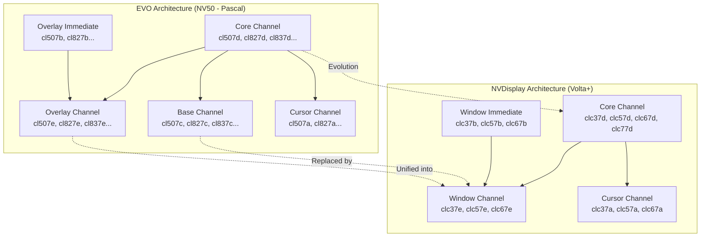
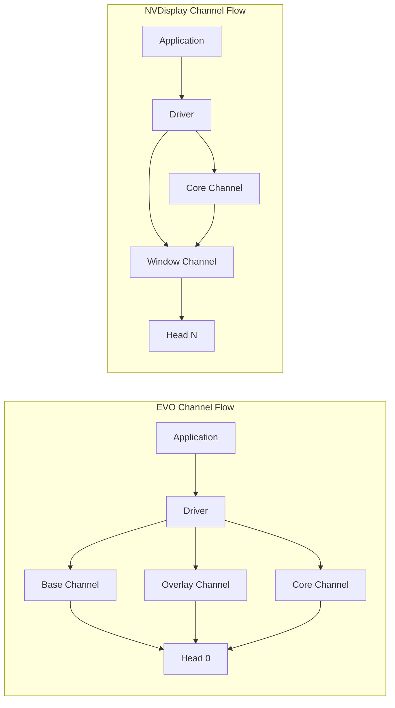
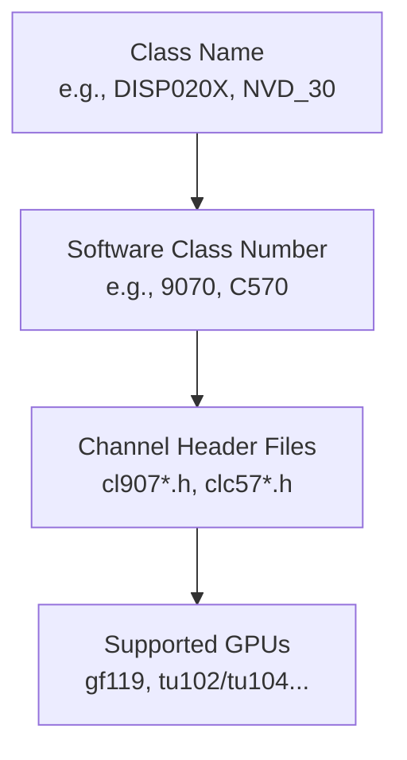
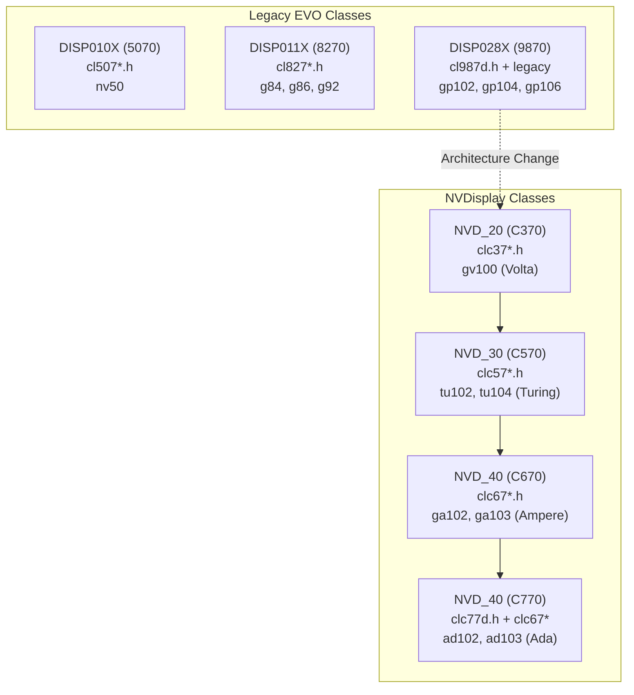
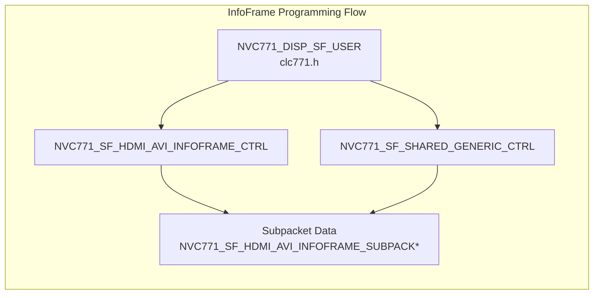

<!-- source: DeepWiki mcp.deepwiki.com · repo NVIDIA/open-gpu-doc · extra page Display Architecture Overview · fetched 2026-10-26 -->

# Display Architecture Overview

Relevant source files

The following files were used as context for generating this wiki page:

- [classes/display/README.txt](classes/display/README.txt)
- [classes/display/clc771.h](classes/display/clc771.h)
- [classes/display/clc773.h](classes/display/clc773.h)
- [classes/display/clc77d.h](classes/display/clc77d.h)
- [classes/display/index.html](classes/display/index.html)

## Purpose and Scope

This document provides an overview of NVIDIA GPU display subsystem architectures, covering the evolution from the legacy EVO display engine to the modern NVDisplay engine. It explains the channel-based programming model, hardware class definitions, and GPU generation support matrix.

For detailed information about specific display programming interfaces, see [Display Core Interface](#3.2.3), [Display Control Channels](#3.2.4), and [Display Capabilities and InfoFrame Control](#3.2.2).

## Architecture Evolution

The NVIDIA display subsystem has evolved through two major architectural generations, each representing significant improvements in flexibility and capabilities.

### EVO Display Engine

The EVO display engine was introduced with the NV50 GPU generation and served as the foundation for display processing across multiple GPU generations. EVO uses a fixed channel architecture where each channel type has a specific, predefined purpose.

### NVDisplay Engine

The NVDisplay engine represents a major architectural advancement introduced with the Volta generation. It provides enhanced flexibility through a more programmable channel model, supporting advanced features like multi-window compositing, improved scaling, and dynamic window-to-head mapping.

**Sources:** [classes/display/README.txt:1-61]()

## Channel Architecture

### EVO Channel Types

EVO employs five distinct channel types, each with specialized functionality:

| Channel Type | Purpose | Scope | Header Examples |
|--------------|---------|-------|-----------------|
| **Core** | Modesets, LUT management, cursor properties | GPU-wide | `cl507d.h`, `cl827d.h` |
| **Base** | Primary surface flipping (OpenGL SwapBuffers) | Per-head | `cl507c.h`, `cl827c.h` |
| **Overlay** | Video overlay surface flipping | Per-head | `cl507e.h`, `cl827e.h` |
| **Overlay Immediate** | Real-time overlay positioning | Per-head | `cl507b.h`, `cl827b.h` |
| **Cursor** | Low-latency cursor positioning | Per-head | `cl507a.h`, `cl827a.h` |

### NVDisplay Channel Types

NVDisplay simplifies and enhances the channel model:

| Channel Type | Purpose | Scope | Key Improvements |
|--------------|---------|-------|------------------|
| **Core** | Modesets, does not support base layer programming | GPU-wide | Enhanced control interface |
| **Window** | Unified surface management with scaling, blending | Flexible head binding | Replaces base + overlay |
| **Window Immediate** | Window positioning with DMA support | Per-window | Multiple queued updates |
| **Cursor** | Cursor positioning | Per-head | Similar to EVO |

**Sources:** [classes/display/README.txt:6-49]()

## Hardware Class Structure

The display system uses software class numbers and names to identify compatible channel combinations across GPU generations.

### Class Naming Convention

### GPU Generation Mapping

**Sources:** [classes/display/README.txt:63-243]()

## Core Channel Implementation

The core channel serves as the primary control interface for display configuration and coordination across all channel types.

### Core Channel Methods (Modern Ada Implementation)

The `clc77d.h` header defines the Ada Lovelace core channel interface with key method categories:

```mermaid
graph TD
    subgraph "NVC77D Core Channel Methods"
        DMA_CTRL["DMA Control<br/>NVC77D_PUT<br/>NVC77D_GET<br/>NVC77D_UPDATE"]
        NOTIFIER["Notification<br/>NVC77D_SET_CONTEXT_DMA_NOTIFIER<br/>NVC77D_SET_NOTIFIER_CONTROL"]
        INTERLOCK["Interlocking<br/>NVC77D_SET_INTERLOCK_FLAGS<br/>NVC77D_SET_WINDOW_INTERLOCK_FLAGS"]
        OUTPUT_CTRL["Output Control<br/>NVC77D_SOR_SET_CONTROL<br/>NVC77D_DSI_SET_CONTROL"]
        WINDOW_CTRL["Window Control<br/>NVC77D_WINDOW_SET_CONTROL<br/>NVC77D_WINDOW_SET_WINDOW_FORMAT_USAGE_BOUNDS"]
        HEAD_CTRL["Head Control<br/>NVC77D_HEAD_SET_CONTROL<br/>NVC77D_HEAD_SET_PIXEL_CLOCK_FREQUENCY"]
    end
    
    DMA_CTRL --> NOTIFIER
    NOTIFIER --> INTERLOCK
    INTERLOCK --> OUTPUT_CTRL
    OUTPUT_CTRL --> WINDOW_CTRL
    WINDOW_CTRL --> HEAD_CTRL
```

### Display Capabilities Interface

The capabilities interface (`clc773.h`) provides hardware feature discovery for software to determine available display functionality.

| Capability Category | Purpose | Key Fields |
|-------------------|---------|------------|
| **System Capabilities** | Hardware presence detection | `NVC773_SYS_CAP_HEAD_EXISTS`, `NVC773_SYS_CAP_SOR_EXISTS` |
| **Window Capabilities** | Available window resources | `NVC773_SYS_CAPB_WINDOW_EXISTS` |
| **IHUB Capabilities** | Memory and processing features | `NVC773_IHUB_COMMON_CAPA_MEMPOOL_ENTRIES` |
| **SOR Capabilities** | Output interface support | `NVC773_SOR_CAP_DP_A`, `NVC773_SOR_CAP_HDMI_FRL` |

**Sources:** [classes/display/clc77d.h:32-33](), [classes/display/clc77d.h:76-698](), [classes/display/clc773.h:31-667]()

## InfoFrame and Serial Frontend Interface

The `DISP_SF_USER` class provides direct access to Serial Frontend registers for programming HDMI InfoFrame data.

The InfoFrame interface supports standard HDMI packet types including AVI InfoFrames and vendor-specific InfoFrames for extended display capabilities.

**Sources:** [classes/display/clc771.h:31-257](), [classes/display/README.txt:56-58]()

---

