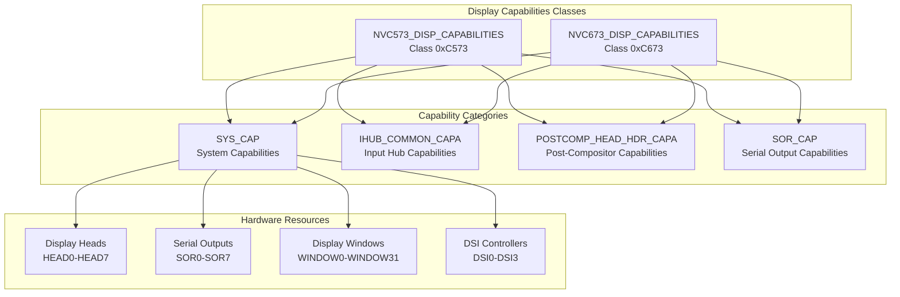
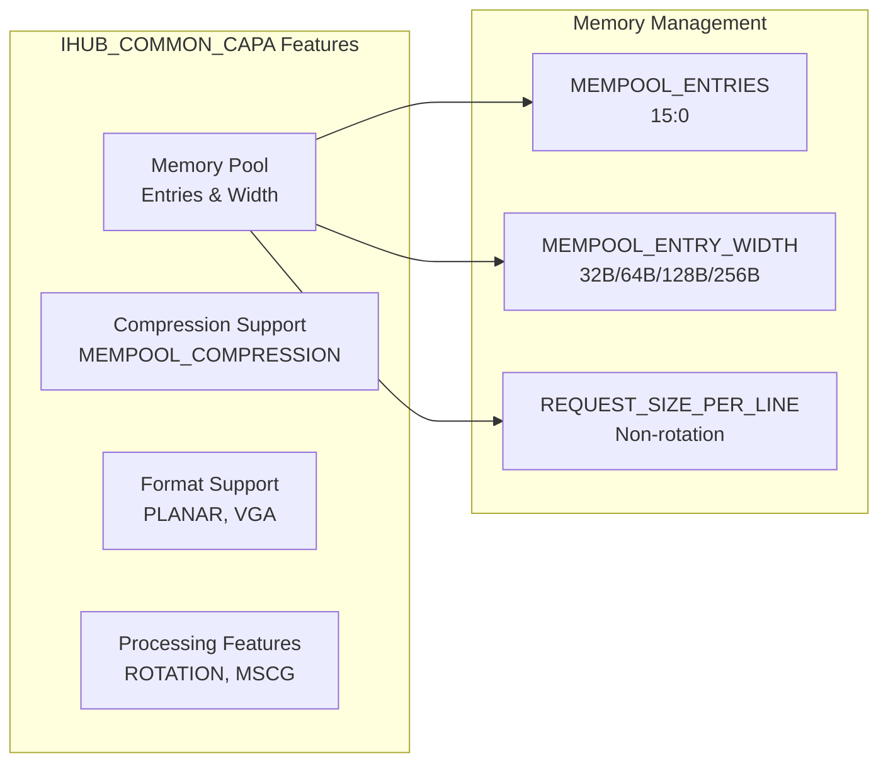
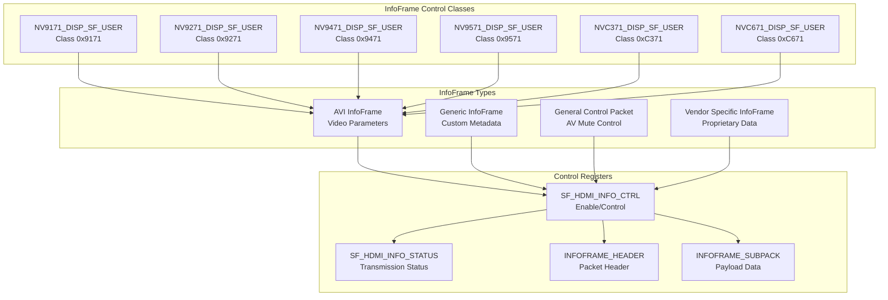
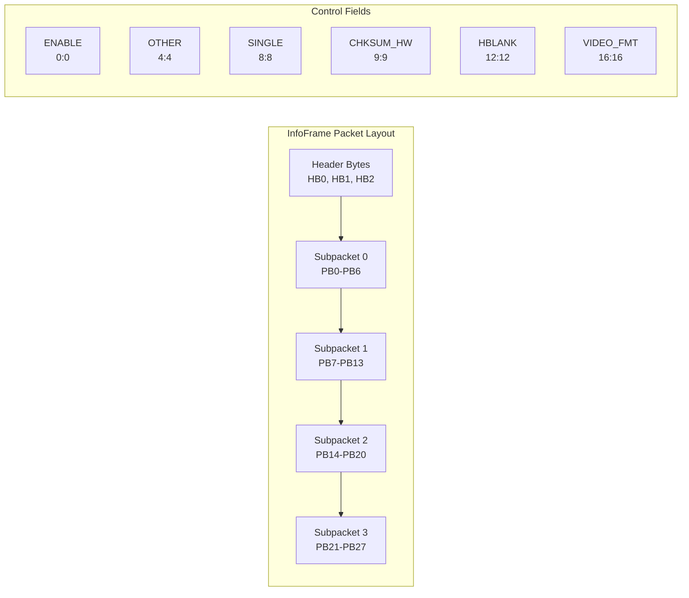
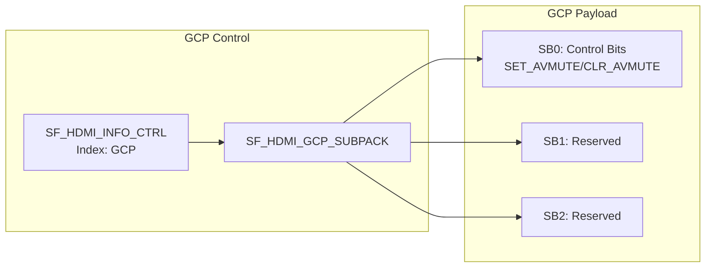
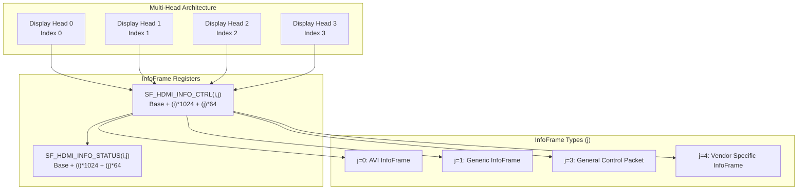

<!-- source: DeepWiki mcp.deepwiki.com · repo NVIDIA/open-gpu-doc · extra page Display Capabilities and InfoFrame Control · fetched 2026-10-26 -->

# Display Capabilities and InfoFrame Control

Relevant source files

The following files were used as context for generating this wiki page:

- [classes/display/cl9171.h](classes/display/cl9171.h)
- [classes/display/cl9271.h](classes/display/cl9271.h)
- [classes/display/cl9471.h](classes/display/cl9471.h)
- [classes/display/cl9571.h](classes/display/cl9571.h)
- [classes/display/clc371.h](classes/display/clc371.h)
- [classes/display/clc573.h](classes/display/clc573.h)
- [classes/display/clc57a.h](classes/display/clc57a.h)
- [classes/display/clc57b.h](classes/display/clc57b.h)
- [classes/display/clc671.h](classes/display/clc671.h)
- [classes/display/clc673.h](classes/display/clc673.h)

This document covers the display subsystem's hardware capability reporting and HDMI InfoFrame signaling interfaces. These systems enable software to query available display hardware features and control video metadata transmission over HDMI connections.

For information about core display channel operation, see [Display Core Interface](#3.2.3). For window and cursor control mechanisms, see [Display Control Channels](#3.2.4).

## Purpose and Scope

The display capabilities system provides standardized interfaces for discovering hardware features across different GPU generations, including heads, SORs (Serial Output Resources), windows, and post-composition processing units. The InfoFrame control system manages HDMI metadata packet transmission, including AVI InfoFrames, General Control Packets, and Vendor Specific InfoFrames.

## Display Capabilities Architecture

The display capabilities system uses dedicated hardware classes to report available display features and their specifications. Different GPU generations implement varying capability sets through versioned class interfaces.

Sources: [classes/display/clc573.h:31-35](), [classes/display/clc673.h:31-35](), [classes/display/clc573.h:38-112](), [classes/display/clc673.h:38-110]()

### System Capabilities

The `SYS_CAP` register provides basic existence flags for display hardware components. Each bit indicates whether a specific resource is present and functional.

| Capability Type | Register Fields | Purpose |
|----------------|----------------|----------|
| Display Heads | `HEAD0_EXISTS` - `HEAD7_EXISTS` | Available display output heads |
| Serial Outputs | `SOR0_EXISTS` - `SOR7_EXISTS` | HDMI/DP/LVDS output controllers |
| Windows | `WINDOW0_EXISTS` - `WINDOW31_EXISTS` | Overlay/composition windows |
| DSI Controllers | `DSI0_EXISTS` - `DSI3_EXISTS` | MIPI DSI interface controllers |

Sources: [classes/display/clc573.h:38-112](), [classes/display/clc673.h:38-110]()

### Input Hub Capabilities

The IHUB capabilities describe memory management and processing features for display input handling.

Sources: [classes/display/clc573.h:247-285](), [classes/display/clc673.h:212-244]()

### Post-Compositor Capabilities

Post-compositor capabilities define available processing units in the display output pipeline.

| Processing Unit | Register Field | Description |
|----------------|----------------|-------------|
| Output Color Space Converter | `OCSC0_PRESENT`, `OCSC1_PRESENT` | Color space conversion |
| Scaler | `SCLR_PRESENT` | Image scaling and filtering |
| Output Low-Pass Filter | `OLPF_PRESENT` | Anti-aliasing filter |
| Dithering | `DTH_PRESENT` | Color depth reduction |
| Overscan | `OSCAN_PRESENT` | Display area adjustment |
| Display Stream Compression | `DSC_PRESENT` | Bandwidth compression |

Sources: [classes/display/clc573.h:286-387](), [classes/display/clc673.h:263-341]()

## InfoFrame Control System

The InfoFrame control system manages HDMI metadata packet transmission through dedicated hardware classes. Different generations provide varying levels of InfoFrame support and control granularity.

Sources: [classes/display/cl9171.h:31-35](), [classes/display/cl9271.h:31-35](), [classes/display/cl9471.h:31-35](), [classes/display/cl9571.h:31-35](), [classes/display/clc371.h:31-35](), [classes/display/clc671.h:31-35]()

### InfoFrame Packet Structure

Each InfoFrame type follows a standardized packet structure with header and payload sections.

Sources: [classes/display/cl9171.h:98-141](), [classes/display/cl9271.h:98-141](), [classes/display/cl9471.h:98-141]()

### AVI InfoFrame Control

The AVI InfoFrame carries video format and display parameters. The control interface provides enable/disable functionality and automatic checksum generation.

| Register | Field | Description |
|----------|-------|-------------|
| `SF_HDMI_AVI_INFOFRAME_CTRL` | `ENABLE` | Enable/disable AVI InfoFrame transmission |
| | `CHKSUM_HW` | Hardware checksum generation |
| | `SINGLE` | Single transmission mode |
| `SF_HDMI_AVI_INFOFRAME_STATUS` | `SENT` | Transmission completion status |
| `SF_HDMI_AVI_INFOFRAME_HEADER` | `HB0-HB2` | InfoFrame header bytes |
| `SF_HDMI_AVI_INFOFRAME_SUBPACK0_LOW` | `PB0-PB3` | Payload bytes 0-3 |
| `SF_HDMI_AVI_INFOFRAME_SUBPACK0_HIGH` | `PB4-PB6` | Payload bytes 4-6 |

Sources: [classes/display/cl9171.h:75-141](), [classes/display/clc671.h:42-118]()

### General Control Packet (GCP)

The GCP provides AV mute control and other general signaling functions.

Sources: [classes/display/cl9171.h:222-231](), [classes/display/cl9271.h:222-231]()

### Multi-Head InfoFrame Management

Modern display classes support per-head InfoFrame control with indexed access patterns.

Sources: [classes/display/cl9171.h:41-74](), [classes/display/cl9271.h:41-74](), [classes/display/cl9471.h:41-74]()

## Hardware Generation Mapping

Different GPU architectures implement varying levels of display capabilities and InfoFrame support.

| GPU Generation | Capabilities Class | InfoFrame Class | Key Features |
|---------------|-------------------|-----------------|--------------|
| Turing | `NVC573` | `NV9171`, `NV9271`, `NV9471`, `NV9571` | Basic capability reporting, full InfoFrame support |
| Ampere | `NVC673` | `NVC371`, `NVC671` | Enhanced capabilities, rotation support, simplified InfoFrame control |

The newer generations provide additional capability flags such as rotation support (`SUPPORT_ROTATION`) and enhanced processing features while maintaining backward compatibility for core InfoFrame functionality.

Sources: [classes/display/clc573.h:31](), [classes/display/clc673.h:31](), [classes/display/clc371.h:31](), [classes/display/clc671.h:31]()

---

