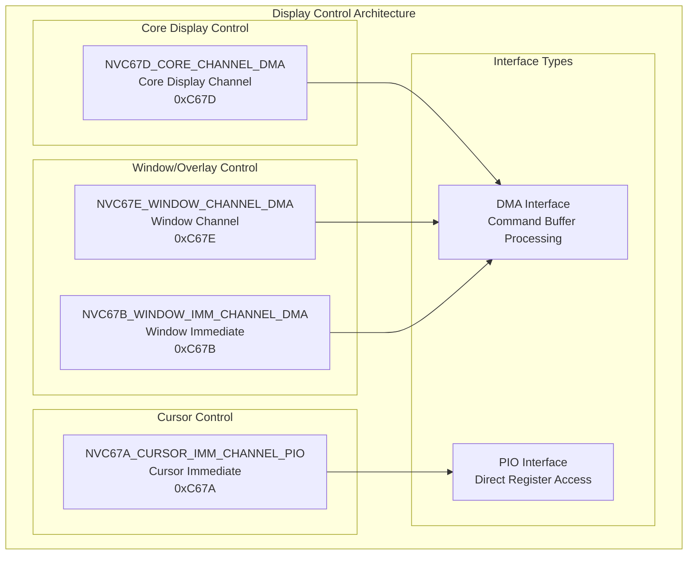
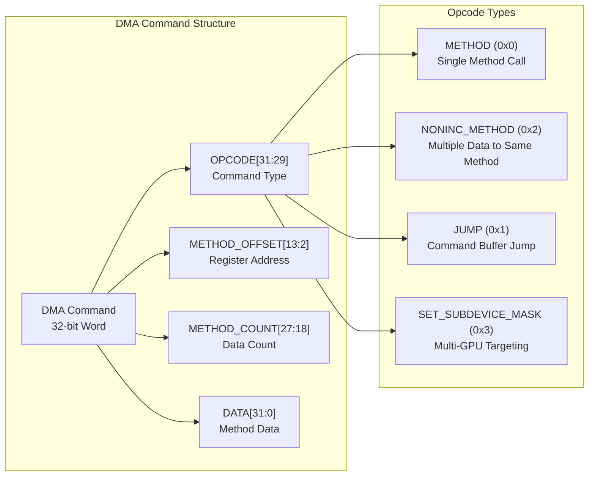
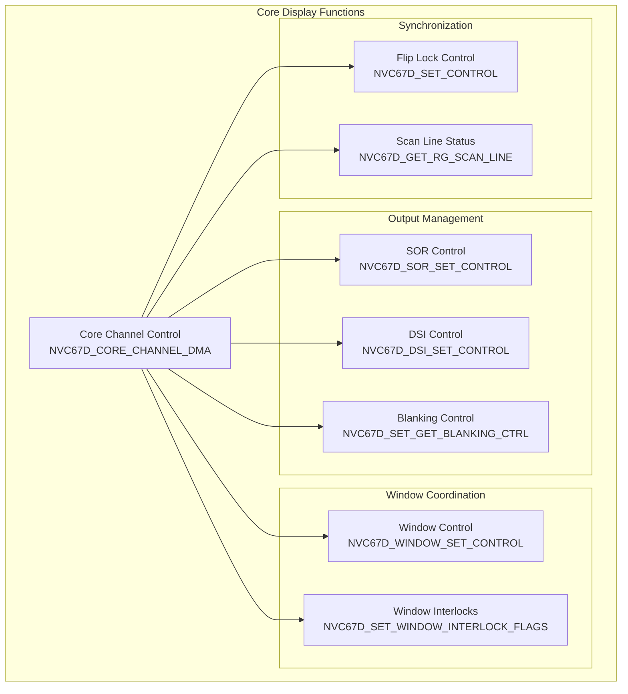
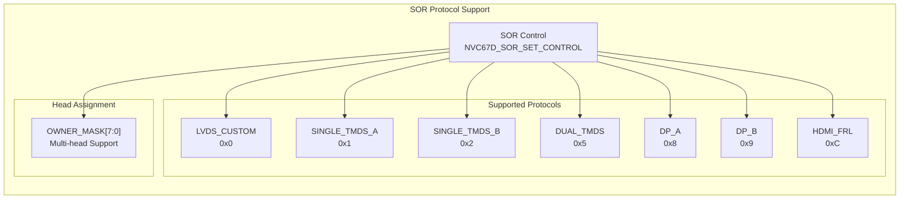
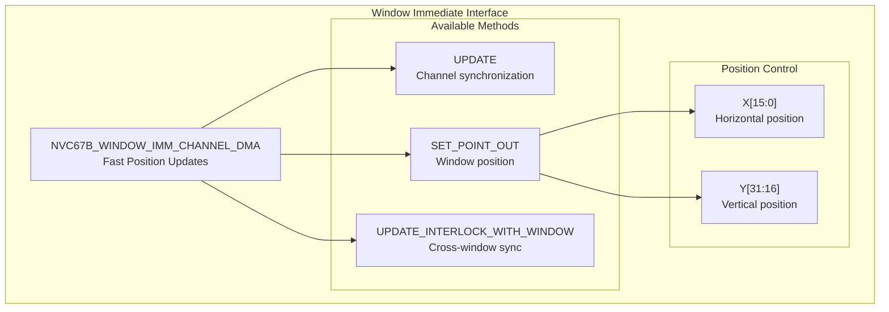
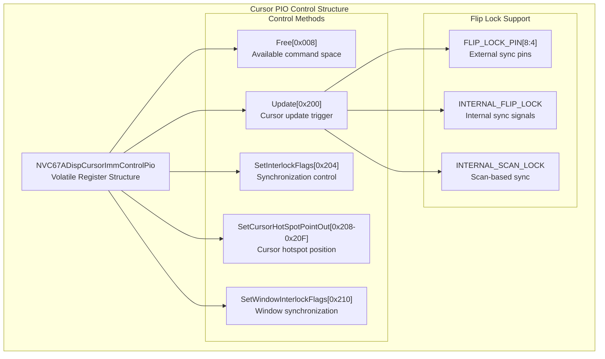
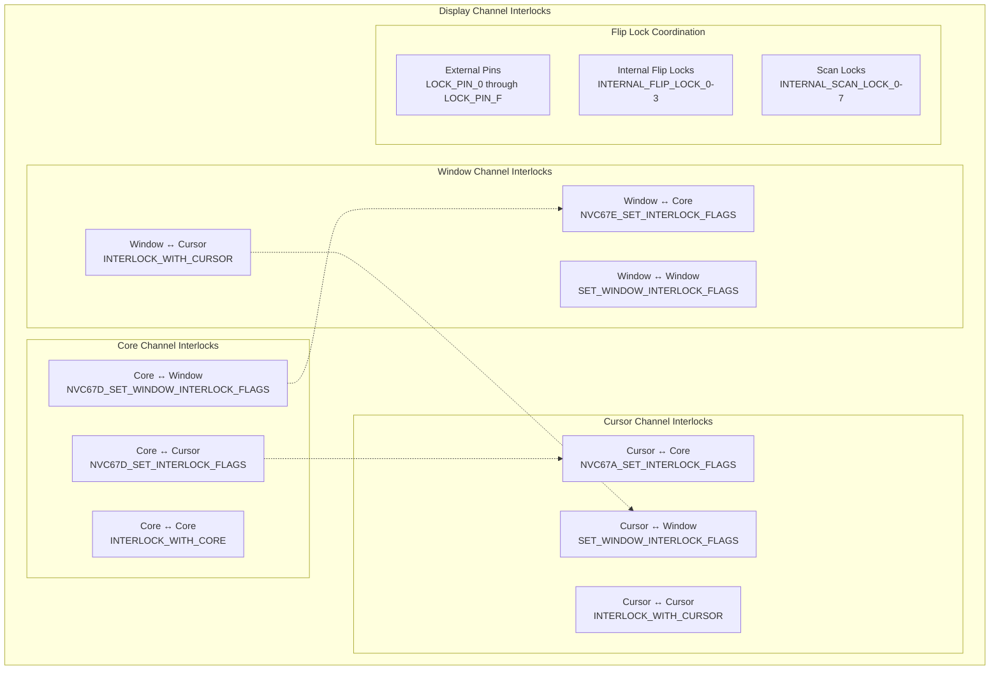

<!-- source: DeepWiki mcp.deepwiki.com · repo NVIDIA/open-gpu-doc · extra page Display Control Channels · fetched 2026-10-26 -->

# Display Control Channels

Relevant source files

The following files were used as context for generating this wiki page:

- [classes/display/cl907dcrcnotif.h](classes/display/cl907dcrcnotif.h)
- [classes/display/cl917c.h](classes/display/cl917c.h)
- [classes/display/cl917dcrcnotif.h](classes/display/cl917dcrcnotif.h)
- [classes/display/cl917e.h](classes/display/cl917e.h)
- [classes/display/cl927c.h](classes/display/cl927c.h)
- [classes/display/cl927dcrcnotif.h](classes/display/cl927dcrcnotif.h)
- [classes/display/clc37a.h](classes/display/clc37a.h)
- [classes/display/clc37b.h](classes/display/clc37b.h)
- [classes/display/clc37dcrcnotif.h](classes/display/clc37dcrcnotif.h)
- [classes/display/clc67a.h](classes/display/clc67a.h)
- [classes/display/clc67b.h](classes/display/clc67b.h)
- [classes/display/clc67d.h](classes/display/clc67d.h)
- [classes/display/clc67e.h](classes/display/clc67e.h)

This document covers the display control channel interfaces that provide software control over GPU display hardware subsystems. These channels offer both DMA-based and PIO-based programming interfaces for managing display output, window composition, and cursor positioning across different GPU generations.

For information about display capabilities and InfoFrame signaling, see [Display Capabilities and InfoFrame Control](#3.2.2). For details about the core display channel DMA interface, see [Display Core Interface](#3.2.3).

## Channel Types and Interface Mechanisms

The display subsystem provides multiple specialized control channels, each designed for specific display functions. These channels use either DMA (Direct Memory Access) or PIO (Programmed Input/Output) mechanisms for hardware communication.

**Sources:** [classes/display/clc67d.h:32](), [classes/display/clc67e.h:32](), [classes/display/clc67b.h:32](), [classes/display/clc67a.h:31]()

### Channel Interface Summary

| Channel Type | Class ID | Interface | Primary Function |
|--------------|----------|-----------|------------------|
| Core Display | `NVC67D_CORE_CHANNEL_DMA` | DMA | Display controller coordination, output routing |
| Window Channel | `NVC67E_WINDOW_CHANNEL_DMA` | DMA | Surface composition, scaling, format conversion |
| Window Immediate | `NVC67B_WINDOW_IMM_CHANNEL_DMA` | DMA | Fast window position updates |
| Cursor Immediate | `NVC67A_CURSOR_IMM_CHANNEL_PIO` | PIO | Cursor positioning and control |

**Sources:** [classes/display/clc67d.h:32](), [classes/display/clc67e.h:32](), [classes/display/clc67b.h:32](), [classes/display/clc67a.h:31]()

## DMA Command Processing

DMA-based channels use a common command format for method calls, providing efficient batch processing of display operations through command buffers.

**Sources:** [classes/display/clc67d.h:58-69](), [classes/display/clc67e.h:35-46]()

### Common DMA Methods

All DMA channels implement standard command buffer control methods:

| Method | Offset | Purpose |
|--------|--------|---------|
| `PUT` | `0x000` | Command buffer write pointer |
| `GET` | `0x004` | Command buffer read pointer |
| `UPDATE` | `0x200` | Channel update and synchronization |

**Sources:** [classes/display/clc67d.h:76-80](), [classes/display/clc67e.h:49-53]()

## Core Display Channel

The `NVC67D_CORE_CHANNEL_DMA` provides centralized control over display output routing, head management, and cross-channel synchronization.

### Core Channel Responsibilities

**Sources:** [classes/display/clc67d.h:299-349](), [classes/display/clc67d.h:351-363](), [classes/display/clc67d.h:185-285]()

### Serial Output Resource (SOR) Control

The core channel manages SOR units that handle different display protocols:

**Sources:** [classes/display/clc67d.h:299-331]()

## Window Control Channels

Window channels manage overlay surfaces, providing composition, scaling, and format conversion capabilities. Two types of window channels are available: full-featured DMA channels and immediate update channels.

### Window Channel DMA

The `NVC67E_WINDOW_CHANNEL_DMA` provides comprehensive surface management:

| Function Category | Key Methods | Purpose |
|------------------|-------------|---------|
| Surface Configuration | `SET_SIZE`, `SET_STORAGE`, `SET_PARAMS` | Surface dimensions and format |
| Memory Management | `SET_CONTEXT_DMA_ISO`, `SET_OFFSET` | Surface memory binding |
| Scaling | `SET_SIZE_IN`, `SET_SIZE_OUT`, `SET_CONTROL_INPUT_SCALER` | Input/output scaling |
| Composition | `SET_COMPOSITION_CONTROL`, `SET_COMPOSITION_FACTOR_SELECT` | Alpha blending control |
| Color Processing | `SET_KEY_ALPHA`, `SET_KEY_RED_CR` | Color keying |

**Sources:** [classes/display/clc67e.h:126-128](), [classes/display/clc67e.h:175-176](), [classes/display/clc67e.h:186-191](), [classes/display/clc67e.h:202-266]()

### Window Immediate Channel

The `NVC67B_WINDOW_IMM_CHANNEL_DMA` provides fast position updates for time-critical operations:

**Sources:** [classes/display/clc67b.h:53-63]()

## Cursor Control Channel

The `NVC67A_CURSOR_IMM_CHANNEL_PIO` provides real-time cursor positioning through direct register access, optimized for minimal latency.

### Cursor PIO Interface

**Sources:** [classes/display/clc67a.h:33-42](), [classes/display/clc67a.h:46-79]()

### Cursor Position Control

The cursor hotspot defines the active point of the cursor relative to its surface:

| Register | Bit Fields | Function |
|----------|------------|----------|
| `SET_CURSOR_HOT_SPOT_POINT_OUT[0]` | `X[15:0]`, `Y[31:16]` | Primary hotspot position |
| `SET_CURSOR_HOT_SPOT_POINT_OUT[1]` | `X[15:0]`, `Y[31:16]` | Secondary hotspot position |

**Sources:** [classes/display/clc67a.h:108-110]()

## Channel Synchronization and Interlocks

Display channels implement sophisticated synchronization mechanisms to ensure tear-free updates and coordinate between multiple display elements.

### Interlock Mechanisms

**Sources:** [classes/display/clc67d.h:153-285](), [classes/display/clc67e.h:324-455](), [classes/display/clc67a.h:80-207]()

### Notification and Semaphore Support

DMA channels support completion notifications and semaphore-based synchronization:

| Mechanism | Window Channel | Core Channel | Purpose |
|-----------|----------------|--------------|---------|
| Context DMA Notifier | `SET_CONTEXT_DMA_NOTIFIER` | `SET_CONTEXT_DMA_NOTIFIER` | Completion notification |
| Semaphore Acquire | `SET_SEMAPHORE_ACQUIRE` | N/A | Pre-execution sync |
| Semaphore Release | `SET_SEMAPHORE_RELEASE` | N/A | Post-execution sync |
| Semaphore Control | `SET_SEMAPHORE_CONTROL` | N/A | Sync configuration |

**Sources:** [classes/display/clc67e.h:113-118](), [classes/display/clc67e.h:291-305](), [classes/display/clc67d.h:126-135]()

## GPU Generation Variations

Different GPU generations implement variations of these channel interfaces while maintaining backward compatibility:

| Generation | Core Channel | Window Channel | Cursor Channel | Notable Changes |
|------------|--------------|----------------|----------------|-----------------|
| Volta (C37x) | `NVC37D` | `NVC37E` | `NVC37A` | Basic interlock support |
| Turing (C67x) | `NVC67D` | `NVC67E` | `NVC67A` | Enhanced flip lock mechanisms |
| Ampere (917x, 927x) | `NV917D`, `NV927D` | `NV917E` | N/A | Advanced color processing |

**Sources:** [classes/display/clc37a.h:32](), [classes/display/cl917c.h:33](), [classes/display/cl927c.h:33]()

---

