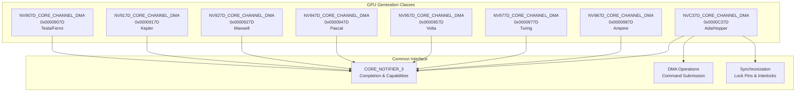
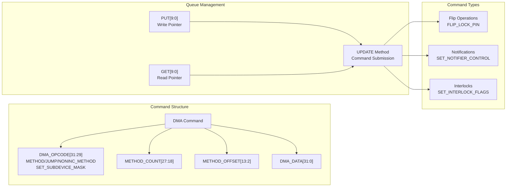
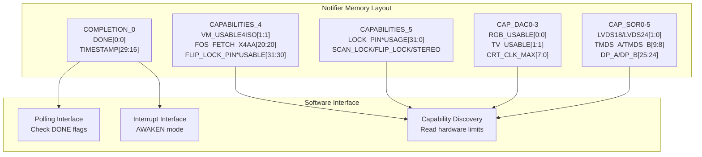
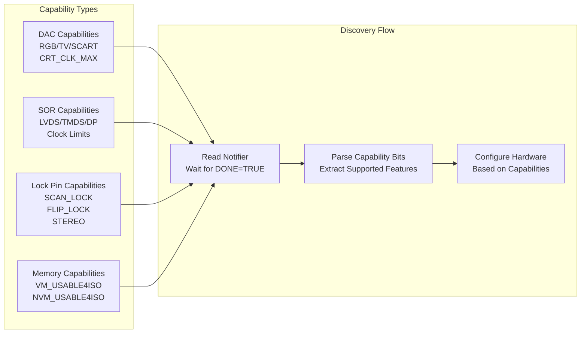
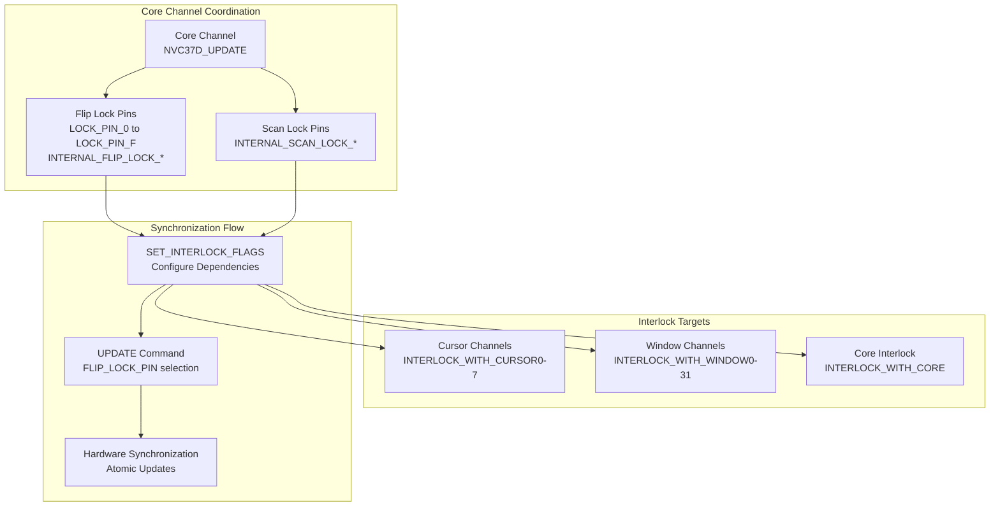

<!-- source: DeepWiki mcp.deepwiki.com · repo NVIDIA/open-gpu-doc · extra page Display Core Interface · fetched 2026-10-26 -->

# Display Core Interface

Relevant source files

The following files were used as context for generating this wiki page:

- [classes/display/cl907d.h](classes/display/cl907d.h)
- [classes/display/cl917d.h](classes/display/cl917d.h)
- [classes/display/cl927d.h](classes/display/cl927d.h)
- [classes/display/cl947d.h](classes/display/cl947d.h)
- [classes/display/cl957d.h](classes/display/cl957d.h)
- [classes/display/cl977d.h](classes/display/cl977d.h)
- [classes/display/cl987d.h](classes/display/cl987d.h)
- [classes/display/clc37d.h](classes/display/clc37d.h)

The Display Core Interface provides the primary DMA-based communication channel between software and the GPU's display engine hardware. This interface handles command submission, hardware capability discovery, completion notifications, and synchronization across different display components like windows, cursors, and output resources.

For information about specific display control channels (window, cursor, immediate), see [Display Control Channels](#3.2.4). For display hardware capabilities and InfoFrame control, see [Display Capabilities and InfoFrame Control](#3.2.2).

## Core Channel Classes

The Display Core Interface is implemented through hardware classes that vary by GPU generation. Each generation provides a DMA channel class with a unique identifier for core display operations.

Sources: [classes/display/cl907d.h:32-32](), [classes/display/cl917d.h:33-33](), [classes/display/cl927d.h:33-33](), [classes/display/cl947d.h:33-33](), [classes/display/cl957d.h:33-33](), [classes/display/cl977d.h:33-33](), [classes/display/cl987d.h:33-33](), [classes/display/clc37d.h:33-33]()

## DMA Command Interface

The core display channel uses a push buffer DMA mechanism for command submission. Commands are structured with specific opcodes and can target different display subsystems.

Sources: [classes/display/clc37d.h:59-70](), [classes/display/clc37d.h:77-95](), [classes/display/clc37d.h:127-136]()

## Notification System

The notification system provides completion tracking and hardware capability reporting through a structured notifier interface. Each core channel maintains a notifier structure in memory that software can poll or receive interrupts for.

### Notifier Structure

| Offset | Field | Purpose |
|--------|-------|---------|
| 0x00 | `COMPLETION_0` | Operation completion status and timestamp |
| 0x04-0x0C | Reserved | Additional completion data |
| 0x10+ | `CAPABILITIES_4+` | Hardware capability flags |
| 0x30+ | `CAP_DAC*` | DAC output capabilities |
| 0x50+ | `CAP_SOR*` | Serial Output Resource capabilities |

Sources: [classes/display/cl917d.h:35-49](), [classes/display/cl917d.h:49-69](), [classes/display/cl917d.h:163-218](), [classes/display/cl917d.h:219-390]()

## Hardware Capability Discovery

The notification system exposes detailed hardware capabilities that software can query to determine available display features and limits.

### DAC Capabilities

The Digital-to-Analog Converter capabilities indicate supported output modes and frequency limits:

- `RGB_USABLE`: Standard RGB output support
- `TV_USABLE`: Television/composite output support  
- `SCART_USABLE`: SCART connector support
- `CRT_CLK_MAX`: Maximum pixel clock for CRT outputs

### SOR Capabilities

Serial Output Resource capabilities cover digital display interfaces:

- **LVDS**: Single/dual channel 18-bit and 24-bit LVDS support
- **TMDS**: Single/dual link TMDS for DVI/HDMI (channels A/B)
- **DisplayPort**: DisplayPort A/B channel support with interlace capability
- **Clock Limits**: Maximum pixel clocks for each interface type

Sources: [classes/display/cl917d.h:163-218](), [classes/display/cl917d.h:219-304](), [classes/display/cl917d.h:49-69](), [classes/display/cl917d.h:70-151]()

## Synchronization and Interlocking

The Display Core Interface provides sophisticated synchronization mechanisms to coordinate operations across multiple display components.

### Lock Pin Management

Lock pins provide hardware-level synchronization for display timing:

| Lock Pin Type | Usage | Description |
|---------------|-------|-------------|
| `SCAN_LOCK` | Vertical synchronization | Locks to display scanout timing |
| `FLIP_LOCK` | Page flip synchronization | Coordinates buffer flips across heads |
| `STEREO` | Stereoscopic display | Synchronizes left/right eye timing |

### Interlock Mechanisms

The system supports interlocking between different display subsystems:

Sources: [classes/display/clc37d.h:93-126](), [classes/display/clc37d.h:154-182](), [classes/display/clc37d.h:186-277](), [classes/display/cl917d.h:70-151]()

---

