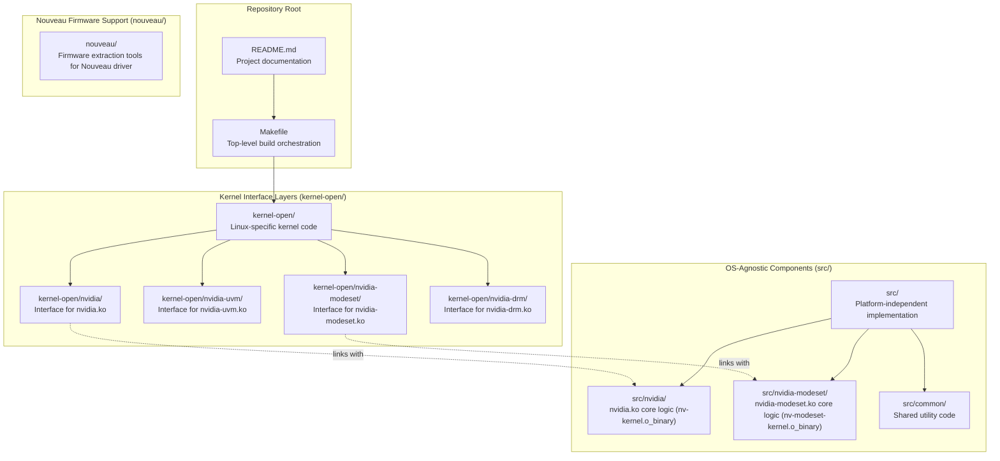
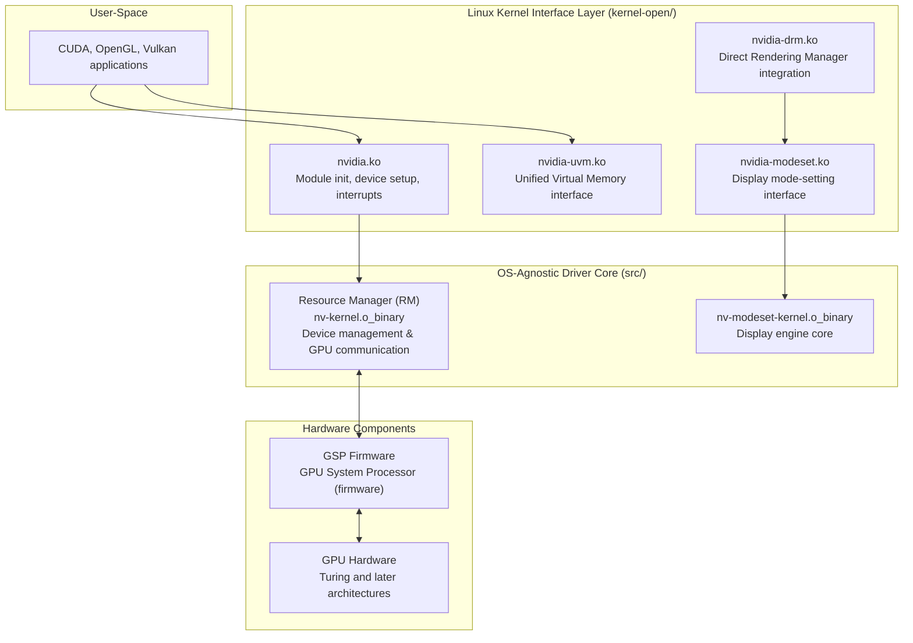

<!-- source: DeepWiki mcp.deepwiki.com · repo NVIDIA/open-gpu-kernel-modules · page 1 Overview · fetched 2026-10-26 -->

# Overview

Relevant source files

The following files were used as context for generating this wiki page:

- [README.md](README.md)

## Purpose and Scope

This document presents a high-level overview of the NVIDIA Open GPU Kernel Modules repository, which provides the Linux kernel driver source code supporting NVIDIA GPUs starting from the Turing architecture onward. These kernel modules implement key GPU management features such as device initialization, memory management, display configuration, and communication with GPU firmware.

The kernel modules in this repository must be used alongside matching GSP (GPU System Processor) firmware and corresponding user-space NVIDIA GPU driver components from the same driver release series — currently version **615.78.08**. The repository focuses exclusively on kernel-space components; user-space libraries and utilities like CUDA, OpenGL, and Vulkan are delivered separately as part of NVIDIA’s proprietary driver packages.

For detailed technical descriptions on architecture, hardware requirements, and subsystems, consult the respective child pages:
- System Architecture and layering: [Architecture Overview](#1.1)
- Hardware Compatibility and prerequisites: [Supported Hardware and Requirements](#1.2)
- Core kernel module design: [Core Kernel Modules](#3)
- GPU resource management and firmware communication: [GPU Resource Management](#4)
- Display subsystem internals: [Display Subsystem](#6)

**Sources:** [README.md:1-25,131-152,180-184]()

---

## Repository Structure

The repository is architected to separate Linux kernel-specific interface code from OS-agnostic core components. This separation permits the bulk of the driver logic to be developed independently of the operating system, while the Linux kernel interface layers handle kernel version specifics, module loading, device probing, and system call interfaces.

### Directory Highlights

| Directory                      | Role                                         | Description                                    |
|-------------------------------|----------------------------------------------|------------------------------------------------|
| `kernel-open/nvidia/`          | Linux kernel interface for `nvidia.ko`       | Kernel module entry points, device lifecycle, and ioctl implementations |
| `kernel-open/nvidia-uvm/`      | Linux interface for `nvidia-uvm.ko`           | Unified Virtual Memory kernel interface          |
| `kernel-open/nvidia-modeset/`  | Linux interface for `nvidia-modeset.ko`       | Display mode-setting kernel layer                |
| `kernel-open/nvidia-drm/`      | Linux DRM integration for `nvidia-drm.ko`     | DRM/KMS subsystem integration                    |
| `src/nvidia/`                  | OS-agnostic core for `nvidia.ko`               | Pre-built binary blob (`nv-kernel.o_binary`) containing core driver logic |
| `src/nvidia-modeset/`          | OS-agnostic core for `nvidia-modeset.ko`       | Pre-built binary blob (`nv-modeset-kernel.o_binary`) with display engine logic |
| `src/common/`                  | Shared utility code                            | Code shared across multiple components           |
| `nouveau/`                    | Firmware extraction tools for Nouveau driver  | Python scripts and firmware layout for GSP firmware extraction |

**Sources:** [README.md:153-177]()

---

## Architecture Overview

The NVIDIA Open GPU driver architecture is composed of layered components that separate Linux kernel-specific code from cross-platform driver core logic. This promotes reusability, portability, and easier maintenance across multiple Linux kernel versions.

In modern NVIDIA GPUs, the GPU System Processor (GSP) firmware acts as an embedded microcontroller that offloads and manages GPU resource management tasks. The kernel driver communicates with the GSP firmware using an RPC-style interface to perform operations efficiently.

### Layered Responsibilities

- **Linux Kernel Interface Layer (`kernel-open/`)**  
  This layer contains Linux kernel version-dependent code handling kernel module initialization, device probing, interrupt management, and system call interfaces such as `ioctl` and `mmap`. It is built specifically for each target Linux kernel version and configuration.

- **OS-Agnostic Driver Core (`src/`)**  
  Provides GPU management, resource tracking, and other core driver functions independent of the OS. To reduce installation compile times, this core code is distributed as pre-compiled binaries embedded within kernel modules (`nv-kernel.o_binary` for `nvidia.ko` and `nv-modeset-kernel.o_binary` for `nvidia-modeset.ko`).

- **GPU System Processor (GSP) Firmware**  
  An embedded microprocessor on the GPU that offloads resource management from the host CPU. The driver communicates with the GSP via a Remote Procedure Call (RPC) interface to manage GPU resources efficiently.

This architectural design promotes modularity, code reuse, and compatibility with a wide range of Linux kernel versions without recompilation of the entire driver core.

**Sources:** [README.md:130-152,170-177]()

---

## Module Architecture

The NVIDIA GPU Linux kernel driver is divided into four primary kernel modules, each handling a distinct area of functionality:

| Module Name          | Role                                | Description                                  |
|----------------------|-----------------------------------|----------------------------------------------|
| `nvidia.ko`          | Core GPU driver                   | Handles GPU device lifecycle, resource management (via RM core), interrupts, power management, and user-space APIs through `ioctl` [kernel-open/nvidia/]() |
| `nvidia-modeset.ko`  | Display mode setting              | Manages display heads, modesetting, and integrates with OS-agnostic display engine logic [kernel-open/nvidia-modeset/]() |
| `nvidia-drm.ko`      | DRM/KMS integration               | Bridges NVIDIA drivers with the Linux Direct Rendering Manager subsystem to enable atomic modesetting and seamless OS integration [kernel-open/nvidia-drm/]() |
| `nvidia-uvm.ko`      | Unified Virtual Memory (UVM)      | Implements virtual memory sharing between CPU and GPU, with tracking of page residency and NUMA-aware allocation strategies [kernel-open/nvidia-uvm/]() |

Each module can be built and loaded independently but operates cohesively to provide a full NVIDIA GPU driver stack on Linux systems.

For a detailed explanation of each kernel module and their interaction, see the child page [Architecture Overview](#1.1).

**Sources:** [README.md:153-159]()

---

## Hardware Support and Requirements

The repository supports all NVIDIA GPUs from the Turing generation onward, encompassing Ampere, Ada Lovelace, Hopper, and the newest Blackwell architectures [README.md:182-184](). This broad support ensures compatibility with most current NVIDIA GPU product lines — including consumer, professional, and datacenter GPUs.

### Supported GPU Architectures and Example Products

| Architecture | Examples                                |
|--------------|---------------------------------------|
| Turing       | GeForce RTX 20 Series, Tesla T4       |
| Ampere       | GeForce RTX 30 Series, A100            |
| Ada Lovelace | GeForce RTX 40 Series, L40 Workstation |
| Hopper       | H100 Data Center GPU                   |
| Blackwell    | B200 Data Center GPU                   |

### Platform and Toolchain Requirements

- **CPU Architectures**: The kernel modules can be built for 64-bit x86_64 and ARM64 (aarch64) CPU architectures [README.md:27-49]().
- **Linux Kernel Versions**: Compatible with Linux kernel 4.15 and newer [README.md:75-78]().
- **Compiler Toolchains**: Compatible with modern versions of GCC and Clang. The kernel interface layer must be compiled with the same toolchain version used to build the host Linux kernel to maintain ABI stability [README.md:67-71]().
- **GSP Firmware**: The kernel modules require matching GSP firmware binaries extracted from the official NVIDIA driver packages. Installation instructions emphasize installing user-space NVIDIA drivers separately with the `--no-kernel-modules` option to avoid version conflicts [README.md:18-25]().
  
For complete hardware details, feature limitations, and platform specifics, refer to the child page [Supported Hardware and Requirements](#1.2).

**Sources:** [README.md:27-49,65-79,180-184]()

---

This overview introduces the NVIDIA Open GPU Kernel Modules project, its modular architecture, repository structure, and supported hardware. Detailed technical design, build procedures, and subsystem documentation are available in the linked child pages.

# End of Overview

---

