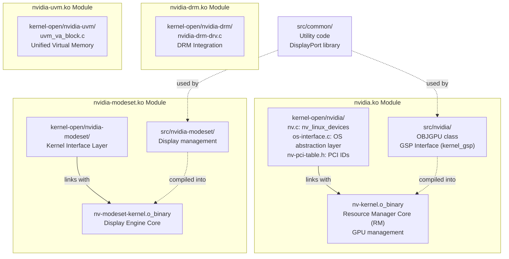
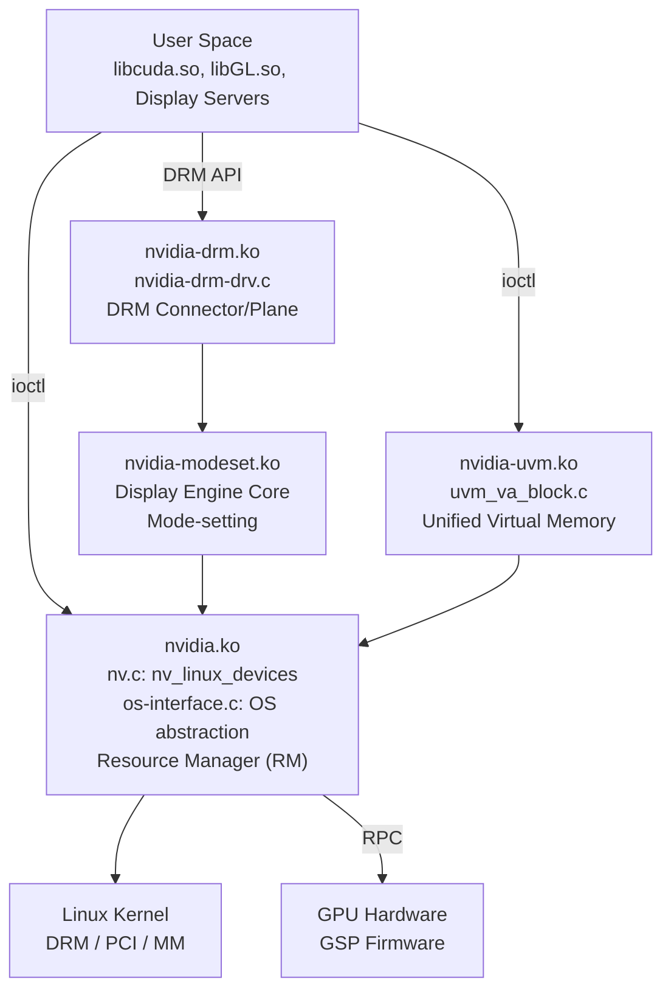
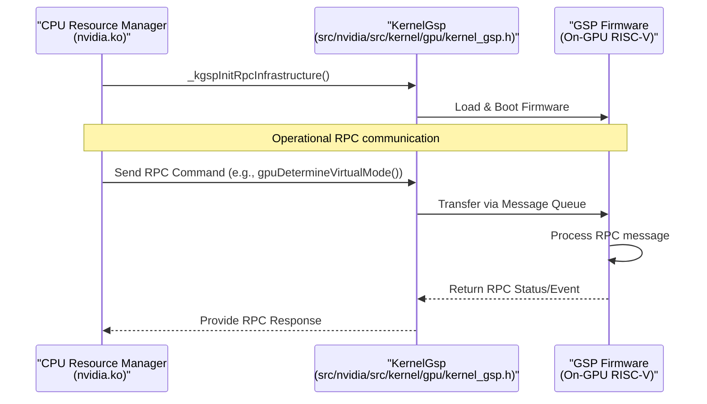

<!-- source: DeepWiki mcp.deepwiki.com · repo NVIDIA/open-gpu-kernel-modules · page 1.1 Architecture Overview · fetched 2026-10-26 -->

# Architecture Overview

Relevant source files

The following files were used as context for generating this wiki page:

- [README.md](README.md)
- [kernel-open/common/inc/nv-linux.h](kernel-open/common/inc/nv-linux.h)
- [kernel-open/nvidia-uvm/uvm_va_block.c](kernel-open/nvidia-uvm/uvm_va_block.c)
- [kernel-open/nvidia/nv.c](kernel-open/nvidia/nv.c)
- [src/nvidia/src/kernel/gpu/device.c](src/nvidia/src/kernel/gpu/device.c)
- [src/nvidia/src/kernel/gpu/gsp/kernel_gsp.c](src/nvidia/src/kernel/gpu/gsp/kernel_gsp.c)

## Purpose and Scope

This document explains the fundamental architecture of the NVIDIA open GPU kernel modules, focusing on the dual-layer design that separates kernel interface code from OS-agnostic components. It covers the four kernel modules that comprise the driver stack, their dependencies, and how they integrate with user-space applications, the GSP (GPU System Processor) firmware, and the Linux kernel.

For additional details regarding the build process and kernel compatibility, please refer to [Kbuild Configuration]() and [Kernel Compatibility Layer]().

## Dual-Layer Architecture Model

The NVIDIA kernel modules are architected with a dual-layer approach that distinctly separates platform-specific kernel interface layers from OS-agnostic core logic. This design allows sharing substantial code components across different operating systems while preserving kernel integration specificity for Linux.

### Kernel Interface Layer

This layer provides the Linux-specific integration and low-level kernel APIs and resides primarily in the `kernel-open/` directory [README.md:130-160]().

#### Key Responsibilities:

- **Module Initialization and Registration**: Handles initialization routines such as resource allocation (`nv_module_resources_init()`), registration of the PCI driver (`nv_pci_register_driver()`), and character device creation exposing `/dev/nvidia*` interfaces [kernel-open/nvidia/nv.c:164-180]().

- **OS Abstraction and Primitives**: Supplies abstractions over Linux kernel primitives, including:
  - Memory allocation and deallocation (e.g., `os_alloc_mem()`, `os_free_mem()`).
  - Synchronization primitives (mutexes, semaphores, read-write locks).
  - System time and delay functions.
  - Hardware I/O operations (reads/writes to MMIO regions).

  These allow OS-agnostic code to perform platform operations transparently [kernel-open/nvidia/nv.c:33]().

- **Device Tracking and State Management**: Maintains detailed per-GPU device state via the `nv_linux_state_t` data structure. This includes global lists (`nv_linux_devices`) and synchronization primitives (mutexes) to protect device state [kernel-open/nvidia/nv.c:164-180]().

### OS-Agnostic Component (Resource Manager)

The bulk of GPU resource management, hardware engine control, and driver logic is implemented in OS-agnostic code usually located in the `src/` directory. This includes major subsystems compiled into binary blobs embedded within certain kernel modules, minimizing Linux-kernel-specific rebuild costs.

#### Characteristics:

- Available for `nvidia.ko` and `nvidia-modeset.ko` as large precompiled binaries:
  - **`nv-kernel.o_binary`**: The core Resource Manager (RM) within `nvidia.ko` that handles GPU device lifecycle, memory management, scheduling, and GSP communication.
  - **`nv-modeset-kernel.o_binary`**: Encapsulates display engine mode setting logic used by `nvidia-modeset.ko`.
  
- Modules `nvidia-drm.ko` and `nvidia-uvm.ko` are fully Linux kernel interface layers without separate OS-agnostic binaries.

- Key functional components in this layer include:
  - Object-oriented GPU device and engine management with `OBJGPU` class abstractions.
  - Client resource tracking and sharing models.
  - GPU virtual memory and page table management.
  - GPU System Processor (GSP) firmware communication via RPC [src/nvidia/src/kernel/gpu/gpu.c:70-100]().

#### Dual-layer Architecture Overview Diagram

**Sources:** [README.md:130-164](), [kernel-open/nvidia/nv.c:164-180](), [src/nvidia/src/kernel/gpu/gpu.c:31-130](), [src/nvidia/src/kernel/rmapi/client_resource.c:28-131]()

## Kernel Module Stack

The NVIDIA driver stack is composed of four kernel modules, layered in order of dependencies as follows [README.md:153-160]():

### 1. `nvidia.ko` — Core Driver

- The foundational kernel module providing PCI/E/S device detection, device initialization, interrupt handling, and power management.
- Manages GPU device lifecycle through the `nv_linux_state_t` structures.
- Implements OS abstraction and exposes user-space device nodes like `/dev/nvidiactl` and `/dev/nvidiaX` [kernel-open/nvidia/nv.c:164-180]().

### 2. `nvidia-modeset.ko` — Mode Setting Module

- Depends on `nvidia.ko`.
- Handles display engine setup and mode setting.
- Uses the OS-agnostic display logic contained in `nv-modeset-kernel.o_binary`.

### 3. `nvidia-drm.ko` — DRM Integration

- Depends on both `nvidia.ko` and `nvidia-modeset.ko`.
- Provides standard Linux DRM subsystem integration including connectors, encoders, planes for modesetting.
- Enables atomic modesetting compatibility.

### 4. `nvidia-uvm.ko` — Unified Virtual Memory Module

- Depends on `nvidia.ko`.
- Implements CUDA Unified Virtual Memory management, including VA blocks and CPU/GPU page residency.
- Provides NUMA-aware allocation and integration with unified memory abstractions [kernel-open/nvidia-uvm/uvm_va_block.c:1-174]().

### Kernel Module Stack and Dependencies Diagram

**Sources:** [README.md:153-160](), [kernel-open/nvidia/nv.c:164-180](), [src/nvidia/src/kernel/gpu/gpu.c:70-100]()

## GSP Firmware and RPC Infrastructure

Modern NVIDIA GPUs (Turing and later) incorporate a **GPU System Processor (GSP)** firmware running on a dedicated on-die RISC-V processor to offload resource management, initialization, and scheduling from the host CPU [README.md:18-20](), [kernel-open/nvidia/nv.c:27-30]().

### Role of GSP Firmware

- **GPU Hardware Initialization**: Manages low-level hardware bring-up, clock gating, and power states autonomously.
  
- **Resource Management Offload**: Assumes responsibility for scheduling GPU hardware engines and resource arbitration.
  
- **Firmware Loading**: Kernel modules declare required GSP firmware binary resources (e.g., `nvidia/version/xxxxx.bin`) that are loaded at module insertion [kernel-open/nvidia/nv.c:27-30]().

- **RPC Endpoint**: Acts as a remote server for RPC commands sent from the CPU driver to configure and control GPU subsystems.

### RPC Communication Flow

CPU-side Resource Manager code encapsulated in the `KernelGsp` abstraction manages RPC message queues to communicate asynchronously with the GSP firmware:

- The CPU GPU driver initializes RPC infrastructure (`_kgspInitRpcInfrastructure()`).
- Firmware binaries are loaded and booted on the GSP processor.
- RPC commands are sent over shared queues to the GSP firmware and results or events are received asynchronously.

Sequence of RPC-interactions:

**Sources:** [README.md:18-20](), [src/nvidia/src/kernel/gpu/gpu.c:74-100](), [kernel-open/nvidia/nv.c:27-30]()

## Object-Oriented C (NVOC)

The Resource Manager and many internal driver components are implemented using NVIDIA's Object-Oriented C (NVOC) framework, which enables class-like constructs and dynamic casting in C. This approach offers modularity and safety without C++ overhead.

### Key NVOC Entities

- **`OBJGPU`**: Core class representing a physical GPU device. Manages the lifecycle of GPU subdevices, engines, and hardware states [src/nvidia/src/kernel/gpu/gpu.c:31-130]().

- **`KernelGsp`**: Encapsulates GSP firmware lifecycle, RPC communications, and error management.

- **`RmClientResource`**: Abstraction representing GPU resources owned by a client, enabling access control and lifetime tracking [src/nvidia/src/kernel/rmapi/client_resource.c:28-131]().

- **Dynamic Casting Mechanism**: The framework supports safe downcasting using macros such as `dynamicCast` to ensure type safety amongst NVOC objects [src/nvidia/src/kernel/rmapi/client_resource.c:174-175]().

This object abstraction layer facilitates maintainable, extensible driver design.

**Sources:** [src/nvidia/src/kernel/gpu/gpu.c:31-130](), [src/nvidia/src/kernel/rmapi/client_resource.c:28-175]()

## User-Space and Kernel Integration

The NVIDIA kernel modules expose functional interfaces to user-space libraries and applications primarily through:

1. **Ioctl Interface**: The `nvidia.ko` module exposes a wide range of ioctl commands enabling clients to manage GPU memory, submit work, query status, and control GPU state [kernel-open/nvidia/nv.c:124-180]().

2. **Memory Mapping (mmap) Interface**: Allows direct user-space mapping of GPU registers and buffers into the application address space.

3. **Unified Virtual Memory (via `nvidia-uvm.ko`)**: Supports CPU-GPU shared address space semantics and coherent page migration capabilities.

4. **DRM/KMS Integration (via `nvidia-drm.ko`)**: Integrates within the Linux graphics kernel subsystem for display server compatibility (Wayland, X11).

These interfaces collectively enable CUDA, OpenGL, Vulkan, and display server functionality.

**Sources:** [README.md:130-164](), [kernel-open/nvidia/nv.c:124-180]()

---

This architecture ensures a clean separation between Linux kernel interface logic and OS-agnostic GPU resource management. It leverages the GSP firmware to offload GPU hardware control and uses a modular layered kernel module stack supporting a wide range of features for Turing and later GPUs.

---

