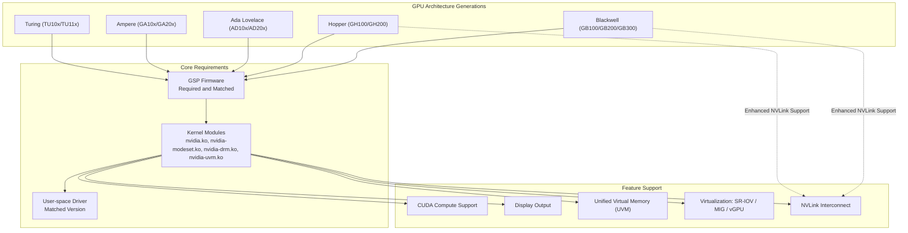
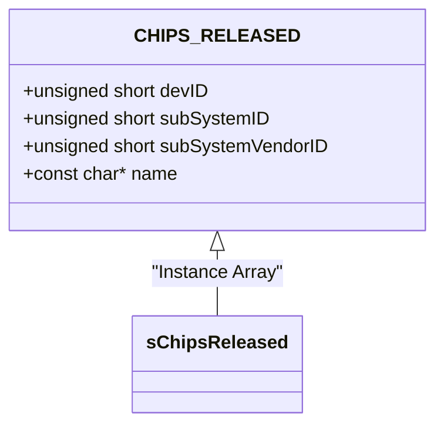
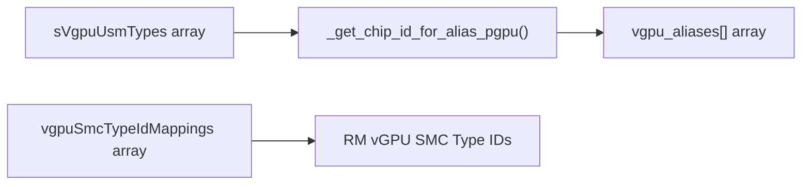
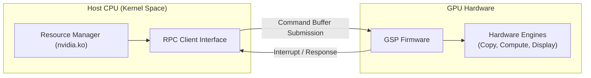

<!-- source: DeepWiki mcp.deepwiki.com · repo NVIDIA/open-gpu-kernel-modules · page 1.2 Supported Hardware and Requirements · fetched 2026-10-26 -->

# Supported Hardware and Requirements

<details>
<summary>Relevant source files</summary>

The following files were used as context for generating this wiki page:

- [README.md](README.md)
- [src/nvidia/generated/g_nv_name_released.h](src/nvidia/generated/g_nv_name_released.h)

</details>


This document specifies the hardware and software requirements for building and running the NVIDIA open GPU kernel modules. It covers supported GPU generations starting from Turing, platform CPU architecture support, Linux kernel compatibility, GSP firmware dependencies, and the comprehensive device compatibility database used by the driver.

For details about the build system, see the [Build System](#2) page. For kernel compatibility mechanisms, see [Kernel Compatibility Layer](#2.2). For architecture principles and module structure, refer to [Architecture Overview](#1.1).

---

## Overview

The NVIDIA open GPU kernel modules target GPUs of **Turing architecture (TU10x/TU11x) and later**. These modules require **Linux kernel 4.15 or newer** and must operate in conjunction with matching versions of the GSP firmware and NVIDIA user-space driver components.

The primary kernel modules forming the driver stack include:

- `nvidia.ko` — Core kernel module for GPU resource management and communication with GSP firmware.
- `nvidia-modeset.ko` — Handles mode setting and display configuration.
- `nvidia-drm.ko` — Integrates with the Linux Direct Rendering Manager (DRM) subsystem.
- `nvidia-uvm.ko` — Implements the Unified Virtual Memory (UVM) features.

Together these modules enable GPU initialization, resource management, display output, virtualization, and unified memory features.

---

## Supported GPU Architectures

### Hardware Generation Requirements

The kernel modules support any NVIDIA GPU based on **Turing or newer architectures**, encompassing multiple generations with details summarized below:

| Architecture   | GPU Series / Code Names       | Initial Release | Status    |
|----------------|------------------------------|-----------------|-----------|
| Turing         | TU10x, TU11x                 | 2018            | Supported |
| Ampere         | GA10x, GA20x                 | 2020            | Supported |
| Ada Lovelace   | AD10x, AD20x                 | 2022            | Supported |
| Hopper         | GH100, GH200                 | 2022            | Supported |
| Blackwell      | GB100, GB200, GB300          | 2024            | Supported |

These cover a broad product range from consumer GeForce cards, professional Quadro/RTX devices, to data center GPUs utilized in HPC and virtualization.

---

### GPU Feature Support Matrix

The following mermaid diagram depicts the relationship of supported GPU architectures with key driver components, firmware, and features enabled through the NVIDIA open kernel modules:



---

## Device Compatibility Database

### Physical GPU Identification

During device initialization, the `nvidia.ko` kernel module consults a **device compatibility database** that matches PCI device and subsystem IDs to GPU model names and supported configurations.

This database is implemented as a statically defined array `sChipsReleased` declared in the header:

```c
typedef struct _CHIPS_RELEASED {
    unsigned short devID;               // PCI Device ID
    unsigned short subSystemID;         // PCI Subsystem Device ID (OEM-specific)
    unsigned short subSystemVendorID;   // PCI Subsystem Vendor ID (OEM-specific)
    const char *name;                   // Marketing name string
} CHIPS_RELEASED;

static const CHIPS_RELEASED sChipsReleased[] = {
    { 0x1E02, 0x0000, 0x0000, "NVIDIA TITAN RTX" },
    { 0x1E30, 0x129e, 0x1028, "Quadro RTX 8000" },
    { 0x1E90, 0x131f, 0x1043, "NVIDIA GeForce RTX 2080 with Max-Q Design" },
    ...
};
```

This array contains hundreds of entries mapping PCI vendor/device and OEM subsystem identifiers to user-friendly GPU model strings for runtime support verification.

Class diagram illustrating this mapping:



The driver code queries `sChipsReleased` during device probing to confirm hardware support and apply any model-specific behaviors or workarounds.

---

### Virtual GPU (vGPU) Compatibility

The kernel modules support NVIDIA vGPU virtualization features by maintaining mappings between physical GPUs and virtualized GPU types. This includes aliasing physical device IDs to virtual device IDs expected by RM (Resource Manager) and virtualization subsystems.

Key components in vGPU compatibility include:

- **Alias Resolution**: The function `_get_chip_id_for_alias_pgpu` searches through the `vgpu_aliases` array to remap physical GPU IDs to their aliases used by RM for vGPU [src/common/shared/inc/g_vgpu_resman_specific.h:7-43]().

- **SMC Type Mapping**: The `vgpuSmcTypeIdMappings` array relates device IDs and partition flags (which indicate fractional GPU sizes such as 1/2 or 1/4 GPU) to SMC vGPU Type IDs used internally by RM [src/common/shared/inc/g_vgpu_resman_specific.h:52-88]().

- **vGPU USM Type Table (PCI Device Mappings)**: The `sVgpuUsmTypes` array enumerates PCI device/vendor/subsystem ID combinations used to identify specific vGPU models (e.g., "GRID T4-8Q", "NVIDIA A30-1-6C") [src/common/shared/inc/g_vgpu_chip_flags.h:8-115]().

These components collaboratively allow accurate identification and validation of physical and virtual GPU configurations at runtime.

Visualization of key vGPU compatibility structures:



---

## Platform Requirements

### Supported CPU Architectures

The open GPU kernel modules support these CPU architectures:

- **x86_64**: The standard 64-bit Intel/AMD architecture used in most PCs and servers.
- **aarch64**: The 64-bit ARM architecture, commonly used in embedded platforms and emerging in high-performance computing (e.g., NVIDIA Grace).

Cross-compilation to these targets is supported by setting environment variables such as `TARGET_ARCH`, `CC`, `LD`, `AR`, and others during the module build process [README.md:27-48]().

Example to cross-compile on an x86_64 host for aarch64 target:

```bash
make modules TARGET_ARCH=aarch64 ARCH=arm64 CC=aarch64-linux-gnu-gcc LD=aarch64-linux-gnu-ld AR=aarch64-linux-gnu-ar CXX=aarch64-linux-gnu-g++ OBJCOPY=aarch64-linux-gnu-objcopy
```

---

### Linux Kernel Requirements

- **Minimum Kernel Version**: Linux kernel version 4.15 or higher is required. This ensures availability of modern kernel APIs needed by the driver.

- **Kernel Configuration Dependencies**:
  - `CONFIG_MODULES` (modules support)
  - `CONFIG_PCI` (PCI subsystem support)
  - `CONFIG_MMU` (Memory management unit support)
  - For Unified Virtual Memory (`nvidia-uvm.ko`), `CONFIG_HMM_MIRROR` enabling heterogeneous memory management mirroring is needed.

- **Compiler Toolchain**:  
  The kernel modules must be built with the C compiler toolchain used to build the running Linux kernel (e.g. matching GCC/Clang version) to avoid ABI compatibility issues.

---

## GSP Firmware Requirements

### GSP Firmware and Driver Version Synchronization

The NVIDIA GPU System Processor (GSP) firmware is a crucial component required for internal GPU functionalities such as security, power management, and resource orchestration.

- The open GPU kernel modules mandate the **presence and activation of the GSP firmware**. Unlike some proprietary drivers which may operate with GSP turned off on legacy GPUs, this open source stack requires GSP.

- The **driver kernel modules, GSP firmware, and NVIDIA user-space components must be version-matched** precisely, typically aligned to the release version (e.g., 615.78.08), ensuring functionality and stability.

- Firmware binaries are typically loaded from the system location `/lib/firmware/nvidia/`.

---

### Communication with GSP Firmware

Interaction with the GSP firmware occurs via an RPC (Remote Procedure Call) client implemented in `nvidia.ko`. This subsystem manages command submission and response processing for GPU control and coordination.

The following diagram models the runtime communication flow between host kernel, driver modules, and GPU hardware:



Key RPC client and firmware interfacing functions are implemented within the `nvidia.ko` kernel module source, coordinating asynchronous GPU operations.

---

## Summary Table of Requirements

| Category          | Details                                                         |
|-------------------|-----------------------------------------------------------------|
| **GPU**           | NVIDIA Turing (TU10x) or later                                  |
| **CPU Architecture**      | x86_64, aarch64                                                |
| **Linux Kernel**  | 4.15 or newer; required configs: MODULES, PCI, MMU, HMM_MIRROR (for UVM) |
| **Firmware**      | GSP Firmware required and must match kernel module/user-space versions |
| **Compiler**      | Toolchain must match the compiler used for the running kernel   |

---

**Sources:**  
[README.md:1-198](),  
[src/nvidia/generated/g_nv_name_released.h:23-115](),  
[src/common/shared/inc/g_vgpu_resman_specific.h:7-88](),  
[src/common/shared/inc/g_vgpu_chip_flags.h:8-115]()

---

