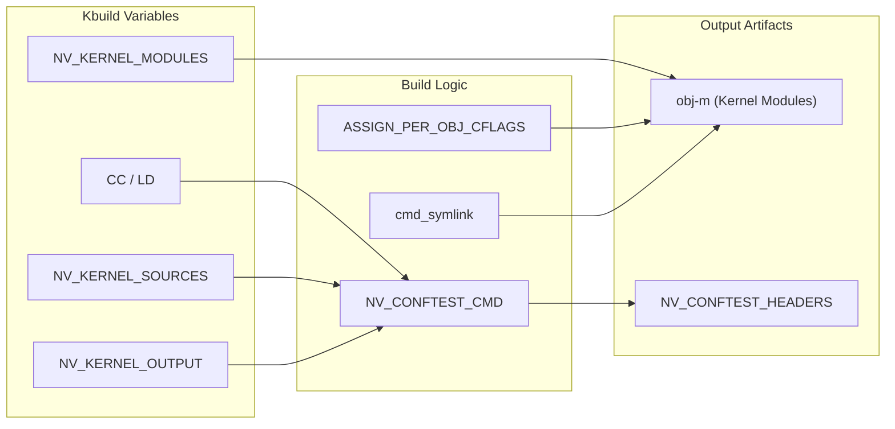
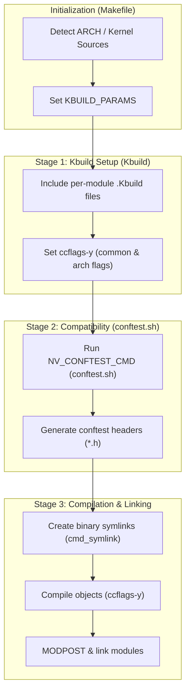

<!-- source: DeepWiki mcp.deepwiki.com · repo NVIDIA/open-gpu-kernel-modules · page 2 Build System · fetched 2026-10-26 -->

# Build System

Relevant source files

The following files were used as context for generating this wiki page:

- [kernel-open/Kbuild](kernel-open/Kbuild)

## Purpose and Scope

This document provides a high-level overview of the NVIDIA open GPU kernel modules build system. It covers the multi-stage build system architecture that integrates Linux kernel Kbuild infrastructure, kernel feature detection through a conftest system, and version management. The system ensures robust compilation of multiple kernel modules across supported CPU architectures (`x86_64` and `arm64`), adapting dynamically to kernel interface changes and platform specifics.

This page serves as a parent overview. For detailed technical explanations, refer to the child pages:
- [Kbuild Configuration](#2.1) — Kbuild orchestration, compiler flags, architecture-specific settings.
- [Kernel Compatibility Layer](#2.2) — Kernel feature detection, sanity checks, generated headers.
- [Version Management](#2.3) — Version strings, build metadata, platform-specific versioning.

## Build System Architecture

The build system centers around the Linux kernel's Kbuild infrastructure, where `kernel-open/Kbuild` is the principal driver file orchestrating build behavior. It includes individual kernel module definitions, manages compiler flags, runs kernel compatibility checks, and constructs the final kernel modules [kernel-open/Kbuild:1-203]().

The `kernel-open/Makefile` acts as the entry point called by users or installers. It detects kernel source and output trees, determines architecture, and invokes Kbuild with appropriate environment variables and settings, supporting multi-architecture builds and out-of-tree module compilation [kernel-open/Makefile:17-116]().

### Mapping Natural Language Concepts to Code Entities in the Build System

The diagram below connects user-facing build concepts and stages to concrete variables and scripts in the codebase to aid navigation:

**Build System Entity Mapping**

**Sources:** [kernel-open/Kbuild:1-203](), [kernel-open/Makefile:17-116]()

## Build Process Flow

The build process is multi-staged and interconnected by dependencies:

1. **Initialization:** The Makefile scripts detect the build target architecture and locate kernel source/output trees, setting environment variables used later by Kbuild [kernel-open/Makefile:21-53]().

2. **Kbuild Setup:** The primary Kbuild file includes per-module Kbuild fragments, sets global and per-module compiler flags (including architecture-specific and platform flags), and defines which kernel modules to build [kernel-open/Kbuild:74-79,118-135]().

3. **Kernel Compatibility Testing (Conftest):** Before compilation, the `conftest.sh` script runs with specified compiler, architecture, and kernel directories to run a series of small compile tests. This detects kernel feature availability and generates header files with conditional defines for use during compilation [kernel-open/Kbuild:177-201,210-215]().

4. **Compilation:** Using flags from conftest and Kbuild, the module source files are compiled to object files. Link and post-processing steps follow.

5. **Linking and Postprocessing:** Kernel modules are linked into `.ko` files, and symbolic links may be created for precompiled binary objects used within modules [kernel-open/Kbuild:70-71,151-153]().

**Build Sequence and Stage Dependencies**

**Sources:** [kernel-open/Kbuild:11-19,177-215](), [kernel-open/Makefile:103-116]()

## Module Organization and Kbuild Integration

The build system supports multiple kernel modules. Each kernel module has an associated `.Kbuild` file included by the top level Kbuild, defining:

- The module's name and resulting target `.ko` file (added to `obj-m`)
- The source object files comprising the module
- Any module-specific compiler flags or conftest dependencies

The list of modules to build is specified by the `NV_KERNEL_MODULES` variable, making the build modular and extensible [kernel-open/Kbuild:74-79](), [kernel-open/Makefile:92-94]().

| Module               | Kbuild File                               | Role                                 | Binary Object Inclusion           |
|----------------------|------------------------------------------|------------------------------------|----------------------------------|
| `nvidia.ko`          | `nvidia/nvidia.Kbuild`                    | Core GPU driver                    | `nv-kernel.o_binary`              |
| `nvidia-modeset.ko`  | `nvidia-modeset/nvidia-modeset.Kbuild`  | Display mode setting               | `nv-modeset-kernel.o_binary`     |
| `nvidia-drm.ko`      | `nvidia-drm/nvidia-drm.Kbuild`            | DRM integration                   | None                             |
| `nvidia-uvm.ko`      | `nvidia-uvm/nvidia-uvm.Kbuild`            | Unified Virtual Memory support    | None                             |

The build system uses the helper macro `ASSIGN_PER_OBJ_CFLAGS` to assign compiler flags on a per-object basis, supporting the recent kernel build system change requiring both relative and basename object paths in `CFLAGS_` variables [kernel-open/Kbuild:40-43]().

**Sources:** [kernel-open/Kbuild:40-79](), [kernel-open/Makefile:92-94]()

## Compilation Flags Overview

Compiler flags (`ccflags-y`) accumulate from multiple sources to tailor builds precisely:

- **Common Flags:** Include standard include paths (`-I`), kernel module macros (`-D__KERNEL__`, `-DMODULE`, etc.), warning controls, and the version string `NV_VERSION_STRING` [kernel-open/Kbuild:102-109]().

- **Architecture-specific Flags:**
  - For `arm64`: `-mstrict-align`, `-mgeneral-regs-only`, `-march=armv8-a`, and disables outline atomics [kernel-open/Kbuild:145-158]().
  - For `x86_64`: `-mno-red-zone` and `-mcmodel=kernel` to suitable kernel code requirements [kernel-open/Kbuild:159-162]().
  
- **Feature and Platform Flags:**
  - Enables unified virtual memory support via `-DNV_UVM_ENABLE` [kernel-open/Kbuild:164]().
  - Define kernel interface layer compatibility with `-DNV_KERNEL_INTERFACE_LAYER` [kernel-open/Kbuild:167]().
  - On Android platforms disables filesystem kernel API access macros [kernel-open/Kbuild:129-135]().
  - Optionally enables undefined behavior sanitizer with `NV_UNDEF_BEHAVIOR_SANITIZER` [kernel-open/Kbuild:82-85]().
  
- **Warning Behavior:** Controlled by `WARNINGS_AS_ERRORS` variable; can elevate all warnings to errors [kernel-open/Kbuild:181-186]().

- **Sanitizer and Diagnostic Flags:** Add `-g` for debug builds, `-ffreestanding` for kernel compatibility, and restrict strict aliasing [kernel-open/Kbuild:139-154]().

### Important Compile-Time Defines

| Macro                         | Description                                      |
|-------------------------------|------------------------------------------------|
| `NV_VERSION_STRING`            | Driver version string for build identification ([example string](https://github.com/NVIDIA/open-gpu-kernel-modules/blob/main/kernel-open/Kbuild#L109)) |
| `NV_FILESYSTEM_ACCESS_AVAILABLE` | Enables/disables kernel filesystem API usage, disabled for Android builds |
| `NV_SPECTRE_V2`                | Defines spectre v2 mitigations level             |

**Sources:** [kernel-open/Kbuild:77-167]()

## Precompiled Binary Objects Integration

Some kernel modules incorporate precompiled binary object files containing OS-agnostic driver logic. To seamlessly integrate these binaries while adapting to kernel source tree layout differences, symbolic links are created by `cmd_symlink` commands.

This approach abstracts differences between Linux kernel versions prior to 6.13 (where the current working directory is the kernel source tree) and newer versions (where the CWD is the external module source tree). Thus, kernel modules build without manual path handling for included binaries [kernel-open/Kbuild:87-98]().

**Sources:** [kernel-open/Kbuild:87-98]()

## Kernel Compatibility Layer (Conftest) Integration

To maintain compatibility across kernel versions and variants, the build system uses a conftest framework that:

- Runs compile-time tests through `conftest.sh` (triggered via `NV_CONFTEST_CMD`) using the configured compiler, architecture, and kernel source/output [kernel-open/Kbuild:177-210]().

- Detects kernel API features, symbols, function availability, and type sizes.

- Generates multiple headers (e.g., `conftest/macros.h`, `conftest/functions.h`, `conftest/symbols.h`, `conftest/types.h`) with defines that enable conditional compilation depending on kernel capabilities.

- Allows kernel module source files to include these generated headers and enable/disable code paths or warn on missing features.

- Improves robustness by avoiding runtime kernel symbol differences and providing early compile-time compatibility feedback.

For full details, see the child page [Kernel Compatibility Layer](#2.2).

**Sources:** [kernel-open/Kbuild:177-201]()

---

This high-level overview bridges conceptual build stages with code components and workflow orchestration. Developers should consult the linked child pages for detailed guidance on customizing or troubleshooting specific build stages.

---

