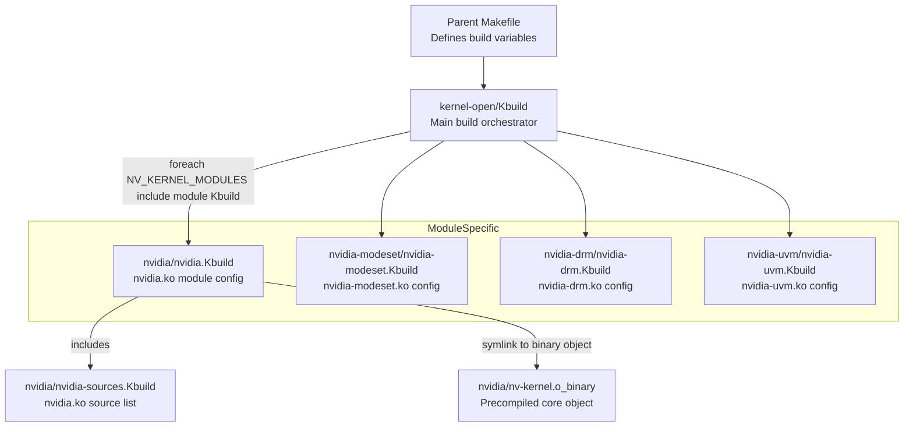
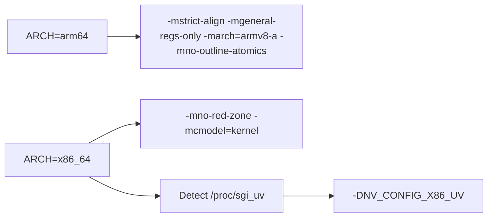
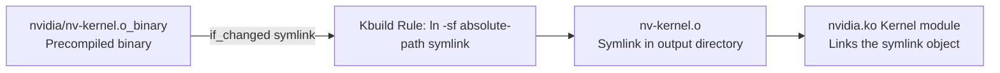
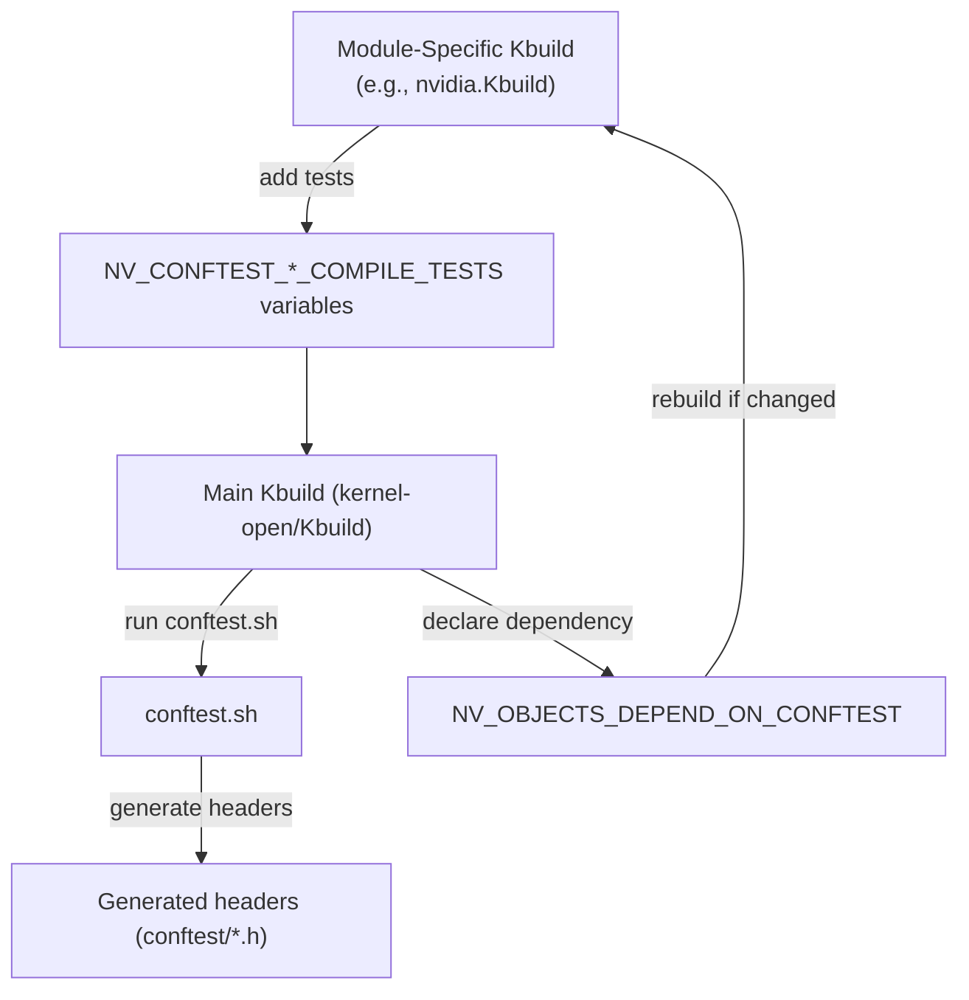

<!-- source: DeepWiki mcp.deepwiki.com · repo NVIDIA/open-gpu-kernel-modules · page 2.1 Kbuild Configuration · fetched 2026-10-26 -->

# Kbuild Configuration

<details>
<summary>Relevant source files</summary>

The following files were used as context for generating this wiki page:

- [kernel-open/Kbuild](kernel-open/Kbuild)
- [kernel-open/nvidia/nvidia.Kbuild](kernel-open/nvidia/nvidia.Kbuild)

</details>


This page describes the Kbuild build orchestration system, compiler flag configuration, module-specific build settings, and architecture-specific configurations used to compile the NVIDIA kernel modules. For information about kernel feature detection and compatibility testing, see [Kernel Compatibility Layer](2.2). For build version management, see [Version Management](2.3).

## Overview

The Kbuild system is the central orchestrator for building all NVIDIA kernel modules. The main Kbuild file located at `kernel-open/Kbuild` coordinates compilation by:

- Including module-specific Kbuild files dynamically for each kernel module specified.
- Setting global compiler flags and preprocessor macros.
- Managing architecture-specific build options.
- Applying platform-specific configurations such as for Android, Tegra, and vGPU.
- Integrating tightly with the kernel feature conftest system for compatibility detection.

The build process supports multiple kernel modules built from a single invocation: `nvidia.ko`, `nvidia-modeset.ko`, `nvidia-drm.ko`, and `nvidia-uvm.ko`.

---

**Diagram: Kbuild File Structure and Module Inclusion**



---

The main Kbuild file uses a GNU Make `foreach` loop to include each requested kernel module's Kbuild fragment dynamically:

```makefile
$(foreach _module, $(NV_KERNEL_MODULES), \
 $(eval include $(src)/$(_module)/$(_module).Kbuild))
```

Each module-specific Kbuild fragment is responsible for:

- Appending its module to `obj-m` for kernel module build targets.
- Defining the object files (.o) built for the module.
- Registering kernel conftest compile tests it depends on.

This modular design supports incremental builds and independent module management.

Sources: [kernel-open/Kbuild:101-103](), [kernel-open/nvidia/nvidia.Kbuild:9-13]()

## Build Variables and Structure

The build system expects the parent makefile to define several core variables:

| Variable           | Description                                         |
|--------------------|-----------------------------------------------------|
| `NV_KERNEL_SOURCES` | Root path to the kernel source tree                 |
| `NV_KERNEL_OUTPUT`  | Output directory for kernel build artifacts (out-of-tree) |
| `NV_KERNEL_MODULES` | List of kernel modules to build (e.g. `nvidia nvidia-modeset`) |
| `ARCH`             | Target CPU architecture, either `x86_64` or `arm64` |
| `NV_BUILD_TYPE`    | Build configuration: `release` (default), `debug`, or `develop` |

Kbuild internally provides:

- `$(src)`: Directory containing current Kbuild file.
- `$(obj)`: Output directory where objects are produced.

These variables coordinate the build path and compilation steps across modules.

Sources: [kernel-open/Kbuild:6-18]()

## Global Compiler Flags

Global compiler flags are set in the main `kernel-open/Kbuild`. These ensure consistent warnings, defines, and architecture flags across all kernel modules.

**Key compilation flags:**

```makefile
ccflags-y += -I$(src)/common/inc
ccflags-y += -I$(src)
ccflags-y += -Wall $(DEFINES) $(INCLUDES) -Wno-cast-qual -Wno-format-extra-args
ccflags-y += -D__KERNEL__ -DMODULE -DNVRM
ccflags-y += -DNV_VERSION_STRING=\"615.78.08\"
ccflags-y += -Wno-unused-function
ccflags-y += -fno-strict-aliasing
ccflags-y += -ffreestanding
```

These flags:

- Add include paths for common kernels and top-level source.
- Enable general warnings (`-Wall`) with selective disables.
- Define kernel build context (`__KERNEL__`, `MODULE`).
- Define NVIDIA-specific macros (version string, kernel layer marker).
- Enforce strict aliasing rules and freestanding assumptions per Linux kernel conventions.

Sources: [kernel-open/Kbuild:105-154]()

**Build-Type Specific Flags:**

| Build Type | CFLAGS Additions                        | Purpose                            |
|------------|---------------------------------------|----------------------------------|
| `release`  | `-UDEBUG -U_DEBUG -DNDEBUG` + `-Wuninitialized` | Optimized build, disable debugging, warn uninitialized vars |
| `develop`  | `-UDEBUG -U_DEBUG -DNDEBUG -DNV_MEM_LOGGER` | Like release but enable memory logger instrumentation |
| `debug`    | `-g -DDEBUG -D_DEBUG -UNDEBUG -DNV_MEM_LOGGER` | Include debug symbols and logging |

The build type defaults to `release` but can be altered via `NV_BUILD_TYPE`. Debug builds also enable debug info and memory logging.

Sources: [kernel-open/Kbuild:138-151](), [kernel-open/nvidia/nvidia.Kbuild:58-69]()

## Architecture-Specific Configuration

The driver adapts compiler flags depending on architecture to comply with kernel ABI conventions and optimize builds.

**Diagram: Architecture-Specific Compiler Flags**



### ARM64 Flags

- `-mstrict-align`: Enforces strict memory alignment.
- `-mgeneral-regs-only`: Restricts to general-purpose registers, avoiding SIMD.
- `-march=armv8-a`: Targets ARMv8 architecture baseline.
- `-mno-outline-atomics`: Disables outlining of atomic operations.

These ensure the kernel driver compiles with correct semantics and performance on ARM64 systems.

Sources: [kernel-open/Kbuild:145-158]()

### x86_64 Flags

- `-mno-red-zone`: Disable red zone usage per kernel ABI requirements.
- `-mcmodel=kernel`: Use kernel-level code model suitable for large kernel addresses.

Additionally, detection of SGI UV large SMP systems via presence of `/proc/sgi_uv` triggers adding `-DNV_CONFIG_X86_UV` macro for specializations.

Sources: [kernel-open/Kbuild:159-175]()

## Per-Object CFLAGS and LDFLAGS Macros

The `ASSIGN_PER_OBJ_CFLAGS` macro facilitates assigning specific compiler flags on a per-object file basis. This is important especially due to changes in kernel build system that require specifying both path-qualified and plain object names for `CFLAGS_<object>` used by Kbuild.

```makefile
ASSIGN_PER_OBJ_CFLAGS = \
 $(foreach _obj, \
 $(sort $(notdir $(1)) $(1)), \
 $(eval $(addprefix CFLAGS_,$(_obj)) += $(2)))
```

This macro iterates through the given object files, appending the given flags to both `CFLAGS_object.o` and `CFLAGS_path/object.o`.

Equivalent macros exist for removing flags and setting per-object linker flags:

- `ASSIGN_PER_OBJ_CFLAGS_REMOVE`
- `ASSIGN_PER_OBJ_LDFLAGS`
- `ASSIGN_PER_OBJ_OBJCOPYFLAGS`

This mechanism allows granular control of compile/link flags per file without polluting global settings.

**Example usage:**

```makefile
NVIDIA_CFLAGS += -I$(src)/nvidia
NVIDIA_CFLAGS += -DNVIDIA_UNDEF_LEGACY_BIT_MACROS
$(call ASSIGN_PER_OBJ_CFLAGS, $(NVIDIA_OBJECTS), $(NVIDIA_CFLAGS))
```

Sources: [kernel-open/Kbuild:40-44](), [kernel-open/Kbuild:46-55](), [kernel-open/nvidia/nvidia.Kbuild:55-72]()

## Binary Object File Integration

Some kernel modules use large precompiled binary object files that contain platform-agnostic core functionality. The `nvidia.ko` module includes a precompiled core in `nvidia/nv-kernel.o_binary`.

Instead of copying this large binary, the build creates a symbolic link named `nv-kernel.o` pointing to `nv-kernel.o_binary`. This is done via a dedicated Kbuild rule for efficiency and compatibility across different kernel build systems.

```makefile
quiet_cmd_symlink = SYMLINK $@
cmd_symlink = ln -sf $(abspath $<) $@

$(obj)/nvidia/nv-kernel.o: $(src)/nvidia/nv-kernel.o_binary FORCE
	$(call if_changed,symlink)

nvidia-y += nvidia/nv-kernel.o
```

The symlink is relative to absolute path of the binary to account for Linux kernel version changes in external module directory handling.

**Diagram: Binary Object Symlink Flow**



This approach reduces disk space overhead and rebuild times, preserving clean binary separation.

Sources: [kernel-open/Kbuild:87-98](), [kernel-open/nvidia/nvidia.Kbuild:19-48]()

## Platform-Specific Adjustments

The build accommodates different platforms by conditionally adding flags or includes:

### Android Platform

On Android kernels, filesystem operations like `filp_open` and `kernel_read` may be restricted. The build disables related filesystem access features when `PLATFORM_IS_ANDROID=1`:

```makefile
PLATFORM_IS_ANDROID ?= 0

ifeq ($(PLATFORM_IS_ANDROID),1)
 ccflags-y += -DNV_FILESYSTEM_ACCESS_AVAILABLE=0
else
 ccflags-y += -DNV_FILESYSTEM_ACCESS_AVAILABLE=1
endif
```

Thus, incompatible code is excluded on Android.

Sources: [kernel-open/Kbuild:129-135]()

### Tegra Support

Tegra out-of-tree modules can be integrated by specifying overlay include paths and symbol files:

```makefile
ifneq ($(wildcard /usr/src/nvidia/nvidia-public),)
 SYSSRCNVOOT ?= /usr/src/nvidia/nvidia-public
endif

ifneq ($(SYSSRCNVOOT),)
 ccflags-y += -I$(SYSSRCNVOOT)/include
 KBUILD_EXTRA_SYMBOLS = $(SYSSRCNVOOT)/Module.symvers
endif

ifneq ($(SYSSRCHOST1X),)
 ccflags-y += -I$(SYSSRCHOST1X)
endif
```

This supports collaborative development of Tegra kernel modules alongside NVIDIA GPU drivers.

Sources: [kernel-open/Kbuild:112-123](), [kernel-open/Kbuild:116-118]()

### vGPU Support

Virtual GPU builds can enable forced PCI core redirection with:

```makefile
ifdef VGX_FORCE_VFIO_PCI_CORE
 ccflags-y += -DNV_VGPU_FORCE_VFIO_PCI_CORE
endif
```

This alters PCI driver selection for virtualization environments.

Sources: [kernel-open/Kbuild:177-179]()

## Compiler Feature Flags and Sanitizer Support

Additional compiler flags are configured to improve robustness and developer experience:

- The build enables `-Werror=undef` if supported, for catching undefined macro usage.
- The variable `WARNINGS_AS_ERRORS` controls whether warnings are treated as errors.
- Undefined Behavior Sanitizer (UBSAN) support is optionally enabled when `NV_UNDEF_BEHAVIOR_SANITIZER=1`:

```makefile
NV_UNDEF_BEHAVIOR_SANITIZER ?=
ifeq ($(NV_UNDEF_BEHAVIOR_SANITIZER),1)
 UBSAN_SANITIZE := y
endif

WARNINGS_AS_ERRORS ?=
ifeq ($(WARNINGS_AS_ERRORS),1)
 ccflags-y += -Werror
else
 ccflags-y += -Wno-error
endif
```

This configurable approach suits different build policies.

Sources: [kernel-open/Kbuild:82-85](), [kernel-open/Kbuild:181-186]()

## Module-Specific Configuration: nvidia.ko Example

The `nvidia.ko` kernel module's Kbuild fragment (`nvidia/nvidia.Kbuild`) illustrates module-specific configuration:

- Sources are included via `nvidia-sources.Kbuild`.
- The precompiled binary object is symlinked and appended to module objects.
- Module-specific CFLAGS include additional include paths and defines.
- Build type variations add or remove debug and memory logger macros.
- A generated compiler version header is included for `nv-procfs.c`.
- A linker script produces a combined interface object `nv-interface.o`.

```makefile
include $(src)/nvidia/nvidia-sources.Kbuild
NVIDIA_OBJECTS = $(patsubst %.c,%.o,$(NVIDIA_SOURCES))

obj-m += nvidia.o
nvidia-y := $(NVIDIA_OBJECTS)
NVIDIA_BINARY_OBJECT := $(src)/nvidia/nv-kernel.o_binary
NVIDIA_BINARY_OBJECT_O := nvidia/nv-kernel.o

targets += $(NVIDIA_BINARY_OBJECT_O)

$(obj)/$(NVIDIA_BINARY_OBJECT_O): $(NVIDIA_BINARY_OBJECT) FORCE
	$(call if_changed,symlink)

nvidia-y += $(NVIDIA_BINARY_OBJECT_O)

NVIDIA_CFLAGS += -I$(src)/nvidia
NVIDIA_CFLAGS += -DNVIDIA_UNDEF_LEGACY_BIT_MACROS
NVIDIA_CFLAGS += -DLIBSPDM_CONFIG=\"nvspdm_rmconfig.h\"

ifeq ($(NV_BUILD_TYPE),release)
 NVIDIA_CFLAGS += -UDEBUG -U_DEBUG -DNDEBUG
endif
ifeq ($(NV_BUILD_TYPE),develop)
 NVIDIA_CFLAGS += -UDEBUG -U_DEBUG -DNDEBUG -DNV_MEM_LOGGER
endif
ifeq ($(NV_BUILD_TYPE),debug)
 NVIDIA_CFLAGS += -DDEBUG -D_DEBUG -UNDEBUG -DNV_MEM_LOGGER
endif

$(call ASSIGN_PER_OBJ_CFLAGS, $(NVIDIA_OBJECTS), $(NVIDIA_CFLAGS))

NV_COMPILER_VERSION_HEADER = nv_compiler.h

$(obj)/$(NV_COMPILER_VERSION_HEADER):
	@echo \#define NV_COMPILER \"`$(CC) -v 2>&1 | tail -n 1`\" > $@

$(obj)/nvidia/nv-procfs.o: $(obj)/$(NV_COMPILER_VERSION_HEADER)

NVIDIA_INTERFACE := nvidia/nv-interface.o
always += $(NVIDIA_INTERFACE)
always-y += $(NVIDIA_INTERFACE)

$(obj)/$(NVIDIA_INTERFACE): $(addprefix $(obj)/,$(NVIDIA_OBJECTS))
	$(LD) -r -o $@ $^
```

This Kbuild fragment demonstrates:

- Explicit source listings and object targets.
- Usage of the symlinked binary object.
- Conditional per-object CFLAGS assignment.
- Generated headers for compiler metadata.
- Creation of a unified interface object by linking all kernel interface objects.

Sources: [kernel-open/nvidia/nvidia.Kbuild:8-130]()

## Conftest Integration for Kernel Compatibility

The NVIDIA Kbuild system integrates with the `conftest` kernel feature detection subsystem to adapt the build to various kernel APIs.

Each module's Kbuild file appends to a set of conftest compile test lists:

- `NV_CONFTEST_FUNCTION_COMPILE_TESTS`
- `NV_CONFTEST_SYMBOL_COMPILE_TESTS`
- `NV_CONFTEST_TYPE_COMPILE_TESTS`
- `NV_CONFTEST_GENERIC_COMPILE_TESTS`

Objects relying on conftest results append to `NV_OBJECTS_DEPEND_ON_CONFTEST`.

The main Kbuild then invokes a script `conftest.sh` to compile these tests against the target kernel headers, generating header files under `conftest/headers.h` that define or undefine macros based on detected features.

---

**Diagram: Conftest Integration Flow**



This integration ensures the modules compile conditionally depending on which kernel functions, symbols, and types are available, increasing compatibility with multiple kernel versions.

Example from `nvidia.Kbuild`:

```makefile
NV_CONFTEST_FUNCTION_COMPILE_TESTS += set_pages_uc
NV_CONFTEST_FUNCTION_COMPILE_TESTS += ioremap_cache
NV_CONFTEST_SYMBOL_COMPILE_TESTS += is_export_symbol_present_swiotlb_dma_ops
NV_CONFTEST_TYPE_COMPILE_TESTS += vmf_insert_pfn_prot

NV_OBJECTS_DEPEND_ON_CONFTEST += $(NVIDIA_OBJECTS)
```

Sources: [kernel-open/Kbuild:133-201](), [kernel-open/nvidia/nvidia.Kbuild:132-245]()

## Spectre v2 Mitigation Awareness

The build defines a macro reflecting whether kernel Spectre variant 2 mitigations are enabled:

```makefile
ccflags-y += -DNV_SPECTRE_V2=$(NV_SPECTRE_V2)
```

The value of `NV_SPECTRE_V2` is passed during build and used in runtime checks for performance or mitigation behavior.

Sources: [kernel-open/Kbuild:166-166]()

## Kernel Interface Layer Marker

All kernel interface source files are defined by a macro:

```makefile
ccflags-y += -DNV_KERNEL_INTERFACE_LAYER
```

This macro enables conditional compilation for source files intertwined with Linux kernel APIs as opposed to OS-agnostic code.

Sources: [kernel-open/Kbuild:167-167]()

## UVM and Additional Compiler Flags

Unified Virtual Memory (UVM) code paths are enabled unconditionally:

```makefile
ccflags-y += -DNV_UVM_ENABLE
```

Other compiler flags include disables for specific warnings like unused functions and format extra args.

Sources: [kernel-open/Kbuild:164-166]()

## Summary

The NVIDIA Open GPU Kernel Modules Kbuild configuration provides:

1. **Central build orchestration** with a master Kbuild file that dynamically includes module-specific fragments.
2. **Global and per-module compiler flag management** using explicit macros and per-object flag assignments.
3. **Architecture-specific compiler settings** for ARM64 and x86_64 supporting kernel ABI compliance.
4. **Platform adaptations** for Android restrictions, Tegra external modules, and vGPU configurations.
5. **Efficient integration of large precompiled binary objects** by generating symlinks instead of binary copies.
6. **Support for different build configurations**: release, debug, and develop, with tailored macro sets.
7. **Integration with conftest testing** for compile-time feature detection ensuring broad kernel compatibility.
8. **Runtime feature awareness macros** such as Spectre v2 mitigations and kernel interface layer marking.

This robust and flexible Kbuild setup allows seamless building of a unified driver source code against multiple kernel versions and architectures while supporting platform-specific requirements.

---

Sources:  
[kernel-open/Kbuild:1-214](),  
[kernel-open/nvidia/nvidia.Kbuild:1-178]()

---

