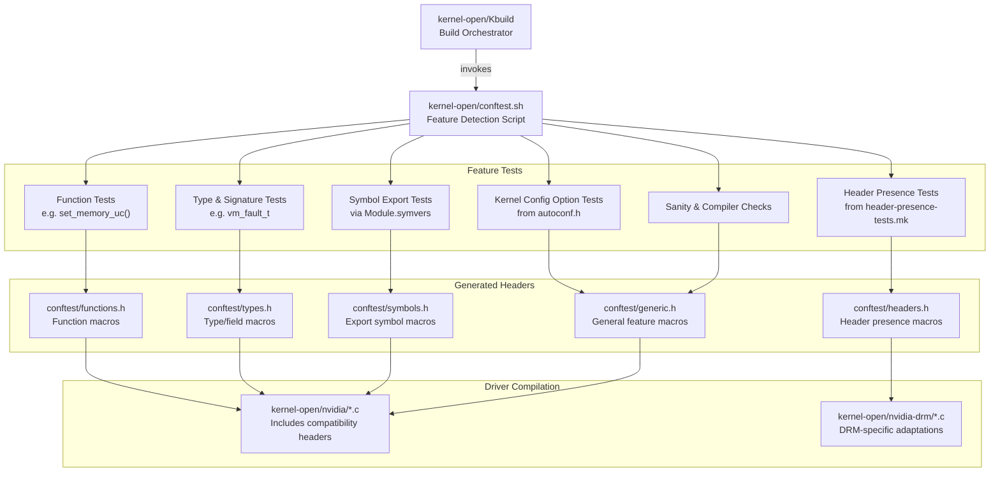
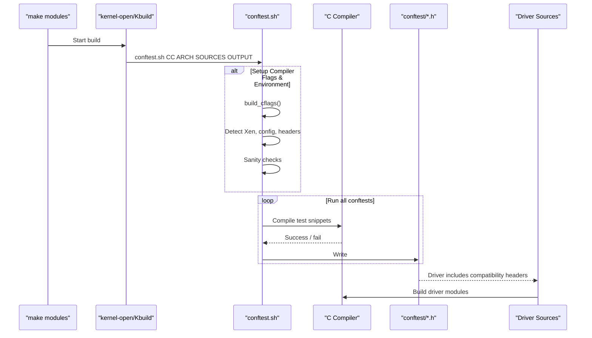
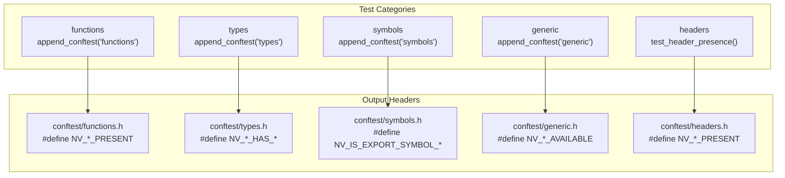
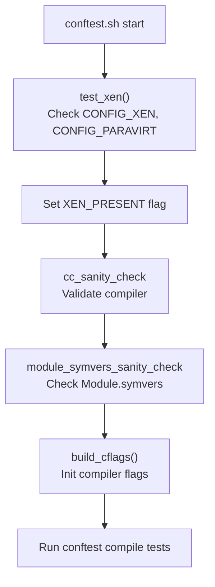
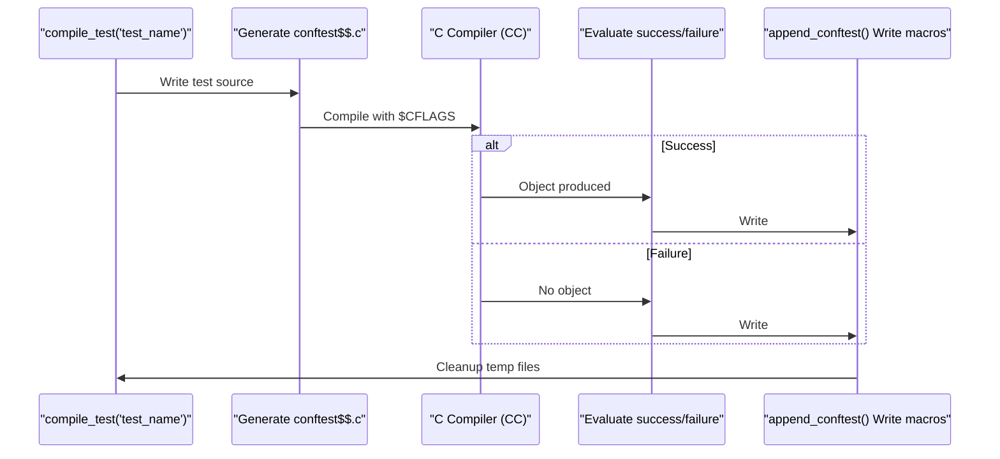

<!-- source: DeepWiki mcp.deepwiki.com · repo NVIDIA/open-gpu-kernel-modules · page 2.2 Kernel Compatibility Layer · fetched 2026-10-26 -->

# Kernel Compatibility Layer

<details>
<summary>Relevant source files</summary>

The following files were used as context for generating this wiki page:

- [kernel-open/common/inc/nv-mm.h](kernel-open/common/inc/nv-mm.h)
- [kernel-open/conftest.sh](kernel-open/conftest.sh)
- [kernel-open/header-presence-tests.mk](kernel-open/header-presence-tests.mk)
- [src/common/modeset/timing/nvtiming.h](src/common/modeset/timing/nvtiming.h)

</details>


## Purpose and Scope

The Kernel Compatibility Layer is a build-time feature detection system implemented primarily in the shell script [kernel-open/conftest.sh](). It performs compile-time tests to detect the presence and characteristics of kernel APIs, functions, types, symbols, kernel configuration options, and headers within the target kernel’s source tree.

Based on the results of these tests, it generates C preprocessor header files containing macros. These macros enable conditional compilation to adapt the NVIDIA GPU kernel modules to the variability and evolution of Linux kernel internals.

This compatibility layer is essential for:

- Supporting a broad range of kernel versions and configurations with one unified codebase.
- Avoiding the complexity of multiple driver source branches per kernel version.
- Enabling the build to dynamically adapt to the target kernel’s feature set.
- Integrating with the multi-stage build system ([2.1 Kbuild Configuration]()) and version management ([2.3 Version Management]()).

Sources: [kernel-open/conftest.sh:1-13]()

---

## Architecture Overview

The Kernel Compatibility Layer activates early during the build process. The `conftest.sh` script orchestrates numerous minimal compile tests, each targeting a particular kernel feature or API variation.

### Test Types and Their Roles

- **Function Tests:** Verify existence of kernel functions.
- **Type & Signature Tests:** Confirm types and struct field presence or layout.
- **Symbol Export Tests:** Check whether kernel symbols are exported for module linkage using `Module.symvers`.
- **Kernel Config Tests:** Determine kernel config options, such as `CONFIG_XEN`.
- **Sanity Checks:** Validate compiler environment, basic assumptions, and `Module.symvers` availability.
- **Header Presence Tests:** Confirm presence of kernel header files important to the driver.

Each test is performed by dynamically creating a test source file and compiling it against the kernel headers and configuration files. Success or failure controls macro definitions in output headers.

### Data Flow and Components



Sources: [kernel-open/conftest.sh:38-101](), [kernel-open/header-presence-tests.mk:1-47]()

---

## Build Integration

The `conftest.sh` script integrates tightly with the Kbuild system and is executed once per build, before driver compilation, to generate compatibility headers.

### Execution Flow



Sources: [kernel-open/conftest.sh:1-19](), [kernel-open/conftest.sh:103-218]()

---

### Command-Line Parameters

The script accepts four command-line parameters for flexibility:

| Parameter | Description                  |
|-----------|------------------------------|
| `$1`      | C compiler executable path   |
| `$2`      | Target architecture (ARCH)   |
| `$3`      | Kernel source directory path |
| `$4`      | Kernel build output directory|

Sources: [kernel-open/conftest.sh:9-13]()

---

### Compiler Flags Construction

The core function `build_cflags()` constructs robust compiler flags including:

- Optimization and kernel mode defines (`-D__KERNEL__`).
- Includes for kernel headers from source tree, generated headers, and architecture-specific directories.
- Detection and integration of Xen machine includes if the target kernel is Xen-based.
- Identification of the appropriate `autoconf.h` based on in-tree or out-of-tree build.
- Support for adding extra defines from `BUILD_PARAMS`.
- Detection of compiler support for features like `asm goto` via auxiliary scripts.

This ensures that feature detection compilation is environment-consistent and precise.

Sources: [kernel-open/conftest.sh:103-197]()

---

## Test Categories

The conftest script groups tests into the following categories:

### Function Presence Tests

Verify if kernel functions exist by compiling minimal invocation snippets. If compilation succeeds, the function is accessible.

Sources: [kernel-open/conftest.sh:290-329]()

---

### Type and Structure Tests

Check for presence of kernel types, typedefs, or structure fields by compiling code referencing those constructs, often using `offsetof()`. This detects kernel ABI differences.

Sources: [kernel-open/conftest.sh:2621-2629]()

---

### Symbol Export Tests

Referencing `Module.symvers` files in the kernel build output directory (and optionally out-of-tree locations on Tegra platforms), these tests verify if kernel symbols are exported and available for module use.

Example code snippet for checking a symbol is:

```sh
check_symbol_exists() {
    SYMBOL="$1"
    TAB='	'
    grep -e "${TAB}${SYMBOL}${TAB}.*${TAB}EXPORT_SYMBOL.*\$" ${MODULE_SYMVERS_PATHS}
}
```

Sources: [kernel-open/conftest.sh:17-23](), [kernel-open/conftest.sh:331-390]()

---

### Kernel Configuration Tests

By parsing the kernel's `autoconf.h`, these tests determine if kernel config options (e.g., `CONFIG_XEN`) are enabled, influencing compilation flags and behavior.

Sources: [kernel-open/conftest.sh:38-52]()

---

### Header Presence Tests

The system attempts to `#include` kernel headers listed in `header-presence-tests.mk` and sets macros like `NV_LINUX_FENCE_H_PRESENT` to indicate availability. This includes headers crucial for the driver's kernel interface.

Example headers tested include `drm/drm_hdcp.h`, `linux/nvhost.h`, `asm/set_memory.h`, etc.

Sources: [kernel-open/conftest.sh:66-101](), [kernel-open/header-presence-tests.mk]()

---

## Generated Headers Organization

The conftest script outputs multiple headers, each encapsulating feature macros based on test results.

### Header Outputs and Their Contents

| Output Header               | Macro Prefix / Content                          | Purpose                                   |
|----------------------------|------------------------------------------------|-------------------------------------------|
| `conftest/functions.h`     | `NV_*_PRESENT` macros for kernel functions     | Function presence detection                |
| `conftest/types.h`         | `NV_*_HAS_*` macros for types & struct members | Type and structure compatibility           |
| `conftest/symbols.h`       | `NV_IS_EXPORT_SYMBOL_*` for exported symbols   | Kernel export symbol availability          |
| `conftest/generic.h`       | General feature flags based on config & sanity  | Kernel config options and generic macros  |
| `conftest/headers.h`       | `NV_*_PRESENT` for header file presence         | Kernel header availability                  |

### Relationships Between Test Categories and Output Headers



Sources: [kernel-open/conftest.sh:54-64](), [kernel-open/conftest.sh:66-101]()

---

## Sanity Checks

Before running any feature detection, `conftest.sh` performs sanity checks including:

- **Xen Kernel Detection:** Function `test_xen()` checks kernel config options `CONFIG_XEN` and `CONFIG_PARAVIRT`, setting `XEN_PRESENT` appropriately. If Xen is present, Xen-specific machine include paths are added.

- **Compiler Environment Verification:** Verifies the compiler accepts minimal C code snippets, detecting readiness for the test compilation.

- **Module Symvers Sanity:** Ensures `Module.symvers` file(s) exist and are readable for symbol export tests.

- **Compiler Feature Availability:** Detects support for GNU C extensions like `asm goto`.

### Sanity Check Flowchart



Sources: [kernel-open/conftest.sh:38-52](), [kernel-open/conftest.sh:103-218]()

---

## Compile Test Implementation

Each test in conftest follows these steps:

1. **Test Source Generation:** Creates a temporary C source file (`conftest$$.c`), embedding the relevant test snippet framed by the common header `CONFTEST_PREAMBLE`.

2. **Compilation Attempt:** Invokes the configured C compiler with tailored flags to compile the test. This compilation may target just preprocessing or full compilation depending on the test.

3. **Result Interpretation:** If compilation succeeds, the target feature is considered present; otherwise it is absent or with a different interface.

4. **Macro Generation:** Writes to the corresponding output header `#define` or `#undef` macros reflecting the test outcome.

5. **Cleanup:** Removes temporary test files before the next test.

### Single Compile Test Diagram



Sources: [kernel-open/conftest.sh:290-329]()

---

## Integration with Driver Code

The generated headers—`functions.h`, `types.h`, `symbols.h`, `generic.h`, and `headers.h`—are included by kernel source files in:

- `kernel-open/nvidia/` — Core driver files.
- `kernel-open/nvidia-drm/` — DRM subsystem driver variants.

These headers govern conditional compilation of kernel API usage, enabling adaptation to kernel differences like presence/absence or signature changes of functions, types, exported symbols, and headers.

For example, if the header `linux/fence.h` is detected as available, the macro `NV_LINUX_FENCE_H_PRESENT` is defined, allowing the use of kernel fence synchronization APIs guarded by:

```c
#ifdef NV_LINUX_FENCE_H_PRESENT
    // fence API usage here
#endif
```

This mechanism minimizes runtime conditional checks by resolving compatibility at compile-time.

Sources: [kernel-open/conftest.sh:83-88](), [kernel-open/header-presence-tests.mk:26]()

---

# Summary

The Kernel Compatibility Layer is a critical subsystem that automates detection of kernel features relevant to the NVIDIA GPU kernel modules. By executing a wide variety of compile-time tests during the build, it produces granular compatibility macros encapsulated in generated headers. These enable driver source code to conditionally compile against diverse Linux kernel versions and configurations with a single unified codebase.

The key benefits include support for evolving kernel APIs without driver source forks, robust build-time feature identification, and integration with the overall multi-stage build and versioning systems.

This system leverages:

- The shell script-based conftest framework.
- Detailed compile-time tests for kernel symbols, types, functions, headers, and config options.
- Symbol export verification from `Module.symvers`.
- Sanity and environment checks to ensure test validity.
- Generated headers that drive conditional compilation downstream.

Together, these capabilities underpin maintainable, portable, and future-proof NVIDIA open GPU kernel modules.

Sources:  
[kernel-open/conftest.sh:1-218](),  
[kernel-open/conftest.sh:290-390](),  
[kernel-open/conftest.sh:1567-1673](),  
[kernel-open/header-presence-tests.mk:1-47](),  
[kernel-open/pahole.sh:11-62]()

---

