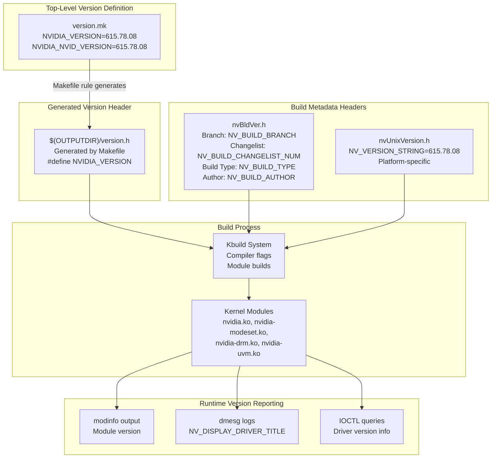
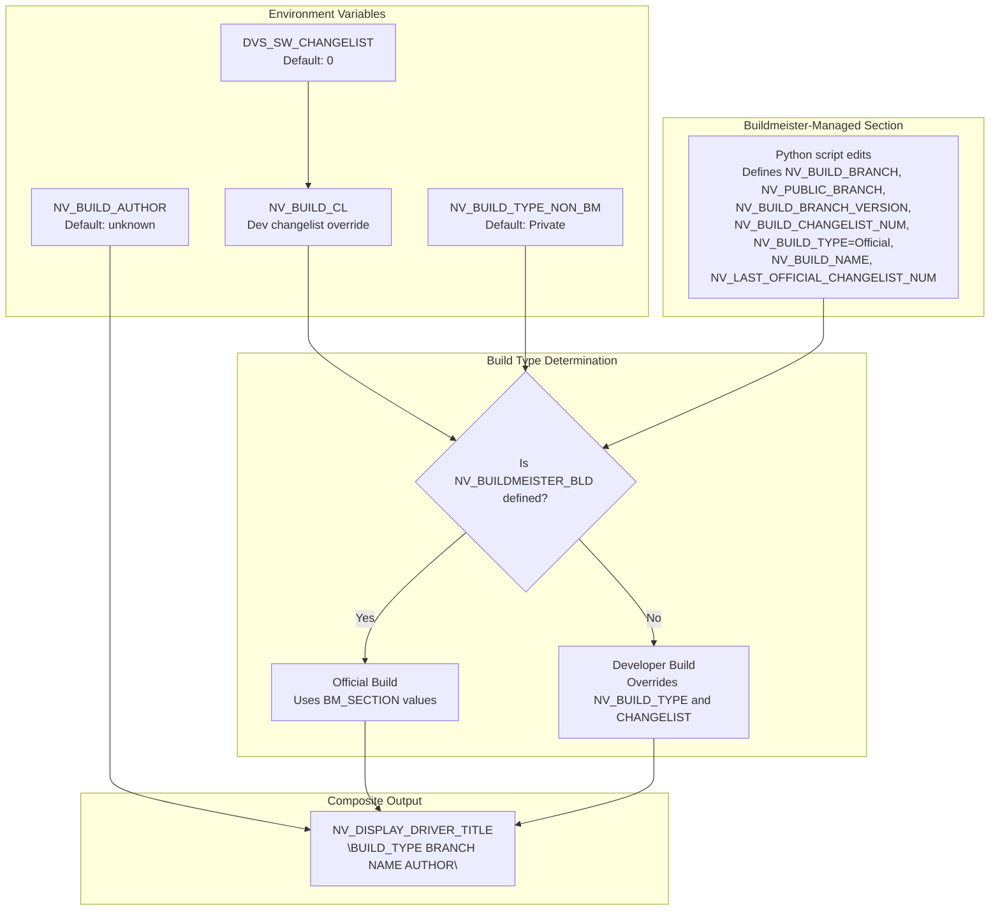
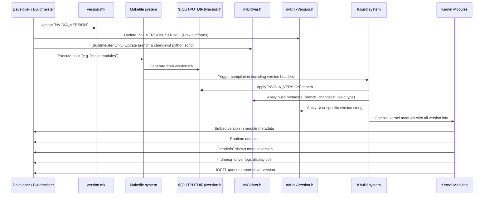

<!-- source: DeepWiki mcp.deepwiki.com · repo NVIDIA/open-gpu-kernel-modules · page 2.3 Version Management · fetched 2026-10-26 -->

# Version Management

<details>
<summary>Relevant source files</summary>

The following files were used as context for generating this wiki page:

- [src/common/inc/nvBldVer.h](src/common/inc/nvBldVer.h)
- [src/common/inc/nvUnixVersion.h](src/common/inc/nvUnixVersion.h)
- [version.mk](version.mk)

</details>


## Purpose and Scope

This document describes the version management system utilized in the NVIDIA Open GPU Kernel Modules repository. The system coordinates version numbers, build metadata, and changelist information consistently across multiple kernel modules and supported platforms. It supports both official buildmeister builds and local developer builds with distinct version identification mechanisms.

The version management system integrates deeply with the multi-stage build system (described in section 2) to propagate version info into the kernel modules, which report it on load and via driver APIs. This page focuses on how versioning data is defined, overridden, and consumed throughout the build and runtime environments.

For details on build orchestration consuming these version definitions, see [Kbuild Configuration](#2.1). For kernel feature detection that operates independently, see [Kernel Compatibility Layer](#2.2).

---

## Version Management Architecture

The version management system comprises three primary components that collectively establish version identity across the driver stack:



**Diagram: Version Information Flow Through Build System**

Sources: [version.mk:1-11](), [src/common/inc/nvBldVer.h:1-73](), [src/common/inc/nvUnixVersion.h:1-16]()

---

## Version Number Definition

### Primary Version String

The authoritative user-facing version number is centrally defined in the file `version.mk` at the repository root. This file serves as the single source of truth for basic driver version identification across all build artifacts:

| Variable              | Purpose                              | Example Value |
|-----------------------|------------------------------------|--------------:|
| `NVIDIA_VERSION`       | Primary driver version as string   | `615.78.08`   |
| `NVIDIA_NVID_VERSION`  | NVID-specific version string (same as above) | `615.78.08`   |
| `NVIDIA_NVID_EXTRA`    | Optional extra suffix (empty if none) | *(empty)*    |

The Makefile rule in `version.mk` generates a header `$(OUTPUTDIR)/version.h` on each build:

```makefile
$(OUTPUTDIR)/version.h: $(VERSION_MK_FILE)
	@$(MKDIR) $(OUTPUTDIR)
	@$(ECHO) '#define NVIDIA_VERSION "$(NVIDIA_VERSION)"' > $@
```

This generated `version.h` header is then included in the headers available to all compilation units, ensuring a consistent `NVIDIA_VERSION` macro across the build [version.mk:6-11]().

---

### Unix Platform Version

The header `nvUnixVersion.h` provides a platform-specific version macro for Unix-like systems supported by the driver. It is only compiled on platforms such as Linux, BSD variants, Solaris, VMware ESXi, QNX, INTEGRITY RTOS, or when building components like GSP firmware or DCE core:

```c
#define NV_VERSION_STRING "615.78.08"
```

This string must be consistent with `version.mk`'s `NVIDIA_VERSION`. Attempts to compile this header on unsupported platforms cause a preprocessor error to prevent cross-platform misuse [src/common/inc/nvUnixVersion.h:4-16]().

---

## Build Metadata System

### Build Identification Components

The `nvBldVer.h` header maintains comprehensive build metadata identifying the exact source state and build configuration, distinguishing between official buildmeister builds and local developer builds.

This is implemented with environment variable overrides for developer builds and a buildmeister-managed section populated automatically by build scripts during official builds.



**Diagram: Build Type and Metadata Resolution**

Sources: [src/common/inc/nvBldVer.h:11-73]()

---

### Environment Variable Overrides for Developer Builds

The metadata system supports environment variables allowing developers to customize version metadata locally:

| Environment Variable        | Default Value | Purpose                              |
|----------------------------|---------------|------------------------------------|
| `DVS_SW_CHANGELIST`         | `0`           | Perforce changelist number          |
| `NV_BUILD_CL`               | `DVS_SW_CHANGELIST` | Effective changelist number        |
| `NV_BUILD_TYPE_NON_BM`      | `Private`     | Build type string for developer builds  |
| `NV_BUILD_AUTHOR`           | `unknown`     | Username or author string           |

If `NV_BUILD_CL` is defined but evaluates to 0, it falls back to `DVS_SW_CHANGELIST`. This fallback logic enables flexible developer environment setups [src/common/inc/nvBldVer.h:11-32]().

---

### Buildmeister-Managed Metadata Section

A dedicated section of `nvBldVer.h` is edited exclusively by buildmeister Python scripts during official builds. This section is not intended for manual edits to prevent conflicts and is marked clearly in the file.

For Unix platforms (Linux, BSD, Solaris), the buildmeister section typically defines macros such as:

| Macro                     | Example Value                 | Purpose                            |
|---------------------------|------------------------------|----------------------------------|
| `NV_BUILD_BRANCH`         | `r617_07`                    | Internal branch identifier        |
| `NV_PUBLIC_BRANCH`        | `r617_07`                    | Public facing branch name         |
| `NV_BUILD_BRANCH_VERSION` | `"rel/gpu_drv/r615/r617_07-228"` | Full branch version string        |
| `NV_BUILD_CHANGELIST_NUM` | `39079891`                   | Official changelist number        |
| `NV_BUILD_TYPE`           | `"Official"`                 | Build classification string       |
| `NV_BUILD_NAME`           | `"rel/gpu_drv/r615/r617_07-228"` | Build name/identifier             |
| `NV_LAST_OFFICIAL_CHANGELIST_NUM` | `39079891`           | Last official changelist synced   |

Windows builds have a different set of values, including a numeric driver version string and `NV_BUILD_BRANCH_BASE_VERSION` [src/common/inc/nvBldVer.h:35-60]().

---

### Non-Buildmeister Build Overrides

When `NV_BUILDMEISTER_BLD` is **not** defined (indicating a developer or non-official build), some metadata macros are redefined:

- `NV_BUILD_TYPE` is set to the stringified `NV_BUILD_TYPE_NON_BM` (usually `"Private"`)
- `NV_BUILD_CHANGELIST_NUM` is set to `NV_BUILD_CL`, enabling the use of environment variable or fallbacks for changelist number

This preserves official branch metadata but allows developer customization of changelist number and build type [src/common/inc/nvBldVer.h:62-69]().

---

## Driver Title Construction

The macro `NV_DISPLAY_DRIVER_TITLE` constructs the driver version title string concatenating build type, branch, build name, and author:

```c
#define NV_DISPLAY_DRIVER_TITLE \
    NV_BUILD_TYPE " " STRINGIZE(NV_BUILD_BRANCH) " " NV_BUILD_NAME " " STRINGIZE(NV_BUILD_AUTHOR)
```

The resulting string appears in kernel logs during driver initialization and when queried via IOCTL interfaces, providing comprehensive build information.

Example runtime title strings:

- Official build: `Official r617_07 rel/gpu_drv/r615/r617_07-228 unknown`
- Developer build: `Private r617_07 rel/gpu_drv/r615/r617_07-228 jsmith`

This string aids in debugging and user support by clearly indicating source build metadata [src/common/inc/nvBldVer.h:71]().

---

## Version Propagation Workflow

The version information lifecycle involves multiple components coordinated during the build system invocation:



**Diagram: Version Information Lifecycle**

Sources: [version.mk:7-11](), [src/common/inc/nvBldVer.h:35-60](), [src/common/inc/nvUnixVersion.h:8]()

---

## Version Macro Usage Details

### Stringification Macros

Within `nvBldVer.h`, stringification macros ensure macro parameters are converted to string literals properly:

```c
#ifndef NVBLDVER_STRINGIZE
#define NVBLDVER_STRINGIZE(t) #t
#endif

#ifndef STRINGIZE
#define STRINGIZE(t) NVBLDVER_STRINGIZE(t)
#endif
```

- `NVBLDVER_STRINGIZE(t)` directly stringifies `t`
- `STRINGIZE(t)` forces macro expansion before stringification

These utilities are used to convert build macros such as `NV_BUILD_BRANCH` and `NV_BUILD_AUTHOR` into strings for concatenation [src/common/inc/nvBldVer.h:4-9]().

---

### Platform-Specific Compilation Conditions

- `nvUnixVersion.h` enforces compilation only on Unix-like platforms by triggering a preprocessor error on unsupported systems [src/common/inc/nvUnixVersion.h:12]()
- `nvBldVer.h` conditionally defines platform-specific macros — Unix platforms have one set of definitions; Windows builds use alternate values and macros like `NV_BUILD_BRANCH_BASE_VERSION` [src/common/inc/nvBldVer.h:45-59]()

This separation ensures appropriate version metadata for each platform without cross-contamination.

---

## Summary

The NVIDIA Open GPU Kernel Modules use a disciplined, multi-layered version management system comprising:

| Layer               | Responsibility                                         |
|---------------------|-------------------------------------------------------|
| **User-facing version strings** (`version.mk`, `nvUnixVersion.h`) | Semantic driver version numbers visible to users and APIs; example: `615.78.08` |
| **Build metadata** (`nvBldVer.h`)  | Branch, changelist, build type, and author information used to uniquely identify builds during official and developer builds |
| **Generated headers** (`version.h`) | Propagates `NVIDIA_VERSION` macro during compilation dynamically for kernel modules |
| **Build system integration** (Kbuild) | Includes all version headers and applies macros during compilation of kernel modules |

This design supports both automated official buildmeister builds with python script-driven metadata and local developer builds with customizable environment overrides, maintaining consistent and clear version metadata throughout the driver stack.

---

**Sources:**

- [version.mk:1-11]()
- [src/common/inc/nvBldVer.h:1-73]()
- [src/common/inc/nvUnixVersion.h:1-16]()

---

