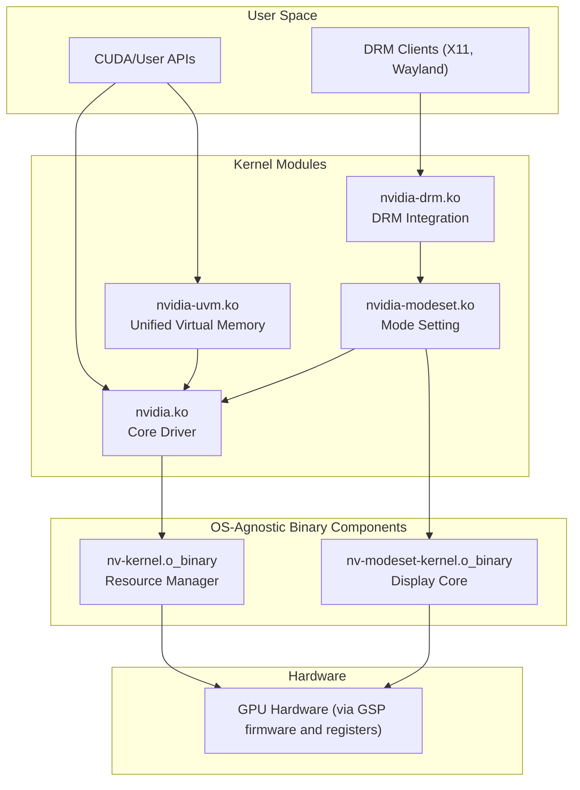
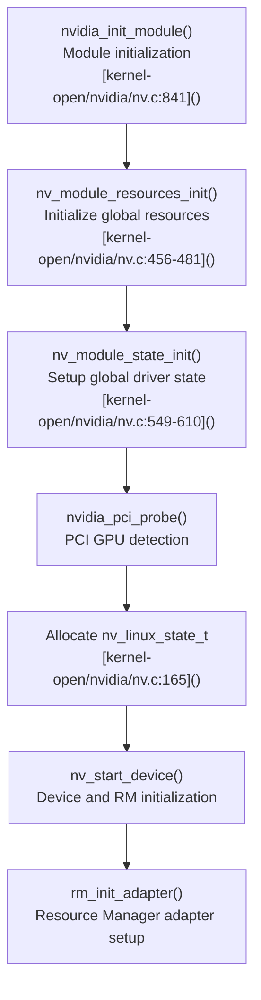
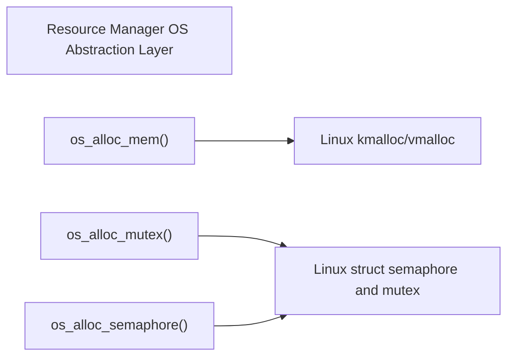
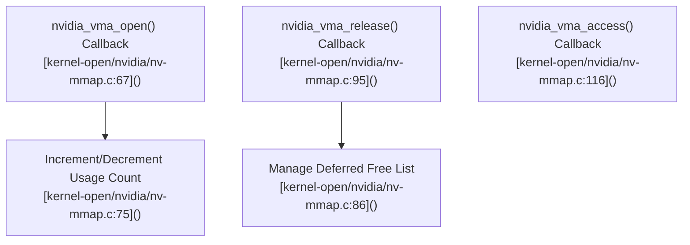

<!-- source: DeepWiki mcp.deepwiki.com · repo NVIDIA/open-gpu-kernel-modules · page 3 Core Kernel Modules · fetched 2026-10-26 -->

# Core Kernel Modules

Relevant source files

The following files were used as context for generating this wiki page:

- [kernel-open/common/inc/nv-linux.h](kernel-open/common/inc/nv-linux.h)
- [kernel-open/nvidia-uvm/uvm_va_block.c](kernel-open/nvidia-uvm/uvm_va_block.c)
- [kernel-open/nvidia/nv.c](kernel-open/nvidia/nv.c)
- [src/nvidia/src/kernel/gpu/device.c](src/nvidia/src/kernel/gpu/device.c)
- [src/nvidia/src/kernel/gpu/gsp/kernel_gsp.c](src/nvidia/src/kernel/gpu/gsp/kernel_gsp.c)

## Purpose and Scope

This document provides a high-level overview of the four primary kernel modules in the NVIDIA GPU driver stack:

- `nvidia.ko` (core driver)
- `nvidia-modeset.ko` (mode setting)
- `nvidia-drm.ko` (DRM integration)
- `nvidia-uvm.ko` (Unified Virtual Memory)

These modules collectively expose the necessary kernel interfaces that interact with the OS-agnostic Resource Manager and other binary components. Together, they manage GPU hardware resources, system integration, and memory management features.

This page serves as a parent overview and links to detailed child pages covering each module’s internals, architectures, and interfaces.

## Module Architecture Overview

NVIDIA's Linux GPU driver is architected as four interrelated kernel modules. Each addresses specific responsibilities, balancing portability and OS integration by combining OS-agnostic binary components with Linux kernel interface layers where applicable.

| Module              | Responsibilities                                                             | OS-Agnostic Binary               | Kernel Interface Location             |
|---------------------|------------------------------------------------------------------------------|---------------------------------|-------------------------------------|
| `nvidia.ko`         | Core driver: device lifecycle, ioctl handling, interrupts, power management, RM integration | `nv-kernel.o_binary`              | `kernel-open/nvidia/`                 |
| `nvidia-modeset.ko` | Mode setting: display configuration, OS-agnostic mode setting core           | `nv-modeset-kernel.o_binary`     | `kernel-open/nvidia-modeset/`        |
| `nvidia-drm.ko`     | DRM subsystem integration: atomic modesetting, kernel graphics compatibility  | None                            | `kernel-open/nvidia-drm/`            |
| `nvidia-uvm.ko`     | Unified Virtual Memory management: shared CPU/GPU memory, page residency, NUMA-aware allocation | None                            | `kernel-open/nvidia-uvm/`            |

### System-Level Interaction Diagram

Sources: [README.md:130-165](), [kernel-open/nvidia/nv.c:31-43]()

---

## nvidia.ko - Core Driver Module

The `nvidia.ko` module is the foundational kernel driver that manages GPU device lifecycle, ioctl-based user control interfaces, interrupt handling, power management, and integration with the OS-agnostic Resource Manager (RM). It is responsible for establishing and maintaining communication with the GPU hardware and firmware.

### Key Responsibilities

- Detect and initialize NVIDIA GPU devices during PCI probe.
- Allocate and manage per-device kernel state structures (`nv_linux_state_t`).
- Provide character device file operations for user-space interaction (`open`, `release`, `unlocked_ioctl`, `poll`, `mmap`).
- Implement OS abstraction interfaces to expose kernel primitives (memory management, locks, timers) required by the RM.
- Manage GPU power state and runtime PM integration.
- Handle interrupt registration and dispatching to appropriate GPU subsystems.
- Coordinate with RM binary for GPU resource management, including Virtual Memory, channels, and GPU reset handling.

### Initialization Workflow

### User-Space Interface via File Operations

User-space communicates with the GPU via character devices registered by `nvidia.ko`. The primary file operations interface is defined by the `nvidia_fops` structure, which includes:

| Operation       | Kernel Function           | Description                            |
|-----------------|--------------------------|------------------------------------|
| `open`          | `nvidia_open`            | Opens device and initializes file context |
| `release`       | `nvidia_close`           | Closes device and frees resources   |
| `unlocked_ioctl`| `nvidia_unlocked_ioctl`  | Main control ioctl handler           |
| `poll`          | `nvidia_poll`            | Wait for asynchronous GPU events     |
| `mmap`          | `nvidia_mmap`            | Map GPU memory to user space          |

This interface is the primary path for user-space components such as the CUDA runtime driver to submit GPU commands, manage memory, and query device status.

### OS Abstraction for the Resource Manager

To support operating system independence, the Resource Manager binary expects an OS abstraction layer. `nvidia.ko` implements this in `os-interface.c`, providing wrappers around Linux kernel primitives:

This design cleanly isolates OS-specific implementations while enabling a unified RM binary to operate across platforms.

For in-depth technical details on device management, interrupt handling, and RM integration, see the child page [nvidia.ko - Core Driver](#3.1).

Sources: [kernel-open/nvidia/nv.c:165-175](), [kernel-open/nvidia/nv.c:456-610](), [kernel-open/nvidia/nv.c:841-1009](), [kernel-open/nvidia/os-interface.c:85-110](), [kernel-open/nvidia/os-interface.c:180-201](), [kernel-open/nvidia/os-interface.c:605-668]()

---

## nvidia-modeset.ko - Mode Setting Module

The `nvidia-modeset.ko` module is responsible for GPU display mode setting functionality. It exposes display configuration interfaces to user-space, interacting with Linux DRM's plane and CRTC abstractions to control outputs, modes, and display pipelines.

This module includes an OS-agnostic binary component named `nv-modeset-kernel.o_binary` that encapsulates the core mode setting logic independent of the Linux kernel. The kernel interface layer found in `kernel-open/nvidia-modeset/` acts as a bridge between this binary and both the Linux DRM subsystem and the `nvidia.ko` core driver.

The modular split enables reuse of display mode setting logic across different operating systems while integrating cleanly with Linux DRM frameworks.

For a detailed explanation of module architecture, mode setting workflow, and binary interface, see [nvidia-modeset.ko - Mode Setting](#3.2).

Sources: [README.md:145-147]()

---

## nvidia-drm.ko - DRM Integration Module

The `nvidia-drm.ko` module integrates NVIDIA GPU driver capabilities with the Linux Direct Rendering Manager (DRM) subsystem. It supports atomic modesetting, buffer object management, and compatibility with the Linux kernel graphics stack, allowing standard DRM clients (e.g. X11, Wayland compositors) to leverage NVIDIA GPU features transparently.

Distinct from `nvidia.ko` and `nvidia-modeset.ko`, this module solely serves as a glue layer without an OS-agnostic binary backing. It exposes DRM entry points and hooks that connect the DRM subsystem to the underlying NVIDIA kernel modeset and device management logic.

For comprehensive integration details and DRM subsystem interactions, see [nvidia-drm.ko - DRM Integration](#3.3).

Sources: [README.md:146-147]()

---

## nvidia-uvm.ko - Unified Virtual Memory Module

The `nvidia-uvm.ko` module implements NVIDIA's Unified Virtual Memory (UVM) support, enabling seamless shared memory spaces between CPU and GPU, transparent page migration, on-demand paging, and fault handling.

Features include:

- Management of VA blocks that represent virtual memory ranges.
- Tracking page residency across CPU/system memory and GPU local memory.
- Integration with Linux HMM (Heterogeneous Memory Management) for efficient address space tracking and migration.
- Support for ATS (Address Translation Services), SVA (Shared Virtual Addressing), and NUMA-aware memory allocation strategies.

The UVM kernel module uses Linux VMA callback functions (`nvidia_vma_open`, `nvidia_vma_release`, `nvidia_vma_access`) to maintain usage counts and deferred GPU allocation freeing. These callbacks are defined in `nv-mmap.c` and ensure consistent tracking of memory mappings between user space and GPU drivers.

Unlike `nvidia.ko` and `nvidia-modeset.ko`, `nvidia-uvm.ko` does not wrap an OS-agnostic binary but implements Linux-specific kernel memory management and page fault handling needed for unified memory operations.

For an in-depth exploration of UVM architecture and internals, see [nvidia-uvm.ko - Unified Virtual Memory](#3.4).

Sources: [kernel-open/nvidia/nv-mmap.c:66-113](), [kernel-open/common/inc/nv-mm.h:138-172]()

---

## Summary

The four core kernel modules provide a modular yet tightly integrated GPU driver stack:

| Module              | Role Summary                                                   |
|---------------------|----------------------------------------------------------------|
| `nvidia.ko`         | Core GPU device management, interrupt and power handling, user ioctl interface, and OS abstraction for Resource Manager. |
| `nvidia-modeset.ko` | Display mode setting with an OS-agnostic binary backend, interfacing with DRM and hardware.  |
| `nvidia-drm.ko`     | Linux DRM subsystem integration, enabling atomic modesetting and compatibility with graphics APIs.  |
| `nvidia-uvm.ko`     | Unified Virtual Memory kernel support, managing shared CPU/GPU memory and fault handling.  |

These modules form a layered architecture that separates OS-dependent kernel interfaces from portable binary GPU resource management components and firmware. Together, they provide a robust and maintainable driver architecture supporting advanced NVIDIA GPU features on Linux.

For detailed technical information on each module's design and implementation, please refer to their child pages:

- [nvidia.ko - Core Driver](#3.1)
- [nvidia-modeset.ko - Mode Setting](#3.2)
- [nvidia-drm.ko - DRM Integration](#3.3)
- [nvidia-uvm.ko - Unified Virtual Memory](#3.4)

---

Sources:  
[README.md:130-165](),  
[kernel-open/nvidia/nv.c:165-175](), [kernel-open/nvidia/nv.c:456-610](), [kernel-open/nvidia/nv.c:841-1009](),  
[kernel-open/nvidia/os-interface.c:85-110](), [kernel-open/nvidia/os-interface.c:180-201](), [kernel-open/nvidia/os-interface.c:605-668](),  
[kernel-open/nvidia/nv-mmap.c:66-113](), [kernel-open/common/inc/nv-mm.h:138-172]()

---

