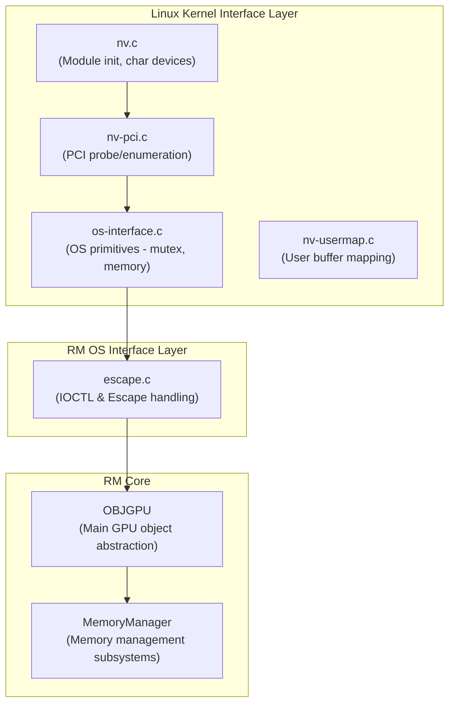
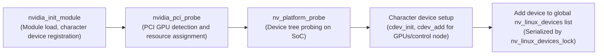
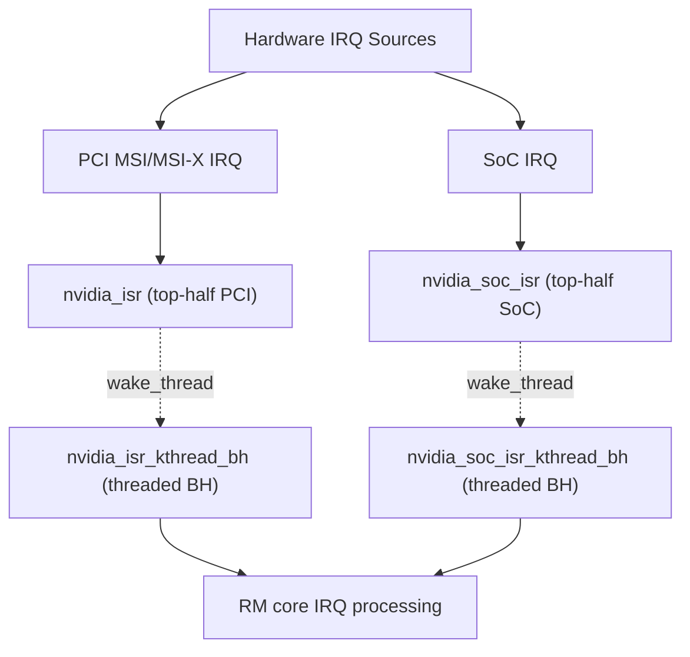

<!-- source: DeepWiki mcp.deepwiki.com · repo NVIDIA/open-gpu-kernel-modules · page 3.1 nvidia.ko - Core Driver · fetched 2026-10-26 -->

# nvidia.ko - Core Driver

Relevant source files

The following files were used as context for generating this wiki page:

- [kernel-open/common/inc/nv-linux.h](kernel-open/common/inc/nv-linux.h)
- [kernel-open/nvidia-drm/nvidia-drm-sources.mk](kernel-open/nvidia-drm/nvidia-drm-sources.mk)
- [kernel-open/nvidia-uvm/uvm_va_block.c](kernel-open/nvidia-uvm/uvm_va_block.c)
- [kernel-open/nvidia/nv-mmap.c](kernel-open/nvidia/nv-mmap.c)
- [kernel-open/nvidia/nv.c](kernel-open/nvidia/nv.c)
- [src/nvidia/arch/nvalloc/unix/src/escape.c](src/nvidia/arch/nvalloc/unix/src/escape.c)
- [src/nvidia/arch/nvalloc/unix/src/os.c](src/nvidia/arch/nvalloc/unix/src/os.c)
- [src/nvidia/arch/nvalloc/unix/src/osapi.c](src/nvidia/arch/nvalloc/unix/src/osapi.c)
- [src/nvidia/src/kernel/gpu/device.c](src/nvidia/src/kernel/gpu/device.c)
- [src/nvidia/src/kernel/gpu/gsp/kernel_gsp.c](src/nvidia/src/kernel/gpu/gsp/kernel_gsp.c)
- [src/nvidia/src/kernel/gpu/intr/intr.c](src/nvidia/src/kernel/gpu/intr/intr.c)
- [src/nvidia/src/kernel/gpu/mig_mgr/kernel_mig_manager.c](src/nvidia/src/kernel/gpu/mig_mgr/kernel_mig_manager.c)
- [src/nvidia/src/kernel/vgpu/rpc.c](src/nvidia/src/kernel/vgpu/rpc.c)

## Overview

The `nvidia.ko` kernel module is the principal kernel driver for managing NVIDIA GPUs within the NVIDIA Open GPU Kernel Modules framework. It functions as the Resource Manager (RM) kernel entity, responsible for managing GPU devices, hardware access, GPU memory, and communication with user-space components such as CUDA and OpenGL libraries.

Key responsibilities include:

- **Device Lifecycle Management**: Discover, initialize, and manage GPU devices via PCI and SoC platform mechanisms, organize device state structures, and maintain global lists.  
- **Operating System Abstraction Layer (OSAL)**: Provide Linux-specific implementations for memory allocation, synchronization, PCI config access, timing, and other OS operations required by RM core components.  
- **User-Space Interface**: Register character device nodes under `/dev/nvidia*`, handle ioctl and escape calls to enable user-space GPU control, memory management, and interactions.  
- **Interrupt Handling**: Support multiple interrupt modes including PCI MSI/MSI-X and SoC platform interrupts, implemented with top-half and threaded bottom-half handlers that forward events to RM interrupt processing.  
- **Power Management**: Integrate with Linux runtime and system suspend/resume PM frameworks, manage power state references, and provide GPU power transitions coordination.  
- **Integration with RM Core**: Serve as a bridge translating Linux kernel operations and device state into calls and objects within the RM core, managing RM API client handles and serialization.

`nvidia.ko` is the foundation module on which other NVIDIA kernel modules such as `nvidia-modeset.ko`, `nvidia-drm.ko`, and `nvidia-uvm.ko` build.

---

## Architecture and Integration

The module structure partitions responsibilities clearly to preserve RM core portability and Linux kernel customizations:

- **Linux Kernel Interface Layer (Open Source)**: Manages Linux kernel devices (`struct pci_dev`), character devices, interrupt registration, and OS integration primitives.  
- **RM OS Interface Layer**: Implements operating system primitives (memory, mutexes, locks, timing, PCI access) required by RM in Linux, along with escape IOCTL call handling.  
- **RM Core Layer (Binary or Open Source)**: Internal RM logic responsible for resource management, firmware communication, and GPU hardware programming.

### Component Interaction and Code Entity Mapping

This architecture delineates the path from Linux kernel drivers through OS abstraction into RM core GPU and memory subsystems.

Sources:  
- [kernel-open/nvidia/nv.c:1-200]()  
- [kernel-open/nvidia/os-interface.c:1-300]()  
- [src/nvidia/arch/nvalloc/unix/src/escape.c:26-131]()  
- [src/nvidia/generated/g_gpu_nvoc.c:56-88]()  

---

## Device Lifecycle and Management

Each GPU is represented by an `nv_linux_state_t` object that encapsulates core device state (`nv_state_t`). Devices are enumerated either by PCI probing or SoC device tree mechanisms and maintained in a global list.

### Device Initialization Flow

- At module load, the core sets up global data structures and registers major device numbers.  
- Each PCI GPU device detected invokes `nvidia_pci_probe`, which sets up GPU device structures and calls RM initialization.  
- On SoC platforms like Tegra, `nv_platform_probe` handles device enumeration through device tree and interrupt setup.  
- Each device is assigned a unique minor number and added to a global linked list guarded by `nv_linux_devices_lock`.

### Global Device Tracking

| Entity               | Purpose                                                | Reference                   |
|----------------------|--------------------------------------------------------|-----------------------------|
| `nv_linux_devices`    | Linked list head maintaining all registered devices    | [kernel-open/nvidia/nv.c:164-165]() |
| `nv_linux_minor_bitmap`| Bitmap tracking all allocated minor device numbers    | [kernel-open/nvidia/nv.c:167]()      |
| `nv_ctl_device`       | Singleton representing the control device `/dev/nvidiactl` | [kernel-open/nvidia/nv.c:168-170]() |

This infrastructure allows iteration, management, and lookup of active GPU devices within the driver.

Sources:  
- [kernel-open/nvidia/nv.c:823-998]()  
- [kernel-open/nvidia/nv-platform.c:139-182]()  

---

## OS Abstraction Layer (OSAL)

The RM core relies on a set of OS primitives for platform independence. These Linux-specific implementations reside mainly in `os-interface.c` and related files, providing:

### Synchronization Primitives

- **Mutexes** (`os_alloc_mutex`, `os_acquire_mutex`, `os_release_mutex`): Wrap Linux semaphores to provide mutual exclusion with timed and interruptible waits.  
- **Read/Write Locks** (`os_alloc_rwlock`, `os_acquire_rwlock_read`, `os_acquire_rwlock_write`): Implemented using Linux kernel `rw_semaphore` for concurrency control.  
- **Semaphores**: Basic kernel semaphores for counting resources or synchronization.

### Memory Management

- **Kernel Memory**: Allocation and freeing of memory (`os_alloc_mem`, `os_free_mem`) with considerations for size and context, using `kmalloc` or `vmalloc`.  
- **User Memory Mapping**: Controlled via `nv_usermap.c`, tracking pinning, access protection, and lifecycle per open file context. This supports user buffer export to GPU.

### PCI and Timing

- Abstractions for reading/writing PCI configuration space mapped to Linux PCI APIs.  
- Timing queried with high resolution, wrapping kernel timer functions.  
- Delays using `udelay` for sub-millisecond accuracy.

### IOCTL / Escape Handling

Escape calls in `escape.c` bridge user-space ioctl requests to RM API calls, performing safe parameter copies and dispatching commands into RM core methods.

Sources:  
- [kernel-open/nvidia/os-interface.c:92-300]()  
- [kernel-open/nvidia/nv-usermap.c:29-150]()  
- [src/nvidia/arch/nvalloc/unix/src/escape.c:75-131]()  

---

## Interrupt Handling

`nvidia.ko` supports interrupts from PCI (legacy, MSI, MSI-X) and SoC platforms, managing both top half (ISR) and bottom half (threaded kthread handlers).

### Interrupt Flow Diagram

- **SoC interrupts** are registered via `nv_request_soc_irq`. ISR quickly checks GPU interrupt status, schedules a mutex-serialized bottom half handler (`nv_soc_isr_kthread_bh`) for processing.  
- **PCI/MSI interrupts** invoke `nvidia_isr` top half, scheduling `nvidia_isr_kthread_bh` as a threaded bottom half.  
- Bottom halves call into RM API interrupt dispatch routines to handle GPU events, command completions, and fault notifications.

Synchronization and concurrency are managed via locks such as `soc_bh_mutex` and RM API client serialization.

Sources:  
- [kernel-open/nvidia/nv-platform.c:34-137]()  
- [kernel-open/nvidia/nv-msi.c:28-118]()  

---

## Power Management

The core driver coordinates with Linux power management for system suspend/resume and runtime PM:

- Uses `nv_system_pm_lock` (rw semaphore) to synchronize system-wide PM operations.  
- Tracks power state via `nv_system_power_state` and nested action depth `nv_system_pm_action_depth`.  
- Registers `nv_pm_notifier` to receive PM events and perform GPU freeze and thaw operations accordingly.  
- Supports dynamic power management with functions that increment/decrement PM references and wake devices from suspend as needed.

This ensures consistent PM state transitions and GPU power stability across diverse platforms.

Sources:  
- [kernel-open/nvidia/nv.c:180-194]()  
- [kernel-open/nvidia/os-interface.c:900-950]()  

---

## Integration with RM Core

The RM core is accessed through RM API clients and objects encapsulating GPU state:

- Upon device probing, RM client handles are allocated with references to PCI or SoC device handles.  
- RM API concurrency is enforced through `rmapiLockAcquire` and `rmapiLockRelease`. Helper functions like `RmUnixRmApiPrologue()` initialize thread context, acquire locks, and handle dynamic power reference counting.  
- RM objects such as `OBJGPU` represent the physical GPU; these hold GPU resources, memory allocators, and hardware state. The RM core performs hardware programming, object creation, and event processing.  
- Memory management, hardware interrupts, and command submission ultimately invoke RM core routines for consistent resource tracking.

This clear boundary keeps the Linux kernel driver code minimal and focused on bridging OS integration.

Sources:  
- [src/nvidia/arch/nvalloc/unix/src/osapi.c:195-214]()  
- [src/nvidia/src/kernel/gpu/device.c:1-170]()  

---

# Summary Table of Key Code Files

| File Path                             | Description                                            | Example Line Ranges          |
|-------------------------------------|--------------------------------------------------------|-----------------------------|
| `kernel-open/nvidia/nv.c`           | Module initialization, character device registration, device list management | 800-1000                    |
| `kernel-open/nvidia/os-interface.c`| Linux OS abstraction for memory, sync, PCI, timing     | 1-300                       |
| `kernel-open/nvidia/nv-platform.c`  | SoC device probing, IRQ registration                    | 30-190                      |
| `kernel-open/nvidia/nv-msi.c`        | PCI MSI/MSI-X interrupt top and bottom half management | 28-118                      |
| `kernel-open/nvidia/nv-usermap.c`   | User buffer memory mapping and tracking                 | 29-150                      |
| `src/nvidia/arch/nvalloc/unix/src/escape.c` | Escape IOCTL handling bridging user space to RM core    | 26-131                      |
| `src/nvidia/generated/g_gpu_nvoc.c` | GPU and RM core object definitions and metadata        | 56-88                       |
| `src/nvidia/arch/nvalloc/unix/src/osapi.c` | RM API prologue/epilogue, OS integration for RM calls  | 195-214                     |
| `src/nvidia/src/kernel/gpu/device.c`| Device resource management and initialization           | 1-170                       |

---

This document details the internal implementation of the `nvidia.ko` core driver module, covering device initialization, OS abstraction, IRQ processing, power management, and integration with the RM core, representing the foundational Linux kernel component for NVIDIA GPU support.

Sources:  
- [kernel-open/nvidia/nv.c:1-200]()  
- [kernel-open/nvidia/os-interface.c:1-300]()  
- [kernel-open/nvidia/nv-platform.c:30-190]()  
- [kernel-open/nvidia/nv-msi.c:28-118]()  
- [kernel-open/nvidia/nv-usermap.c:29-150]()  
- [src/nvidia/arch/nvalloc/unix/src/escape.c:26-131]()  
- [src/nvidia/generated/g_gpu_nvoc.c:56-88]()  
- [src/nvidia/arch/nvalloc/unix/src/osapi.c:195-214]()  
- [src/nvidia/src/kernel/gpu/device.c:1-170]()

---

