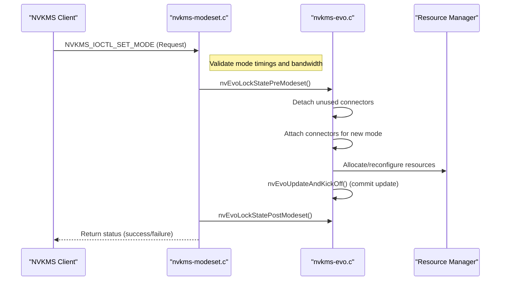
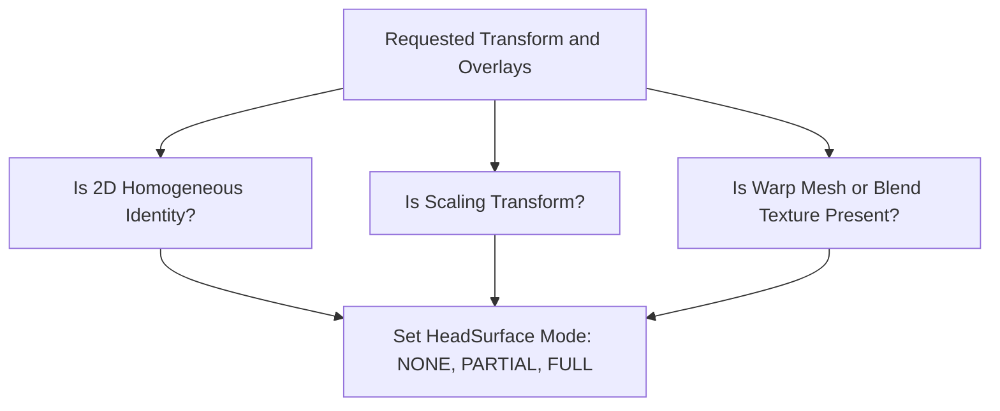

<!-- source: DeepWiki mcp.deepwiki.com · repo NVIDIA/open-gpu-kernel-modules · page 3.2 nvidia-modeset.ko - Mode Setting · fetched 2026-10-26 -->

# nvidia-modeset.ko - Mode Setting

<details>
<summary>Relevant source files</summary>

The following files were used as context for generating this wiki page:

- [kernel-open/nvidia-modeset/nvidia-modeset-linux.c](kernel-open/nvidia-modeset/nvidia-modeset-linux.c)
- [src/nvidia-modeset/src/nvkms-evo.c](src/nvidia-modeset/src/nvkms-evo.c)
- [src/nvidia-modeset/src/nvkms-framelock.c](src/nvidia-modeset/src/nvkms-framelock.c)
- [src/nvidia-modeset/src/nvkms-hdmi.c](src/nvidia-modeset/src/nvkms-hdmi.c)

</details>


## Purpose and Scope

The `nvidia-modeset.ko` kernel module functions as the dedicated display mode setting component within the NVIDIA GPU kernel driver stack. It is responsible for enumerating display hardware, validating and configuring display timings and modes, and programming the GPU’s display engine to present desktop framebuffer contents correctly on connected monitors.

Its core responsibilities include:

- Enumerating display GPUs, display engines (Disps), physical connectors, and logical display devices (dpys).
- Validating requested display modes against hardware capabilities and timing/bandwidth constraints.
- Managing display pipeline elements such as heads, windows, cursors, connectors, and multi-stream transport (MST) dynamic displays.
- Mapping framebuffer scanout surfaces to the display engine windows and layers.
- Coordinating closely with the core NVIDIA Resource Manager (`nvidia.ko`) for GPU channel/resource allocation.

Most of the display logic is implemented in an OS-agnostic binary component known as `nvkms`. The `nvidia-modeset.ko` module on Linux implements the OS-specific kernel interface, exposing the NVKMS API, IOCTL handlers, and integration layer functions.

---

## Architecture

The module is architected with a clear separation between OS-specific integration and core mode setting logic, enabling portability and reuse.

| Component                     | Role                                                                        | Code File(s)                                    |
|-------------------------------|-----------------------------------------------------------------------------|------------------------------------------------|
| **Linux Interface Layer**      | Kernel module implementation, Linux bindings, module parameters, IOCTLs    | `nvidia-modeset-linux.c`                        |
| **NVKMS Core (OS-agnostic)**   | Internal mode setting API, display engine abstractions, state machines     | `nvkms-evo.c`, `nvkms-modeset.c`, others       |
| **DisplayPort Library (common)** | DP link management, MST, device discovery                                   | DP subdirectory files                           |
| **Resource Manager (RM)**      | GPU resource control, channel allocation, hardware command submission       | `nvidia.ko` (separate kernel module)            |

### Display Abstractions and Code Entity Mapping

Mode setting revolves around several key display abstractions which map directly to internal code structures and external API handles. The following diagram illustrates this mapping:

```mermaid
graph TD
    subgraph "Natural Language Space"
        GPU["Physical GPU or SLI Group"]
        Engine["Display Engine (Disp)"]
        Port["Physical Connector (DVI, HDMI, DP)"]
        Monitor["Display Device (Monitor/Panel)"]
        Buffer["Framebuffer Surface"]
    end

    subgraph "Code Entity Space"
        NVDevEvoRec[NVDevEvoRec (Device Object)]
        NVDispEvoRec[NVDispEvoRec (Display Engine Object)]
        NVConnectorEvoRec[NVConnectorEvoRec (Connector Object)]
        NVDpyEvoRec[NVDpyEvoRec (Display Device Object)]
        NVSurfaceEvoRec[NVSurfaceEvoRec (Surface Object)]
    end

    subgraph "API Handle Space"
        DeviceHandle["NvKmsDeviceHandle (deviceHandle)"]
        DispHandle["NvKmsDispHandle (dispHandle)"]
        ConnectorHandle["NvKmsConnectorHandle (connectorHandle)"]
        DpyId["NVDpyId (dpyId)"]
        SurfaceHandle["NvKmsSurfaceHandle (surfaceHandle)"]
    end

    GPU --- NVDevEvoRec --- DeviceHandle
    Engine --- NVDispEvoRec --- DispHandle
    Port --- NVConnectorEvoRec --- ConnectorHandle
    Monitor --- NVDpyEvoRec --- DpyId
    Buffer --- NVSurfaceEvoRec --- SurfaceHandle

    NVDevEvoRec --> NVDispEvoRec
    NVDispEvoRec --> NVConnectorEvoRec
    NVConnectorEvoRec --> NVDpyEvoRec
```

This mapping is important for understanding how user-space clients interact with the kernel module through opaque handles corresponding to these internal objects.

Sources: [src/nvidia-modeset/interface/nvkms-api.h:39-89](), [src/nvidia-modeset/include/nvkms-types.h:133-156]()

---

### Internal Component Interaction

Within the `nvidia-modeset.ko` module, several internal components collaborate closely to implement mode setting functionality:

```mermaid
flowchart HI
    subgraph "nvidia-modeset.ko (Internal)"
        API["NVKMS API Layer (nvkms-api.h)"]
        EVO["EVO Logic (nvkms-evo.c)"]
        MODES["Modeset State Machine (nvkms-modeset.c)"]
        HS["HeadSurface Management (nvkms-headsurface.c)"]
    end

    subgraph "External Dependencies"
        RM["Resource Manager (nvidia.ko)"]
        DPLIB["DisplayPort Library (DP helper code)"]
    end

    API --> MODES
    MODES --> EVO
    EVO --> RM
    EVO <--> DPLIB
    MODES --> HS
```

- The NVKMS API layer exposes a device file and IOCTLs to user-space.
- The modeset state machine aggregates mode change requests and validates them.
- EVO logic manages the intricate hardware head, window, and sync configurations.
- HeadSurface subsystem manages internal warp/blend surfaces for advanced display transformations.
- The Resource Manager handles resource allocations and program submission at the hardware level.
- The DisplayPort library manages DP-specific link training and MST functionality.

Sources: [kernel-open/nvidia-modeset/nvidia-modeset-linux.c:45-51](), [src/nvidia-modeset/src/nvkms-headsurface-config.c:24-38]()

---

## Core Data Structures and Concepts

### NVDevEvoRec (Device Object)
Represents the logical device abstraction tied to a GPU or SLI group. It contains global state for display management and tracks all associated display engines (disps).

### NVDispEvoRec (Display Engine Object)
Represents an individual GPU subdevice's display engine capable of scanout and signal generation. Manages heads, overlays, and the window pipeline.

### NVConnectorEvoRec (Connector Object)
Represents physical connectors (e.g., HDMI, DP, DVI). Manages link status, hotplug detection, and associated EDID data.

### NVDpyEvoRec (Display Device Object)
Represents a logical display device endpoint attached to a connector or MST stream. Tracks display timings, EDID, and connection events.

### NVSurfaceEvoRec (Surface Object)
Represents a scanout-capable framebuffer surface registered with the modeset, usually backed by GPU memory allocated by RM.

### NVEvoModesetUpdateState
Encapsulates deferred hardware register writes and batching of modeset updates before committing atomically. This structure avoids inconsistent hardware state during in-progress mode changes.

Sources: [src/nvidia-modeset/include/nvkms-types.h:130-169]()

---

## Mode Setting Workflow

The processing of a display mode setting operation involves multiple coordinated stages to ensure correctness and hardware safety:

1. **Mode Set Request**: Originates from userspace via `NVKMS_IOCTL_SET_MODE` or analogous NVKMS API calls.

2. **Mode Validation**: Checks display timings against hardware limits, bandwidth limitations, and connector capabilities. Early rejection before programming hardware.

3. **State Preparation**: Uses the EVO logic to detach connectors no longer used and attach new connectors as defined by the requested mode.

4. **Update State Assembly**: Generates and accumulates hardware register writes and state changes in an `NVEvoModesetUpdateState` context.

5. **State Commit**: Atomically commits the update batch to hardware registers, effectively kicking off the mode change on the GPU's display engine.

6. **Result Propagation**: Returns success or failure status to the userspace caller.

### Mode Setting Sequence Diagram



- The key locking functions `nvEvoLockStatePreModeset` and `nvEvoLockStatePostModeset` surround the actual state update allowing consistent state transitions.

Sources: [src/nvidia-modeset/interface/nvkms-api.h:102-104](), [src/nvidia-modeset/src/nvkms-headsurface-config.c:35-36]()

---

### Hardware Register Updates

- The hardware state updates are batched and deferred via the `NVEvoModesetUpdateState` to avoid partial or inconsistent register updates.
- Scanout surfaces must comply with alignment and pitch requirements (e.g., 4KB alignment).
- Display Look-Up Tables (LUT) and overlay layers are programmed as part of the modeset.
- Vertical blank and synchronization points are managed to ensure smooth and tear-free transition.

Sources: [src/nvidia-modeset/include/nvkms-types.h:90-120]()

---

## HeadSurface (HS) Configuration

`HeadSurface` is a subsystem that routes the desktop framebuffer through a special internal surface on the GPU before scanout. This enables advanced features such as:

- Warp and blend for projection mapping.
- Stereo 3D rendering with different views.
- Custom scaling, color transformation, and overlay mixing.

### HeadSurface Configuration Workflow

The HeadSurface mode is determined by analyzing the desired transformations and overlay layers:

- If the requested viewport transform is a 2D homogeneous identity transformation and no warping or blending is needed, no HeadSurface is installed.
- If a scaling transform is present or warp meshes/blend textures are active, the HeadSurface is partially or fully activated.
- Internal surfaces and warp meshes are created and managed dynamically.



This subsystem ensures that complex display configurations can be implemented cleanly.

Sources: [src/nvidia-modeset/src/nvkms-headsurface-config.c:44-100](), [src/nvidia-modeset/src/nvkms-headsurface-config.c:129-160]()

---

## DisplayPort and MST Support

`nvidia-modeset.ko` supports DisplayPort Multi-Stream Transport (MST), allowing multiple independent displays to be connected via one physical DP port.

- MST streams are represented as "dynamic dpys" with their own `NVDpyId`.
- The module handles dynamic connect/disconnect events for MST streams, sending notifications to clients.
- Clients can register interest on dynamic dpys to prevent their destruction and maintain stable identities.
- Link training and configuration utilize the DisplayPort common library interfaces.
- Support for DisplayPort 1.4 and DP 2.x features including link training and Display Stream Compression (DSC) is included.

Sources: [src/nvidia-modeset/interface/nvkms-api.h:119-140](), [src/nvidia-modeset/include/nvkms-types.h:170-180]()

---

## Linux Kernel Module Parameters

The `nvidia-modeset.ko` module exposes several module parameters that control its behavior and assist in debugging:

| Parameter                   | Type       | Description                                                        | Location (line range)                          |
|-----------------------------|------------|--------------------------------------------------------------------|-----------------------------------------------|
| `output_rounding_fix`       | bool       | Enables fix for output rounding issues.                            | kernel-open/nvidia-modeset/nvidia-modeset-linux.c:83-84 |
| `disable_hdmi_frl`          | bool       | Disable HDMI Fixed Rate Link (FRL) feature.                        | kernel-open/nvidia-modeset/nvidia-modeset-linux.c:86-87 |
| `disable_vrr_memclk_switch` | bool       | Disable dynamic memclk switching during Variable Refresh Rate.     | kernel-open/nvidia-modeset/nvidia-modeset-linux.c:89-90 |
| `hdmi_deepcolor`            | bool       | Enable HDMI deep color support.                                    | kernel-open/nvidia-modeset/nvidia-modeset-linux.c:92-93 |
| `max_output_color_depth`    | uint       | Max output color bit depth (default 10).                          | kernel-open/nvidia-modeset/nvidia-modeset-linux.c:94-96 |
| `opportunistic_display_sync`| bool       | Enable opportunistic VBlank synchronization.                      | kernel-open/nvidia-modeset/nvidia-modeset-linux.c:98-99 |
| `debug`                    | int        | Enable verbose debug logging.                                      | kernel-open/nvidia-modeset/nvidia-modeset-linux.c:138-140  |
| `fail_malloc`              | int        | Fail the Nth call to internal allocator for fault injection.       | kernel-open/nvidia-modeset/nvidia-modeset-linux.c:109-111 |
| `fail_alloc_core_channel`  | int        | Simulate failure allocating RM core channel for testing.           | kernel-open/nvidia-modeset/nvidia-modeset-linux.c:134-136 |

These parameters enable developers and integrators to tune system behavior, work around hardware quirks, or test robustness.

Sources: [kernel-open/nvidia-modeset/nvidia-modeset-linux.c:72-140]()

---

## Summary

The `nvidia-modeset.ko` kernel module provides the comprehensive mode setting and display configuration capabilities needed to enable desktop output on NVIDIA GPUs under Linux. It orchestrates GPU display resources, manages display connectors and devices, validates complex mode settings, including multi-GPU and display protocol extensions like MST, and commits these settings atomically to GPU hardware.

Central to its architecture is the OS-independent `nvkms` binary component that implements the core logic, with `nvidia-modeset.ko` providing Linux-specific kernel interfaces, module controls, and IOCTL dispatching.

Support for advanced features like HeadSurface warping and blending, HDMI audio, fixed rate link, and VRR parameters reflect the module's role in delivering modern display pipeline features.

---

## Sources

- kernel-open/nvidia-modeset/nvidia-modeset-linux.c:1-185
- src/nvidia-modeset/interface/nvkms-api.h:20-140
- src/nvidia-modeset/include/nvkms-types.h:130-180
- src/nvidia-modeset/src/nvkms-evo.c:1-178
- src/nvidia-modeset/src/nvkms-headsurface-config.c:30-160
- src/nvidia-modeset/src/nvkms-framelock.c:1-176
- src/nvidia-modeset/src/nvkms-hdmi.c:1-177

---

