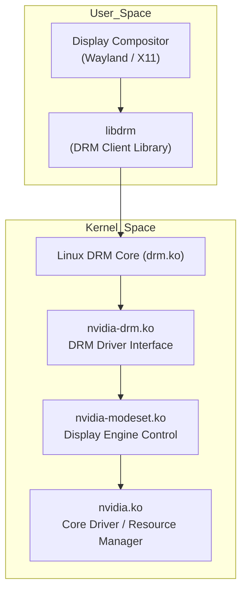
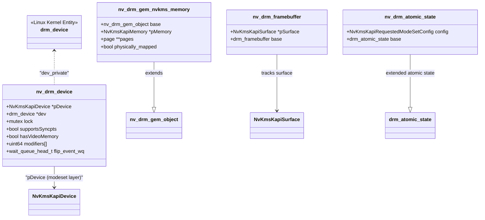
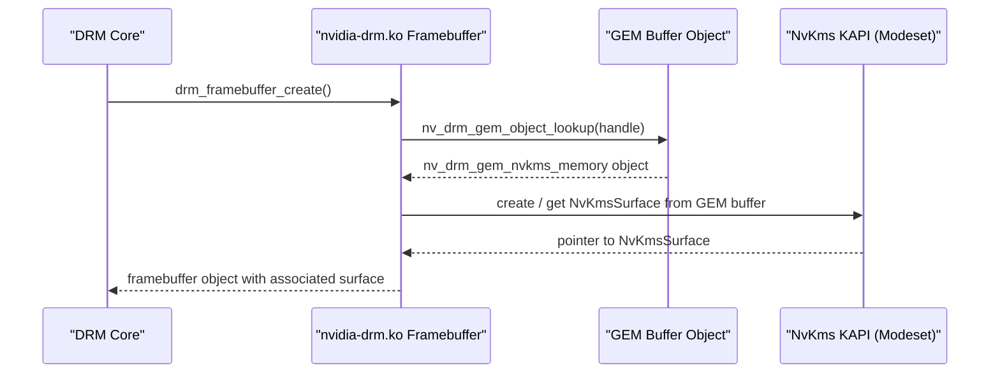

<!-- source: DeepWiki mcp.deepwiki.com · repo NVIDIA/open-gpu-kernel-modules · page 3.3 nvidia-drm.ko - DRM Integration · fetched 2026-10-26 -->

# nvidia-drm.ko - DRM Integration

Relevant source files

The following files were used as context for generating this wiki page:

- [kernel-open/nvidia-drm/nvidia-drm-connector.c](kernel-open/nvidia-drm/nvidia-drm-connector.c)
- [kernel-open/nvidia-drm/nvidia-drm-crtc.c](kernel-open/nvidia-drm/nvidia-drm-crtc.c)
- [kernel-open/nvidia-drm/nvidia-drm-modeset.c](kernel-open/nvidia-drm/nvidia-drm-modeset.c)
- [kernel-open/nvidia-uvm/uvm_migrate_pageable.c](kernel-open/nvidia-uvm/uvm_migrate_pageable.c)
- [src/common/displayport/inc/dp_auxbus.h](src/common/displayport/inc/dp_auxbus.h)
- [src/common/modeset/hdmipacket/nvhdmipkt_C671.c](src/common/modeset/hdmipacket/nvhdmipkt_C671.c)

## Purpose and Scope

The `nvidia-drm.ko` kernel module integrates the NVIDIA GPU driver with the Linux Direct Rendering Manager (DRM) subsystem. It provides a standard Linux kernel interface for display management, enabling atomic modesetting, buffer management, and synchronization compatible with modern Linux display stacks (including Wayland and X11 compositors). This module acts as the bridge between the Linux DRM core APIs and NVIDIA's internal, OS-agnostic display engine controls implemented in `nvidia-modeset.ko`.

---

## Architecture Overview

### Module Position in Driver Stack

- `nvidia-drm.ko` registers itself as a DRM driver with Linux DRM core and implements DRM/KMS callbacks.
- Delegates OS-agnostic display configuration and modesetting commands to `nvidia-modeset.ko`.
- The underlying GPU device management and resource handling are performed by `nvidia.ko`.

**Sources:** [kernel-open/nvidia-drm/nvidia-drm-priv.h:35-50]()

---

### Data Structures and Code Entities Mapping

This diagram maps core Linux DRM structures to NVIDIA's internal data representations within `nvidia-drm.ko`:

- `nv_drm_device` manages the NVIDIA-specific device data and references the modeset device (`NvKmsKapiDevice`).
- GEM objects with Nvidia's KMS memory backend are represented by `nv_drm_gem_nvkms_memory`.
- Framebuffers maintain a reference to `NvKmsKapiSurface` objects, used by the modeset layer for display scanout.
- Atomic state extensions accommodate NVIDIA-specific requested mode set configurations.

**Sources:** 
- [kernel-open/nvidia-drm/nvidia-drm-priv.h:90-185]()
- [kernel-open/nvidia-drm/nvidia-drm-gem-nvkms-memory.c:40-110]()
- [kernel-open/nvidia-drm/nvidia-drm-modeset.c:50-60]()

---

## DRM Subsystem Integration

### Driver Structure and Per-Device State

- The DRM driver registers the `drm_driver` structure with callbacks for:
  - Device initialization and teardown.
  - Modesetting (atomic and legacy).
  - GEM buffer management and framebuffer operations.
- Per-device state is held in a `struct nv_drm_device` containing:
  - `pDevice`: Pointer to the `NvKmsKapiDevice` (modeset display device abstraction).
  - `lock`: A mutex protecting the device state.
  - `flip_event_wq`: Wait queue to signal pageflip events.
  - Feature flags like `supportsSyncpts` (syncpoints for fencing) and `hasVideoMemory` (indicates availability of dedicated local video memory).
- The `nvKms` symbol references the `NvKmsKapiFunctionsTable` of hardware-specific display control function pointers [kernel-open/nvidia-drm/nvidia-drm-priv.h:100-200]().

---

### Atomic Modesetting Implementation

- `nv_drm_atomic_state` extends DRM’s `drm_atomic_state` by embedding an `NvKmsKapiRequestedModeSetConfig` to track NVIDIA-specific requested display modes and configurations during atomic commits.
  
- Key functions managing the atomic state lifecycle:
  - `nv_drm_atomic_state_alloc()`: Allocates and initializes a new extended atomic state object [kernel-open/nvidia-drm/nvidia-drm-modeset.c:63-73]().
  - `nv_drm_atomic_state_clear()`: Resets atomic state content [kernel-open/nvidia-drm/nvidia-drm-modeset.c:75-81]().
  - `nv_drm_atomic_state_free()`: Frees allocated atomic state memory [kernel-open/nvidia-drm/nvidia-drm-modeset.c:82-89]().

- The function `__will_generate_flip_event()` analyzes the old and new DRM CRTC and plane states post atomic state swap to decide whether the hardware will generate a pageflip event notification. It counts active plane framebuffer changes that trigger hardware flip event generation and increments a counter in `nv_flip->pending_events` [kernel-open/nvidia-drm/nvidia-drm-modeset.c:97-138]().

These mechanisms ensure NVIDIA's display modesetting changes participate fully in DRM’s atomic transaction model, supporting features like atomic test, commit, and rollback.

---

## Buffer Object Management

### GEM and NvKms Memory Buffers

- `nvidia-drm.ko` leverages the Linux DRM GEM layer for buffer management and sharing.
- `nv_drm_gem_nvkms_memory` is a GEM buffer object wrapper that keeps a reference to the `NvKmsKapiMemory` handle representing GPU-accessible memory allocated via the modeset layer.
- These objects can be memory-mapped (`mmap`) into user-space to allow clients direct CPU access where applicable.
- Vidmem-type buffers maintain GPU active references by using a "GC6 blocker" refcount on the device power management to prevent GPU suspend during buffer usage.
- Page faults on mapped GEM objects invoke handlers that insert the appropriate physical pages into the process virtual memory area (VMA) mapping [kernel-open/nvidia-drm/nvidia-drm-gem-nvkms-memory.c:70-168]().

---

### Framebuffer Creation Workflow

The creation of framebuffers involves binding DRM framebuffers to underlying NvKms surfaces and GEM buffers as follows:

This pathway connects DRM framebuffers with the modeset layer's surface abstraction, enabling scanout on GPUs.

---

## Synchronization and Fences

- To synchronize rendering completion with display scanout, `nvidia-drm.ko` translates Linux `dma_fence` objects (passed by user-space through atomic plane states) into NVIDIA display engine semaphores or syncpoints.
- The module installs DMA fence callbacks (`__nv_drm_plane_fence_cb()`) that signal the NVIDIA modeset display semaphore upon fence completion, ensuring the GPU signals are properly propagated to user-space fences and hardware semaphores [kernel-open/nvidia-drm/nvidia-drm-modeset.c:168-180]().
- Semaphores are allocated in a ring buffer fashion (`display_semaphores` array in `nv_drm_device`) to manage asynchronous signaling of page flips and overlays [kernel-open/nvidia-drm/nvidia-drm-priv.h:165-170]().
- This fence to semaphore translation provides accurate synchronization for atomic modeset changes, helping compositors detect when a frame is ready for present.

---

## Color Management Integration

- The driver supports DRM's color pipeline framework, including wide color gamut and HDR processing.
- PQ (Perceptual Quantizer) EOTF and related transfer functions are implemented using precomputed LUT tables embedded in `nvidia-drm-crtc.c`, compliant with BT.2100 PQ transfer curves [kernel-open/nvidia-drm/nvidia-drm-crtc.c:54-110]().
- The module exposes DRM color management properties such as CTMs (Color Transformation Matrices), degamma and regamma LUTs, dithering modes, HDR metadata, and supports kernel color pipeline operations for framebuffers and CRTCs.
- Integration with DRM color management also includes compatibility with vendor-specific and DRM atomic property blobs, handling 16-bit and 32-bit LUT formats transparently [kernel-open/nvidia-drm/nvidia-drm-crtc.c:55-85]().

---

## Module Parameters and Configuration

The module exports several parameters configurable at load time via `module_param_named` macros in `nvidia-drm-linux.c`:

| Parameter         | Description                                               | Default   |
|-------------------|-----------------------------------------------------------|-----------|
| `modeset`         | Enables atomic kernel modesetting (1=enable, 0=disable)  | 1 (enabled) |
| `fbdev`           | Enables framebuffer device support for console usage     | 1 (enabled) |
| `vblank`          | Enables vblank interrupt notifications                    | 0 (disabled) |
| `color_pipeline`  | Enables DRM color pipeline support                        | 1 (enabled) |

### Important Fields of `nv_drm_device`

- `pDevice`: Underlying modeset layer device `NvKmsKapiDevice` [kernel-open/nvidia-drm/nvidia-drm-priv.h:105-112]().
- `supportsSyncpts`: Whether syncpoints (hardware fences) are supported by GPU [kernel-open/nvidia-drm/nvidia-drm-priv.h:158-160]().
- `hasVideoMemory`: Set if GPU has dedicated video memory, affecting buffer management and power options [kernel-open/nvidia-drm/nvidia-drm-priv.h:143-146]().
- `flip_event_wq`: Wait queue used by user-space to wait for completion of pageflip or modeset events [kernel-open/nvidia-drm/nvidia-drm-priv.h:148-150]().

---

# Summary

The `nvidia-drm.ko` kernel module is the core integration point linking the NVIDIA GPU driver to the Linux DRM subsystem. It registers as a DRM driver providing atomic kernel modesetting, GEM buffer management, framebuffer scanout, synchronization via fences and semaphores, and color management support including HDR pipelines. Internally, it passes modesetting operations to the OS-agnostic `nvidia-modeset.ko` component via the `NvKmsKapiDevice` interface, combining Linux-native interfaces with NVIDIA's platform-specific display control layers.

This integration allows NVIDIA GPUs to work seamlessly with modern Linux display servers, compositors, and graphics clients while benefiting from advanced features like synchronized page flips, precise fence signaling, and wide color gamut display support.

---

**Sources:**

- [kernel-open/nvidia-drm/nvidia-drm-priv.h:35-200]()
- [kernel-open/nvidia-drm/nvidia-drm-modeset.c:50-230]()
- [kernel-open/nvidia-drm/nvidia-drm-gem-nvkms-memory.c:40-168]()
- [kernel-open/nvidia-drm/nvidia-drm-linux.c:30-75]()
- [kernel-open/nvidia-drm/nvidia-drm-crtc.c:54-110]()
- [kernel-open/nvidia-drm/nvidia-drm-connector.c:50-180]()

---

