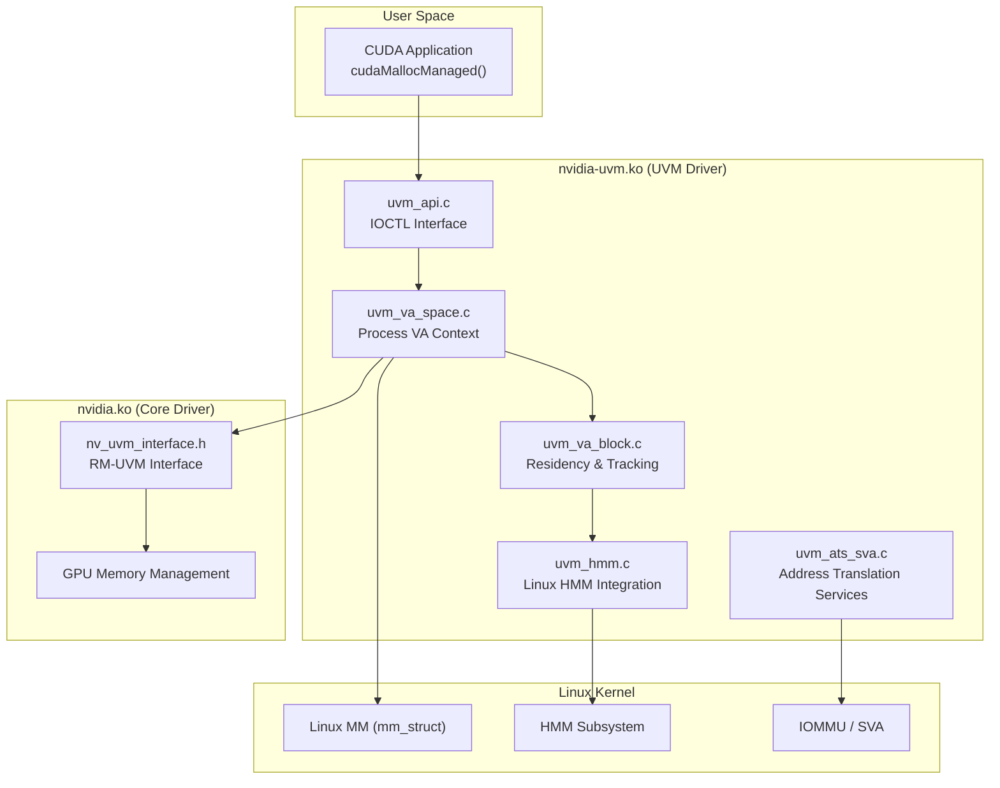
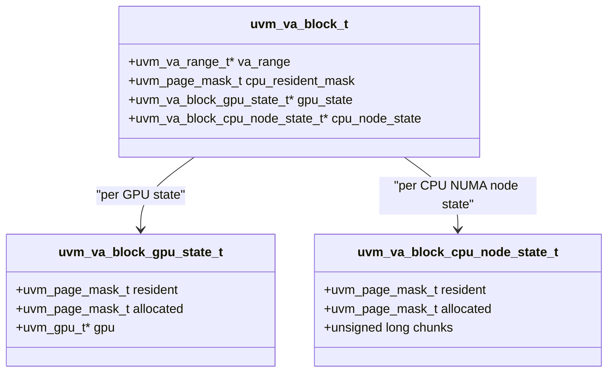
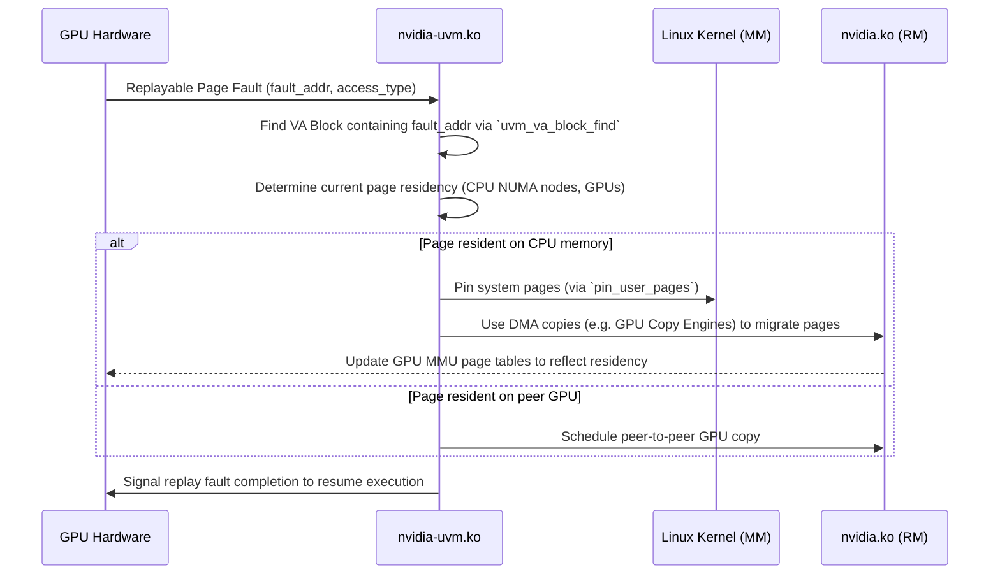
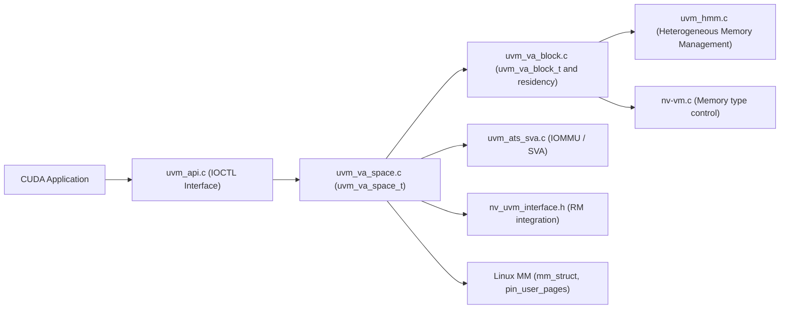

<!-- source: DeepWiki mcp.deepwiki.com · repo NVIDIA/open-gpu-kernel-modules · page 3.4 nvidia-uvm.ko - Unified Virtual Memory · fetched 2026-10-26 -->

# nvidia-uvm.ko - Unified Virtual Memory

<details>
<summary>Relevant source files</summary>

The following files were used as context for generating this wiki page:

- [kernel-open/common/inc/nv-linux.h](kernel-open/common/inc/nv-linux.h)
- [kernel-open/nvidia-uvm/uvm_ats_sva.c](kernel-open/nvidia-uvm/uvm_ats_sva.c)
- [kernel-open/nvidia-uvm/uvm_hmm.c](kernel-open/nvidia-uvm/uvm_hmm.c)
- [kernel-open/nvidia-uvm/uvm_linux.h](kernel-open/nvidia-uvm/uvm_linux.h)
- [kernel-open/nvidia-uvm/uvm_va_block.c](kernel-open/nvidia-uvm/uvm_va_block.c)
- [kernel-open/nvidia/nv-vm.c](kernel-open/nvidia/nv-vm.c)
- [kernel-open/nvidia/nv.c](kernel-open/nvidia/nv.c)
- [src/nvidia/generated/g_gpu_acct_nvoc.h](src/nvidia/generated/g_gpu_acct_nvoc.h)
- [src/nvidia/src/kernel/gpu/device.c](src/nvidia/src/kernel/gpu/device.c)
- [src/nvidia/src/kernel/gpu/gsp/kernel_gsp.c](src/nvidia/src/kernel/gpu/gsp/kernel_gsp.c)

</details>


## Purpose and Scope

The `nvidia-uvm.ko` kernel module implements NVIDIA's Unified Virtual Memory (UVM) subsystem, providing a shared virtual address space spanning CPU and GPUs within a process. It enables:

- **Unified Address Space:** A coherent virtual address space shared between CPUs and all GPUs registered with UVM.
- **Automatic Page Migration:** Pages migrate transparently to the processor accessing them, triggered by hardware faults or software migration calls.
- **Page Residency Tracking:** Tracks physical residency per page across multiple processors (CPU NUMA nodes and GPUs).
- **VA Block Management:** Virtual memory is divided into manageable blocks (commonly 2MB aligned) to efficiently track residency and manage mappings.
- **Linux Heterogeneous Memory Management (HMM) Integration:** Mirrors system pages for GPU access, allowing page migration and migration faults transparent to applications.
- **NUMA-Aware Allocation:** UVM optimizes page allocations and migrations based on NUMA node affinity to improve access locality.

This driver handles all the kernel-side UVM functionality including page fault handling, migration, residency management, and interaction with the NVIDIA Resource Manager (RM).

Sources: [kernel-open/nvidia-uvm/uvm_va_block.c:1-50](), [kernel-open/nvidia-uvm/uvm_hmm.c:26-47](), [kernel-open/nvidia-uvm/uvm_linux.h:24-35]()

---

## UVM Module Architecture

UVM driver forms a core kernel subsystem interacting with:

- **User-Space CUDA Applications:** Via CUDA APIs such as `cudaMallocManaged()`
- **Linux Kernel Memory Manager (MM):** Using mm_struct and VMAs with MMU notifiers
- **NVIDIA Core Driver (nvidia.ko):** Resource manager (RM) interface for GPU memory management
- **Linux HMM Subsystem:** To handle heterogeneous memory with the CPU page tables being mirrored to GPUs
- **IOMMU & ATS/SVA (Address Translation Services / Shared Virtual Addressing):** For GPU access to CPU page tables directly where supported



**Components:**

- **VA Space (`uvm_va_space_t`):** Represents the unified virtual memory space for a process. Holds context for registered GPUs, VA ranges, and memory management.
- **VA Block (`uvm_va_block_t`):** Manages a 2MB-aligned chunk of virtual memory, tracking which processors have resident copies of pages in that block.
- **HMM Integration (`uvm_hmm.c`):** Hooks into the Linux kernel HMM to intercept page faults and manage GPU page migration transparently for pageable memory.
- **ATS/SVA (`uvm_ats_sva.c`):** Supports platforms where GPUs can translate addresses using CPU page tables via IOMMU and PASIDs.
- **RM Interface:** Bridges with the Resource Manager for managing GPU page tables and memory.

Sources: [kernel-open/nvidia-uvm/uvm_va_block.c:24-46](), [kernel-open/nvidia-uvm/uvm_hmm.c:26-75](), [kernel-open/nvidia-uvm/uvm_ats_sva.c:26-52]()

---

## VA Block Management

The central abstraction for memory management in UVM is the **VA Block**, typically a 2MB aligned region of virtual address space. VA blocks simplify management by grouping contiguous pages for fault handling, residency, and migration.

### VA Block Structure & Residency Masks



- **`cpu_resident_mask`**: Bitmask indicating which pages in the block are resident in CPU memory.
- **`uvm_va_block_gpu_state_t`**: Per GPU state with bitmasks for pages resident or allocated in GPU memory.
- **`uvm_va_block_cpu_node_state_t`**: Per CPU NUMA node state tracking allocated and resident pages on that node; used for NUMA-aware allocation.

Residency is tracked at page granularity within a block, allowing UVM to precisely migrate and manage page states.

### CPU Chunk Storage Types and Encoding

The CPU system memory backing is stored in "chunks" which can be either one large chunk (e.g., 2MB) or a mixed set of smaller chunks (4KB or 64KB).

The storage type is encoded in the lower bits of the `chunks` pointer within `uvm_va_block_cpu_node_state_t`:

| Storage Type                   | Value | Description                                       |
|-------------------------------|-------|-------------------------------------------------|
| `UVM_CPU_CHUNK_STORAGE_CHUNK` | 0     | Single contiguous large chunk backing            |
| `UVM_CPU_CHUNK_STORAGE_MIXED` | 1     | Mixed 4KB and 64KB chunks backing different pages|

This encoding allows efficient access and migration handling for different page size backings.

Sources: [kernel-open/nvidia-uvm/uvm_va_block.c:98-126](), [kernel-open/nvidia-uvm/uvm_va_block.c:180-260]()

---

## HMM and SVA Integration

### Heterogeneous Memory Management (HMM)

HMM enables UVM to mirror CPU page mappings on the GPU, allowing pageable CPU memory to be accessed by GPUs without explicit registration for each page. The Linux kernel's HMM subsystem notifies UVM of page migrations or invalidations, enabling transparent GPU access and automatic page migration.

#### Key Implementation Points:

- Controlled by the module parameter `uvm_disable_hmm` allowing disabling if needed.
- Disabled if Confidential Computing is enabled to enforce GPU access restrictions.
- Disabled if ATS is enabled due to incompatibilities.
- Depends on Linux kernel config options: `CONFIG_HMM_MIRROR`, `CONFIG_DEVICE_PRIVATE`, and `NV_MIGRATE_DEVICE_RANGE_PRESENT`.
- Hooks into `uvm_va_block_t` via the `hmm` node member for tracking HMM-related operations.

```c
bool uvm_hmm_is_enabled_system_wide(void)
{
    if (uvm_disable_hmm)
        return false;
    if (g_uvm_global.ats.enabled)
        return false;
    if (g_uvm_global.conf_computing_enabled)
        return false;
    return uvm_va_space_mm_enabled_system();
}
```

Copies device-private pages back to CPU pages for handling faults and migration are implemented via `hmm_copy_devmem_page`, which uses GPU DMA engines to copy memory in a fault-safe manner.

### Shared Virtual Addressing (SVA) and ATS

ATS/SVA enables the GPU to directly use CPU page tables for address translation, eliminating some overhead of software page table management. This involves:

- Binding the GPU device to the process's mm via Linux's IOMMU SVA interface (`iommu_sva_bind_device`).
- Support primarily on ARM64 platforms with SMMUv3.
- Special attention for WARs (workarounds) on SMMU command queues to manage known hardware errata.

This is implemented mainly in the `uvm_ats_sva.c` file with functions to manage the device bindings and low-level command queue handling.

Sources: [kernel-open/nvidia-uvm/uvm_hmm.c:130-166](), [kernel-open/nvidia-uvm/uvm_ats_sva.c:26-165](), [kernel-open/nvidia-uvm/uvm_linux.h:90-104]()

---

## Data Flow: Page Fault Handling and Migration

The primary operation of UVM involves handling replayable page faults triggered when a GPU accesses a virtual address that is not resident on that GPU. The processing involves:



### Key Functions and Concepts:

- `uvm_va_block_find`: Searches for the `uvm_va_block_t` for a given virtual address [kernel-open/nvidia-uvm/uvm_va_block.c:603-613]() (not shown but conceptually).
- **Page Pinning:** UVM pins CPU pages in memory to prevent eviction during migration with functions wrapping `pin_user_pages` [kernel-open/common/inc/nv-mm.h:53-64]().
- **Device Private Page Copying:** Managed by `hmm_copy_devmem_page` that performs copies between GPU and CPU pages safely [kernel-open/nvidia-uvm/uvm_hmm.c:160-195]().

This fault handling loop ensures transparent migration, maintaining a unified virtual address abstraction across processors.

Sources: [kernel-open/nvidia-uvm/uvm_va_block.c:603-613](), [kernel-open/nvidia-uvm/uvm_hmm.c:160-195](), [kernel-open/common/inc/nv-mm.h:53-64]()

---

## Module Integration and Memory Pool Management

The UVM kernel module interfaces and depends on several core kernel driver utilities and Linux subsystems to implement its functionality efficiently and robustly:

| Feature                | Code Entity                 | Purpose / Description                                                      |
|------------------------|----------------------------|---------------------------------------------------------------------------|
| **Memory Locking**      | `nv_mmap_read_lock`          | Synchronizes access to mm_struct during memory operations to prevent races [kernel-open/common/inc/nv-mm.h:138-145]() |
| **Memory Type Control** | `nv_set_memory_type`          | Sets cache attributes of memory pages (Uncached, Writeback) for sysmem [kernel-open/nvidia/nv-vm.c:154-174]() |
| **Cgroup Accounting**  | `uvm_memcg_context_start`     | Tracks system memory usage accounting per process memory cgroup [kernel-open/nvidia-uvm/uvm_linux.h:140-180]() |
| **Kernel Compatibility Layer** | `nv-linux.h`, `uvm_linux.h` | Abstracts kernel version differences and defines kernel helper functions |

These components ensure that UVM's physical memory allocation, protection, and accounting behave correctly, integrating with Linux kernel policies and platform features.

Sources: [kernel-open/common/inc/nv-mm.h:130-145](), [kernel-open/nvidia/nv-vm.c:154-174](), [kernel-open/nvidia-uvm/uvm_linux.h:140-180]()

---

## Summary Diagram: System Names to Code Entities



This diagram associates the natural language system components with the key source files and internal data structures for easier navigation and understanding.

Sources: [kernel-open/nvidia-uvm/uvm_va_block.c:1-260](), [kernel-open/nvidia-uvm/uvm_hmm.c:20-166](), [kernel-open/nvidia/nv-vm.c:100-180](), [kernel-open/nvidia-uvm/uvm_ats_sva.c:20-120]()

---

# References

- [kernel-open/nvidia-uvm/uvm_va_block.c:1-260]()
- [kernel-open/nvidia-uvm/uvm_hmm.c:26-166]()
- [kernel-open/nvidia-uvm/uvm_ats_sva.c:26-165]()
- [kernel-open/common/inc/nv-mm.h:50-75,130-145]()
- [kernel-open/nvidia/nv-vm.c:154-174]()
- [kernel-open/nvidia-uvm/uvm_linux.h:130-180]()

---

