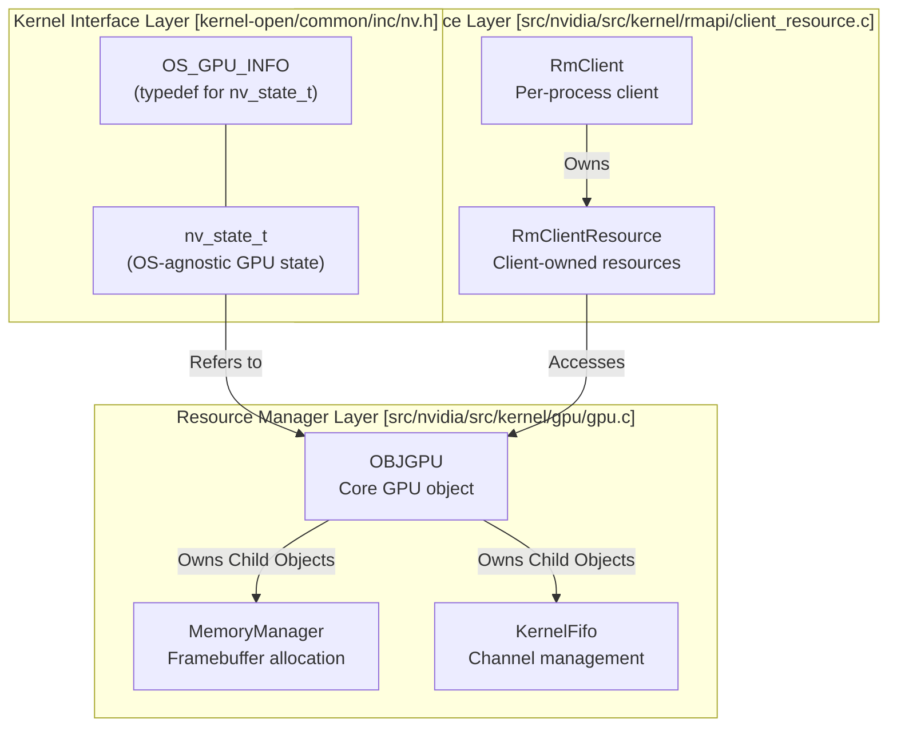
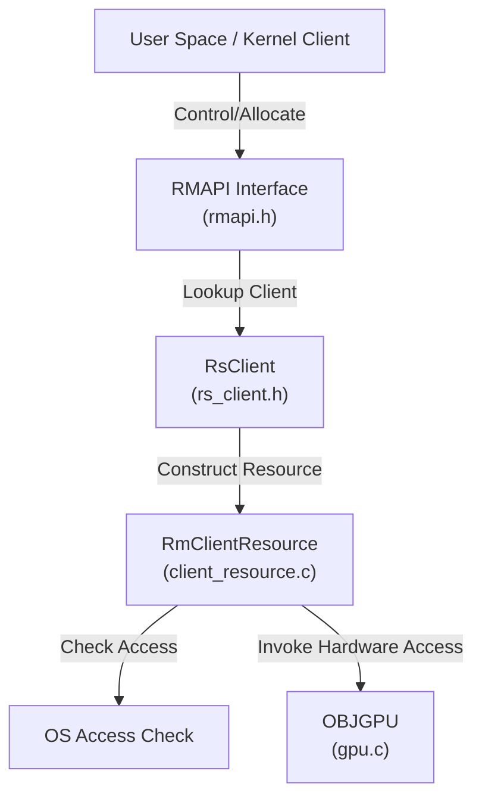
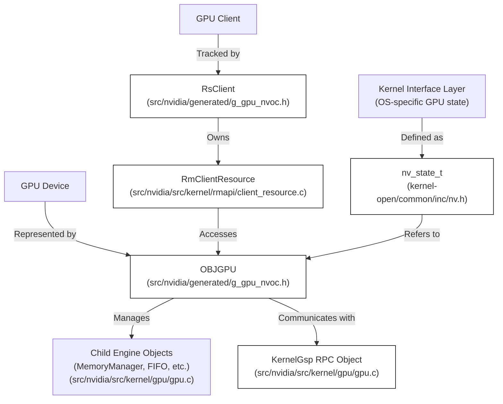
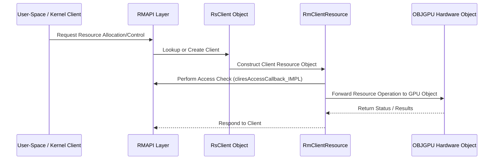

<!-- source: DeepWiki mcp.deepwiki.com · repo NVIDIA/open-gpu-kernel-modules · page 4 GPU Resource Management · fetched 2026-10-26 -->

# GPU Resource Management

Relevant source files

The following files were used as context for generating this wiki page:

- [src/nvidia/src/kernel/gpu/gpu.c](src/nvidia/src/kernel/gpu/gpu.c)
- [src/nvidia/src/kernel/rmapi/client_resource.c](src/nvidia/src/kernel/rmapi/client_resource.c)

## Overview

GPU Resource Management in the NVIDIA open GPU kernel modules provides the core infrastructure responsible for managing GPU devices, allocating GPU resources such as memory and compute channels, and enabling communication between the kernel driver and GPU System Processor (GSP) firmware. The design cleanly separates OS-specific kernel interfaces from platform-agnostic Resource Manager logic and encapsulates complex GPU hardware details behind well-defined object abstractions.

The system is organized into three primary layers:

1. **Device Management Layer**  
   Manages the full lifecycle of GPU devices including their discovery, initialization, active management, and teardown. The central representation of a GPU device is encapsulated in the `OBJGPU` structure, which maintains the device state and oversees its child engine and subdevice objects.

2. **Resource Allocation Layer**  
   Exposes the Resource Manager API (RMAPI), providing user-space and kernel clients with mechanisms to request, access, share, and release GPU resources. RMAPI enforces security policies and maintains client-owned resource objects tracked by `RsClient` and `RmClientResource` structures.

3. **Communication Layer**  
   Implements a robust Remote Procedure Call (RPC) interface to communicate with the GPU System Processor (GSP) firmware through asynchronous command/response queues. This interface supports firmware-driven management of critical hardware functions such as power management, video encoding, and security.

Kernel interface headers in [kernel-open/common/inc/nv.h] define OS-specific GPU state types (`OS_GPU_INFO` / `nv_state_t`) and utility macros, while core Resource Manager objects and logic reside mainly in platform-neutral source code at [src/nvidia/src/kernel/gpu/gpu.c] and generated object definitions at [src/nvidia/generated/g_gpu_nvoc.h].

For in-depth coverage of individual subsystems, please consult the detailed child pages:
- [Device and Client Management](#4.1)
- [Subdevice Control Interface](#4.2)
- [GSP Communication](#4.3)
- [GPU Memory Management](#4.4)
- [UVM Memory Management](#4.5)
- [Error Handling and Recovery](#4.6)
- [MIG and Performance Management](#4.7)

**Sources:**  
[src/nvidia/src/kernel/gpu/gpu.c:1-149](),  
[src/nvidia/generated/g_gpu_nvoc.h:1-241](),  
[kernel-open/common/inc/nv.h:1-93]()

---

## OBJGPU Structure and GPU Object Management

The `OBJGPU` object is the fundamental representation of a physical GPU device within the Resource Manager. It holds device-specific hardware state, configuration, and manages numerous child objects representing GPU subcomponents such as memory managers, compute engines, communication interfaces, and more. The `OBJGPU` persists throughout the GPU device's lifetime — from system probe through runtime operation to device removal.

The diagram below lays out the core relationships between the kernel interface layers, Resource Manager objects, and client resource abstractions:

This hierarchy demonstrates the separation between the OS-specific GPU kernel interface state (`nv_state_t`) and the Resource Manager's core GPU abstractions (`OBJGPU`). RMAPI client resources interface with those lower-level objects to realize GPU resource allocation and control.

**Sources:**  
[src/nvidia/generated/g_gpu_nvoc.h:121-241](),  
[src/nvidia/src/kernel/gpu/gpu.c:71-82](),  
[src/nvidia/src/kernel/rmapi/client_resource.c:123-139]()

---

## GPU Manager and Discovery

The GPU Manager subsystem (`OBJGPUMGR`) oversees all globally relevant GPU device state on the system, handling GPU detection, registration, and initialization. It sets up hardware abstraction layers and starts the Resource Manager cascade of GPU initialization workflows.

Important functions integral to GPU discovery and mode determination include:

| Function                     | Purpose                                                      | Source Location                        |
|------------------------------|--------------------------------------------------------------|-------------------------------------|
| `gpuXlateHalImplToArchImpl()` | Maps HAL implementations to GPU architecture-specific IDs    | [src/nvidia/src/kernel/gpu/gpu.c:133]() |
| `_gpuChildrenPresentInit()`    | Detects which hardware engines and subdevices are present on the GPU | [src/nvidia/src/kernel/gpu/gpu.c:126]() |
| `gpuDetermineVirtualMode()`    | Detects if the GPU is operating in virtualized or SR-IOV mode | [src/nvidia/src/kernel/gpu/gpu.c:100]() |

Child engine and subdevice objects (e.g., FIFO engine, memory manager, interrupts) are dynamically instantiated based on detected GPU capabilities, allowing flexible modular support tailored to device features.

**Sources:**  
[src/nvidia/src/kernel/gpu/gpu.c:98-149]()

---

## Resource Manager API (RMAPI)

The Resource Manager API (RMAPI) is the primary interface layer through which clients allocate, control, and release GPU resources. RMAPI supports strict access control, resource sharing policies, and lifecycle management to ensure secure and efficient resource usage.

### Client and Resource Model

- **Clients:** Managed by the `RsClient` structure, clients represent user processes, kernel threads, or other entities interacting with the GPU.
  
- **Resources:** Client resources (`RmClientResource`) represent the association of GPU resources (channels, memory, engines) with a client, encapsulating ownership and permissions.

### Access Control and Sharing

RMAPI invokes callbacks during resource allocation and sharing operations to enforce security policies:

- `cliresAccessCallback_IMPL` evaluates if the client has permission to access certain rights (e.g. performance monitoring, nice-level access) by delegating checks to OS security layers (`osCheckAccess`).

- `cliresShareCallback_IMPL` manages sharing semantics based on OS security tokens and client privilege levels, ensuring that kernel clients handling fruits of user-space dup operations are properly validated.

### RMAPI Call Flow Diagram

This flow highlights RMAPI's role in facilitating controlled, auditable access to GPU functionalities exposed via core GPU objects.

**Sources:**  
[src/nvidia/src/kernel/rmapi/client_resource.c:123-215](),  
[src/nvidia/generated/g_gpu_nvoc.h:236-241]()

---

## Device Lifecycle

The GPU device lifecycle consists of carefully coordinated steps managed by Resource Manager code to ensure hardware and software states remain consistent and recoverable.

### Initialization Sequence

1. **OBJGPU Creation**  
   The main GPU device object is instantiated via `gpuCreateObject`, creating the `OBJGPU` structure that drives all GPU interactions.

2. **Architectural Configuration**  
   The HAL implementation is mapped to architecture-specific behaviors using `gpuXlateHalImplToArchImpl`, ensuring the code handles chips correctly.

3. **Child Engine Instantiation**  
   Detected subdevices and hardware engines are enumerated and instantiated with `gpuCreateChildObjects`. This includes engines responsible for DMA, video processing, interrupts, and memory management.

4. **Pre-load and Post-load State Transitions**  
   GPU hardware is brought up through `gpuStatePreLoad` and `gpuStatePostLoad` to initialize the device and enable normal operation, with failure handling hooks.

### Teardown Sequence

A matching teardown sequence ensures all engines and resources are safely released, drivers flushed, and state cleaned during device removal or driver unload.

**Sources:**  
[src/nvidia/src/kernel/gpu/gpu.c:123-149]()

---

## GSP Communication Overview

Modern NVIDIA GPUs beginning with the Turing architecture integrate a dedicated GPU System Processor (GSP) to offload resource and hardware management tasks. Communication between the kernel driver and GSP firmware is implemented through a Remote Procedure Call (RPC) system managed by the `KernelGsp` object.

### GSP RPC Infrastructure

- **`KernelGsp` Object**  
  Responsible for managing the lifecycle of communication with GSP-RM firmware. It handles command and response queues and orchestrates asynchronous message exchanges and event delivery.

- **Message Queues**  
  Bidirectional command/request queues allow the kernel to issue requests and receive asynchronous responses from firmware.

- **Tracing and Event Reporting**  
  The communication layer supports fine-grained tracing and event log facilities, aiding in debugging and performance profiling.

This abstracted RPC interface allows other GPU kernel modules like memory managers and video engines to interact transparently with firmware-managed hardware functions without direct hardware register manipulation.

For an exhaustive discussion of this component, refer to the child page on [GSP Communication](#4.3).

**Sources:**  
[src/nvidia/src/kernel/gpu/gpu.c:71](),  
[src/nvidia/generated/g_gpu_nvoc.h:112-113]()

---

# Summary

GPU Resource Management in the NVIDIA open GPU kernel modules forms a layered system allowing:

- Representation of physical GPU devices as coordinated `OBJGPU` objects with hierarchical nested engines and subdevices.
- Fine-grained resource allocation, sharing, and access control through RMAPI's client and resource abstractions.
- Communication with GSP firmware via a robust RPC mechanism that abstracts firmware hardware control.
- Lifecycle management of GPU devices including discovery, initialization, and teardown.

Together, these subsystems enable secure, stable, and performant GPU functionality under Linux, integrating virtualization, memory management, error recovery, and advanced hardware features.

For expanded technical details on each subsystem, please see the respective child wiki pages:
- [Device and Client Management](#4.1)
- [Subdevice Control Interface](#4.2)
- [GSP Communication](#4.3)
- [GPU Memory Management](#4.4)
- [UVM Memory Management](#4.5)
- [Error Handling and Recovery](#4.6)
- [MIG and Performance Management](#4.7)

---

# Additional Diagram: Mapping System Concepts to Code Entities

---

# Additional Diagram: RMAPI Client-Resource Interaction Flow

---

**Sources:**  
[src/nvidia/generated/g_gpu_nvoc.h:43-241](),  
[src/nvidia/src/kernel/gpu/gpu.c:1-149](),  
[src/nvidia/src/kernel/rmapi/client_resource.c:120-215](),  
[kernel-open/common/inc/nv.h:25-93]()

# End of Section 4: GPU Resource Management

---

