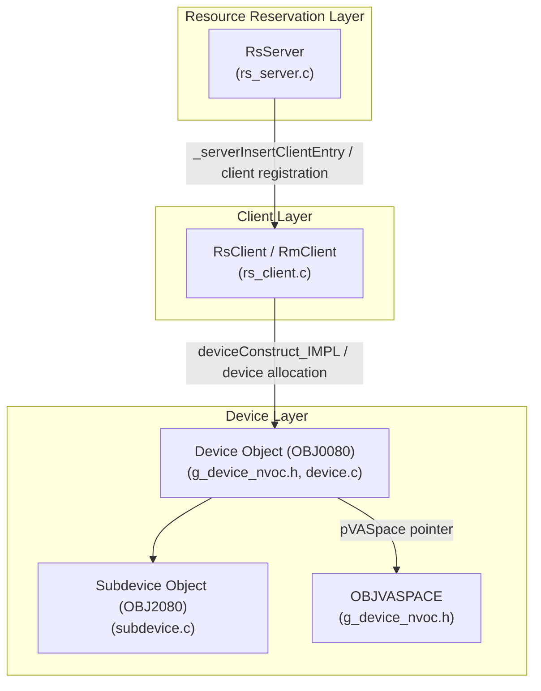
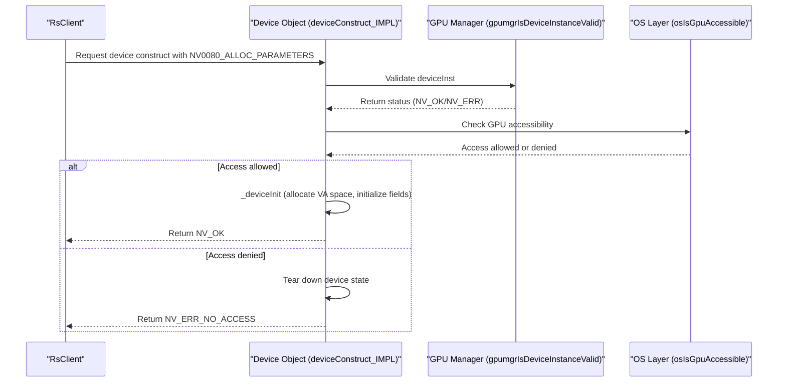
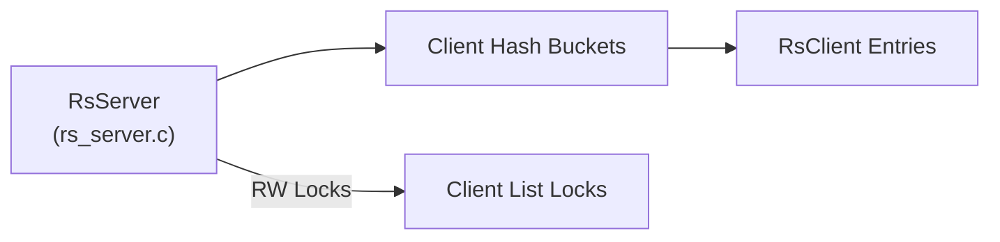
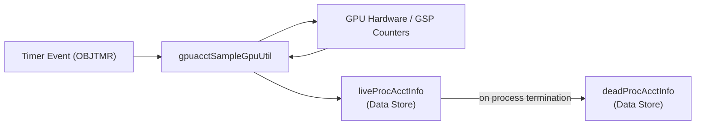
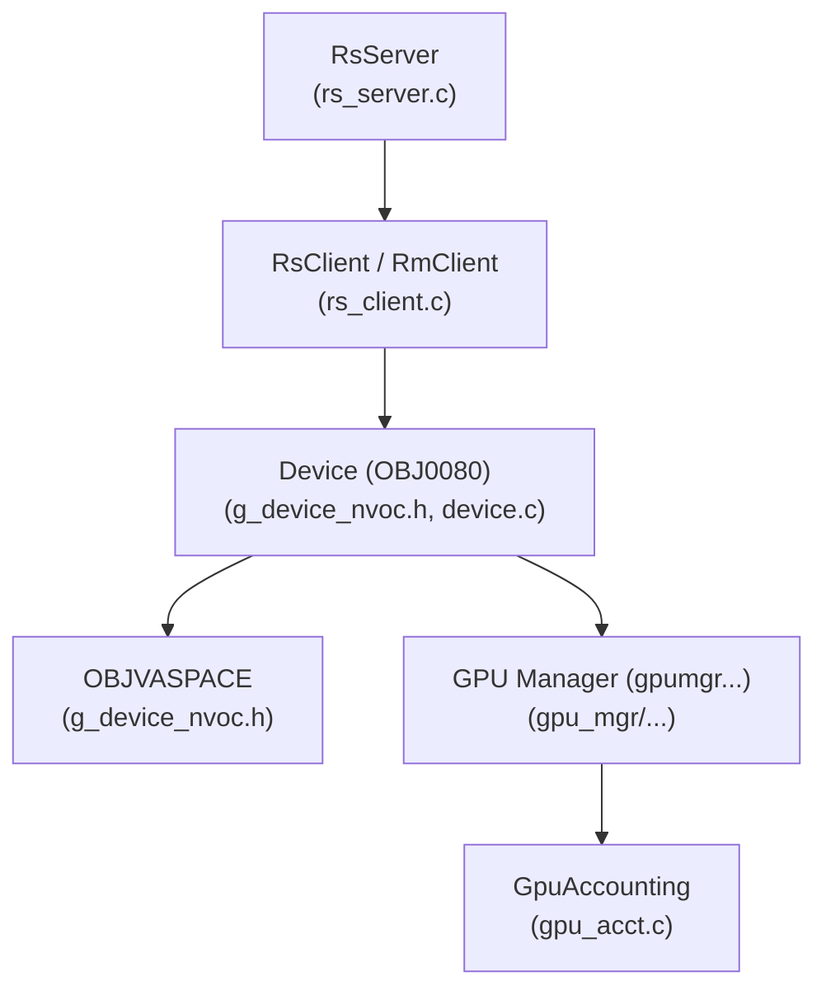

<!-- source: DeepWiki mcp.deepwiki.com · repo NVIDIA/open-gpu-kernel-modules · page 4.1 Device and Client Management · fetched 2026-10-26 -->

# Device and Client Management

Relevant source files

The following files were used as context for generating this wiki page:

- [kernel-open/nvidia/os-interface.c](kernel-open/nvidia/os-interface.c)
- [src/common/sdk/nvidia/inc/ctrl/ctrl2080/ctrl2080fb.h](src/common/sdk/nvidia/inc/ctrl/ctrl2080/ctrl2080fb.h)
- [src/nvidia/generated/g_device_nvoc.c](src/nvidia/generated/g_device_nvoc.c)
- [src/nvidia/generated/g_device_nvoc.h](src/nvidia/generated/g_device_nvoc.h)
- [src/nvidia/generated/g_gpu_nvoc.c](src/nvidia/generated/g_gpu_nvoc.c)
- [src/nvidia/generated/g_gpu_nvoc.h](src/nvidia/generated/g_gpu_nvoc.h)
- [src/nvidia/generated/g_mem_mgr_nvoc.h](src/nvidia/generated/g_mem_mgr_nvoc.h)
- [src/nvidia/src/kernel/diagnostics/gpu_acct.c](src/nvidia/src/kernel/diagnostics/gpu_acct.c)
- [src/nvidia/src/kernel/rmapi/event_api.c](src/nvidia/src/kernel/rmapi/event_api.c)
- [src/nvidia/src/libraries/resserv/src/rs_server.c](src/nvidia/src/libraries/resserv/src/rs_server.c)

## Purpose and Scope

Device and client management establishes and maintains the lifecycle and management of GPU device objects and clients in the NVIDIA kernel driver Resource Manager (RM) hierarchy. It controls the creation, registration, and teardown of device objects (`Device`), manages client sessions (`RsClient`), facilitates GPU accounting per client, and enables sharing of Virtual Address (VA) spaces between multiple clients or devices. This subsystem ensures resource isolation, proper usage accounting, and efficient sharing where appropriate, forming the foundation for higher-layer GPU resource management.

This page explains key implementation details, data flows, and critical functions involved. For hardware abstractions (`OBJGPU`) and firmware communication, see related pages.

---

## Client and Device Lifecycle

The lifecycle of GPU devices and clients is managed through layered kernel objects:

- **RsServer**: The global server managing client registrations.
- **RsClient**: Represents a user-space or kernel-space client with a valid session.
- **Device (OBJ0080)**: Represents a client's allocation of a GPU device instance.
- **Subdevice (OBJ2080)**: Child GPU objects for functional subunits.
- **OBJVASPACE**: An abstraction of the virtual address space owned or shared by the device.

### Object Hierarchy and Relations

- `RsServer` is responsible for global client registrations and client handle management, supporting insertion and lookup of client entries.
- `RsClient` represents a runtime client session and owns `Device` instances allocated for GPU access.
- `Device` objects correspond to allocated GPU device instances for a client, representing GPU hardware abstraction.
- Each `Device` may contain multiple `Subdevice` child objects reflecting hardware subunits.
- The `Device` maintains a pointer to a Virtual Address Space object (`OBJVASPACE`) representing the GPU VA space assigned to that device.

This layered object hierarchy enforces ownership and isolation semantics essential for resource management within the NVIDIA kernel driver.

Sources:  
[src/nvidia/src/libraries/resserv/src/rs_server.c:54-91](),  
[src/nvidia/generated/g_device_nvoc.h:94-143](),  
[src/nvidia/src/kernel/gpu/device.c:30-50]()  

---

### Device Construction Flow

Device construction occurs during client requests to allocate GPU devices, typically via creating objects of class `NV01_DEVICE_0` or equivalent.

The primary constructor function is `deviceConstruct_IMPL` which performs the following:

1. **Validation & Security Checks**  
   - Checks if the specified GPU device instance (`deviceInst`) is valid via GPU manager (e.g., `gpumgrIsDeviceInstanceValid`).
   - Determines if the GPU is accessible to the client (`osIsGpuAccessible`).
   - Verifies requested client sharing handles and internal flags.

2. **Internal Initialization**  
   - Calls internal routine `_deviceInit` to initialize device internal state.
   - Allocates and configures `OBJVASPACE` for GPU virtual address management linked to the device.
   - Sets VA space bounds (`vaStartInternal`, `vaLimitInternal`) and allocation mode flags.
   - Initializes device data structures and vtables.

3. **Error Handling**  
   - If GPU accessibility check or other validations fail, the constructor tears down partial state and returns error status.

Key aspects:

- VA space allocation respects flags like `NV_DEVICE_ALLOCATION_FLAGS_RESTRICT_RESERVED_VALIMITS`.
- Handles for sharing VA spaces or target clients/devices are resolved and validated during the construction.
- Internal device state tracks performance requests, CUDA limits, and client share handles.

Relevant functions:  
- `deviceConstruct_IMPL` for the constructor entry point [src/nvidia/src/kernel/gpu/device.c:64-133]()  
- `_deviceInit` for internal device initialization details [src/nvidia/src/kernel/gpu/device.c:57-61]()  

Sources:  
[src/nvidia/src/kernel/gpu/device.c:64-133](),  
[src/nvidia/generated/g_device_nvoc.h:94-143]()  

---

### Device Teardown & Reference Counting

Device objects employ reference counting to manage lifetime.

- `_deviceTeardownRef`: Decrements the device reference count and triggers teardown if it reaches zero.
- `_deviceTeardown`: Cleans up device resources, releases VA space, and detaches subdevice objects.
  
This design avoids premature destruction and ensures proper release synchronization.

Sources:  
[src/nvidia/src/kernel/gpu/device.c:55-56]()  

---

## Client Registration and Management

Clients are globally managed by `RsServer`, which maintains hash-bucketed lists of registered clients with proper synchronization.

Key functions involved include:

- `_serverGetAndLockClientEntryByHandle`: Retrieves and locks a client entry by client handle.
- `_serverInsertClientEntry`: Inserts a new client into the global registration list.
- `_serverMarkClientEntryPendingFree`: Marks a client as pending free to coordinate teardown.

Locking ensures safe concurrent access during lookups and registrations.

Registration workflow involves:

1. `RsServer` creates or looks up `RsClient` structures by handle.
2. Locks are obtained to safely modify client lists.
3. Clients may correspond to different OS processes or kernel entities.
4. Each `RsClient` may own one or more `Device` objects.

Sources:  
[src/nvidia/src/libraries/resserv/src/rs_server.c:50-150]()  

---

## GPU Accounting

GPU accounting tracks GPU resource usage on a per-client or per-process basis, enabling usage statistics, profiling, and diagnostics.

### Data Structures and Initialization

- `GpuAccounting` maintains per-GPU instance accounting data.
- Each GPU instance has two `GPU_ACCT_PROC_DATA_STORE`s:  
  - `liveProcAcctInfo` for active processes,  
  - `deadProcAcctInfo` for terminated processes for retention.

Both use intrusive maps (`procMap`) and lists (`procList`) for efficient lookup and enumeration.

Initialization of these data stores and accounting state occurs in `gpuacctConstruct_IMPL`.

### Sampling Usage

GPU utilization sampling is performed periodically using timer callbacks:

- `gpuacctStartTimerCallbacks` activates periodic sampling timers (`OBJTMR`).
- `gpuacctSampleGpuUtil` reads hardware counters and updates per-process accounting entries.
- When a process exits, its accounting entry moves from live to dead data stores.

This mechanism keeps track of GPU resource consumption accurately over time.

Sources:  
[src/nvidia/src/kernel/diagnostics/gpu_acct.c:60-70](),  
[src/nvidia/src/kernel/diagnostics/gpu_acct.c:104-130](),  
[src/nvidia/src/kernel/diagnostics/gpu_acct.c:200-212]()  

---

## Virtual Address (VA) Space Sharing

Virtual Address spaces (`OBJVASPACE`) represent the GPU virtual memory context in which device memory allocations and accesses occur.

### VA Space in Device Object

The `Device` object contains the following VA space related members:

| Field Name          | Description                                                | Location                          |
|---------------------|------------------------------------------------------------|----------------------------------|
| `pVASpace`          | Pointer to the `OBJVASPACE` object representing VA space    | [g_device_nvoc.h:132]            |
| `vaStartInternal`   | Start address of an internally restricted VA segment       | [device.c:103-110]               |
| `vaLimitInternal`   | Limit (end) address of an internally restricted VA segment | [device.c:103-110]               |
| `vaSize`            | Size of the allocated VA space                              | [device.c:102-105]               |
| `vaMode`            | Flags specifying the VA space access mode                   | [device.c:103]                   |
| `hClientShare`      | Handle indicating client sharing for VA                      | [device.c:133-135]               |
| `hTargetClient`     | Handle for targeted client sharing                           | [device.c:133-135]               |
| `hTargetDevice`     | Handle for targeted device sharing                           | [device.c:133-135]               |

During device construction, sharing handles are resolved to objects by `RsServer` to verify validity and permissions.

### Sharing and Restrictions

- The flag `NV_DEVICE_ALLOCATION_FLAGS_RESTRICT_RESERVED_VALIMITS` restricts client's VA allocation to certain bounds.
- Devices may share VA space by referencing the same `OBJVASPACE` object, enabling features like CUDA IPC, unified memory, or cross-client memory sharing.
- Sharing targets are validated to avoid unauthorized access.

This infrastructure promotes efficient GPU memory usage and supports advanced sharing scenarios with isolation guarantees.

Sources:  
[src/nvidia/generated/g_device_nvoc.h:132-140](),  
[src/nvidia/src/kernel/gpu/device.c:97-125](),  
[src/nvidia/src/libraries/resserv/src/rs_server.c:80-90]()  

---

## Summary Mermaid Diagram: Client and Device Management Key Entities to Code

This diagram helps map the natural language terms "Client", "Device", and "GPU Accounting" to their corresponding implementation files and modules for developers navigating the codebase.

---

## Key Function References

| Function                         | Description                                     | File & Lines                     |
|---------------------------------|------------------------------------------------|---------------------------------|
| `deviceConstruct_IMPL`           | Constructs/initializes a device object and GPU context | src/nvidia/src/kernel/gpu/device.c:64-133 |
| `_deviceInit`                   | Internal helper to initialize device state and VA space | src/nvidia/src/kernel/gpu/device.c:57-61  |
| `_deviceTeardown`               | Frees device resources on release               | src/nvidia/src/kernel/gpu/device.c:55-56  |
| `_serverInsertClientEntry`      | Insert new client entry into RsServer database   | src/nvidia/src/libraries/resserv/src/rs_server.c:100-110 |
| `_serverGetAndLockClientEntryByHandle` | Safely fetch and lock client by handle   | src/nvidia/src/libraries/resserv/src/rs_server.c:80-90  |
| `gpuacctConstruct_IMPL`         | Initializes GPU accounting data structures       | src/nvidia/src/kernel/diagnostics/gpu_acct.c:61-70    |
| `gpuacctSampleGpuUtil`          | Timer callback sampling GPU usage counters       | src/nvidia/src/kernel/diagnostics/gpu_acct.c:46-49    |

---

This page provides detailed coverage of device and client management, focusing on the kernel data structures, lifecycle flows, GPU accounting integration, and VA space sharing essential to resource isolation and coordination in the NVIDIA GPU driver stack.

Sources summary:  
[src/nvidia/src/libraries/resserv/src/rs_server.c](),  
[src/nvidia/src/kernel/gpu/device.c](),  
[src/nvidia/generated/g_device_nvoc.h](),  
[src/nvidia/src/kernel/diagnostics/gpu_acct.c]()

---

