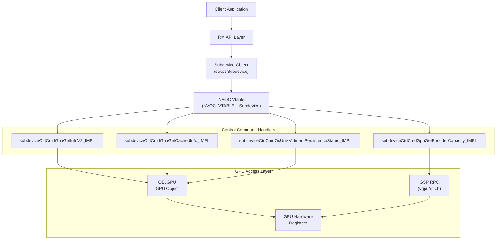
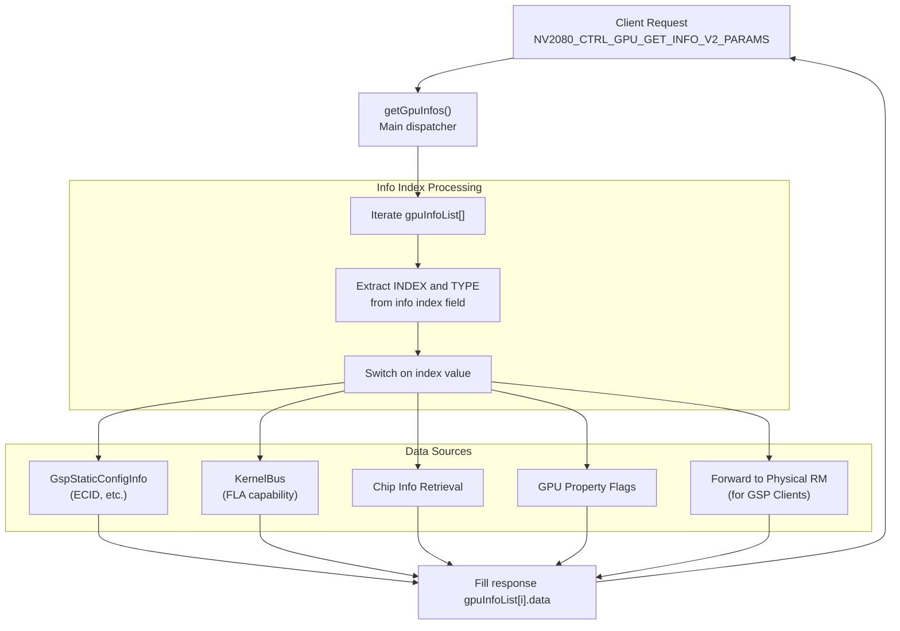
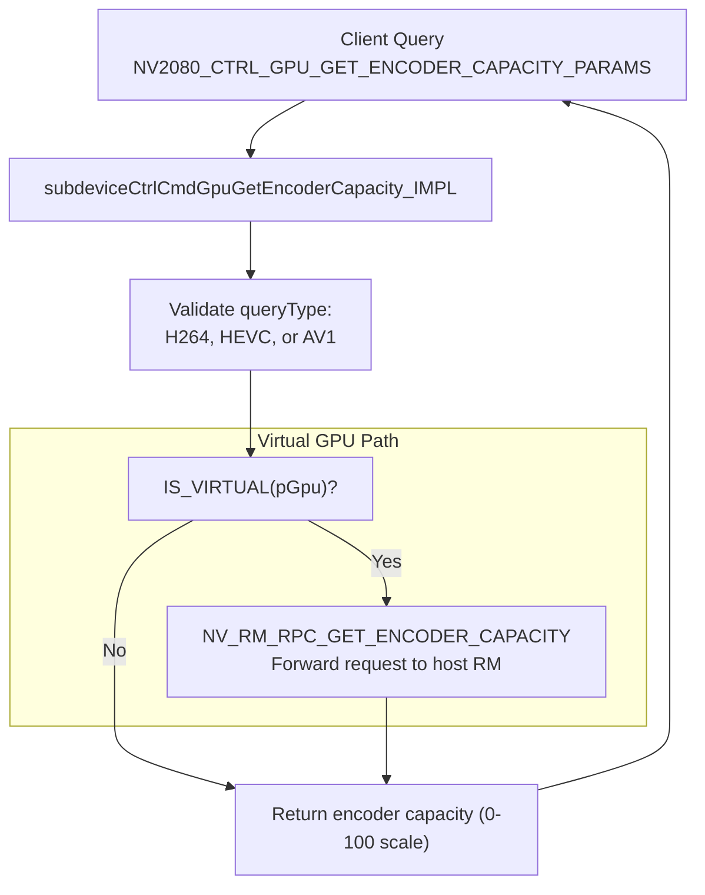
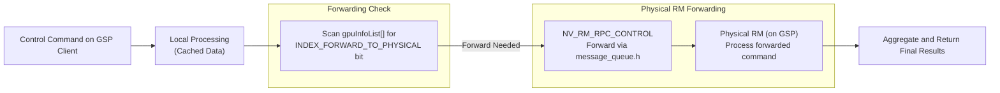

<!-- source: DeepWiki mcp.deepwiki.com · repo NVIDIA/open-gpu-kernel-modules · page 4.2 Subdevice Control Interface · fetched 2026-10-26 -->

# Subdevice Control Interface

<details>
<summary>Relevant source files</summary>

The following files were used as context for generating this wiki page:

- [kernel-open/nvidia-uvm/uvm_va_range.c](kernel-open/nvidia-uvm/uvm_va_range.c)
- [src/common/sdk/nvidia/inc/ctrl/ctrlb0cc/ctrlb0ccprofiler.h](src/common/sdk/nvidia/inc/ctrl/ctrlb0cc/ctrlb0ccprofiler.h)
- [src/nvidia/generated/g_mem_mgr_nvoc.c](src/nvidia/generated/g_mem_mgr_nvoc.c)
- [src/nvidia/generated/g_subdevice_nvoc.c](src/nvidia/generated/g_subdevice_nvoc.c)
- [src/nvidia/generated/g_subdevice_nvoc.h](src/nvidia/generated/g_subdevice_nvoc.h)
- [src/nvidia/src/kernel/gpu/gpu_user_shared_data.c](src/nvidia/src/kernel/gpu/gpu_user_shared_data.c)
- [src/nvidia/src/kernel/gpu/mem_mgr/arch/maxwell/virt_mem_allocator_gm107.c](src/nvidia/src/kernel/gpu/mem_mgr/arch/maxwell/virt_mem_allocator_gm107.c)
- [src/nvidia/src/kernel/gpu/subdevice/subdevice_ctrl_gpu_kernel.c](src/nvidia/src/kernel/gpu/subdevice/subdevice_ctrl_gpu_kernel.c)

</details>


## Purpose and Scope

The Subdevice Control Interface provides a command-based architecture for querying GPU information, managing encoder resources, and controlling subdevice-level functionality within the NVIDIA Open GPU Kernel Modules. A subdevice represents a single GPU within a device and provides unicast semantics; i.e., all operations on a subdevice apply only to its associated GPU.

This page documents the control command architecture, command processing flow, key handlers, and major control command categories related to subdevice-level GPU control. It details how GPU information queries, encoder statistics, and resource controls are implemented and dispatched through the kernel driver.

For related topics, see [Device and Client Management](4.1) for device lifecycle and client registration, and [GSP Communication](4.3) for message queue and RPC infrastructure used in forwarding some control commands.

Sources: [src/nvidia/generated/g_subdevice_nvoc.h:93-97](), [src/nvidia/src/kernel/gpu/subdevice/subdevice_ctrl_gpu_kernel.c:24-30]()

---

## Control Command Architecture

The `Subdevice` class (NV20_SUBDEVICE_0) is the primary kernel object representing a GPU subdevice. It inherits from `GpuResource` and `Notifier` classes, encapsulating GPU management and notification behavior.

Control commands targeting a GPU subdevice are identified by unique command codes defined in `ctrl2080.h` and are dispatched via NVOC-generated vtables associated with `Subdevice`. The commands execute handler functions directly tied to the subdevice instance and operate unicast on the associated GPU.

The dispatch architecture can be summarized as follows:



**Figure 1: Subdevice Control Command Architecture**

- Clients issue control commands through the RM API layer.
- Commands are routed to a `Subdevice` instance representing the target GPU.
- The `Subdevice` vtable dispatches each command to the appropriate implementation handler.
- GPU hardware interaction occurs via the `OBJGPU` object or, for virtualized GPUs, via GSP RPC mechanisms.

Sources: [src/nvidia/generated/g_subdevice_nvoc.h:116-137](), [src/nvidia/src/kernel/gpu/subdevice/subdevice_ctrl_gpu_kernel.c:24-30]()

---

## Control Command Categories

Control commands for subdevices are grouped by the interface ID `0x2080` and a 6-bit category field. Each command category targets distinct GPU subsystems or functionalities:

| Category          | Example Commands                                                   | Purpose                                                |
|-------------------|------------------------------------------------------------------|--------------------------------------------------------|
| GPU Information   | `NV2080_CTRL_CMD_GPU_GET_INFO_V2`, `NV2080_CTRL_CMD_GPU_GET_CACHED_INFO` | Query GPU properties, capabilities, and configuration |
| Framebuffer Info  | `NV2080_CTRL_FB_GET_INFO`                                         | Query framebuffer memory sizes, heap layouts, bus info |
| Encoder Management| `NV2080_CTRL_CMD_GPU_GET_ENCODER_CAPACITY`,<br>`NV2080_CTRL_CMD_GPU_GET_NVENC_SW_SESSION_STATS` | Query and manage hardware encoder capacities and stats |
| OS/Unix Specific  | `NV2080_CTRL_CMD_OS_UNIX_VIDMEM_PERSISTENCE_STATUS`               | Manage Linux-specific video memory persistence         |
| BIOS Information  | `NV2080_CTRL_CMD_BIOS_GET_INFO_V2`                               | Retrieve BIOS SKU and firmware version info             |

Each command code has a corresponding handler implemented as a method on `Subdevice`, enabling modular support for various control operations.

Sources: [src/nvidia/src/kernel/gpu/subdevice/subdevice_ctrl_gpu_kernel.c:24-30](), [src/common/sdk/nvidia/inc/ctrl/ctrl2080/ctrl2080base.h:34-103](), [src/common/sdk/nvidia/inc/ctrl/ctrl2080/ctrl2080fb.h:41-142]()

---

## GPU Information Query System

The GPU information interface supports retrieving a variety of GPU properties via an index-based query system:

- Clients send a list of `gpuInfoList` entries specifying indices for information fields.
- The handler `getGpuInfos()` iterates over each index and retrieves corresponding data.
- The system supports composite queries (multiple indices per call).
- Certain indices may be forwarded to physical RM for processing via GSP (see GSP Forwarding section).

### GPU Information Query Processing Flow



**Figure 2: GPU Information Query Processing Flow**

---

### Key Information Indices

Some important information indices supported include:

| Index Constant                              | Description                         | Implementation Source                     |
|--------------------------------------------|-----------------------------------|-------------------------------------------|
| `NV2080_CTRL_GPU_INFO_INDEX_ECID_LO32`     | Lower 32 bits of Electronic Chip ID (ECID) | Retrieved from GSP static config (`GspStaticConfigInfo.ecidInfo.info[0]`) |
| `NV2080_CTRL_GPU_INFO_INDEX_GPU_FLA_CAPABILITY` | GPU Firmware Load Accelerator (FLA) support | Queried via `kbusIsFlaSupported()` in KernelBus |
| `NV2080_CTRL_GPU_INFO_INDEX_MINOR_REVISION_EXT` | Extended minor chip revision      | Obtained by `gpuGetChipMinExtRev()`       |
| `NV2080_CTRL_GPU_INFO_INDEX_GPU_SMC_MODE` | SMC mode indicative of MIG support | Query via `KernelMIGManager` interface   |
| `NV2080_CTRL_GPU_INFO_INDEX_GPU_SM_VERSION`| Streaming Multiprocessor (SM) version | Retrieved from `KernelGraphicsManager`    |

Indexes are retrieved conditionally based on whether the client is a GSP client or physical GPU client, with forwarding as needed.

Sources: [src/nvidia/src/kernel/gpu/subdevice/subdevice_ctrl_gpu_kernel.c:123-196](), [src/nvidia/src/kernel/gpu/subdevice/subdevice_ctrl_gpu_kernel.c:233-266]()

---

### Hardware Access Control

Control commands distinguish between queries that require direct hardware access and queries served from cached state to improve performance:

| Command Handler                            | Hardware Access | Description                                      |
|-------------------------------------------|-----------------|------------------------------------------------|
| `subdeviceCtrlCmdGpuGetInfoV2_IMPL`       | Yes (`bCanAccessHw=NV_TRUE`) | Queries GPU state requiring hardware interaction |
| `subdeviceCtrlCmdGpuGetCachedInfo_IMPL`   | No  (`bCanAccessHw=NV_FALSE`) | Returns only software cached information         |

This differentiation enables performance optimization by avoiding unnecessary hardware access when stale or cached info suffice.

Sources: [src/nvidia/src/kernel/gpu/subdevice/subdevice_ctrl_gpu_kernel.c:583-615]()

---

## Framebuffer and MIG Management

The subdevice interface supports querying memory partitioning and Multi-Instance GPU (MIG) information:

- Framebuffer (FB) info indices (e.g., `NV2080_CTRL_FB_INFO_INDEX_TOTAL_RAM_SIZE`) return SMC-aware memory sizes, showing only the partition memory if subscribed to a MIG instance.
- GPUInstanceSubscription objects manage per-client subscriptions to MIG partitions to ensure accounting and correct shared access across a VA space.

This subsystem guarantees that control commands reflect the correct memory scope according to the client's MIG context.

Sources: [src/common/sdk/nvidia/inc/ctrl/ctrl2080/ctrl2080fb.h:83-89](), [src/nvidia/src/kernel/gpu/mig_mgr/gpu_instance_subscription.c:54-119]()

---

## Encoder Capacity Management

The encoder capacity interface controls and reports the GPU's video encoder resource availability. It serves to throttle or inform clients about encoder load and capability.



**Figure 3: Encoder Capacity Query Flow**

- Capacity values range from 0 (no capacity) to 100 (fully available).
- On virtual GPUs, capacity queries are forwarded to the host RM using RPC.
- Physical GPU queries retrieve the current encoder load directly.

This command requires holding both the RM API lock and GPU lock for thread safety.

Sources: [src/nvidia/src/kernel/gpu/subdevice/subdevice_ctrl_gpu_kernel.c:901-959]()

---

## GSP Client Forwarding Mechanism

In a GSP client setup, some control commands require forwarding to the physical RM running on the GSP subsystem. This forwarding is needed when certain GPU info indices request data only the physical RM can provide.

The forwarding is indicated by setting the high bit (`INDEX_FORWARD_TO_PHYSICAL = 0x80000000`) on such info indices.



**Figure 4: GSP Client Command Forwarding**

- The local `Subdevice` handler first processes all info indices it can handle from cached or context.
- If any index requires physical RM processing, the entire command or that subset is forwarded using `NV_RM_RPC_CONTROL` through GSP's message queue interface.
- Results are merged and returned to the client, providing seamless integration of virtual and physical data sources.

Sources: [src/nvidia/src/kernel/gpu/subdevice/subdevice_ctrl_gpu_kernel.c:83-87](), [src/nvidia/src/kernel/gpu/subdevice/subdevice_ctrl_gpu_kernel.c:546-576]()

---

## Locking and Thread Safety

Proper synchronization is vital in the control interface due to concurrent access and hardware interaction:

| Handler                                 | Locking Requirements                              |
|----------------------------------------|--------------------------------------------------|
| `subdeviceCtrlCmdGpuGetEncoderCapacity_IMPL` | Requires owning RM API Lock and GPU Lock          |
| `subdeviceCtrlCmdGpuGetCachedInfo_IMPL`        | Requires RM API Lock only (no hardware access)  |

Lock assertions exemplify enforcing lock state:

```c
NV_ASSERT_OR_RETURN(rmapiLockIsOwner() && (!bNeedGpuLock || rmGpuLockIsOwner()), NV_ERR_INVALID_LOCK_STATE);
```

This ensures that commands touching GPU state or hardware run with correct locks held to protect data integrity and prevent race conditions.

Sources: [src/nvidia/src/kernel/gpu/subdevice/subdevice_ctrl_gpu_kernel.c:928](), [src/nvidia/src/kernel/gpu/subdevice/subdevice_ctrl_gpu_kernel.c:980]()

---

# Summary

The Subdevice Control Interface in the NVIDIA Open GPU Kernel Modules provides a flexible and extensible command framework to manage and query GPU properties and subsystems at the per-GPU (subdevice) level. This encompasses comprehensive GPU information querying, encoder capacity management, framebuffer and MIG handling, and seamless communication with physical RM for GSP clients.

The interface employs a precise command dispatch architecture via NVOC-generated vtables, supports both cached and hardware-accessed queries, and rigorously maintains locking discipline for thread safety.

This architecture ensures that client applications and user-space drivers can effectively control GPU subdevices across diverse hardware configurations and virtualization scenarios.

---

Sources:  
[src/nvidia/generated/g_subdevice_nvoc.h:93-140](),  
[src/nvidia/generated/g_subdevice_nvoc.c:34-120](),  
[src/nvidia/src/kernel/gpu/subdevice/subdevice_ctrl_gpu_kernel.c:24-150](),  
[src/common/sdk/nvidia/inc/ctrl/ctrl2080/ctrl2080base.h:34-103](),  
[src/common/sdk/nvidia/inc/ctrl/ctrl2080/ctrl2080fb.h:41-142](),  
[src/nvidia/src/kernel/gpu/mig_mgr/gpu_instance_subscription.c:54-119](),  
[src/nvidia/src/kernel/gpu/subdevice/subdevice_ctrl_gpu_kernel.c:583-615](),  
[src/nvidia/src/kernel/gpu/subdevice/subdevice_ctrl_gpu_kernel.c:901-959](),  
[src/nvidia/src/kernel/gpu/subdevice/subdevice_ctrl_gpu_kernel.c:83-87](),  
[src/nvidia/src/kernel/gpu/subdevice/subdevice_ctrl_gpu_kernel.c:546-576](),  
[src/nvidia/src/kernel/gpu/subdevice/subdevice_ctrl_gpu_kernel.c:928-957]()

---

