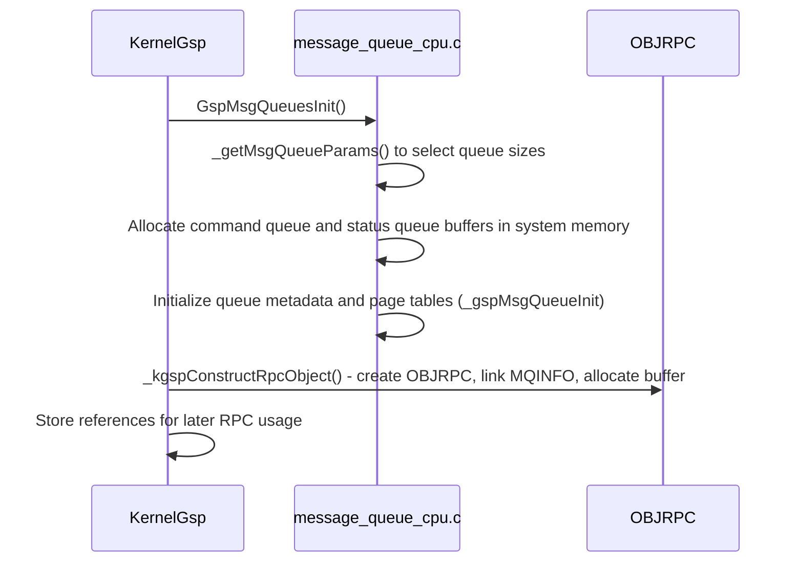
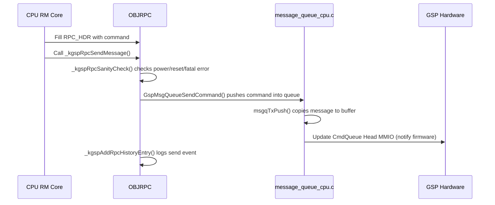
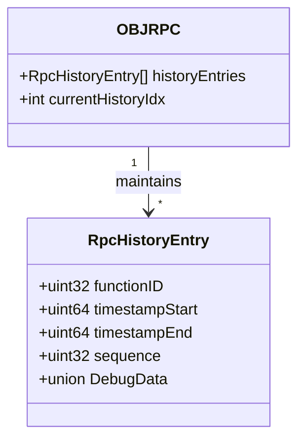

<!-- source: DeepWiki mcp.deepwiki.com · repo NVIDIA/open-gpu-kernel-modules · page 4.3 GSP Communication · fetched 2026-10-26 -->

# GSP Communication

<details>
<summary>Relevant source files</summary>

The following files were used as context for generating this wiki page:

- [kernel-open/common/inc/nvkms-kapi.h](kernel-open/common/inc/nvkms-kapi.h)
- [src/nvidia-modeset/kapi/interface/nvkms-kapi.h](src/nvidia-modeset/kapi/interface/nvkms-kapi.h)
- [src/nvidia/generated/g_bindata_kgspGetBinArchiveBooterLoadUcode_AD102.c](src/nvidia/generated/g_bindata_kgspGetBinArchiveBooterLoadUcode_AD102.c)
- [src/nvidia/generated/g_bindata_kgspGetBinArchiveBooterLoadUcode_GA100.c](src/nvidia/generated/g_bindata_kgspGetBinArchiveBooterLoadUcode_GA100.c)
- [src/nvidia/generated/g_bindata_kgspGetBinArchiveBooterLoadUcode_GA102.c](src/nvidia/generated/g_bindata_kgspGetBinArchiveBooterLoadUcode_GA102.c)
- [src/nvidia/generated/g_bindata_kgspGetBinArchiveBooterLoadUcode_TU102.c](src/nvidia/generated/g_bindata_kgspGetBinArchiveBooterLoadUcode_TU102.c)
- [src/nvidia/generated/g_bindata_kgspGetBinArchiveConcatenatedFMC_GH100.c](src/nvidia/generated/g_bindata_kgspGetBinArchiveConcatenatedFMC_GH100.c)
- [src/nvidia/generated/g_bindata_kgspGetBinArchiveGspRmCcFmcGfwProdSigned_GH100.c](src/nvidia/generated/g_bindata_kgspGetBinArchiveGspRmCcFmcGfwProdSigned_GH100.c)
- [src/nvidia/generated/g_kernel_gsp_nvoc.c](src/nvidia/generated/g_kernel_gsp_nvoc.c)
- [src/nvidia/generated/g_kernel_gsp_nvoc.h](src/nvidia/generated/g_kernel_gsp_nvoc.h)
- [src/nvidia/src/kernel/gpu/falcon/arch/ampere/kernel_falcon_ga102.c](src/nvidia/src/kernel/gpu/falcon/arch/ampere/kernel_falcon_ga102.c)
- [src/nvidia/src/kernel/gpu/falcon/arch/turing/kernel_falcon_tu102.c](src/nvidia/src/kernel/gpu/falcon/arch/turing/kernel_falcon_tu102.c)
- [src/nvidia/src/kernel/gpu/gsp/arch/hopper/kernel_gsp_gh100.c](src/nvidia/src/kernel/gpu/gsp/arch/hopper/kernel_gsp_gh100.c)

</details>


This page documents the RPC (Remote Procedure Call) infrastructure used for communication between CPU-RM (the kernel-side Resource Manager) and GSP-RM (the Resource Manager running on the GPU System Processor firmware). The GSP is a dedicated RISC-V processor integrated on NVIDIA GPUs starting with Turing and later architectures. It manages low-level GPU hardware tasks and firmware, and the kernel driver communicates with it using a message queue-based RPC system.

RPC enables:
- Sending commands from CPU-RM to GSP-RM firmware.
- Receiving synchronous responses to commands.
- Receiving asynchronous event notifications from GSP.

---

## Overview

Communication between CPU-RM and GSP-RM occurs through a pair of message queues implemented in system memory. The CPU side writes commands into the **Command Queue** and reads responses and events from the **Status Queue**. The GSP firmware reads commands and writes responses/events. This asynchronous mechanism enables robust communication without busy-waits or stalls.

The RPC infrastructure manages:
- Message queue setup and synchronization.
- Serialization and dispatch of RPC commands and responses.
- Handling asynchronous event messages from GSP firmware.
- Boot firmware microcode archive management for the GSP booter.
- Tracking RPC history for debugging and diagnostics.

The asynchronous events convey hardware and firmware statuses such as error notifications, memory faults, and state changes, thus facilitating tight integration between kernel and GPU firmware.

Sources: [src/nvidia/src/kernel/gpu/gsp/kernel_gsp.c:33-60](), [src/nvidia/generated/g_kernel_gsp_nvoc.h:47-195]()

---

## RPC Infrastructure Components

### Architecture Diagram: System-Level Entities and Code Objects

```mermaid
flowchart TB
  subgraph CPU_RM
    KGSP[KernelGsp Object]
    OBJRPC[OBJRPC Object]
    MQINFO[MESSAGE_QUEUE_INFO Metadata]
    MSG_BUF[message_buffer (RPC Message Buffer)]
  end

  subgraph Shared_Memory
    CMDQ[Command Queue Buffer (CPU→GSP)]
    STATQ[Status Queue Buffer (GSP→CPU)]
    PAGETBL[Page Table]
  end

  subgraph GSP_RM_Firmware
    GSPFW[GSP-RM Firmware (RISC-V)]
    GSP_MSGQ[GSP Message Queue Logic]
  end

  KGSP -->|creates/manages| OBJRPC
  OBJRPC -->|references| MQINFO
  MQINFO -->|contains pointers to| CMDQ & STATQ
  CMDQ <--> |DMA/MMIO| GSP_MSGQ
  STATQ <--> |DMA/MMIO| GSP_MSGQ
  GSP_MSGQ -->|dispatches RPC commands| GSPFW
```

### Key Data Structures

| Structure                   | Role / Purpose                                         | Notes / Key Fields                                         |
|----------------------------|-------------------------------------------------------|------------------------------------------------------------|
| `KernelGsp`                | Top-level kernel object managing GSP communication    | Holds `OBJRPC` instances, boot params, and WPR metadata    |
| `OBJRPC`                   | Represents state of an RPC channel (cmd/status queues) | Tracks queue metadata, message buffer, sequence counters   |
| `MESSAGE_QUEUE_INFO`       | Metadata describing command and status queues          | Contains handles to command & status queues, pointers      |
| `rpc_message_header_v`     | Root struct of an RPC message                           | Function ID, versioned RPC parameters union, sequence       |
| `MESSAGE_QUEUE_COLLECTION` | Collection of queues and page table metadata            | Array of message queues, page table size/count             |

The `OBJRPC` encapsulates the state for one command/status queue pair. `KernelGsp` manages these channels and coordinates RPC communication to GSP-RM firmware.

Sources: [src/nvidia/src/kernel/gpu/gsp/kernel_gsp.c:102-141](), [src/nvidia/src/kernel/gpu/gsp/message_queue_cpu.c:60-130](), [src/nvidia/generated/g_kernel_gsp_nvoc.h:48-195]()

---

## RPC Infrastructure Initialization

The kernel initializes the message queue infrastructure early during GPU driver loading.

- `GspMsgQueuesInit` computes the appropriate sizes for command and status queues based on platform (default 256 KB on silicon, larger on pre-silicon), the number of pages, and initializes the queue metadata including a page table. [src/nvidia/src/kernel/gpu/gsp/message_queue_cpu.c:60-124]()

- `_gspMsgQueueInit` sets up the queue metadata and allocates workspace for queue state, configuring the transmit (Tx) and receive (Rx) queues via the msgq library functions. [src/nvidia/src/kernel/gpu/gsp/message_queue_cpu.c:140-190]()

- `KernelGsp` creates and configures `OBJRPC` objects representing RPC channels, linking to the allocated message queue buffers and allocating local message buffers used for RPC serialization. [src/nvidia/src/kernel/gpu/gsp/kernel_gsp.c:150-180]()

### Initialization Sequence Diagram



Sources: [src/nvidia/src/kernel/gpu/gsp/message_queue_cpu.c:60-190](), [src/nvidia/src/kernel/gpu/gsp/kernel_gsp.c:130-160]()

---

## Message Queue Architecture

### Queue Layout and Parameters

- Queues are implemented as circular buffers in physically contiguous system memory.
- The **Command Queue** (Direction: CPU-RM → GSP-RM) carries outgoing RPC calls.
- The **Status Queue** (Direction: GSP-RM → CPU-RM) carries asynchronous events and command responses.
- Both queues have associated metadata structs managing their indices, versions, and synchronization.
- Command queue size defaults to 256 KB on silicon GPUs, larger sizes (up to 512 KB) are used on pre-silicon or emulation platforms to accommodate large VBIOS or firmware images.
- Status queue size can be overridden by registry string `NV_REG_STR_RM_GSP_STATUS_QUEUE_SIZE`.
- Queues are page-aligned and described by a page table index array.

Sources: [src/nvidia/src/kernel/gpu/gsp/message_queue_cpu.c:60-130]()

### Queue Operations

| Operation                   | Description                                             | Code Reference                                 |
|----------------------------|---------------------------------------------------------|-----------------------------------------------|
| Initialization             | Prepare msgq metadata and allocate queue buffers        | `_gspMsgQueueInit` [message_queue_cpu.c]     |
| Transmit Side Setup        | Configure Tx queue for sending commands                  | `msgqTxCreate`                                |
| Receive Side Polling       | Poll status queue for asynchronous events/response       | `_kgspRpcRecvPoll`                            |
| Push Command Message       | Copy RPC message into command queue and notify GSP      | `GspMsgQueueSendCommand`                       |

The CPU side manages queue indices and updates MMIO registers to notify GSP firmware when new commands arrive.

Sources: [src/nvidia/src/kernel/gpu/gsp/message_queue_cpu.c:150-190]()

---

## RPC Message Structure and Access

RPC messages have a common header with a versioned union of possible RPC commands.

- The root struct is `rpc_message_header_v` containing:
  - `function` field: RPC method/function identifier.
  - `rpc_message_data`: union that holds a versioned RPC parameter struct for each function.
  - `sequence`: incremental ID for out-of-order detection.

- The macro `RPC_HDR` casts the `message_buffer` pointer inside `OBJRPC` to `rpc_message_header_v*`, accessing the raw RPC message. [src/nvidia/src/kernel/gpu/gsp/kernel_gsp.c:102-103]()

- The macro `RPC_PARAMS(r, v)` obtains a typed pointer named `rpc_params` to the RPC parameters struct associated with function `r` and version `v`.

Example usage:
```c
#define RPC_PARAMS(r, v) rpc_##r##v *rpc_params = &RPC_HDR->rpc_message_data->r##_v
```

This mechanism aids in compile-time typing of RPC parameters.

Sources: [src/nvidia/src/kernel/gpu/gsp/kernel_gsp.c:100-141]()

---

## Sending RPC Commands

### RPC Send Flow

To send an RPC command:

1. Prepare a message in the `rpc_message_header_v` struct referenced by the `OBJRPC`'s `message_buffer`.
2. Call `_kgspRpcSendMessage`, which performs sanity checks on GPU power/reset and GSP state.
3. If checks pass, call `GspMsgQueueSendCommand` to write the message into the command queue buffer.
4. The `msgqTxPush` method copies the message and updates the queue.
5. A MMIO register is updated indicating new commands available to GSP.
6. Add the RPC message to the history buffer for debugging.

### Sending RPC Sequence Diagram



Sources: [src/nvidia/src/kernel/gpu/gsp/kernel_gsp.c:135-160](), [src/nvidia/src/kernel/gpu/gsp/message_queue_cpu.c:120-185]()

### Sanity Checks

`_kgspRpcSanityCheck` verifies:

- GSP is not flagged with fatal errors (`pKernelGsp->bFatalError`).
- GPU is not in reset.
- GPU is not lost or detached.
- GPU power is ON.
- System memory access is allowed.

Failing any check prevents RPC sending to avoid driver deadlocks or inconsistent state.

Sources: [src/nvidia/src/kernel/gpu/gsp/kernel_gsp.c:281-327]()

---

## Receiving RPC Responses and Events

### Polling for Responses

- `_kgspRpcRecvPoll` repeatedly polls the status queue for a message matching a specific RPC function and sequence number. This function can block with retry attempts or poll asynchronously. [src/nvidia/src/kernel/gpu/gsp/kernel_gsp.c:135-145]()

- During polling, if any asynchronous events (not matching active RPC responses) are received, `_kgspRpcDrainEvents` is called immediately to process and clear those events, ensuring the event queue does not back up.

### Event Processing and Handlers

The RPC layer supports multiple types of asynchronous GSP events:

| Handler Function          | Purpose                                                                                |
|--------------------------|----------------------------------------------------------------------------------------|
| `_kgspRpcPostEvent`       | Forwards GSP generated events to user-space event handling                             |
| `_kgspRpcRCTriggered`     | Detects robust channel errors, logs error state, updates journal for debugging         |
| `_kgspRpcOsErrorLog`      | Logs XID error codes sent from GSP firmware onto kernel error log                      |
| `_kgspRpcMMUFaultQueued`  | Signals non-replayable memory faults to UVM for further handling                       |

Handlers decode event details and may adjust internal driver error states, notify other subsystems, or log diagnostics.

Sources: [src/nvidia/src/kernel/gpu/gsp/kernel_gsp.c:480-560](), [src/nvidia/src/kernel/gpu/gsp/kernel_gsp.c:570-740](), [src/nvidia/src/kernel/gpu/gsp/kernel_gsp.c:980-1000]()

---

## GSP Hardware Abstraction Layer (HAL)

Platform-specific differences in GSP hardware access, reset logic, and initialization require hardware abstractions per GPU architecture.

### Blackwell (GB100) Example

- Uses Protection Level Mask (PLM) bits for reset access control. `_kgspWaitForResetAccess` waits for protection bits to clear before resetting the GSP. [src/nvidia/src/kernel/gpu/gsp/arch/blackwell/kernel_gsp_gb100.c:40-90]()

- Handles fatal poison errors by checking GSP global memory fault bits. Unexpected poison asserts trigger error logging and recovery. [src/nvidia/src/kernel/gpu/gsp/arch/blackwell/kernel_gsp_gb100.c:160-200]()

### Hopper (GH100) Example

- Reset involves asserting and deasserting the GSP falcon engine reset FSM, waiting for reset status bits `_ASSERTED` and `_DEASSERTED` with timeout guard. [src/nvidia/src/kernel/gpu/gsp/arch/hopper/kernel_gsp_gh100.c:100-150]()

- Allocates boot argument buffers in unprotected memory for Confidential Compute. [src/nvidia/src/kernel/gpu/gsp/arch/hopper/kernel_gsp_gh100.c:150-190]()

### Turing (TU102) Example

- Configures GSP falcon with register base addresses, including RISC-V MMU interfaces.
- Allocates boot parameter buffers for WPR metadata and libOS init using memory descriptor APIs. [src/nvidia/src/kernel/gpu/gsp/arch/turing/kernel_gsp_tu102.c:60-170]()

This HAL abstraction enables the upper KernelGsp layers to remain architecture-neutral.

Sources:  
[src/nvidia/src/kernel/gpu/gsp/arch/blackwell/kernel_gsp_gb100.c:1-206](),  
[src/nvidia/src/kernel/gpu/gsp/arch/hopper/kernel_gsp_gh100.c:1-197](),  
[src/nvidia/src/kernel/gpu/gsp/arch/turing/kernel_gsp_tu102.c:1-173]()

---

## Booter Microcode Archives

The GSP firmware boot process loads microcode (ucode) from tightly packed archives embedded into the driver:

- Each architecture (GA102, GH100, TU102, AD102, etc.) has a distinct booter ucode archive storing signed binary images for booting GSP RM and associated firmware components.
- These archives are referenced via functions like `kgspGetBinArchiveBooterLoadUcode_<ARCH>()`.
- The ucode images come in variants: direct boot, boot with loader, and boot-from-hardware-semaphore.
- The kernel passes pointers to these archives to GSP firmware during the boot sequence to initiate RM execution.

This structured management ensures secure, versioned firmware loading on the GPU System Processor.

Sources:  
[src/nvidia/generated/g_bindata_kgspGetBinArchiveBooterLoadUcode_GA102.c](),  
[src/nvidia/generated/g_bindata_kgspGetBinArchiveBooterLoadUcode_TU102.c](),  
[src/nvidia/generated/g_bindata_kgspGetBinArchiveBooterLoadUcode_GA100.c](),  
[src/nvidia/generated/g_bindata_kgspGetBinArchiveBooterLoadUcode_AD102.c](),  
[src/nvidia/generated/g_bindata_kgspGetBinArchiveGspRmCcFmcGfwProdSigned_GH100.c]()

---

## RPC History and Debugging Support

### RPC History Buffer

`OBJRPC` maintains a circular history buffer named `RpcHistoryEntry` that records:

| Field                | Description                                  |
|----------------------|----------------------------------------------|
| `function`           | RPC command function ID                      |
| `timestampStart`     | Start time when RPC was sent                 |
| `timestampEnd`       | Completion time of RPC                        |
| `sequence`           | Message sequence number                       |
| `DebugData`          | Optional info such as class handles, ctrl cmds |

This history helps diagnose GPU hangs, stalls in RPC processing, and unexpected errors.

---

### Key Functions

| Function                       | Purpose                                                         |
|-------------------------------|-----------------------------------------------------------------|
| `_kgspAddRpcHistoryEntry`      | Allocates and initializes a new history entry when RPC sent    |
| `_kgspCompleteRpcHistoryEntry` | Marks an entry as completed with end timestamp                  |
| `_kgspGetActiveRpcDebugData`   | Extracts human-readable debug data for active RPC commands      |

### Debug Log Architecture Diagram



This structured debug data supports kernel and firmware diagnostics in complex GPU firmware interactions.

Sources: [src/nvidia/src/kernel/gpu/gsp/kernel_gsp.c:190-370]()

---

# Summary

The GSP Communication layer implements a sophisticated message queue-based RPC mechanism enabling the NVIDIA kernel-side Resource Manager (CPU-RM) to interact with the GPU System Processor firmware (GSP-RM). Communication is asynchronously managed using circular queues for commands and events, abstracted for architecture differences spanning Turing through Hopper and Blackwell GPUs.

This design supports:
- Robust firmware boot via microcode archives.
- Asynchronous event notification for hardware errors and memory faults.
- Diagnostic tracing and history tracking to aid debugging.
- Safe GPU reset and synchronization through HAL abstractions.
- Firmware message serialization via versioned RPC structs.

These components together ensure a reliable, extensible, and debuggable interface between CPU and GPU system processors.

---

# References

- Core RPC implementation and KernelGsp: `src/nvidia/src/kernel/gpu/gsp/kernel_gsp.c`
- Message queue CPU-side: `src/nvidia/src/kernel/gpu/gsp/message_queue_cpu.c`
- Hardware abstraction Blackwell: `src/nvidia/src/kernel/gpu/gsp/arch/blackwell/kernel_gsp_gb100.c`
- Hardware abstraction Hopper: `src/nvidia/src/kernel/gpu/gsp/arch/hopper/kernel_gsp_gh100.c`
- Hardware abstraction Turing: `src/nvidia/src/kernel/gpu/gsp/arch/turing/kernel_gsp_tu102.c`
- Booter ucode archives: Various `g_bindata_kgspGetBinArchiveBooterLoadUcode_*.c` files

Sources:  
[src/nvidia/src/kernel/gpu/gsp/kernel_gsp.c](),  
[src/nvidia/src/kernel/gpu/gsp/message_queue_cpu.c](),  
[src/nvidia/src/kernel/gpu/gsp/arch/blackwell/kernel_gsp_gb100.c](),  
[src/nvidia/src/kernel/gpu/gsp/arch/hopper/kernel_gsp_gh100.c](),  
[src/nvidia/src/kernel/gpu/gsp/arch/turing/kernel_gsp_tu102.c](),  
[src/nvidia/generated/g_bindata_kgspGetBinArchiveBooterLoadUcode_GA102.c](),  
[src/nvidia/generated/g_bindata_kgspGetBinArchiveBooterLoadUcode_TU102.c](),  
[src/nvidia/generated/g_bindata_kgspGetBinArchiveBooterLoadUcode_GA100.c](),  
[src/nvidia/generated/g_bindata_kgspGetBinArchiveBooterLoadUcode_AD102.c](),  
[src/nvidia/generated/g_bindata_kgspGetBinArchiveGspRmCcFmcGfwProdSigned_GH100.c]()

---

