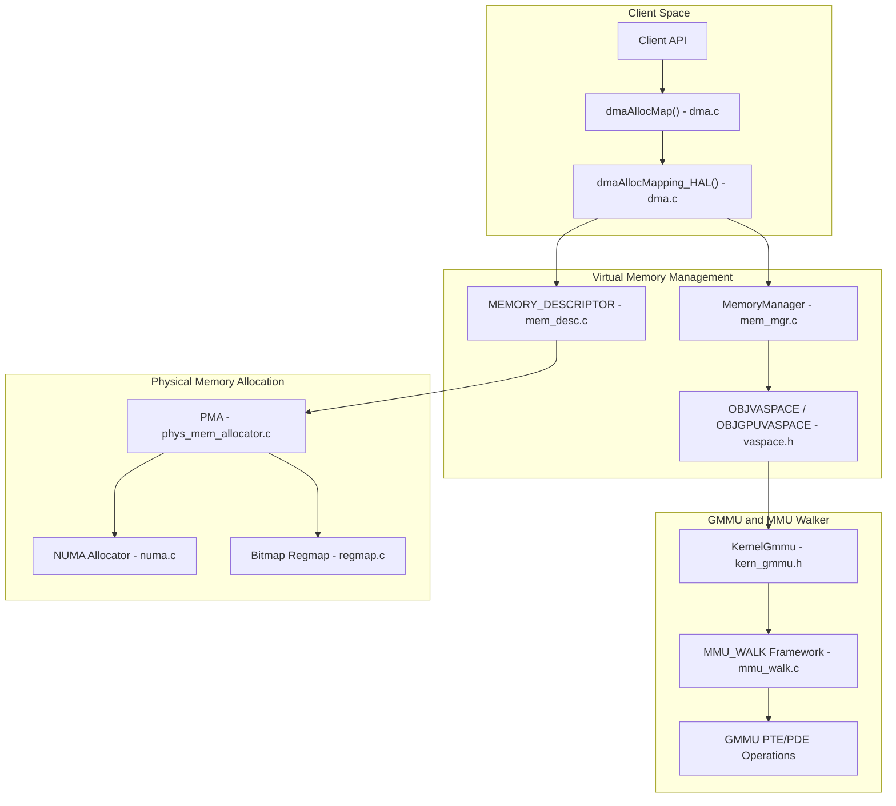
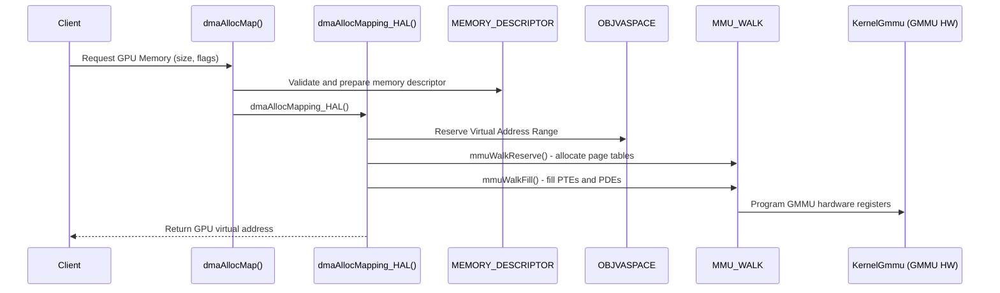
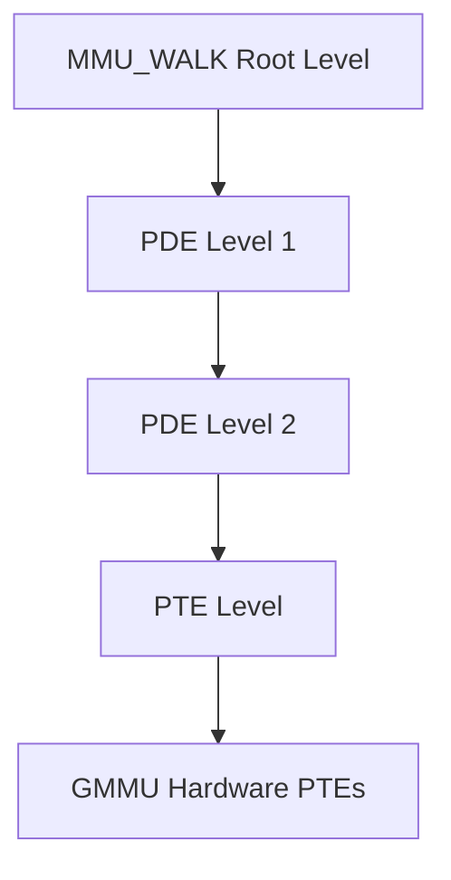
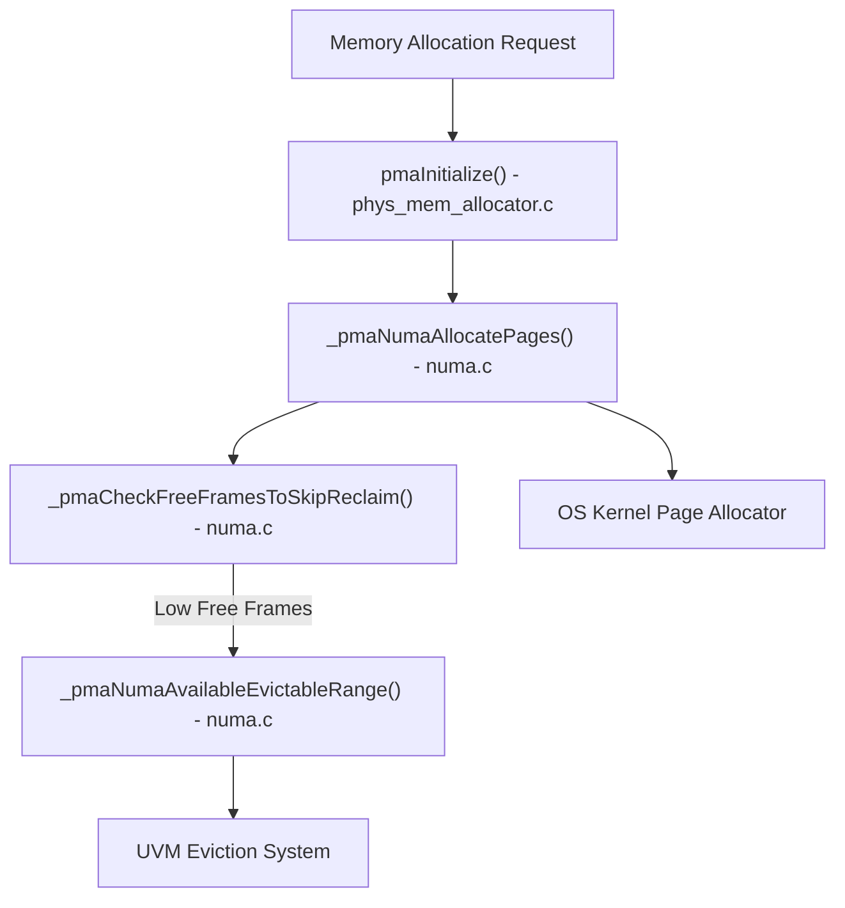

<!-- source: DeepWiki mcp.deepwiki.com · repo NVIDIA/open-gpu-kernel-modules · page 4.4 GPU Memory Management · fetched 2026-10-26 -->

# GPU Memory Management

Relevant source files

The following files were used as context for generating this wiki page:

- [src/nvidia/arch/nvalloc/unix/src/osinit.c](src/nvidia/arch/nvalloc/unix/src/osinit.c)
- [src/nvidia/src/kernel/gpu/bus/arch/maxwell/kern_bus_gm107.c](src/nvidia/src/kernel/gpu/bus/arch/maxwell/kern_bus_gm107.c)
- [src/nvidia/src/kernel/gpu/fifo/kernel_channel.c](src/nvidia/src/kernel/gpu/fifo/kernel_channel.c)
- [src/nvidia/src/kernel/gpu/mem_mgr/arch/blackwell/mem_mgr_gb10b_phys.c](src/nvidia/src/kernel/gpu/mem_mgr/arch/blackwell/mem_mgr_gb10b_phys.c)
- [src/nvidia/src/kernel/gpu/mem_mgr/arch/maxwell/mem_mgr_gm107.c](src/nvidia/src/kernel/gpu/mem_mgr/arch/maxwell/mem_mgr_gm107.c)
- [src/nvidia/src/kernel/gpu/mem_mgr/mem_mgr.c](src/nvidia/src/kernel/gpu/mem_mgr/mem_mgr.c)
- [src/nvidia/src/kernel/gpu/mem_mgr/mem_mgr_pwr_mgmt.c](src/nvidia/src/kernel/gpu/mem_mgr/mem_mgr_pwr_mgmt.c)
- [src/nvidia/src/kernel/gpu/mem_mgr/phys_mem_allocator/numa.c](src/nvidia/src/kernel/gpu/mem_mgr/phys_mem_allocator/numa.c)
- [src/nvidia/src/kernel/gpu/mem_mgr/phys_mem_allocator/phys_mem_allocator.c](src/nvidia/src/kernel/gpu/mem_mgr/phys_mem_allocator/phys_mem_allocator.c)
- [src/nvidia/src/kernel/gpu/mem_mgr/phys_mem_allocator/regmap.c](src/nvidia/src/kernel/gpu/mem_mgr/phys_mem_allocator/regmap.c)
- [src/nvidia/src/kernel/gpu/mem_sys/kern_mem_sys.c](src/nvidia/src/kernel/gpu/mem_sys/kern_mem_sys.c)
- [src/nvidia/src/libraries/mmu/mmu_walk.c](src/nvidia/src/libraries/mmu/mmu_walk.c)

This document details the GPU memory management subsystem within the NVIDIA Open GPU Kernel Modules. It focuses on the implementation and data flow of virtual memory allocation, page table management, GMMU aperture programming, the physical memory allocator, and memory type configuration including caching and compression. The subsystem integrates with various kernel abstractions, hardware-specific constructs, and NUMA-aware physical memory management to provide efficient mapping of GPU virtual address spaces.

---

## Architecture Overview

GPU Memory Management is a critical component providing support for GPU virtual address spaces, multi-level page tables, memory allocations (both virtual and physical), and interactions with hardware units like the GPU Memory Management Unit (GMMU).

Key structural components engaged in GPU memory management include:

- **MemoryManager (`MemoryManager` struct)**: The main engine responsible for managing video memory, virtual address spaces, and interfacing with physical memory allocators.

- **KernelGmmu (`KernelGmmu`)**: Hardware abstraction managing multi-level GPU page tables, programming Page Table Entries (PTEs), and controlling apertures.

- **MMU Walker (`MMU_WALK`)**: A framework to walk and manipulate multi-level page tables efficiently, abstracting operations like allocate, reserve, and fill of page tables.

- **Physical Memory Allocator (`PMA`)**: A bitfield-based resource allocator that manages physical pages, supporting NUMA-aware allocations.

- **Memory Descriptors (`MEMORY_DESCRIPTOR`)**: Encapsulate ownership, size, alignment, and attributes of physical memory allocations.

The system supports multi-page sizes and chooses the appropriate "kind" (tiling/compression format) for each allocation based on surface parameters.

### Component Interconnections with Code Entities

**Sources:** [src/nvidia/src/kernel/gpu/mem_mgr/mem_mgr.c:24-122](), [src/nvidia/src/libraries/mmu/mmu_walk.c:83-127](), [src/nvidia/src/kernel/gpu/mem_mgr/mem_desc.c:1-110](), [src/nvidia/src/kernel/gpu/mem_mgr/phys_mem_allocator/phys_mem_allocator.c:31-180](), [src/nvidia/src/kernel/gpu/mem_mgr/phys_mem_allocator/numa.c:1-200](), [src/nvidia/src/kernel/gpu/mem_mgr/phys_mem_allocator/regmap.c:30-132]()

---

## Virtual Address Space & Memory Allocation

### Virtual Memory Allocation Flow

The GPU virtual memory allocation process involves mapping physical memory objects into GPU virtual address spaces with carefully programmed page tables managed by the GMMU.

The key sequence steps:

1. **Client request:** Initiated via calls such as `dmaAllocMap()`, specifying desired virtual address and memory properties.

2. **Parameter validation and processing:** The allocator evaluates alignment, aperture selection, and memory kinds (compression/tiling), handled partly in `dmaAllocMap` and `dmaAllocMapping_HAL`.

3. **Virtual address reservation:** Using the virtual address space objects (e.g., `OBJVASPACE`), the system reserves address ranges accommodating size and alignment.

4. **Page table update:** The MMU Walker is invoked to allocate and fill corresponding page directories and page tables with the appropriate PTEs.

5. **GMMU programming:** The hardware page tables are programmed with physical addresses, kinds, attributes, and aperture flags.

6. **Return mapped address:** The final GPU virtual address is returned to the caller.

**Sources:** [src/nvidia/src/kernel/gpu/mem_mgr/dma.c:76-184](), [src/nvidia/src/libraries/mmu/mmu_walk.c:54-67](), [src/nvidia/src/kernel/gpu/mem_mgr/mem_mgr.c:80-123]()

### Page Sizes & Alignment

The system supports multiple page sizes to optimize address space overhead versus memory management flexibility:

| Page Size  | Constant                | Use Case / Notes                          |
|------------|-------------------------|------------------------------------------|
| 4 KB       | `RM_PAGE_SIZE`           | Standard small pages                      |
| 64 KB      | `RM_PAGE_SIZE_64K`       | Big pages optimizing TLB entries          |
| 2 MB       | `RM_PAGE_SIZE_2M`        | Huge pages for large buffers              |
| 512 MB     | `RM_PAGE_SIZE_512M`      | Massive pages used in large mappings      |
| 256 GB     | `RM_PAGE_SIZE_256G`      | Hopper+ max page size                      |

Page alignment is chosen based on the requested page size and allocation flags. The function `memmgrAllocDetermineAlignment_GM107` enforces alignment and pads allocations accordingly to ensure hardware-friendly page boundaries.

**Sources:** [src/nvidia/src/kernel/gpu/mem_mgr/arch/maxwell/mem_mgr_gm107.c:153-176](), [src/nvidia/src/kernel/gpu/mem_mgr/mem_mgr.c:100-122]()

---

## GPU Memory Management Unit (GMMU) & Page Table Management

### Multi-Level Page Tables & MMU Walker

The GMMU supports multi-level page tables. The NVIDIA driver uses `MMU_WALK` to abstract page table traversals. Key features of this walker include:

- Dynamic creation and destruction (`mmuWalkCreate`, `mmuWalkDestroy`).
- Recursive allocation of page directories and page tables (`_mmuWalkPdeAcquire`).
- Handling page entry states and committing entries to hardware.
- Supports different GPU architectures through format descriptors.

MMU walker layers correspond to page directory tiers, allowing flexible page table depth and page size management.

The MMU walker interacts heavily with the `KernelGmmu` hardware abstraction to program physical addresses and attributes into GPU page tables.

**Sources:** [src/nvidia/src/libraries/mmu/mmu_walk.c:83-127](), [src/nvidia/src/kernel/gpu/mem_mgr/arch/maxwell/mem_mgr_gm107.c:66-150]()

### Memory Apertures

Physical memory is accessed via various apertures that define the physical address range and coherency domain:

| Aperture         | Description                   | Example Code Reference        |
|------------------|-------------------------------|-----------------------------|
| `ADDR_FBMEM`     | GPU Local Framebuffer Memory   | [mem_desc.c:79-82]()          |
| `ADDR_SYSMEM`    | System Host Memory             | [mem_desc.c:79-82]()          |
| `ADDR_FABRIC_MC` | Multicast Fabric Memory        | [dma.c:106-111]()             |
| `ADDR_FABRIC_V2` | Fabric Version 2 Memory        | [dma.c:106-111]()             |

The `MEMORY_DESCRIPTOR` field `Aperture` stores the aperture type and is used in programming GMMU page tables to ensure correct routing.

**Sources:** [src/nvidia/src/kernel/gpu/mem_mgr/mem_desc.c:79-82](), [src/nvidia/src/kernel/gpu/mem_mgr/dma.c:106-111]()

---

## Memory Type Configuration: Compression & Tiling ("Kind")

The "Kind" of a page specifies its memory layout, including compression formats and tiling schemes. This impacts bandwidth and cache efficiency.

The function `memmgrChooseKindCompressC_GM107` selects a "kind" based on pixel format depth, anti-aliasing (AA) samples, and preferences for zero-bandwidth-clear (ZBC).

Example "Kind" choices:

| Depth/AA Samples       | Optional Preferences                 | Kind Constant                        | Source                        |
|-----------------------|------------------------------------|------------------------------------|-------------------------------|
| 8-bit, 16-bit          | -                                  | `NV_MMU_PTE_KIND_GENERIC_16BX2`    | [mem_mgr_gm107.c:66-80]()      |
| 32-bit, 1x AA          | -                                  | `NV_MMU_PTE_KIND_C32_2CRA`          | [mem_mgr_gm107.c:81-90]()      |
| 32-bit, 4x AA          | Prefer ZBC enabled/disabled         | `NV_MMU_PTE_KIND_C32_MS4_2CBR` or `NV_MMU_PTE_KIND_C32_MS4_2BRA` | [mem_mgr_gm107.c:88-95]() |
| 64-bit, 4x AA          | Prefer ZBC enabled/disabled         | `NV_MMU_PTE_KIND_C64_MS4_2CBR` or `NV_MMU_PTE_KIND_C64_MS4_2BRA` | [mem_mgr_gm107.c:100-120]()|
| 128-bit                | -                                  | `NV_MMU_PTE_KIND_C128_2CR` and MS2/MS4/8 variants | [mem_mgr_gm107.c:124-148]()  |

This detailed mapping supports optimal memory use tailored to the rendering or compute workload.

**Sources:** [src/nvidia/src/kernel/gpu/mem_mgr/arch/maxwell/mem_mgr_gm107.c:59-151]()

---

## Physical Memory Allocator (PMA) & NUMA Memory Integration

### PMA Overview

The Physical Memory Allocator (PMA) manages base physical pages that back GPU virtual memory. It tracks page usage via bitmaps, supports allocation, eviction, and scrubbing.

PMA uses a region-based allocation where each memory region manages a set of physical pages tracked via bitmap maps implemented in `regmap.c`.

### NUMA-Aware Allocation

On NUMA architectures, PMA delegates to NUMA-aware mechanisms implemented in `numa.c`, integrating with the Linux kernel to allocate memory preferentially from specified NUMA nodes. This ensures locality and optimizes latency and bandwidth.

Key NUMA allocator functions:

- `_pmaNumaAllocatePages()` attempts to allocate physical pages on the desired NUMA node while supporting scrubbing and eviction policies.

- `_pmaNumaAvailableEvictableRange()` scans for contiguously evictable physical memory.

- `_pmaTranslateKernelPage()` maps kernel physical addresses to GPU address space relative offsets.

These methods all maintain PMA’s internal consistency and ensure efficient physical memory provisioning for GPU workloads.

### PMA Allocation Flow

**Sources:** [src/nvidia/src/kernel/gpu/mem_mgr/phys_mem_allocator/phys_mem_allocator.c:108-181](), [src/nvidia/src/kernel/gpu/mem_mgr/phys_mem_allocator/numa.c:40-204](), [src/nvidia/src/kernel/gpu/mem_mgr/phys_mem_allocator/regmap.c:20-200]()

---

## Memory Descriptor (MEMDESC) and Allocation Flags

`MEMORY_DESCRIPTOR` structures describe a memory allocation's properties including size, alignment, physical addresses, apertures, and ownership.

### Allocation Size and Contiguity

The internal helper `_memdescCalculateAllocSize` adjusts requested sizes accounting for OS page sizes and alignment requirements, ensuring compatibility especially for system memory and special hardware requirements such as large page support.

On Tegra platforms, system memory contiguous allocations are padded to allow proper alignment.

### Ownership and Suballocator Flags

Memory descriptors may carry flags like `MEMDESC_FLAGS_OWNED_BY_CURRENT_DEVICE` which imply ownership of the allocation by the current GPU. This triggers allocation from a physical memory suballocator heap specialized for that device.

The function `_memdescSetSubAllocatorFlag` adjusts the flags and GFID (GPU instance identifier) for suballocator allocations.

This design improves allocation granularity and isolates device-specific allocations efficiently.

**Sources:** [src/nvidia/src/kernel/gpu/mem_mgr/mem_desc.c:105-240](), [src/nvidia/src/kernel/gpu/mem_mgr/mem_mgr.c:60-123](), [src/nvidia/src/kernel/mem_mgr/system_mem.c:140-190]()

---

# Summary

NVIDIA’s GPU Memory Management subsystem integrates multiple layers to efficiently map GPU virtual addresses to physical memory. It leverages:

- Flexible multi-level page tables managed through the MMU walker and programmed by the KernelGmmu.
- Virtual address management embedding policies for various page sizes and compression kinds tailored to workload.
- Physical memory allocation via a bitmap-based PMA coupled with NUMA-aware support to ensure locality.
- Detailed memory descriptor management that supports device ownership, alignment, and suballocation.

This layered and modular design ensures high performance, flexibility, and scalability across supported hardware platforms.

# End of Document

---

