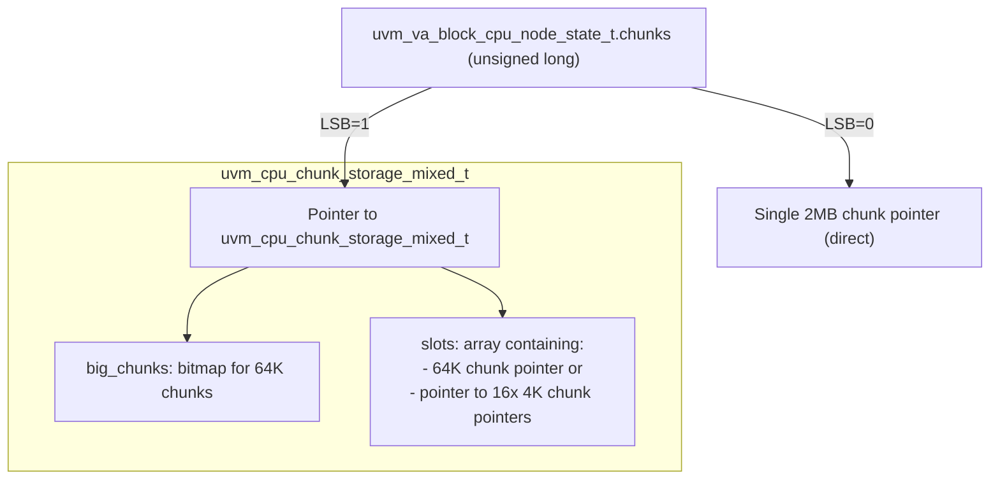
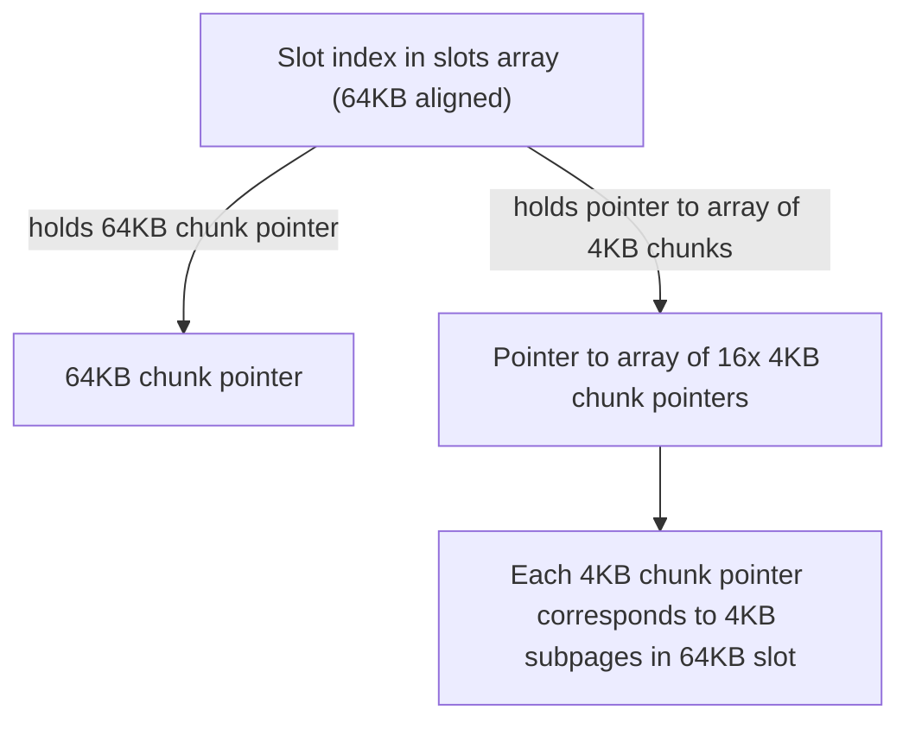
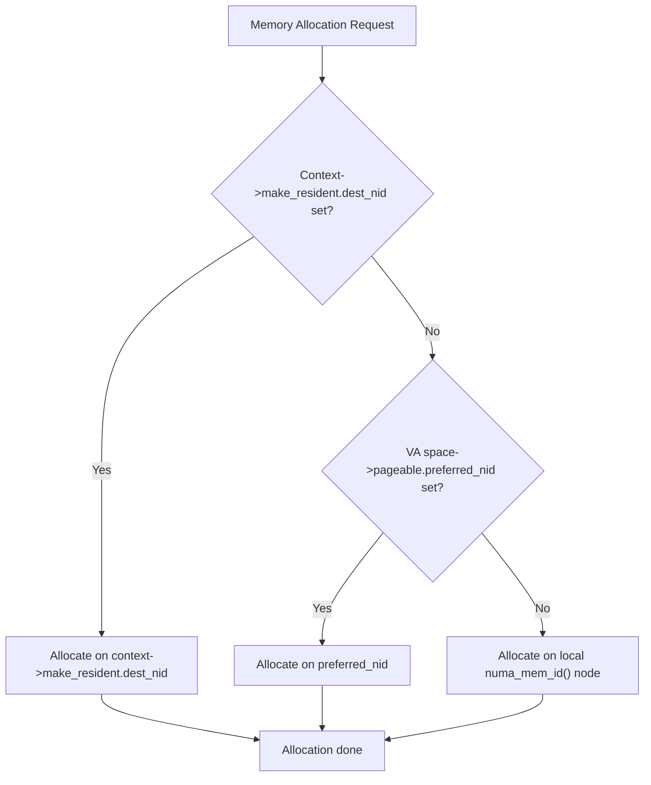
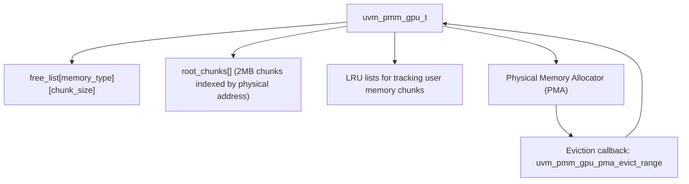
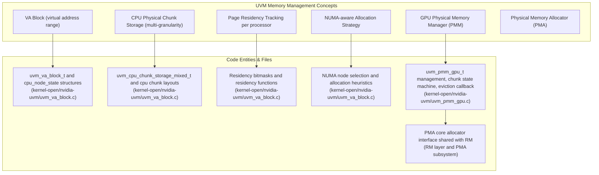

<!-- source: DeepWiki mcp.deepwiki.com · repo NVIDIA/open-gpu-kernel-modules · page 4.5 UVM Memory Management · fetched 2026-10-26 -->

# UVM Memory Management

Relevant source files

The following files were used as context for generating this wiki page:

- [kernel-open/common/inc/nv-linux.h](kernel-open/common/inc/nv-linux.h)
- [kernel-open/nvidia-uvm/uvm_hmm.c](kernel-open/nvidia-uvm/uvm_hmm.c)
- [kernel-open/nvidia-uvm/uvm_va_block.c](kernel-open/nvidia-uvm/uvm_va_block.c)
- [kernel-open/nvidia/nv.c](kernel-open/nvidia/nv.c)
- [src/nvidia/src/kernel/gpu/device.c](src/nvidia/src/kernel/gpu/device.c)
- [src/nvidia/src/kernel/gpu/gsp/kernel_gsp.c](src/nvidia/src/kernel/gpu/gsp/kernel_gsp.c)
- [src/nvidia/src/kernel/mem_mgr/fabric_vaspace.c](src/nvidia/src/kernel/mem_mgr/fabric_vaspace.c)
- [src/nvidia/src/kernel/mem_mgr/mem_fabric_import_ref.c](src/nvidia/src/kernel/mem_mgr/mem_fabric_import_ref.c)
- [src/nvidia/src/kernel/rmapi/nv_gpu_ops.c](src/nvidia/src/kernel/rmapi/nv_gpu_ops.c)

## Purpose and Scope

This page documents the Unified Virtual Memory (UVM) driver's memory management subsystem (`nvidia-uvm.ko`), focusing on:

- **CPU chunk storage** methods supporting diverse page sizes and NUMA nodes.
- **Page residency tracking** across CPU NUMA nodes and GPUs within virtual address blocks (VA blocks).
- **NUMA-aware allocation strategies** to optimize memory placement on host and GPU.
- **Interactions with Physical Memory Manager (PMM)** and Physical Memory Allocator (PMA) for efficient GPU memory management.

Detailed GPU-side memory management (like GMMU, page tables) is covered separately [GPU Memory Management](). System memory allocation is discussed in [System Memory and Page Pools]().

---

## VA Blocks and CPU Memory Storage

### VA Block: Core Data Structure

At the core of UVM memory management lies the `uvm_va_block_t` structure, representing a fixed-sized contiguous virtual address range (up to 2MB). The VA block tracks:

- Residency of pages on multiple processors (CPU NUMA nodes and GPUs).
- CPU chunk storage representing physical backing for pages on each NUMA node.
- Per-GPU state pointers referencing GPU memory allocations.

Each VA block maintains a `uvm_va_block_cpu_t` member for CPU memory state and an array of GPU state pointers indexed by GPU IDs.

### CPU Node State and Chunk Storage

CPU memory backing within a VA block is tracked per NUMA node via `uvm_va_block_cpu_node_state_t`. Each node's state contains:

- `allocated`: A bitmap mask indicating logical pages allocated on that node.
- `resident`: Pages that actually reside on this node.
- `chunks`: An unsigned long serving dual role:
  - If LSB = 0: points directly to a **single 2MB chunk** (largest granularity).
  - If LSB = 1: points to a **mixed-storage structure** managing finer granularity chunks (64KB and 4KB).

This dual interpretation is optimized for page allocation granularity, allowing efficient representation of contiguous large chunks or mixed granularity storage where needed.

### Mixed Storage Details

The `uvm_cpu_chunk_storage_mixed_t` structure optimizes managing chunks smaller than 2MB:

- `big_chunks`: Bitmap tracking presence of 64KB chunks.
- `slots[]`: Array where each slot corresponds to a 64KB-aligned segment of the VA block.
  - Each slot either stores a direct pointer to a 64KB chunk.
  - Or a pointer to an array of 16 pointers to 4KB chunks (for fully subchunked regions).

This design supports flexible allocation granularities within a VA block when the 2MB chunk is not sufficient.

---

## Page Residency Tracking

### Per-Block Residency Masks

The VA block tracks residency of pages on CPUs and GPUs:

- `uvm_processor_mask_t resident`: Mask of processors (CPUs / GPUs) with any pages resident in the block.
- CPU residency is further broken down per NUMA node with `uvm_page_mask_t` masks such as `allocated` and `resident` bitmaps.

### Key Functions for Residency

| Function                                  | Description                                                      |
|------------------------------------------|----------------------------------------------------------------|
| `uvm_va_block_cpu_set_resident_page`     | Marks a specific page index as resident on a CPU NUMA node.     |
| `uvm_va_block_cpu_clear_resident_all_chunks` | Clears all resident pages across NUMA nodes for a VA block.     |
| `block_get_page_node_residency`           | Queries which CPU NUMA node currently holds residency for a page.|

This fine-grained residency tracking supports page migrations, zero-filling, and fault servicing by reflecting precise backing on each NUMA node.

---

## NUMA-aware Allocation Strategy

UVM leverages several policies and runtime conditions to determine the NUMA node for CPU page allocations. Priority is given as:

1. **Explicit migration context**: If the current context's `make_resident.dest_nid` (destination NUMA node ID) is set, allocate on that node.
2. **VA space policy hint**: If the VA space has a preferred NUMA node configured (`va_space->pageable.preferred_nid`).
3. **Local NUMA node**: Otherwise, fall back to the local node returned by `numa_mem_id()`.

This strategy balances explicit control, user hints, and locality to optimize memory placements in NUMA systems.

---

## GPU Physical Memory Manager (PMM) and PMA Integration

### PMM Structure and Responsibilities

The `uvm_pmm_gpu_t` object manages GPU physical memory allocations and integrates with the core Physical Memory Allocator (`PMA`) provided by the Resource Manager.

Key components inside PMM include:

- **Free Lists** indexed by memory type and chunk size, for efficient allocation and deallocation.
- **Root chunk array (`root_chunks`)**: Flat array indexing all 2MB chunks by physical address.
- **LRU Lists**: Tracking user memory chunks to identify candidates for eviction under memory pressure.
- **Eviction Callback**, registered with PMA, to evict GPU chunks when needed.

### Chunk Lifecycle

- **Allocation:**  
  PMM always allocates root 2MB chunks from PMA. These chunks can be split recursively into smaller chunks (1MB, 64KB, 4KB) on demand.

- **Chunk States:**  
  - `UVM_PMM_GPU_CHUNK_STATE_FREE`: Free chunks on free lists.
  - `UVM_PMM_GPU_CHUNK_STATE_TEMP_PINNED`: Temporarily pinned during concurrent allocations.
  - `UVM_PMM_GPU_CHUNK_STATE_ALLOCATED`: Actively backing VA block pages.

- **Merging and Splitting:**  
  When all sub-chunks of a parent chunk are free, PMM eagerly merges them back. Splitting is performed on demand for finer granularity allocations.

- **Eviction:**  
  Under memory pressure, PMM requests PMA to evict memory. It selects suitable root chunks from the LRU list, migrates pages to CPU, and frees GPU memory.

---

## Summary Diagram: From UVM Concepts to Code Entities

---

## Sources

- CPU storage and VA block node state: [kernel-open/nvidia-uvm/uvm_va_block.c:98-125](), [kernel-open/nvidia-uvm/uvm_va_block.c:180-241]()
- Mixed chunk storage design: [kernel-open/nvidia-uvm/uvm_va_block.c:251-304]()
- Residency tracking and NUMA allocation: [kernel-open/nvidia-uvm/uvm_va_block.c:603-709](), [kernel-open/nvidia-uvm/uvm_va_block.c:725-750]()
- GPU PMM and eviction logic: [kernel-open/nvidia-uvm/uvm_pmm_gpu.c:36-121]()
- Fabric memory and imported memory management (context): [src/nvidia/src/kernel/mem_mgr/fabric_vaspace.c:35](), [src/nvidia/src/kernel/mem_mgr/mem_fabric_import_ref.c:66-70]()

---

This page concludes the detailed technical documentation on UVM-specific memory management strategies within the NVIDIA Open GPU Kernel Modules repository.

---

