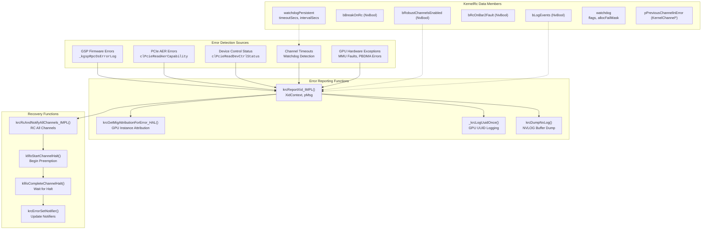
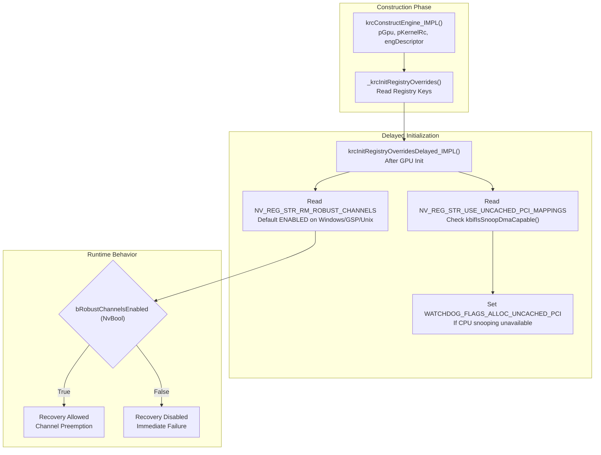
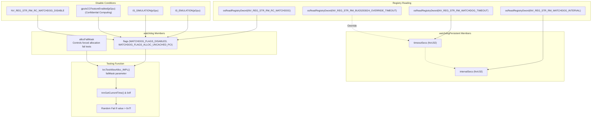
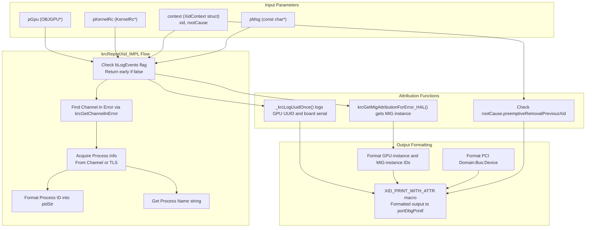
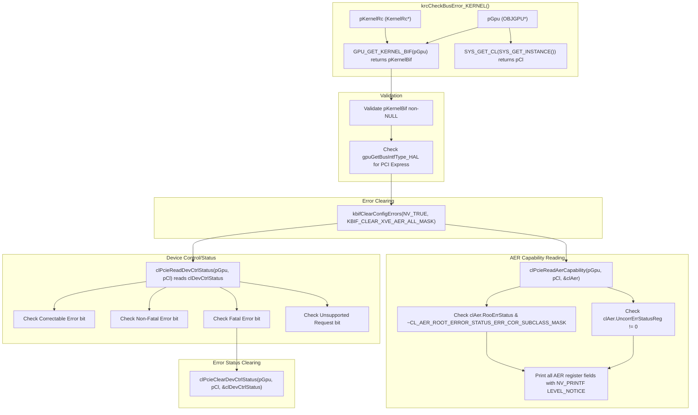
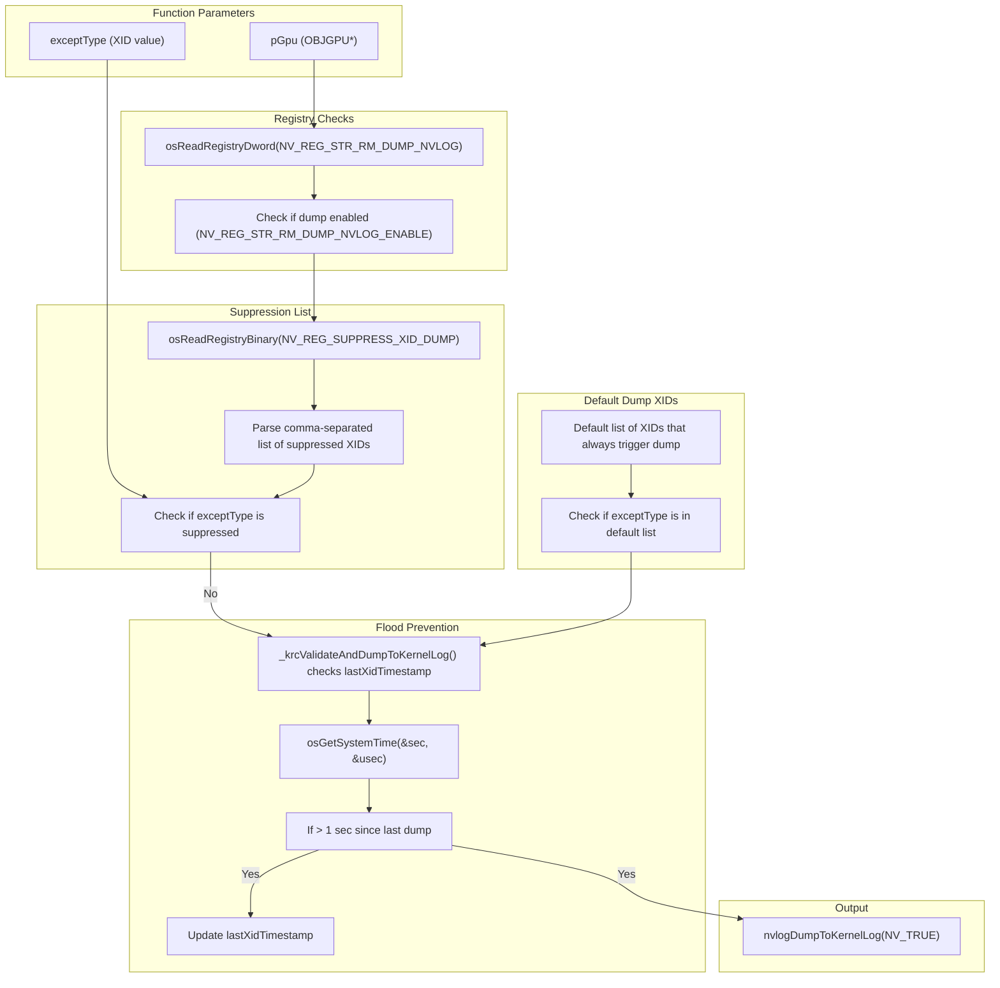

<!-- source: DeepWiki mcp.deepwiki.com · repo NVIDIA/open-gpu-kernel-modules · page 4.6 Error Handling and Recovery · fetched 2026-10-26 -->

# Error Handling and Recovery

<details>
<summary>Relevant source files</summary>

The following files were used as context for generating this wiki page:

- [src/nvidia/generated/g_all_dcl_pb.h](src/nvidia/generated/g_all_dcl_pb.h)
- [src/nvidia/generated/g_chipset_nvoc.h](src/nvidia/generated/g_chipset_nvoc.h)
- [src/nvidia/generated/g_nvdebug_pb.h](src/nvidia/generated/g_nvdebug_pb.h)
- [src/nvidia/src/kernel/gpu/disp/vblank_callback/vblank_callback.c](src/nvidia/src/kernel/gpu/disp/vblank_callback/vblank_callback.c)
- [src/nvidia/src/kernel/gpu/fifo/kernel_fifo.c](src/nvidia/src/kernel/gpu/fifo/kernel_fifo.c)
- [src/nvidia/src/kernel/gpu/mem_mgr/channel_utils.c](src/nvidia/src/kernel/gpu/mem_mgr/channel_utils.c)
- [src/nvidia/src/kernel/gpu/rc/kernel_rc.c](src/nvidia/src/kernel/gpu/rc/kernel_rc.c)

</details>


The error handling and recovery subsystem provides comprehensive error detection, reporting, and recovery mechanisms encompassing GPU hardware exceptions, channel hangs, PCIe bus errors, and GSP firmware faults. This functionality is orchestrated primarily by the `KernelRc` (Robust Channel) engine within the kernel driver, which monitors GPU operations and initiates recovery actions such as channel preemption or full GPU resets when necessary.

This page details the architecture and implementation of the robust channel error management, XID (exception ID) reporting, PCIe error detection, and watchdog recovery mechanisms, emphasizing their interactions, data flow, key functions, and configuration.

Related pages: [4.1 Device and Client Management](), [4.3 GSP Communication](), [5.1 Chipset and PCIe Management]().

---

## KernelRc Engine Architecture

The `KernelRc` engine acts as the central coordination point for error detection and recovery on the GPU. It integrates multiple error sources and determines when and how to initiate recovery sequences.

### Components and Error Flow



This diagram illustrates the integration of error detection, reporting, and recovery within the `KernelRc` context. Error events originate from hardware exceptions, PCIe errors, GSP firmware fault logs, and watchdog timers that detect channel hangs. The KernelRc engine collects these inputs and dispatches them to XID reporting, logging, and channel/GPU recovery mechanisms.

**Sources:** [src/nvidia/src/kernel/gpu/rc/kernel_rc.c:45-56](), [src/nvidia/src/kernel/gpu/rc/kernel_rc.c:297-418](), [src/nvidia/src/kernel/gpu/rc/kernel_rc.c:683-755]()

---

## Robust Channels Configuration

Robust channels enable error recovery by leveraging hardware-assisted GPU channel preemption and reset. This mode allows for finer-grained recovery and reduces GPU resets.

### Initialization and Configuration

The robust channels feature is controlled by the `bRobustChannelsEnabled` flag within `KernelRc`. This value is read from the system registry or configuration during startup and dictates whether channel error recovery via preemption is allowed.



By default, robust channels are enabled on Windows, GSP, and Unix platforms. The allocation of pushbuffer memory for the recovery channel is generally cached to avoid large uncached contiguous allocations, which can cause issues when sharing channels with recovery. Uncached pushbuffers are forced on platforms that do not support CPU cache snooping or when the registry key `NV_REG_STR_USE_UNCACHED_PCI_MAPPINGS` is set.

**Sources:** [src/nvidia/src/kernel/gpu/rc/kernel_rc.c:60-110](), [src/nvidia/src/kernel/gpu/rc/kernel_rc.c:72-83]()

---

## Watchdog System

The watchdog monitors GPU channels for hung conditions by periodically checking progress and triggering recovery if channel activity does not advance.

### Watchdog Data Flow and Configuration



### Key Points

- Watchdog timeout and interval values are loaded from registry keys, providing flexible tuning based on system or environment.
- Interval is clamped to not exceed the timeout for logical consistency.
- The watchdog is forcibly disabled for emulation and simulation platforms and confidential computing mode (for security/stability reasons).
- A fail mask in the watchdog flags supports forced failure simulation for testing recovery behavior, used in `krcTestAllowAlloc_IMPL()` to induce allocation failures based on a timer-based pseudo-random test.

| Registry Key                            | Default                              | Purpose                                           |
|---------------------------------------|------------------------------------|--------------------------------------------------|
| `NV_REG_STR_RM_WATCHDOG_TIMEOUT`      | `NV_REG_STR_RM_WATCHDOG_TIMEOUT_DEFAULT` (seconds) | Timeout before recovery triggers.                 |
| `NV_REG_STR_RM_WATCHDOG_INTERVAL`     | `NV_REG_STR_RM_WATCHDOG_INTERVAL_DEFAULT` (seconds) | Watchdog check frequency (capped by timeout).    |
| `NV_REG_STR_RM_RC_WATCHDOG`            | Enabled by default; can disable    | Controls watchdog enablement.                      |
| `NV_REG_STR_RM_BUG5203024_OVERRIDE_TIMEOUT` | None | Override watchdog timeout with specific value (ms). |

**Sources:** [src/nvidia/src/kernel/gpu/rc/kernel_rc.c:147-213](), [src/nvidia/src/kernel/gpu/rc/kernel_rc.c:422-446]()

---

## XID Error Reporting

XID (Exception ID) codes provide a standardized mechanism for reporting GPU errors. The `krcReportXid_IMPL()` processes XID errors, formats detailed logs including process and MIG attribution, and triggers appropriate recovery flows.

### XID Reporting Data Flow



### XidContext Fields

- `xid`: Numeric exception identifier, representing various hardware or firmware errors.
- `rootCause.preemptiveRemovalPreviousXid`: The previously detected XID that caused preemptive channel removal, useful for debug chains and complex failures.

### Common XID Examples

| XID | Macro Name                                | Description                         |
|------|------------------------------------------|-----------------------------------|
| 13   | `ROBUST_CHANNEL_GR_EXCEPTION`             | Graphics Engine Exception         |
| 31   | `ROBUST_CHANNEL_FIFO_ERROR_MMU_ERR_FLT`  | MMU Fault in FIFO                 |
| 32   | `ROBUST_CHANNEL_PBDMA_ERROR`               | PBDMA Engine Error                |
| 43   | `ROBUST_CHANNEL_RESETCHANNEL_VERIF_ERROR` | Channel Reset Verification Error |
| 61   | `PMU_BREAKPOINT`                          | PMU Breakpoint Hit                |
| 62   | `PMU_HALT_ERROR`                          | PMU Halt Error                   |
| 79   | `ROBUST_CHANNEL_GPU_HAS_FALLEN_OFF_THE_BUS` | GPU Fell Off Bus                  |
| 119  | `GSP_RPC_TIMEOUT`                         | GSP RPC Timeout                  |
| 120  | `GSP_ERROR`                               | GSP Firmware Error               |

### Typical Output Examples

- With MIG and process attribution:

  ```
  NVRM: Xid (PCI:0000:01:00 GPU-I:00 GPU-CI:01): 13, pid=1234, name=app, Channel exception
  ```

- Without MIG info:

  ```
  NVRM: Xid (PCI:0000:01:00): 79, GPU has fallen off the bus
  ```

- With root cause chain reporting:

  ```
  NVRM: Xid (PCI:0000:01:00): 94 caused by previous Xid 31
  ```

The reporting prints PCI Bus IDs, GPU instance numbers, MIG instance IDs, process IDs, and process names if available, along with human-readable exceptions or error strings. This enriched log aids in debugging and triaging GPU faults.

**Sources:** [src/nvidia/src/kernel/gpu/rc/kernel_rc.c:297-418](), [src/nvidia/src/kernel/gpu/rc/kernel_rc.c:238-273](), [src/nvidia/src/kernel/gpu/rc/kernel_rc.c:277-293]()

---

## PCIe Bus Error Detection

PCIe bus errors are detected by reading the Device Control/Status registers and Advanced Error Reporting (AER) capabilities through chipset integration. This mechanism ensures bus errors are logged and cleared to maintain stable GPU operation.

### Bus Error Detection Flow



### PCIe AER Capability Structure

The `PcieAerCapability` struct is defined in the chipset header with all relevant Advanced Error Reporting registers:

```c
typedef struct PcieAerCapability {
    NvU32  PexEnhCapHeader;
    NvU32  UncorrErrStatusReg;      // +0x04
    NvU32  UncorrErrMaskReg;        // +0x08
    NvU32  UncorrErrSeverityReg;    // +0x0C
    NvU32  CorrErrStatusReg;        // +0x10
    NvU32  CorrErrMaskReg;          // +0x14
    NvU32  AEcapCrtlReg;            // +0x18
    struct {
        NvU32 Header[4];            // +0x1C-0x2B
    } HeaderLogReg;
    NvU32  RootErrCmd;              // +0x2C
    NvU32  RooErrStatus;            // +0x30
    NvU32  ErrSrcReg;               // +0x34
} PcieAerCapability;
```

When uncorrectable or root error statuses are detected, the driver prints out detailed AER register contents for debugging via kernel log (`NV_PRINTF`). After handling, these status bits are cleared to reset error conditions and enable fresh detection.

**Sources:** [src/nvidia/src/kernel/gpu/rc/kernel_rc.c:450-573](), [src/nvidia/generated/g_chipset_nvoc.h:198-213]()

---

## Diagnostic Logging

The `krcDumpNvLog()` function dumps NVLOG error buffers to kernel logs, capturing detailed events around GPU exceptions for postmortem debugging.

### NVLOG Dump Control Flow



### Automatic Dump XID List

The following XIDs cause automatic NVLOG dumps if the dump feature is enabled:

| XID | Name                                  | Description           |
|-----|---------------------------------------|-----------------------|
| 13  | `ROBUST_CHANNEL_GR_EXCEPTION`          | Graphics Exception    |
| 31  | `ROBUST_CHANNEL_FIFO_ERROR_MMU_ERR_FLT`| FIFO MMU Fault        |
| 32  | `ROBUST_CHANNEL_PBDMA_ERROR`            | PBDMA Error           |
| 43  | `ROBUST_CHANNEL_RESETCHANNEL_VERIF_ERROR` | Reset Verification Error |
| 61  | `PMU_BREAKPOINT`                      | PMU Breakpoint        |
| 62  | `PMU_HALT_ERROR`                      | PMU Halt Error        |
| 79  | `ROBUST_CHANNEL_GPU_HAS_FALLEN_OFF_THE_BUS` | Lost GPU Bus         |
| 119 | `GSP_RPC_TIMEOUT`                     | GSP Timeout           |
| 120 | `GSP_ERROR`                          | GSP Firmware Error    |

To avoid flooding logs during repetitive errors, `krcDumpNvLog` tracks the time of the last dump (`lastXidTimestamp`) and suppresses subsequent dumps if the last dump was less than one second ago.

**Sources:** [src/nvidia/src/kernel/gpu/rc/kernel_rc.c:606-666](), [src/nvidia/src/kernel/gpu/rc/kernel_rc.c:592-603]()

---

## Configuration and Registry Overrides

Robust error handling behavior is configurable via registry key overrides, allowing tuning and debugging at runtime.

| Registry Key                   | Values                      | Purpose                                         |
|-------------------------------|-----------------------------|------------------------------------------------|
| `NV_REG_STR_RM_ROBUST_CHANNELS` | ENABLE / DISABLE            | Enable robust channel recovery                  |
| `NV_REG_STR_RM_BREAK_ON_RC`     | ENABLE / DISABLE            | Trigger debugger break on robust channel errors for easier debugging |
| `NV_REG_STR_RM_WATCHDOG_TIMEOUT`| Seconds (DWORD)             | Watchdog recovery timeout                        |
| `NV_REG_STR_RM_WATCHDOG_INTERVAL`| Seconds (DWORD)            | Watchdog check frequency                         |
| `NV_REG_STR_RM_RC_WATCHDOG`      | ENABLE / DISABLE           | Enable or disable the watchdog system           |
| `NV_REG_STR_RM_DO_LOG_RC_EVENTS` | ENABLE / DISABLE           | Enable verbose logging for robust channel events|
| `NV_REG_STR_RM_DUMP_NVLOG`       | ENABLE / DISABLE           | Enable automatic NVLOG dump on XID              |
| `NV_REG_SUPPRESS_XID_DUMP`       | CSV of XIDs                | Suppress automatic NVLOG dump for specific XIDs|

Special conditions for automatic disabling include:

- Emulation platform disables watchdog.
- Simulation platform disables watchdog.
- Confidential Computing feature disables watchdog.

**Sources:** [src/nvidia/src/kernel/gpu/rc/kernel_rc.c:113-235](), [src/nvidia/src/kernel/gpu/rc/kernel_rc.c:60-110]()

---

This comprehensive error handling framework ensures timely detection and recovery from hardware and firmware faults, maintaining GPU stability and robustness across supported platforms and use cases.

# End of Section 4.6

---

**Summary:**  
This page documents the `KernelRc` subsystem's design and critical functions for error handling and recovery, including robust channel configuration, detailed XID error reporting with MIG attribution, PCIe bus error detection via chipset interactions, watchdog timers for hang detection, and diagnostic logging controls. The system’s configuration is extensible via registry keys and adapts to platform-specific capabilities such as cache snooping and simulation environments.

---

**All source segments referenced are from:**  
- `src/nvidia/src/kernel/gpu/rc/kernel_rc.c` (lines 45-56, 60-110, 113-235, 238-293, 297-418, 422-446, 450-573, 592-666)  
- `src/nvidia/generated/g_chipset_nvoc.h` (lines 198-213)

---

