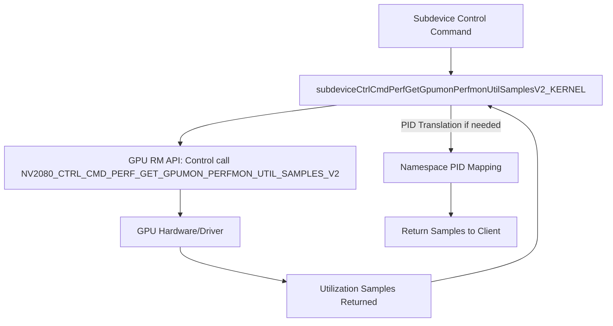
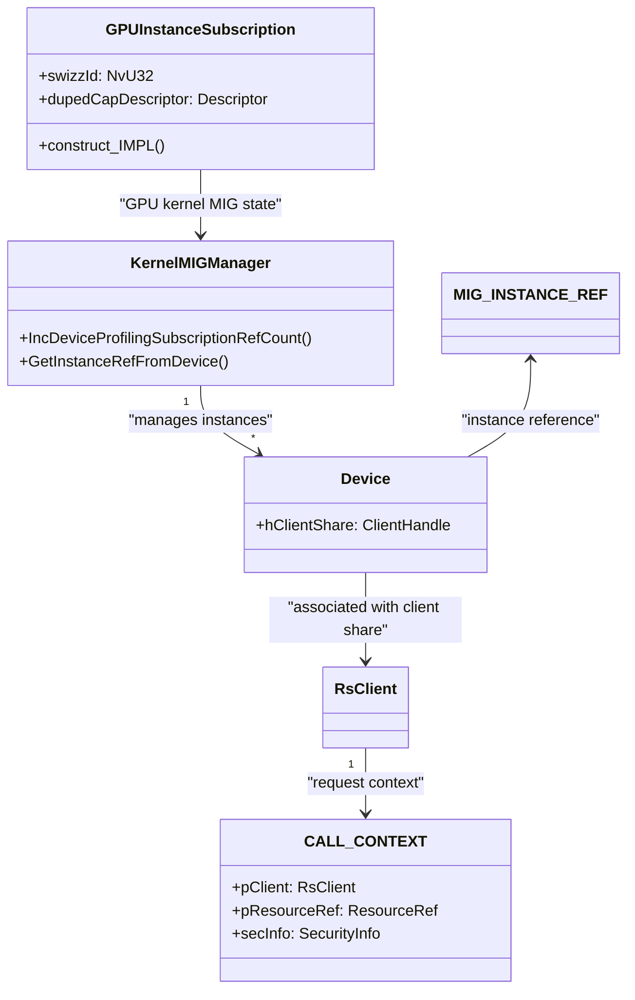
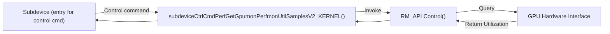

<!-- source: DeepWiki mcp.deepwiki.com · repo NVIDIA/open-gpu-kernel-modules · page 4.7 MIG and Performance Management · fetched 2026-10-26 -->

# 4.7 MIG and Performance Management

Relevant source files

The following files were used as context for generating this wiki page:

- [src/nvidia/interface/nvrm_registry.h](src/nvidia/interface/nvrm_registry.h)
- [src/nvidia/src/kernel/gpu/mig_mgr/gpu_instance_subscription.c](src/nvidia/src/kernel/gpu/mig_mgr/gpu_instance_subscription.c)
- [src/nvidia/src/kernel/gpu/perf/kern_perf_ctrl.c](src/nvidia/src/kernel/gpu/perf/kern_perf_ctrl.c)

This section documents the implementation and architecture of Multi-Instance GPU (MIG) partitioning, GPU instance subscription management, and GPU performance/power control in the NVIDIA Open GPU Kernel Modules. It covers how multiple GPU instances are managed, how client subscriptions to MIG instances operate, and how performance monitoring and control are implemented at the kernel level.

---

## 1. Multi-Instance GPU (MIG) Partitioning Overview

Multi-Instance GPU (MIG) technology allows a single physical GPU to be partitioned into multiple independent GPU instances (also known as GPU slices or GPU partitions). Each GPU instance functions as a separate GPU with dedicated resources, enabling enhanced workload isolation and more efficient resource utilization.

In the kernel modules, MIG partitioning is managed by the **kernel MIG manager** subsystem which handles GPU instance lifecycle, client subscriptions, and resource management specific to MIG.

The MIG manager oversees:

- Enabling/disabling MIG on the GPU
- Creating and destroying GPU instances
- Client subscriptions to GPU instances
- Ensuring resource isolation and sharing semantics across MIG instances

This design enables clients and subsystems to interact with a particular GPU instance as if it were a distinct GPU device.

### Core Data Structures and Objects

- **GPUInstanceSubscription**: Represents a client's subscription to a specific GPU instance (identified by a swizzle ID).
- **KernelMIGManager**: Central manager object attached to the GPU handling MIG-related state and operations.
- **MIG_INSTANCE_REF**: Reference type linking GPU instances to resources and clients.

---

## 2. GPU Instance Subscription Management

### Purpose

GPU instance subscriptions allow clients to request access to a specific MIG partition by "subscribing" to the GPU instance identified by a swizzle ID. This restricts client operations and visibility to that particular instance.

The subscription mechanism:

- Maps client requests to the appropriate physical instance.
- Manages resource allocation tied to the instance.
- Handles interactions with the Resource Manager (RM) for capability caching and resource reservations.

### Subscription Implementation Details

The main logic related to GPU instance subscriptions is implemented in `gpu_instance_subscription.c`.

#### Key Functions

- **`gisubscriptionConstruct_IMPL`** (lines 121-179):

  This function constructs a GPU instance subscription object. It validates MIG enablement, disables RM control cache as a workaround, and handles special swizzle IDs such as the root profiling swizzle. It increases profiling subscription reference counts when applicable.

  It takes parameters:

  - `GPUInstanceSubscription *pGPUInstanceSubscription`: The subscription object.
  - `CALL_CONTEXT *pCallContext`: Context of the client's call.
  - `RS_RES_ALLOC_PARAMS_INTERNAL *pRmAllocParams`: Allocation parameters containing user mode info, including the target swizzle ID.

- **`_gisubscriptionClientSharesVASCrossPartition`** (lines 54-119):

  This inline helper checks if a client shares a virtual address space (VAS) across multiple GPU instances, i.e., if the client's address space spans more than one MIG instance.

  It inspects clients sharing the same device and determines if the sharing occurs across different swizzle IDs, indicating cross-MIG-instance sharing.

#### Subscription Logic Flow

- Validate that MIG is enabled on the GPU.
- Extract the swizzle ID that identifies the GPU instance.
- For special cases like root profiling swizzle IDs, permissions and profiling subscription counts are managed.
- Manage RM control path caching for MIG subscriptions.
- Detect client sharing of VAS across instances for resource isolation.
- Complete the subscription by associating the client with the specific GPU instance.

This subscription model enables secure and resource-contained interactions with GPU instances in a multi-tenant environment.

---

## 3. Performance Management and Control Paths

### Purpose

Performance management involves monitoring GPU utilization and controlling power/performance state transitions. It provides metrics and control commands to adjust GPU clocks, power states, and gather engine utilization data.

### Implementation Overview

Performance control is handled primarily via subdevice control interfaces implemented in the file `kern_perf_ctrl.c`. These interfaces respond to control commands for performance data retrieval and state management.

### Key Functionalities

- **Performance Monitoring Samples Retrieval**

  Functions:

  - `subdeviceCtrlCmdPerfGetGpumonPerfmonUtilSamplesV2_VF` (lines 51-82):

    This function serves virtual function (VF) clients and returns an error if MIG is enabled, as performance monitoring is unsupported with SMC (Secure Multi-Compute) enabled in MIG mode.

  - `subdeviceCtrlCmdPerfGetGpumonPerfmonUtilSamplesV2_KERNEL` (lines 95-179):

    Handles kernel client's request for performance monitoring utilization samples (`NV2080_CTRL_PERF_GET_GPUMON_PERFMON_UTIL_SAMPLES_V2` command). It uses RM API to query GPU utilization data regarding various GPU engines (graphics, framebuffer, encode, decode, JPEG, OFA).

    Additionally, it translates OS-specific process IDs (pids) for samples into namespace-specific pids when requested from non-root namespaces, supporting containerized or virtualized environments.

### Performance Control Data Flow

This flow ensures that client requests to get GPU performance utilization are serviced accurately, with support for different client contexts.

---

## 4. Data Flow and Component Relationships

The interaction between MIG management, instance subscription, and performance control encompasses multiple GPU kernel components:

- When a client requests access to a MIG partition, the **gpu_instance_subscription** subsystem processes the subscription. It relies on the **KernelMIGManager** to validate the instance and manage resources.
- RM (Resource Manager) APIs are employed to communicate subscription and allocation requests.
- The **performance control** subsystem interacts closely with RM APIs to retrieve performance monitoring data.
- The **subdevice** abstraction serves as the entry point for control commands, including performance-related commands.
- Virtual GPU (vGPU) layers and virtualization components may also interface through these pathways, handling multipass translations.

---

## 5. Code Entity Mapping with System Concepts

### Diagram 1: MIG Instance Subscription Entities

### Diagram 2: Performance Management Path

These diagrams relate kernel module artifacts with system functional elements to help engineers navigate and identify code for MIG and performance subsystems.

---

## 6. Additional Information

- The code explicitly disables RM control caching during MIG subscriptions as a temporary workaround pending completion of CORERM-5016. This ensures cache coherence during the subscription and control path setup.
- Performance monitoring commands are unsupported with MIG enabled for virtual functions, reflecting underlying hardware or firmware limitations.
- Client virtual address space sharing across different GPU instances is carefully checked to prevent violating instance isolation guarantees.
  
---

## References and Code Locations

- GPU Instance Subscription Management: `src/nvidia/src/kernel/gpu/mig_mgr/gpu_instance_subscription.c: head lines 1-179`  
  This file contains core logic for GPU instance subscriptions, swizzle ID handling, client share cross-partition checks, and special profiling subscription management.

- Performance Control Command Implementation: `src/nvidia/src/kernel/gpu/perf/kern_perf_ctrl.c: lines 51-179`  
  Implements retrieval of GPU utilization samples via RM APIs and translates process IDs for non-root namespaces.

- Registry keys related to power and performance control are defined in `src/nvidia/interface/nvrm_registry.h` but not covered in detail in this section.

---

# Summary

The kernel-level MIG and performance management functionalities enable the NVIDIA GPU driver to:

- Partition a GPU into multiple independent instances.
- Allow clients to subscribe securely to individual MIG partitions.
- Provide accurate and namespace-aware GPU utilization metrics for performance monitoring.
- Integrate with Resource Manager (RM) control paths for resource and capability management.

This architectural and code-level design provides strong isolation, flexible resource control, and effective monitoring capabilities critical for modern multi-tenant GPU environments.

---

**Sources:**  
- `src/nvidia/src/kernel/gpu/mig_mgr/gpu_instance_subscription.c:1-179`  
- `src/nvidia/src/kernel/gpu/perf/kern_perf_ctrl.c:51-179`  
- `src/nvidia/interface/nvrm_registry.h:1-149`

---

