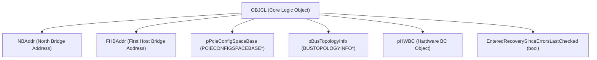
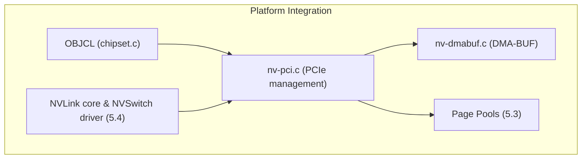
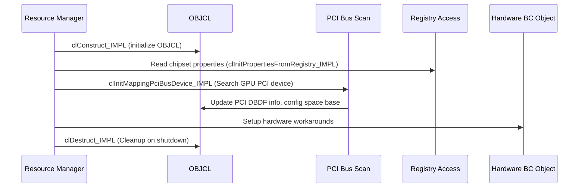

<!-- source: DeepWiki mcp.deepwiki.com · repo NVIDIA/open-gpu-kernel-modules · page 5 Platform Integration · fetched 2026-10-26 -->

# Platform Integration

Relevant source files

The following files were used as context for generating this wiki page:

- [src/nvidia/src/kernel/platform/chipset/chipset.c](src/nvidia/src/kernel/platform/chipset/chipset.c)

## Purpose and Scope

Platform Integration defines the interfaces and mechanisms by which the NVIDIA Open GPU Kernel Modules interact with the underlying system hardware and platform firmware. This includes chipset and PCIe bus detection, PCIe configuration space access, vendor-specific hardware workarounds, and system-level memory management relevant to platform operation.

The core logic abstracts platform-specific details to provide a robust foundation for GPU initialization, communication, and resource sharing with other devices and the operating system.

This is a **parent page**. Detailed coverage of key sub-areas is provided in child pages:

- **[Chipset and PCIe Management](#5.1)** — Explains chipset detection, PCIe config space access, ASPM management, root port setup, and vendor-specific workarounds.
- **[DMA Buffer Sharing](#5.2)** — Documents the DMA-BUF framework integration for inter-device memory sharing, including attachment and mapping semantics.
- **[System Memory and Page Pools](#5.3)** — Details the system memory allocator with NUMA-awareness, page pools, memory scrubbing, and integration with Linux kernel memory shrinkers.
- **[NVLink and NVSwitch](#5.4)** — Documents the NVLink core library, Linux integration shim, and NVSwitch driver code for complex interconnect topologies.

---

## Core Logic Object (OBJCL)

The Core Logic Object, known as `OBJCL` in the code, represents the chipset and platform context abstracted from hardware details. It encapsulates system properties and provides key PCIe platform functions utilized by the Resource Manager (RM) and other kernel components.

`OBJCL` is responsible for maintaining key chipset addresses (such as the North Bridge and First Host Bridge), PCIe configuration space mappings, and bus topology information. It also tracks hardware workaround structures (`pHWBC`) to manage chipset-specific quirks and maintains flags for recovery state tracking of PCIe links.

### Key Responsibilities

- Holds chipset address space pointers for access and control.
- Tracks PCIe configuration space base address and topology caches.
- Manages hardware workaround objects used for stability and compatibility.
- Facilitates chipset property initialization from registry values.
- Handles PCI device scanning to map the GPU device within the PCI domain/bus/device/function (DBDF) space.
- Manages cleanup and destruction of chipset-related resources.

### OBJCL Structure Overview

### Lifecycle and Initialization

- `clConstruct_IMPL` initializes the `OBJCL`, setting default chipset flags such as `PDB_PROP_CL_IS_CHIPSET_IO_COHERENT` (set true for all except Tegra chipsets) and initializes recovery-tracking flags.
- `clInitPropertiesFromRegistry_IMPL` reads system registry entries to override chipset behavior, e.g. disabling PCIe flow control or forcing PCIe Gen2 speeds.
- `clInitMappingPciBusDevice_IMPL` searches PCI buses/domains/devices for the NVIDIA GPU by matching vendor/device IDs and BAR0 addresses. This discovery establishes the GPU's PCI address and config space mapping, crucial for further operations.
- `clDestruct_IMPL` cleans up recursive hardware workaround structures, PCIe topology caches, and unmaps PCIe config space.

See `src/nvidia/src/kernel/platform/chipset/chipset.c` [lines 45-121]().

---

## PCIe Platform Management and Root Port Detection

The platform integration layer provides detailed handling of PCIe device initialization and management, focusing on detection and configuration of root ports, PCIe link states, and applying platform-specific workarounds.

### PCI Probe and Resizable BAR (ReBAR) Handling

Within the PCIe probing process (`nv_pci_probe`), the driver attempts to enable Resizable BAR support by invoking `nv_resize_pcie_bars`. This function interfaces with the Linux PCI subsystem's APIs (e.g., `pci_rebar_get_possible_sizes`) to fetch supported BAR sizes and adjust BAR1 accordingly if the hardware and user configuration allow.

This optimization can improve memory window size for GPU BARs, increasing performance by allowing larger direct CPU access to GPU memory.

### Vendor-Specific Workarounds and GPU Exclusion

The driver manages a database of known root ports, upstream bridges, and specific hardware models to apply workarounds for compatibility and stability. It also provides mechanisms to exclude GPUs dynamically based on UUIDs, accommodating multi-GPU or virtualized configurations.

Virtualization environments (Hyper-V, KVM) influence interrupt and IRQ handling behavior to adapt to the guest environment.

---

## DMA Buffer Sharing (DMA-BUF)

The NVIDIA kernel modules integrate with Linux's DMA-BUF framework to enable shared memory buffers between GPU devices and other components, allowing zero-copy data sharing.

This system supports:

- Exporting GPU buffers as DMA-BUFs.
- Importing DMA-BUFs from other drivers for use on NVIDIA GPUs.
- Managing buffer attachments, proper mapping, and IOMMU translation to ensure coherent and secure memory access.

This capability is critical for multi-GPU systems, heterogeneous drivers, and advanced sharing scenarios common in modern workloads.

See the child page [DMA Buffer Sharing](#5.2) for in-depth coverage.

---

## System Memory and Page Pools

The driver incorporates an advanced page pool subsystem to manage system memory allocations efficiently:

- Allocations respect system NUMA topology to reduce latency and optimize memory locality.
- Memory scrubbing is performed during page recycling to wipe sensitive data.
- The subsystem integrates with Linux kernel shrinking mechanisms (shrinkers) to release memory under pressure.
- Checks for IOMMU presence and PCI ATS support are incorporated to maintain proper DMA address translations and security.

This system is essential for GPU memory operations where fast, predictable, and secure memory allocations are needed.

See the child page [System Memory and Page Pools](#5.3) for comprehensive documentation.

---

## NVLink and NVSwitch

High-speed interconnects between NVIDIA GPUs are managed through NVLink and NVSwitch layers:

- The NVLink core library abstracts NVLink protocol management, error handling, and link training.
- A Linux integration shim provides the interface to the Linux kernel.
- NVSwitch driver code supports LR10/LS10 switches for multi-GPU interconnect topologies.

These components enable coherent multi-GPU clusters with high bandwidth and low latency.

For detailed information, refer to the child page [NVLink and NVSwitch](#5.4).

---

## Summary of Platform Components

| Component                | Responsibility                                          | Primary Source Files                    |
|-------------------------|---------------------------------------------------------|---------------------------------------|
| **OBJCL (Core Logic Object)** | Abstract chipset and PCIe topology, config access     | `src/nvidia/src/kernel/platform/chipset/chipset.c` |
| **PCIe Management**       | PCI device probe, config space mapping, ReBAR, IRQ     | `kernel-open/nvidia/nv-pci.c`         |
| **DMA-BUF Integration**   | Inter-device buffer sharing and mapping                 | `kernel-open/nvidia/nv-dmabuf.c`      |
| **System Memory Paging**  | Page pools, NUMA-aware allocation, memory scrubbing    | See child page 5.3                    |
| **NVLink and NVSwitch**   | High-speed GPU interconnect management                   | See child page 5.4                    |
| **Platform IRQ Handling** | SoC interrupt management, virtualization adaptations     | `kernel-open/nvidia/nv-platform.c`    |

---

## Diagram: Platform Conceptual to Code Entity Bridge

## Diagram: OBJCL Lifecycle and PCIe Device Initialization Flow

---

This high-level overview introduces core platform integration concepts and code architecture in the NVIDIA Open GPU Kernel Modules project. For detailed technical discussions, implementation specifics, and subsystem internals, please refer to the linked child pages.

---

## References to Code

- OBJCL core structure and methods: `src/nvidia/src/kernel/platform/chipset/chipset.c:45-121`()
- PCI device probe, ReBAR support, vendor workarounds: `kernel-open/nvidia/nv-pci.c:80-131`(), `kernel-open/nvidia/nv-pci.c:133-148`(), `kernel-open/nvidia/nv-pci.c:84-97`()
- Platform SoC IRQ management: `kernel-open/nvidia/nv-platform.c:34-137`()
- DMA-BUF buffer sharing: `kernel-open/nvidia/nv-dmabuf.c`
- Various types and macros: `kernel-open/common/inc/nvtypes.h`()

---

Sources:  
[src/nvidia/src/kernel/platform/chipset/chipset.c:45-121](),  
[kernel-open/nvidia/nv-pci.c:80-131](), [kernel-open/nvidia/nv-pci.c:133-148](), [kernel-open/nvidia/nv-pci.c:84-97](),  
[kernel-open/nvidia/nv-platform.c:34-137](),  
[kernel-open/common/inc/nvtypes.h]()

---

