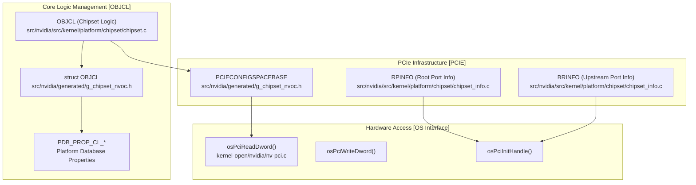
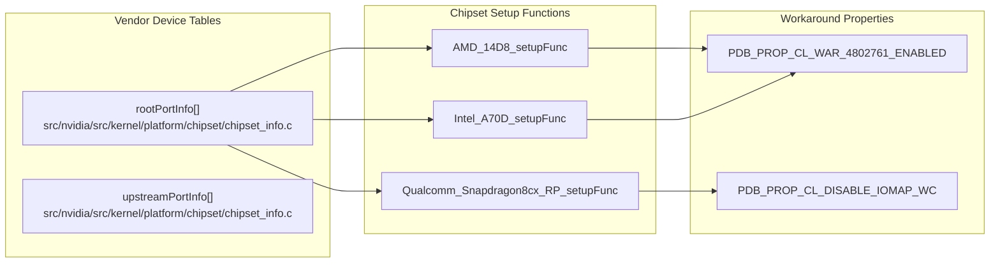

<!-- source: DeepWiki mcp.deepwiki.com · repo NVIDIA/open-gpu-kernel-modules · page 5.1 Chipset and PCIe Management · fetched 2026-10-26 -->

# Chipset and PCIe Management

Relevant source files

The following files were used as context for generating this wiki page:

- [kernel-open/nvidia/nv-pci.c](kernel-open/nvidia/nv-pci.c)
- [src/nvidia/generated/g_chipset_nvoc.h](src/nvidia/generated/g_chipset_nvoc.h)
- [src/nvidia/src/kernel/gpu/disp/vblank_callback/vblank_callback.c](src/nvidia/src/kernel/gpu/disp/vblank_callback/vblank_callback.c)
- [src/nvidia/src/kernel/gpu/rc/kernel_rc.c](src/nvidia/src/kernel/gpu/rc/kernel_rc.c)
- [src/nvidia/src/kernel/platform/chipset/chipset.c](src/nvidia/src/kernel/platform/chipset/chipset.c)

The Chipset and PCIe Management subsystem provides platform-specific detection, PCIe configuration space access, Active State Power Management (ASPM), PCIe root port setup, and vendor-specific workaround implementation to ensure optimal GPU operation across diverse hardware platforms. This system handles chipset detection, bus topology initialization, PCIe capability discovery, ASPM management, root port configuration, and overrides for hardware errata.

## Architecture Overview

The cornerstone of the chipset management system is the `OBJCL` (Chipset Logic) object. It coordinates platform and chipset-specific functionality, maintains chipset and root port information databases, and applies appropriate configuration and workarounds as needed.

### Chipset Logic Entity Mapping

The following diagram maps high-level system concepts related to chipset and PCIe management to their corresponding core code entities:

This framework organizes chipset-specific data and integrates with PCIe configuration management and platform hardware interfaces.

Sources: [src/nvidia/src/kernel/platform/chipset/chipset.c:46-61](), [src/nvidia/src/kernel/platform/chipset/chipset_info.c:54-107](), [kernel-open/nvidia/nv-pci.c:195-230]()

## Chipset Detection and Initialization

Detection of the chipset and PCIe device layout is foundational to configuring the GPU and ensuring platform compatibility.

### Detection Flow

Chipset and device discovery happen during the early Resource Manager (RM) initialization phase:

1. **PCI Domain, Bus, Device, Function (DBDF) Mapping**:  
   The function `clInitMappingPciBusDevice_IMPL` scans PCI domains, buses, and devices to locate the NVIDIA GPU device by matching the vendor ID, device class, and Base Address Register (BAR0) against the GPU’s physical address. This discovery caches the DBDF (Domain, Bus, Device, Function) in `pGpu->busInfo`. If no valid device is found, an error is reported. This process iterates over potential addresses to ensure correct GPU detection [src/nvidia/src/kernel/platform/chipset/chipset.c:127-198]().

2. **Subsystem ID Retrieval**:  
   The driver walks the PCI capability list starting at the PCI capability pointer to find the subsystem vendor and device ID, facilitating platform variant identification and handling OEM configurations [src/nvidia/src/kernel/platform/chipset/chipset.c:204-230]().

3. **Host Bridge / Root Port Enumeration**:  
   Chipset-specific setup functions examine extended configuration space (E.g., Intel 25xx chipset registers) to determine root port and host bridge capabilities, facilitating detailed PCIe link management [src/nvidia/src/kernel/platform/chipset/chipset_info.c:54-107]().

4. **Chipset Setup Routine Invocation**:  
   The chipset identification code matches detected vendor/device IDs against static tables (`rootPortInfo[]` and `upstreamPortInfo[]`) and calls associated setup functions such as `Intel_25XX_setupFunc`, `AMD_14D8_setupFunc`, or `Qualcomm_Snapdragon8cx_RP_setupFunc` that apply chipset or platform-specific properties, flags, and workarounds [src/nvidia/src/kernel/platform/chipset/chipset_info.c:54-107]().

### Property Initialization and Registry Overrides

The `OBJCL` object maintains platform database (PDB) properties to configure chipset features and behaviors:

- By default, the chipset sets `PDB_PROP_CL_IS_CHIPSET_IO_COHERENT` to `NV_TRUE`, indicating chipset I/O coherency, with specific platforms like Tegra able to override this [src/nvidia/src/kernel/platform/chipset/chipset.c:58-60]().

- Several registry keys influence chipset features, such as:
  - `NV_REG_STR_RM_FORCE_ENABLE_GEN2` to force PCIe Gen2 link speed.
  - `NV_REG_STR_RM_FORCE_DISABLE_IOMAP_WC` to disable I/O mapping write-combining for safety [src/nvidia/src/kernel/platform/chipset/chipset.c:65-90]().

This setup enables stable behavior tuned via OS registry facilities.

Sources: [src/nvidia/src/kernel/platform/chipset/chipset.c:46-198](), [src/nvidia/src/kernel/platform/chipset/chipset_info.c:54-143]()

## PCIe Configuration Space Management

Direct access to PCIe configuration space is essential for querying capabilities and applying settings such as Resizable BAR (ReBAR) and ASPM controls.

### Resizable BAR (ReBAR) Management

The driver supports PCIe Resizable BAR resizing to optimize GPU memory aperture size and thus performance:

- **Querying Supported Sizes:**  
  The function `pci_rebar_get_possible_sizes` queries hardware support for variable BAR1 size apertures, determining the maximum supported size [kernel-open/nvidia/nv-pci.c:212-217]().

- **Setting BAR Size:**  
  When `NVreg_EnableResizableBar` is enabled and compatible hardware is detected, the driver calls `pci_rebar_set_size` to program the BAR aperture for an increased GPU memory window [kernel-open/nvidia/nv-pci.c:205-223]().

### Configuration Access Mechanisms

PCI config space reads and writes are achieved through OS PCI abstractions:

- The driver caches a sysfs configuration file pointer (`nvl->sysfs_config_file`) for fast repeated access to PCI config space on Linux systems, avoiding overhead in locating sysfs paths [kernel-open/nvidia/nv-pci.c:133-193]().

- Capability traversal walks the PCI capability linked list from the standard capability pointer register, enabling identification of features like Advanced Error Reporting (AER), ASPM, and Resizable BAR support [src/nvidia/src/kernel/platform/chipset/chipset.c:204-230]().

Sources: [kernel-open/nvidia/nv-pci.c:133-230](), [src/nvidia/src/kernel/platform/chipset/chipset.c:204-230]()

## ASPM and Power Management

Active State Power Management (ASPM) lowers power usage by placing PCIe links in low-power states like L0s and L1. The NVIDIA driver manages ASPM states carefully for platform stability.

### ASPM Control and Configuration

- The `OBJCL` tracks ASPM capabilities and configures them using PDB properties and chipset-specific rules.

- Registry keys (e.g., `NV_REG_STR_CL_ASLM_CFG`) enable toggling rules for ASPM states, Gen2 enforcement, hot reset support, and link upgrade bypass.

- The helper function `_Set_ASPM_L0S_L1` disables problematic ASPM states (L0s or L1) for specific chipset/workaround cases to avoid link instability, called from chipset setup routines [src/nvidia/src/kernel/platform/chipset/chipset_info.c:52-54]().

### PCIe Link Recovery Monitoring

The boolean `EnteredRecoverySinceErrorsLastChecked` property on `OBJCL` flags whether the PCIe link has entered a recovery state recently, facilitating error monitoring and diagnostics for PCIe link issues [src/nvidia/src/kernel/platform/chipset/chipset.c:46-50]().

Sources: [src/nvidia/src/kernel/platform/chipset/chipset.c:46-50](), [src/nvidia/src/kernel/platform/chipset/chipset_info.c:52-54]()

## Vendor-Specific Workarounds

To maintain wide platform compatibility and handle silicon errata, the chipset module applies vendor-specific and device-specific workarounds:

### Workaround Entity Mapping

### Important Workarounds

- **AMD/Intel Erratum 4802761:**  
  Enabled in chipset setup functions `AMD_14D8_setupFunc` and `Intel_A70D_setupFunc` to mitigate known chipset issues via `PDB_PROP_CL_WAR_4802761_ENABLED` [src/nvidia/src/kernel/platform/chipset/chipset_info.c:109-129]().

- **Qualcomm Snapdragon 8cx Root Port Workaround:**  
  Applies specialized configuration for Qualcomm platforms via `Qualcomm_Snapdragon8cx_RP_setupFunc` and disables I/O mapping write-combining using `PDB_PROP_CL_DISABLE_IOMAP_WC` [src/nvidia/src/kernel/platform/chipset/chipset_info.c:86-87]().

- **IOMAP Write-Combining Disablement:**  
  Some chipsets disable iomap write-combining by setting `PDB_PROP_CL_DISABLE_IOMAP_WC`, configurable via registry key overrides to avoid data consistency issues [src/nvidia/src/kernel/platform/chipset/chipset.c:83-87]().

- **GPU Exclusion by UUID:**  
  The function `nv_check_and_exclude_gpu` in `nv-pci.c` filters GPUs from initialization if their UUIDs match exclusion criteria, preventing problematic GPUs from loading driver support [kernel-open/nvidia/nv-pci.c:84-130]().

Sources: [src/nvidia/src/kernel/platform/chipset/chipset_info.c:54-143](), [src/nvidia/src/kernel/platform/chipset/chipset.c:65-90](), [kernel-open/nvidia/nv-pci.c:84-130]()

---

This page details the chipset and PCIe management mechanisms implemented in the NVIDIA Open GPU Kernel Modules to provide robust, platform-aware GPU initialization and operation.

# Summary Table of Key Code Concepts

| Concept                 | Code Entity / Function                 | Description                                    | Source File                               |
|-------------------------|--------------------------------------|------------------------------------------------|------------------------------------------|
| Chipset Logic Object     | `OBJCL`                              | Core chipset state, PCIe link administration   | chipset.c, g_chipset_nvoc.h              |
| PCIe Config Space Base   | `PCIECONFIGSPACEBASE`                 | PCIe config space base address and bus range    | g_chipset_nvoc.h                         |
| Root Port Info Table     | `rootPortInfo[]`                      | Static list of vendor/device root port info     | chipset_info.c                           |
| Upstream Port Info Table | `upstreamPortInfo[]`                  | List of upstream PCIe bridge device info        | chipset_info.c                           |
| PCI DBDF Mapping         | `clInitMappingPciBusDevice_IMPL`     | PCI device detection and bus/device mapping     | chipset.c                               |
| PCIe ReBAR Management    | `pci_rebar_get_possible_sizes`       | Query and set Resizable BAR sizes                | nv-pci.c                               |
| ASPM Control             | `_Set_ASPM_L0S_L1`                    | Disable problematic PCI ASPM states              | chipset_info.c                         |
| Vendor Workarounds       | `AMD_14D8_setupFunc` etc.             | Chipset-specific setup functions and flags      | chipset_info.c                         |
| GPU Exclusion Logic      | `nv_check_and_exclude_gpu`            | Exclude GPUs based on UUID filters               | nv-pci.c                              |

Sources: [src/nvidia/src/kernel/platform/chipset/chipset.c](), [src/nvidia/src/kernel/platform/chipset/chipset_info.c](), [kernel-open/nvidia/nv-pci.c](), [src/nvidia/generated/g_chipset_nvoc.h]()

---

