<!-- source: DeepWiki mcp.deepwiki.com · repo NVIDIA/open-gpu-kernel-modules · page 5.2 DMA Buffer Sharing · fetched 2026-10-26 -->

# DMA Buffer Sharing

<details>
<summary>Relevant source files</summary>

The following files were used as context for generating this wiki page:

- [kernel-open/nvidia/nv-dmabuf.c](kernel-open/nvidia/nv-dmabuf.c)
- [src/nvidia/src/kernel/mem_mgr/mem_list.c](src/nvidia/src/kernel/mem_mgr/mem_list.c)
- [src/nvidia/src/kernel/platform/chipset/chipset_info.c](src/nvidia/src/kernel/platform/chipset/chipset_info.c)

</details>


## Purpose and Scope

This document describes the DMA-BUF buffer sharing implementation within the NVIDIA Open GPU Kernel Modules. The subsystem enables zero-copy inter-device memory sharing by exporting and importing GPU-backed buffers via the Linux DMA-BUF framework. It covers the mechanisms for buffer export and import, attachment validation, and device mappings, facilitating efficient shared GPU memory access by other system devices such as display controllers, video codecs, or peer PCIe devices.

For complementary details, see sections on [GPU Memory Management](#4.4) and [System Memory and Page Pools](#5.3).

---

## Architecture Overview

The DMA-BUF subsystem interfaces GPU memory with Linux's DMA-BUF infrastructure, enabling allocation and sharing of GPU-backed buffers with peer devices. It supports both exporting GPU memory for others to import, and importing DMA-BUFs allocated by external entities.

Key components and data flows are depicted below. The `nv_dma_buf_file_private_t` structure holds export-side private data, while import is handled via `nv_dma_buf_t`. The Linux DMA-BUF framework mediates file descriptor management, attachment, and mapping callbacks.

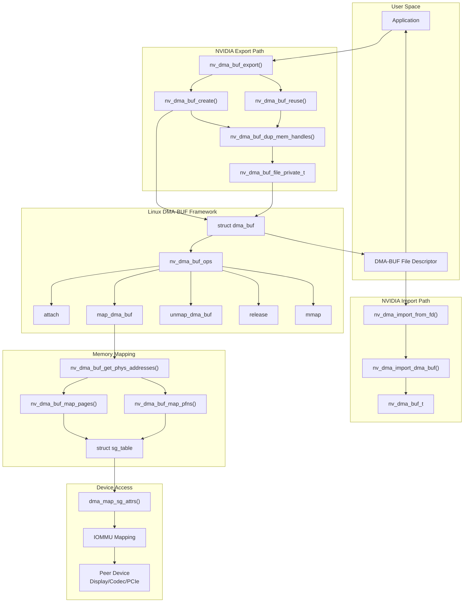

**Sources:** [kernel-open/nvidia/nv-dmabuf.c:1-1872]()

---

## Data Structures

### Export Private Data (`nv_dma_buf_file_private_t`)

This structure maintains per-export DMA-BUF state:

| Field                          | Type                          | Description                                                                                   |
|-------------------------------|-------------------------------|-----------------------------------------------------------------------------------------------|
| `nv`                          | `nv_state_t*`                 | GPU device state pointer                                                                      |
| `h_client`, `h_device`, `h_subdevice` | `NvHandle`                 | RM handles for client, device, and subdevice                                                  |
| `total_objects`, `num_objects` | `NvU32`                      | Expected total and currently attached memory handles                                         |
| `total_size`, `attached_size` | `NvU64`                       | Total expected and attached memory sizes                                                     |
| `handles`                     | `nv_dma_buf_mem_handle_t*`   | Array of duplicated handles and associated info                                              |
| `mapping_type`                | `NvU8`                        | Mapping type: `NV_DMABUF_EXPORT_MAPPING_TYPE_DEFAULT` or `NV_DMABUF_EXPORT_MAPPING_TYPE_FORCE_PCIE` |
| `skip_iommu`                 | `NvBool`                      | Whether to skip IOMMU map/unmap operations (PCIe bypass)                                     |
| `static_phys_addrs`            | `NvBool`                      | Physical addresses are static and cached throughout lifetime                                  |
| `map_attrs`                   | Struct                       | Map attributes containing caching flags, mmap permissions, read-only flag, and memory type    |
| `lock`                       | `struct mutex`                | Protects access during dma-buf callbacks                                                     |

Each `nv_dma_buf_mem_handle_t` entry contains:

| Field             | Type        | Description                                                       |
|-------------------|-------------|-------------------------------------------------------------------|
| `h_memory`        | `NvHandle`  | RM memory object handle duplicated for export                     |
| `offset`, `size`  | `NvU64`     | Byte offset and size within the handle                            |
| `mem_info`        | `void*`     | RM memory descriptor private data pointer                         |
| `phys_refcount`   | `NvU64`     | Reference count for physical address mappings                     |
| `memArea`         | `MemoryArea`| Scatter-gather physical memory ranges associated                   |

**Sources:** [kernel-open/nvidia/nv-dmabuf.c:28-140]()

---

### Import Private Data (`nv_dma_buf_t`)

Imported DMA-BUFs are wrapped by this structure:

| Field             | Type                              | Description                                                     |
|-------------------|----------------------------------|-----------------------------------------------------------------|
| `dma_buf`         | `struct dma_buf*`                 | Underlying Linux DMA-BUF object                                 |
| `dma_attach`      | `struct dma_buf_attachment*`     | Attachment of device to the dma_buf                             |
| `sgt`             | `struct sg_table*`               | Scatter-gather table for DMA mappings                           |
| `direction`       | `enum dma_data_direction`        | DMA direction (`DMA_TO_DEVICE` or `DMA_BIDIRECTIONAL`)          |

**Sources:** [kernel-open/nvidia/nv-dmabuf.h](), [kernel-open/nvidia/nv-dmabuf.c:1732-1738]()

---

## Export Operations

The export path creates a DMA-BUF file descriptor representing aggregate GPU memory. The main function `nv_dma_buf_export()` provides creation or reuse based on `fd` input.

### Export Creation Flow

```mermaid
sequenceDiagram
    participant App as "User Application"
    participant Export as "nv_dma_buf_export()"
    participant Create as "nv_dma_buf_create()"
    participant Dup as "nv_dma_buf_dup_mem_handles()"
    participant RM as "Resource Manager"
    participant GetPhys as "nv_dma_buf_get_phys_addresses()"
    participant DmaBuf as "dma_buf_export()"
    participant FD as "dma_buf_fd()"
    
    App->>Export: Provide memory handles, sizes, fd = -1 (new export)
    Export->>Create: Create file_private structure
    Create->>Create: nv_dma_buf_alloc_file_private()
    Create->>Create: Store total_objects, total_size
    
    Create->>Dup: Duplicate memory handles
    Note over Dup: Acquire RM API + GPU locks
    loop For each memory handle
        Dup->>RM: rm_dma_buf_dup_mem_handle()
        RM-->>Dup: Return duplicated handle, mem info, and cache type
        Dup->>Dup: Store duplicated handle info, verify consistency
    end
    Note over Dup: Release locks
    
    alt static_phys_addrs == TRUE
        Create->>GetPhys: Pull physical addresses for handles
        GetPhys->>RM: rm_dma_buf_map_mem_handle()
        RM-->>GetPhys: Return physical memory areas
        GetPhys->>GetPhys: Increment phys_refcount
    end
    
    Create->>DmaBuf: Call dma_buf_export() with ops and private data
    DmaBuf-->>Create: Returns dma_buf object
    Create->>FD: dma_buf_fd() creates fd from dma_buf
    FD-->>Create: Returns fd number
    Create-->>Export: FD stored in output parameter
    Export-->>App: Return success and fd
```

This procedure duplicates original RM memory handles under a private client to decouple lifetimes and enforces attribute consistency.

**Sources:** [kernel-open/nvidia/nv-dmabuf.c:1422-1583](), [kernel-open/nvidia/nv-dmabuf.c:360-498]()

---

### Memory Handle Duplication and Validation

The function `nv_dma_buf_dup_mem_handles()` performs:

- Duplication of each RM memory handle through `rm_dma_buf_dup_mem_handle()`.
- Validates no handle is already free, fits within aggregated size, and all handles share the same cache, read-only, and memory type attributes.
- Caches map attributes from the first handle; subsequent handles must match or error out.

Flow diagram:

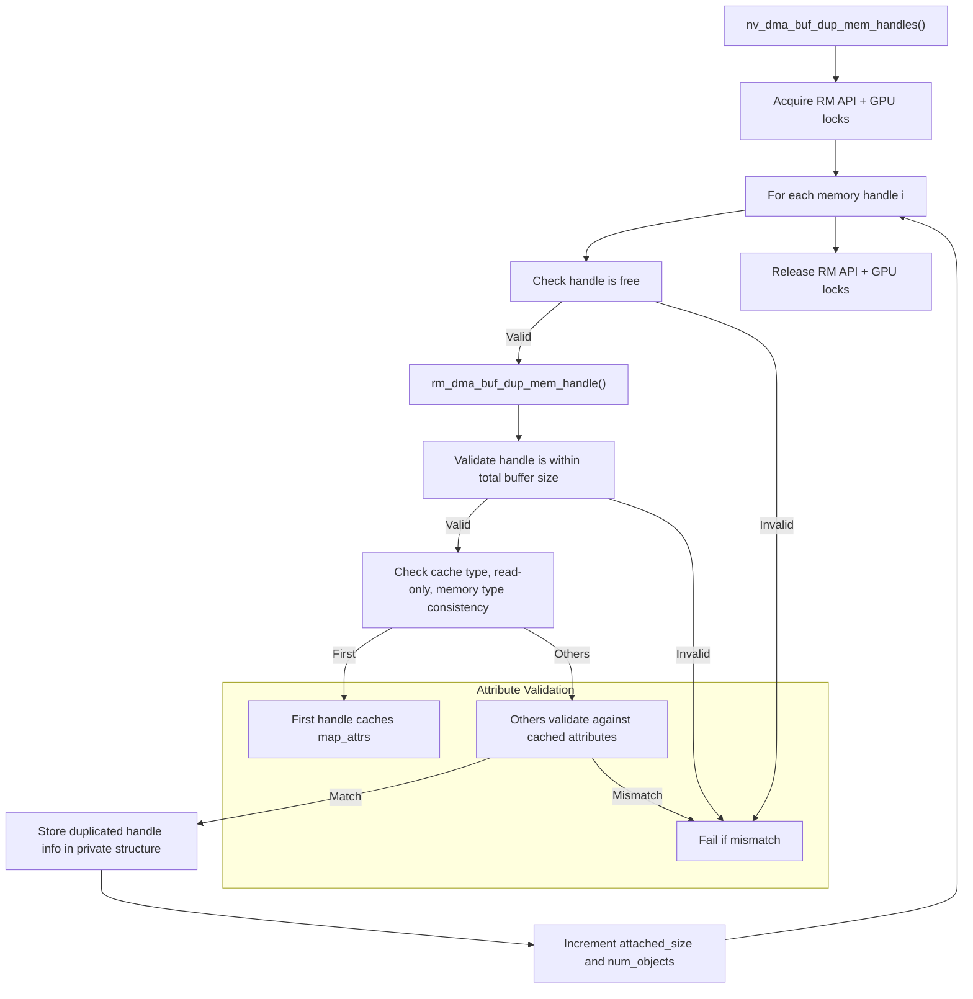

This method guarantees a consistent aggregate DMA-BUF.

**Sources:** [kernel-open/nvidia/nv-dmabuf.c:317-498]()

---

### Buffer Reuse

`nv_dma_buf_reuse()` attaches additional handles to an existing DMA-BUF (when fd >= 0) to extend its memory content dynamically.

```mermaid
graph LR
    APP["Application"] -->|"fd >= 0"| REUSE["nv_dma_buf_reuse()"]
    REUSE --> GET["dma_buf_get(fd)"]
    GET --> VALIDATE["Validate dma_buf_ops == nv_dma_buf_ops"]
    VALIDATE --> LOCK["mutex_lock(&priv->lock)"]
    LOCK --> CHECK["Check expected total_objects and mapping_type"]
    CHECK --> DUP["Invoke nv_dma_buf_dup_mem_handles()"]
    DUP -->|"static_phys_addrs == TRUE"| GET_PHYS["nv_dma_buf_get_phys_addresses()"]
    GET_PHYS --> UNLOCK["mutex_unlock(&priv->lock)"]
    UNLOCK --> PUT["dma_buf_put()"]
```

Physical addresses are refreshed if `static_phys_addrs` is set for the combined buffer.

**Sources:** [kernel-open/nvidia/nv-dmabuf.c:1585-1680]()

---

## DMA-BUF Operations

The driver implements the required DMA-BUF callbacks via `nv_dma_buf_ops` with these key functions:

| Operation | Function                 | Description                                             |
|-----------|--------------------------|---------------------------------------------------------|
| attach    | `nv_dma_buf_attach()`    | Validates attaching device compatibility                 |
| map       | `nv_dma_buf_map()`       | Creates scatter-gather table for DMA hardware            |
| unmap     | `nv_dma_buf_unmap()`     | Unmaps device scatter-gather mappings                    |
| release   | `nv_dma_buf_release()`   | Frees allocated private export data                      |
| mmap      | `nv_dma_buf_mmap()`      | Maps exported GPU buffer memory into user virtual space  |

These ensure proper device access and buffer lifetime management via the Linux DMA-BUF framework.

**Sources:** [kernel-open/nvidia/nv-dmabuf.c:1406-1420]()

---

### Attachment Validation (`nv_dma_buf_attach()`)

Attachment validates the mapping type requested by the peer device and PCIe topology:

- For `FORCE_PCIE` mappings:

  - Validates direct PCIe topology with `nv_pci_is_valid_topology_for_direct_pci()`.
  - If valid, sets `skip_iommu = TRUE` marking that IOMMU programming is bypassed.

- For `DEFAULT` mappings:

  - Checks PCIe topology support via `nv_grdma_pci_topology_supported()`.
  
- Validates peer-to-peer attachment support by checking `attachment->peer2peer` and `mem_has_struct_page`.

Attach fails if invalid topology or unsupported device conditions arise.

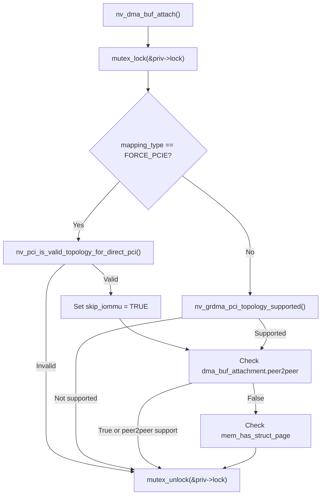

**Sources:** [kernel-open/nvidia/nv-dmabuf.c:959-1021]()

---

### Device Mapping (`nv_dma_buf_map()`)

When a device attaches, this callback creates an SG table representing the physical memory for DMA:

- The function verifies all expected handles are attached.
- If physical addresses are dynamic (`static_phys_addrs == FALSE`), it fetches physical addresses and increments the corresponding refcounts.
- Depending on whether `mem_has_struct_page` is set and mapping type, it chooses:

  - **Page-based mapping:** Uses `sg_set_page()` to build the SG table using `struct page*` pointers.
  - **PFN-based mapping:** Uses `sg_set_page()` with `NULL` page but sets DMA address directly, bypassing IOMMU mapping if `skip_iommu` is true, else maps via `dma_map_sg_attrs()`.

Diagram:

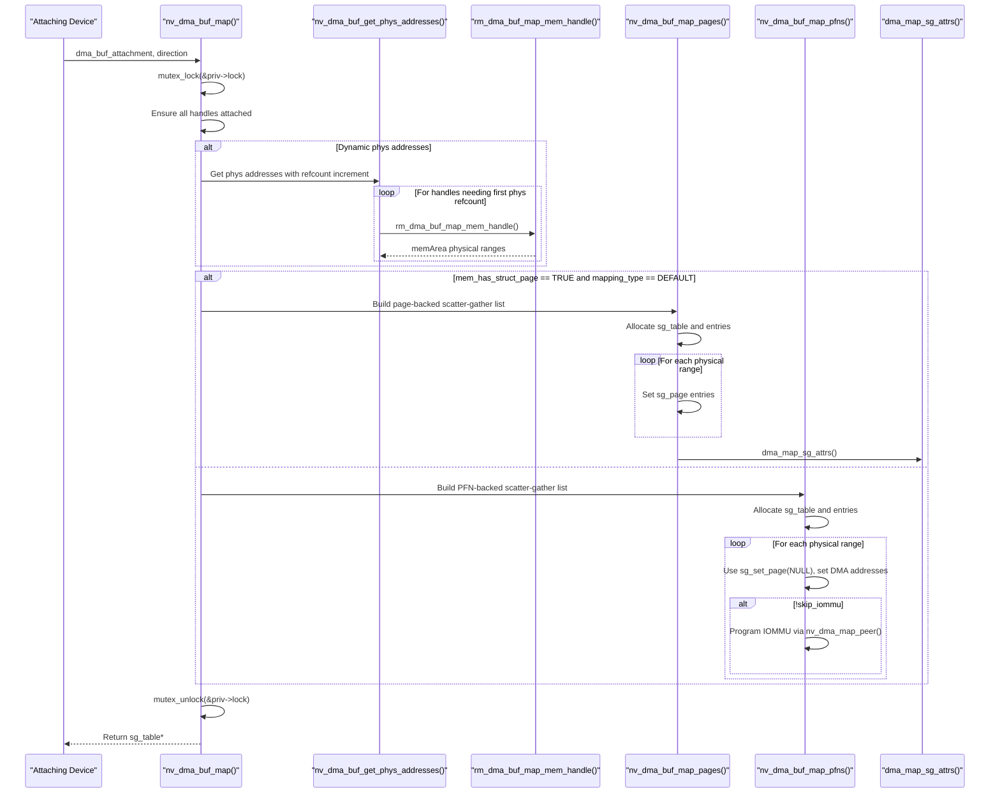

**Sources:** [kernel-open/nvidia/nv-dmabuf.c:1023-1082](), [kernel-open/nvidia/nv-dmabuf.c:776-851](), [kernel-open/nvidia/nv-dmabuf.c:853-957]()

---

## Physical Address Management and Refcounting

DMA-BUF exports maintain reference counts for physical address mappings via `phys_refcount` in each memory handle:

```mermaid
stateDiagram-v2
    [*] --> Unmapped : phys_refcount=0
    Unmapped --> Fetching : nv_dma_buf_get_phys_addresses()
    Fetching --> Mapped : phys_refcount=1; rm_dma_buf_map_mem_handle()
    Mapped --> Mapped : nv_dma_buf_get_phys_addresses(); phys_refcount++
    Mapped --> Releasing : nv_dma_buf_put_phys_addresses(); phys_refcount--
    Releasing --> Unmapped : phys_refcount=0; rm_dma_buf_unmap_mem_handle()
    Releasing --> Mapped : phys_refcount>0
```

- **Increment on map:** Physical addresses are fetched and mapped if reference count transitions from 0 to 1.
- **Decrement on unmap:** Addresses are unmapped when refcount drops from 1 to 0.
- Static physical addresses (if `static_phys_addrs == TRUE`) are mapped once on export creation and remain cached throughout the lifetime, allowing lockless map/unmap operations.
- Dynamic mode fetches and releases physical addresses on every device map/unmap call.

**Sources:** [kernel-open/nvidia/nv-dmabuf.c:233-254](), [kernel-open/nvidia/nv-dmabuf.c:589-696](), [kernel-open/nvidia/nv-dmabuf.c:500-587]()

---

## User Space Memory Mapping (`nv_dma_buf_mmap()`)

Supports memory mapping of DMA-BUFs into user space via the `mmap` system call:

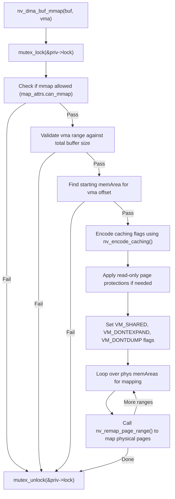

- Applies cache policy from export attributes.
- Read-only exports disable write flags on user pages.
- Uses remap of physical addresses for each memory range.

**Sources:** [kernel-open/nvidia/nv-dmabuf.c:1175-1356]()

---

## Import Operations

The import path enables NVIDIA driver clients or other kernel components to import buffers via exported DMA-BUF file descriptors.

### Import Sequence

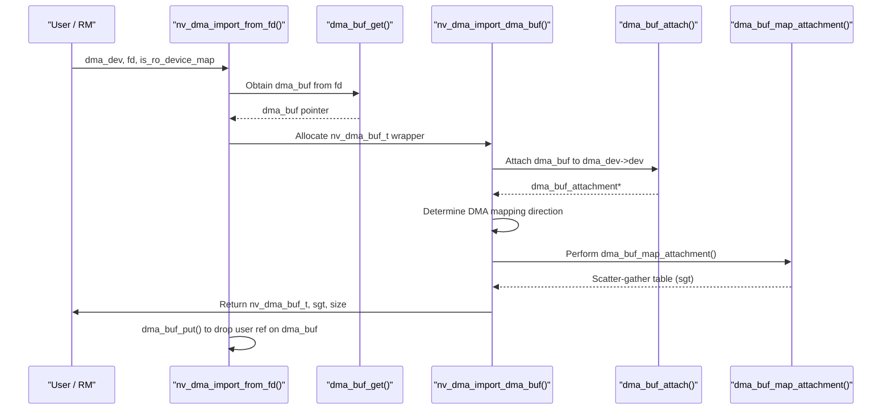

- `is_ro_device_map` hints to use `DMA_TO_DEVICE` direction, otherwise `DMA_BIDIRECTIONAL`.
- Imported buffers allow GPU to access memory from other devices or vice versa.

### Import Release

`nv_dma_release_dma_buf()` cleans attachments, unmaps, and frees import wrappers.

**Sources:** [kernel-open/nvidia/nv-dmabuf.c:1819-1848](), [kernel-open/nvidia/nv-dmabuf.c:1732-1817](), [kernel-open/nvidia/nv-dmabuf.c:1850-1871]()

---

## Mapping Types and IOMMU Handling

The DMA-BUF export supports two distinct mapping types controlling how memory is accessed by device clients.

### DEFAULT Mapping Type

Normal GPU memory is mapped for device DMA with IOMMU translation enabled.

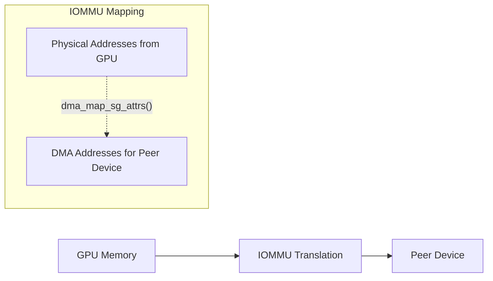

- The driver uses `dma_map_sg_attrs()` to program IOMMU.
- Requires topology verification supporting peer GPU direct memory access (`nv_grdma_pci_topology_supported()`).

### FORCE_PCIE Mapping Type

Used for BAR memory or coherent GPU memory regions, bypassing the IOMMU:

```mermaid
graph LR
    GPU["GPU BAR Memory"] -.->|"Direct PCIe Access"| PEER["Peer Device"]
    
    subgraph "Direct Mapping"
        PHYS["BAR Physical Addresses"]
        SKIP["skip_iommu = TRUE"]
        PHYS -.->|"No IOMMU"-> SKIP
    end
```

- Strict PCIe topology checks via `nv_pci_is_valid_topology_for_direct_pci()` ensure safe bypass.
- `skip_iommu` prevents mapping/unmapping calls to IOMMU APIs.
- Preferred for systems with hardware limitations on P2P and coherent platforms.

**Sources:** [kernel-open/nvidia/nv-dmabuf.c:973-1002](), [kernel-open/nvidia/nv-dmabuf.c:705-738](), [kernel-open/nvidia/nv-dmabuf.c:908-925]()

---

## Scatter-Gather Table Construction

Memory physical ranges are split and packaged into DMA-compatible scatter-gather entries respecting device maximum segment sizes.

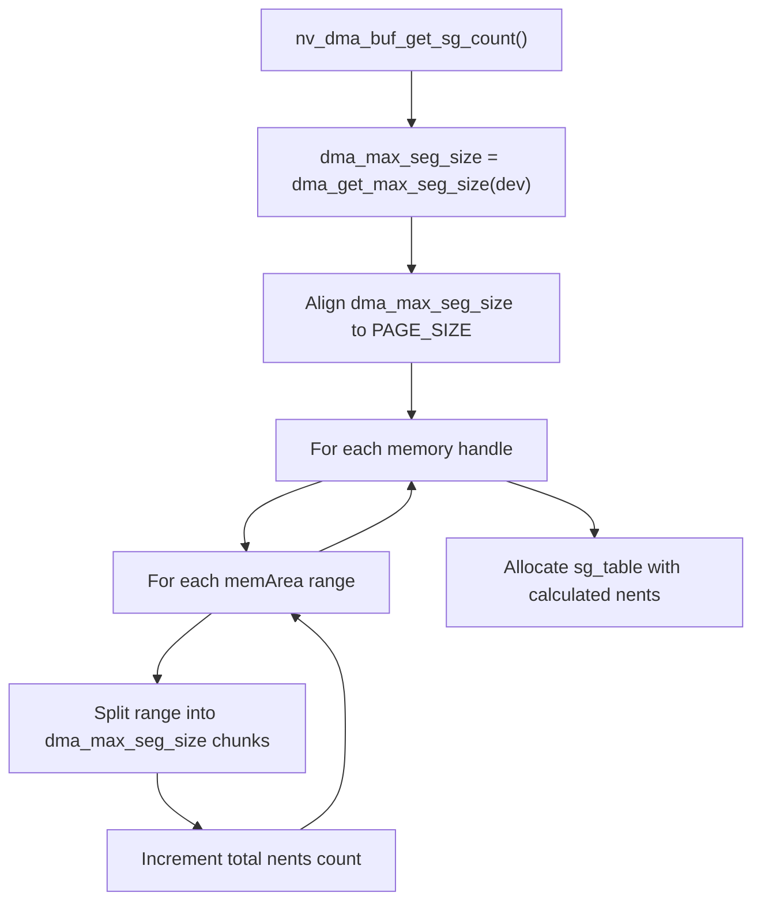

Populating SG entries depends on mapping type:

- **Page-based:** `sg_set_page(sg, page, len, offset)`
- **PFN-based:** `sg_set_page(sg, NULL, len, 0)` plus DMA address set explicitly

**Sources:** [kernel-open/nvidia/nv-dmabuf.c:740-774](), [kernel-open/nvidia/nv-dmabuf.c:802-830](), [kernel-open/nvidia/nv-dmabuf.c:886-935]()

---

## GPU Lock Management During Handle Duplication

The `nv_dma_buf_dup_mem_handles()` function manages locking carefully:

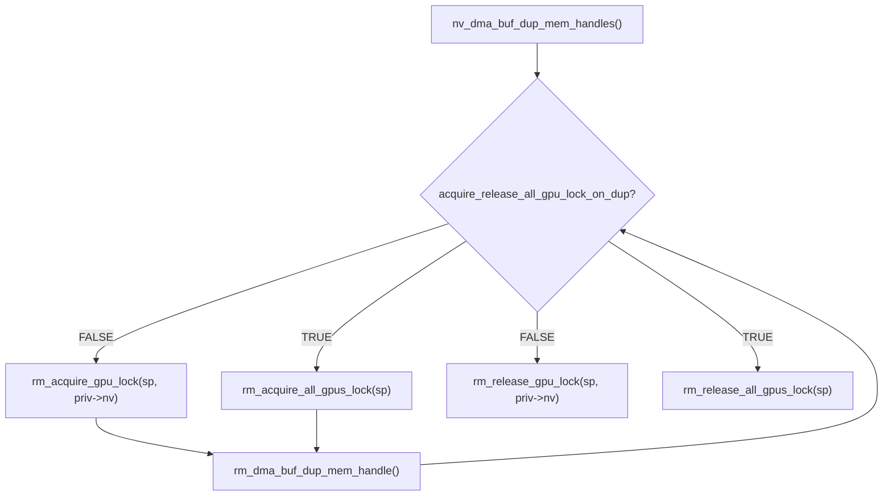

- The `acquire_release_all_gpu_lock_on_dup` flag controls if all GPUs locks should be acquired simultaneously.
- On integrated zero-FB chips, locking all GPUs is required to correctly duplicate SYSMEM memory without race conditions.
- Otherwise, a per-device lock is sufficient.

**Sources:** [kernel-open/nvidia/nv-dmabuf.c:317-358]()

---

## Configuration and Build Integration

DMA-BUF support is conditional, enabled only if Linux kernel config `CONFIG_DMA_SHARED_BUFFER` is set.

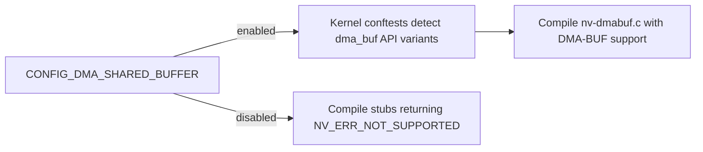

- Kernel conftests adapt to different kernel versions, detecting legacy and new DMA-BUF callbacks like atomic map and peer-to-peer attachment support.
- Without the config, minimal stub functions are compiled to maintain build compatibility.

**Sources:** [kernel-open/nvidia/nv-dmabuf.c:26-27](), [kernel-open/nvidia/nv-dmabuf.c:1689-1730](), [kernel-open/nvidia/nvidia.Kbuild:146-148]()

---

# Summary

The DMA Buffer Sharing subsystem enables efficient, zero-copy memory sharing between NVIDIA GPUs and peer devices using the Linux DMA-BUF framework. It implements export and import paths with careful handle duplication, PCIe topology and device capability validation, and mapping operations that support both page-backed and PFN-backed (PCI BAR) memory segments. The design includes robust physical address management with reference counting and supports both IOMMU-translated and direct PCIe bypass mappings, depending on hardware platform constraints.

---

**Sources:**  
- [kernel-open/nvidia/nv-dmabuf.c:1-2024]()  
- [kernel-open/nvidia/nv-dmabuf.h]()  
- [kernel-open/nvidia/nvidia.Kbuild:146-148]()

---

