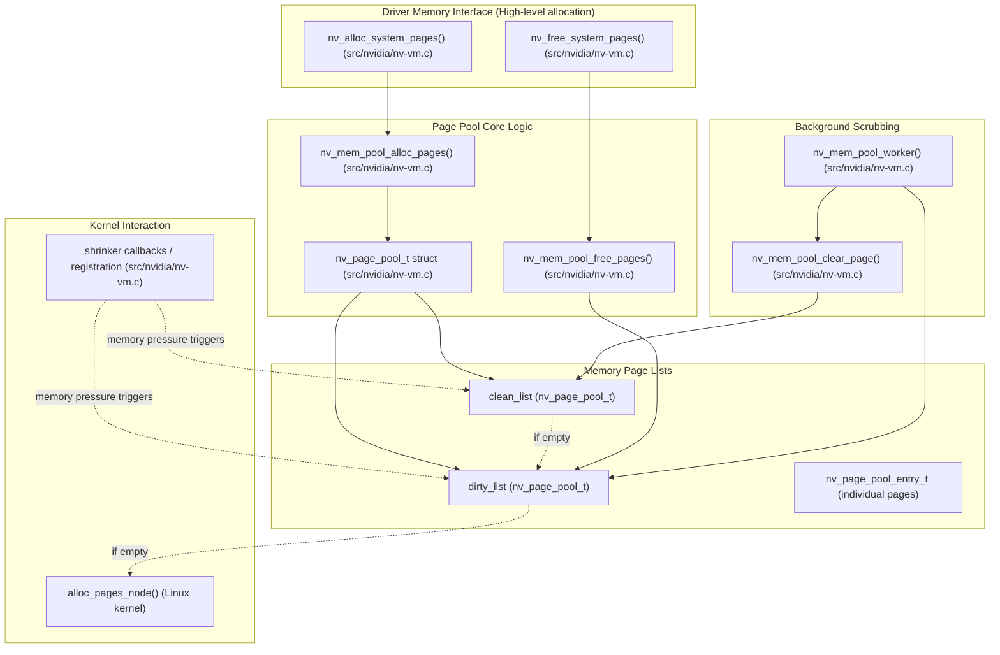
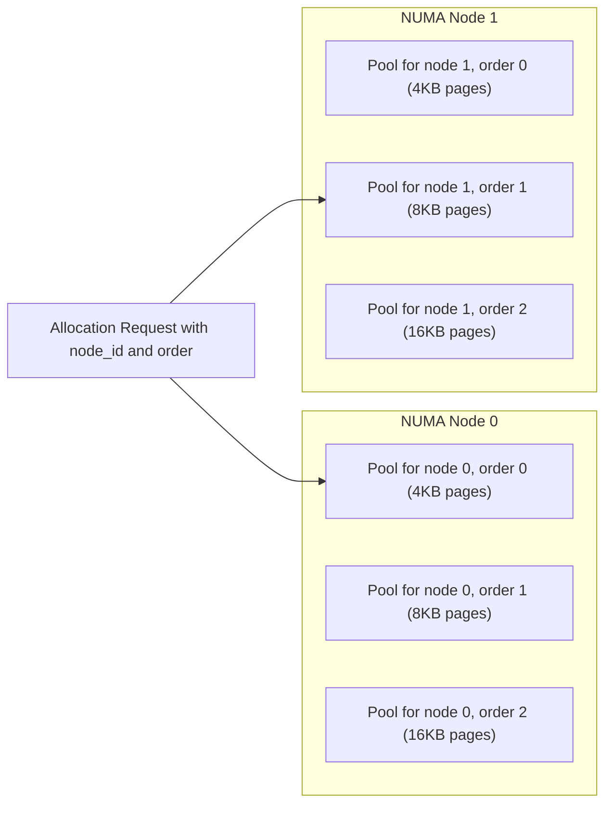
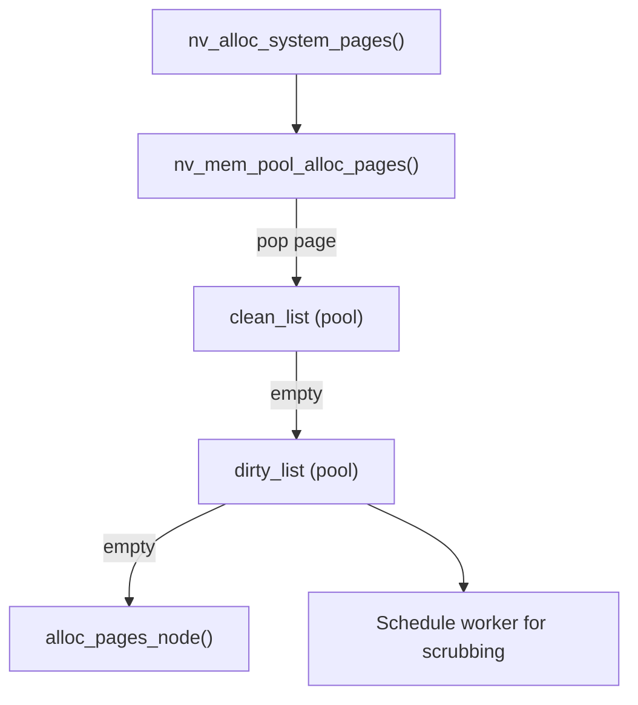
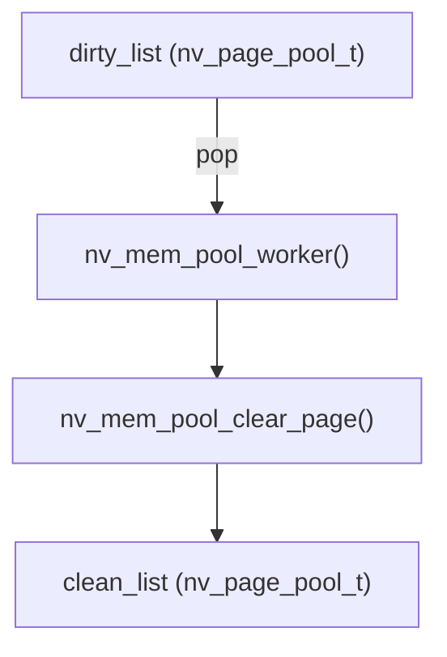
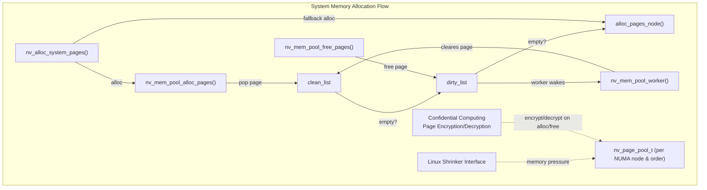

<!-- source: DeepWiki mcp.deepwiki.com · repo NVIDIA/open-gpu-kernel-modules · page 5.3 System Memory and Page Pools · fetched 2026-10-26 -->

# System Memory and Page Pools

<details>
<summary>Relevant source files</summary>

The following files were used as context for generating this wiki page:

- [kernel-open/common/inc/nv-mm.h](kernel-open/common/inc/nv-mm.h)
- [src/common/sdk/nvidia/inc/ctrl/ctrl208f/ctrl208ffb.h](src/common/sdk/nvidia/inc/ctrl/ctrl208f/ctrl208ffb.h)
- [src/nvidia/src/kernel/mem_mgr/system_mem.c](src/nvidia/src/kernel/mem_mgr/system_mem.c)

</details>


This document describes the system memory page pool infrastructure employed by the NVIDIA kernel driver. This system is designed to optimize allocation and deallocation of system memory pages by caching pre-allocated, pre-scrubbed pages organized by NUMA node and page order. This reduces allocation latency and improves allocation performance, especially on NUMA architectures.

For more contextual information on GPU memory management and dedicated UVM memory management, please see sections [GPU Memory Management](#4.4) and [UVM Memory Management](#4.5). For mechanisms supporting buffer sharing across devices using DMA-BUFs, see [DMA Buffer Sharing](#5.2).

---

## Overview

The system memory page pool acts as a caching layer between higher-level driver allocation requests and the Linux kernel’s page allocator. By keeping pools of zeroed pages grouped according to NUMA locality and page order, the driver can reduce the overhead of repeated allocation and freeing of system memory, thereby lowering latency and avoiding fragmentation.

Pages are split into two core lists inside each pool:

- **Clean List:** Pages that are zeroed out and ready for immediate reuse.  
- **Dirty List:** Pages that have been freed into the pool but need to be scrubbed (zeroed) before reuse, to avoid any data leakage.

An asynchronous scrubber worker clears pages from the dirty list into the clean list in the background. The system integrates with Linux kernel memory shrinkers to release pages from pools back to the kernel allocator under system memory pressure.

### System Components & Code Entity Mapping

Below diagram bridges system components (natural language space) with actual code entities and functions involved in system memory page pool implementation:



Sources: [src/nvidia/src/kernel/mem_mgr/system_mem.c:385-410](), [src/nvidia/src/kernel/mem_mgr/system_mem.c:505-570](), [src/nvidia/src/kernel/mem_mgr/system_mem.c:661-688]()

---

## Page Pool Architecture

### Core Data Structures

The page pool system is centered on several key data types:

**nv_page_pool_t**

- Holds the main state of the page pool for a specific NUMA node and page order.  
- Contains:  
  - `clean_list`: Intrusive linked list of zeroed (clean) page entries.  
  - `dirty_list`: Intrusive linked list of dirty pages requiring scrubbing.  
  - `scrubber_queue`: Work item to schedule background scrubbing.  
  - `node_id`: The NUMA node this pool is assigned to.  
  - `order`: Page order (`0` for 4KB, `1` for 8KB, etc.).  
  - `pages_owned`: Number of pages currently cached in this pool.  
  - `lock`: Mutex protecting the pool’s state.  
  - `shrinker`: Linux kernel shrinker interface structure for reclaiming memory.

**nv_page_pool_entry_t**

- Represents a single page allocated within a pool, including:  
  - `virt_addr`: Kernel virtual address of the page.  
  - `list_node`: List node for linking into `clean_list` or `dirty_list`.

Pools are stored in a 2D static array indexed by NUMA node and order:

```c
static nv_page_pool_t *sysmem_page_pools[MAX_NUMNODES][NV_MAX_PAGE_ORDER + 1];
```

This allows efficient retrieval of the pool instance matched to an allocation request based on locality and granularity. Pools are created and initialized per NUMA node and page order to maximize cache affinity and minimize cross-node traffic. [src/nvidia/src/kernel/mem_mgr/system_mem.c:385-410](), [src/nvidia/src/kernel/mem_mgr/system_mem.c:410]()

### NUMA-Aware Pooling and Page Order

The pools maintain separate queues for different NUMA nodes and page sizes, helping the system honor memory locality policies and reducing fragmentation.

Illustration of NUMA node and page order partitioning:



The helper function `nv_mem_pool_get(int node_id, unsigned int order)` performs a bounds check and returns either the pool pointer for the specified NUMA node and order or `NULL` if no pool exists or parameters are invalid. This ensures allocation and freeing always target the correct pool instance, preserving locality. [src/nvidia/src/kernel/mem_mgr/system_mem.c:887-898]()

When returning pages to the pools, the driver verifies the page's NUMA node and order match the target pool for consistency and locality assurance. [src/nvidia/src/kernel/mem_mgr/system_mem.c:804-809]()

Sources: [src/nvidia/src/kernel/mem_mgr/system_mem.c:385-410](), [src/nvidia/src/kernel/mem_mgr/system_mem.c:770-844](), [src/nvidia/src/kernel/mem_mgr/system_mem.c:887-898]()

---

## Memory Allocation Flow

### Allocation Path

The main entry for allocating system memory pages within the driver is `nv_alloc_system_pages()`. This function first attempts to allocate from one of the enabled page pools for the requested NUMA node and page order, aiming to reuse pre-zeroed pages and reduce allocation latency.

**Allocation via Page Pool:**

- The driver checks if the pool is enabled for the requested order size (via `NVreg_EnableSystemMemoryPools` mask bit).  
- It verifies conditions to avoid DMA32-only memory or conflicting flags.  
- When successful, it calls `nv_mem_pool_alloc_pages()` which tries to pop a page from the `clean_list`.  
- If no clean pages exist, it attempts to pop a page from the `dirty_list` and schedules it for scrubbing by the background worker.  
- Failing pool allocation, it falls back to `alloc_pages_node()` to allocate new pages directly from the kernel.



This approach avoids the full latency penalty of kernel allocations by reusing cached zeroed pages and batching zeroing operations asynchronously. [src/nvidia/src/kernel/mem_mgr/system_mem.c:963-982](), [src/nvidia/src/kernel/mem_mgr/system_mem.c:585-651]()

### Deallocation Path

When pages are freed via `nv_free_system_pages()`, the driver attempts to return them to the pool if they belong to a pool allocation and conditions permit:

- Detects pool allocation via `at->flags.pool`.  
- Checks that the NUMA node of the page matches the pool node to maintain locality.  
- Converts pages into `nv_page_pool_entry_t` and adds them to the `dirty_list` for scrubbing and reuse.  
- If conditions aren't met or the page is not from a pool, pages are directly freed to the kernel allocator.

Returning pages to the pool defers expensive zeroing operations to background work and reduces churn on the kernel allocator.

The free path is safe to be called from a context that may sleep since the pool insertion operations and possible page scrubbing can block. [src/nvidia/src/kernel/mem_mgr/system_mem.c:901-960](), [src/nvidia/src/kernel/mem_mgr/system_mem.c:770-844]()

Sources: [src/nvidia/src/kernel/mem_mgr/system_mem.c:585-651](), [src/nvidia/src/kernel/mem_mgr/system_mem.c:901-960](), [src/nvidia/src/kernel/mem_mgr/system_mem.c:770-844]()

---

## Background Scrubbing

Zeroing freed pages before reuse is essential for security and correctness. To avoid paying zeroing costs in the allocation path, pages freed to the pool enter the dirty list and are scrubbed asynchronously by worker threads.

### Worker Thread Behavior

Each pool maintains a worker workqueue item named `scrubber_queue`:

- `nv_mem_pool_worker()` executes in process context.  
- It pops pages from the dirty list and calls `nv_mem_pool_clear_page()` to zero memory.  
- After zeroing, pages are moved into the clean list.  
- The worker schedules itself while there are dirty pages remaining.



`nv_mem_pool_clear_page(unsigned long virt_addr, unsigned int order)` handles clearing multi-order pages by applying `clear_page()` on each 4KB page within the larger allocation to ensure full scrubbing. [src/nvidia/src/kernel/mem_mgr/system_mem.c:573-582](), [src/nvidia/src/kernel/mem_mgr/system_mem.c:661-688]()

Sources: [src/nvidia/src/kernel/mem_mgr/system_mem.c:573-582](), [src/nvidia/src/kernel/mem_mgr/system_mem.c:661-688]()

---

## Linux Shrinker Integration

To respond to overall system memory pressure, the page pools integrate with the Linux kernel’s shrinker subsystem. This allows cached pages in the clean and dirty lists to be progressively freed back to the kernel, preventing excessive memory consumption.

### Shrinker Callbacks

Two key callbacks implement this:

| Callback          | Function Name                 | Role                                           |
|-------------------|------------------------------|------------------------------------------------|
| `count_objects`    | `nv_mem_pool_shrinker_count()`| Returns total number of pages owned by the pool |
| `scan_objects`     | `nv_mem_pool_shrinker_scan()` | Frees pages from clean or dirty lists to reclaim memory |

These callbacks acquire pool locks and free pages until the requested number is satisfied or the lists become empty.

### Registration Strategy

The driver supports a flexible shrinker registration to handle differences across kernel versions:

- For Linux 6.7 and newer, it dynamically allocates shrinkers using `shrinker_alloc()` and registers them with `shrinker_register()`, assigning its own `count_objects` and `scan_objects` entry points.  
- For older kernels, it directly registers a static `nv_mem_pool_shrinker`.

This design ensures that the driver remains responsive to memory pressure signals while maintaining broad kernel compatibility. [src/nvidia/src/kernel/mem_mgr/system_mem.c:412-464](), [src/nvidia/src/kernel/mem_mgr/system_mem.c:505-570]()

Sources: [src/nvidia/src/kernel/mem_mgr/system_mem.c:412-464](), [src/nvidia/src/kernel/mem_mgr/system_mem.c:505-570]()

---

## Memory Cache Type Management

Pages managed by the system memory pools may require specific CPU cache attributes (e.g., write-back, uncached). The driver enforces cache attributes carefully:

- Upon allocation, if the memory requires non-default cache types, kernels APIs such as `set_memory_uc()` or `set_pages_uc()` are invoked to set the appropriate cache mode on the page frame number.

- When pages are freed back to the pool or kernel allocator, the cache type is restored to write-back (`NV_MEMORY_WRITEBACK`) by calling `nv_set_memory_type(at, NV_MEMORY_WRITEBACK)`. This resets the cache mode to standard, consistent with other system memory.

This ensures system-wide cache behavior correctness, avoiding corruption or performance issues linked to cache attribute mismatches. [src/nvidia/src/kernel/mem_mgr/system_mem.c:154-225](), [src/nvidia/src/kernel/mem_mgr/system_mem.c:919-922]()

Sources: [src/nvidia/src/kernel/mem_mgr/system_mem.c:154-225](), [src/nvidia/src/kernel/mem_mgr/system_mem.c:919-922]()

---

## Confidential Computing Support

The page pools are designed to operate correctly on Confidential Computing (CC) platforms that enforce hardware memory encryption, such as AMD SEV-SNP or Intel TDX.

In this context:

- Pages allocated by the pools are marked as **unencrypted** (decrypted) before use by setting page protections via helper functions (`uvm_pgprot_decrypted()`), clearing the encrypted memory bit. This allows the driver / GPU access to decrypted memory regions.

- When pages are freed, their encryption status is restored by resetting protections to encrypted form, ensuring confidentiality is maintained.

This approach allows the NVIDIA drivers to seamlessly comply with hardware memory encryption enforced by CC platforms, ensuring data privacy and integrity without requiring changes to standard memory allocation workflows. [src/nvidia/nv-vm.c:1025-1029](), [src/nvidia/nv-vm.c:935-937](), [kernel-open/nvidia-uvm/uvm_linux.h:191-200]()

Sources: [src/nvidia/nv-vm.c:1025-1029](), [src/nvidia/nv-vm.c:935-937](), [kernel-open/nvidia-uvm/uvm_linux.h:191-200]()

---

## Module Parameters

### NVreg_EnableSystemMemoryPools

This module parameter acts as a bitmask controlling the enabling of system memory pools by page size (order):

- Each bit corresponds to a supported page size, shifted by 12 (e.g., order 0 -> 4KB pages corresponds to bit at (12 + 0)).  
- If the relevant bit for the requested page order is set, the pool allocation is enabled for that page size.  
- The driver consults this parameter during allocation to decide if fallback to pool allocation is permitted. [src/nvidia/nv-vm.c:29](), [src/nvidia/nv-vm.c:855-858]()

---

## Summary Diagram of Page Pool System



---

# References and Sources

- [src/nvidia/src/kernel/mem_mgr/system_mem.c:29-29]()  
- [src/nvidia/src/kernel/mem_mgr/system_mem.c:385-410]()  
- [src/nvidia/src/kernel/mem_mgr/system_mem.c:412-464]()  
- [src/nvidia/src/kernel/mem_mgr/system_mem.c:505-570]()  
- [src/nvidia/src/kernel/mem_mgr/system_mem.c:573-582]()  
- [src/nvidia/src/kernel/mem_mgr/system_mem.c:661-688]()  
- [src/nvidia/src/kernel/mem_mgr/system_mem.c:770-844]()  
- [src/nvidia/src/kernel/mem_mgr/system_mem.c:887-898]()  
- [src/nvidia/src/kernel/mem_mgr/system_mem.c:901-960]()  
- [src/nvidia/src/kernel/mem_mgr/system_mem.c:919-922]()  
- [src/nvidia/src/kernel/mem_mgr/system_mem.c:963-982]()  
- [src/nvidia/src/kernel/mem_mgr/system_mem.c:981-982]()  
- [src/nvidia/src/kernel/mem_mgr/system_mem.c:982]()  
- [kernel-open/nvidia-uvm/uvm_linux.h:191-200]()

---

